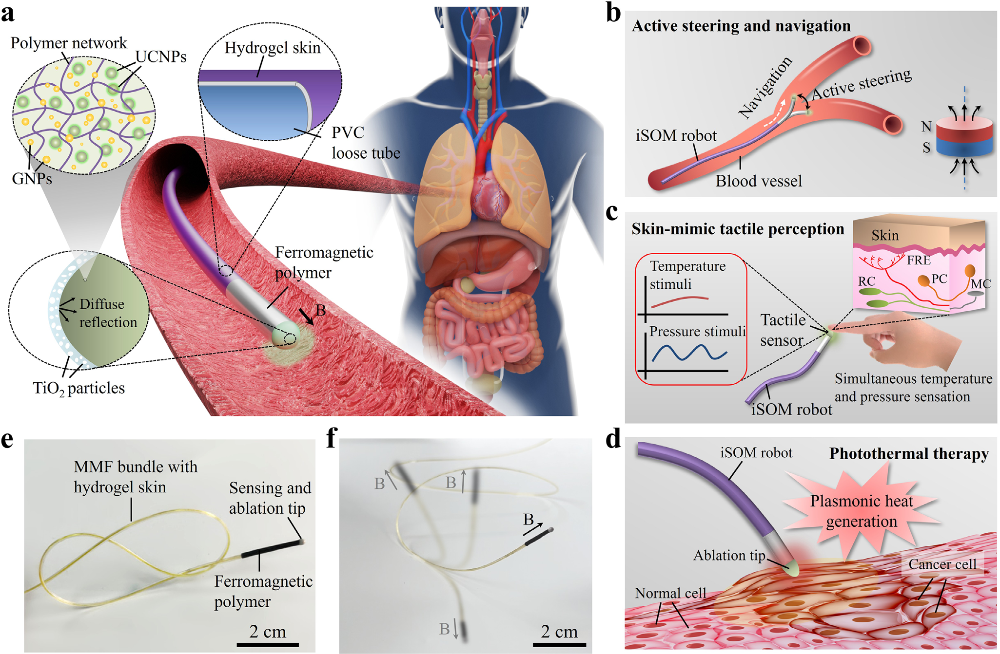
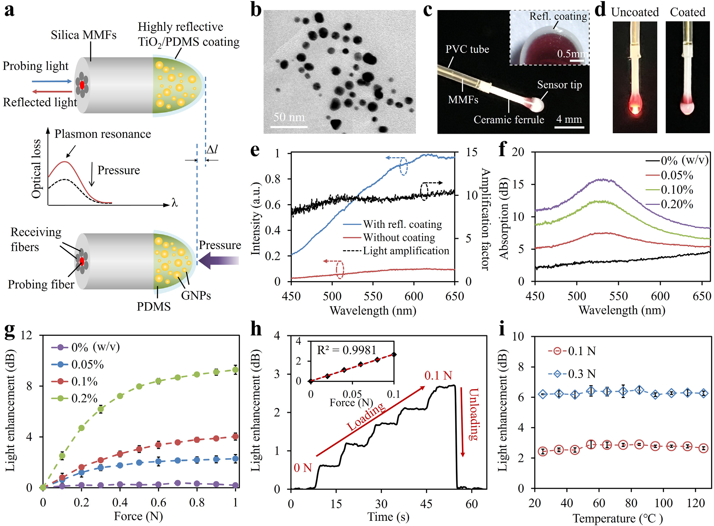
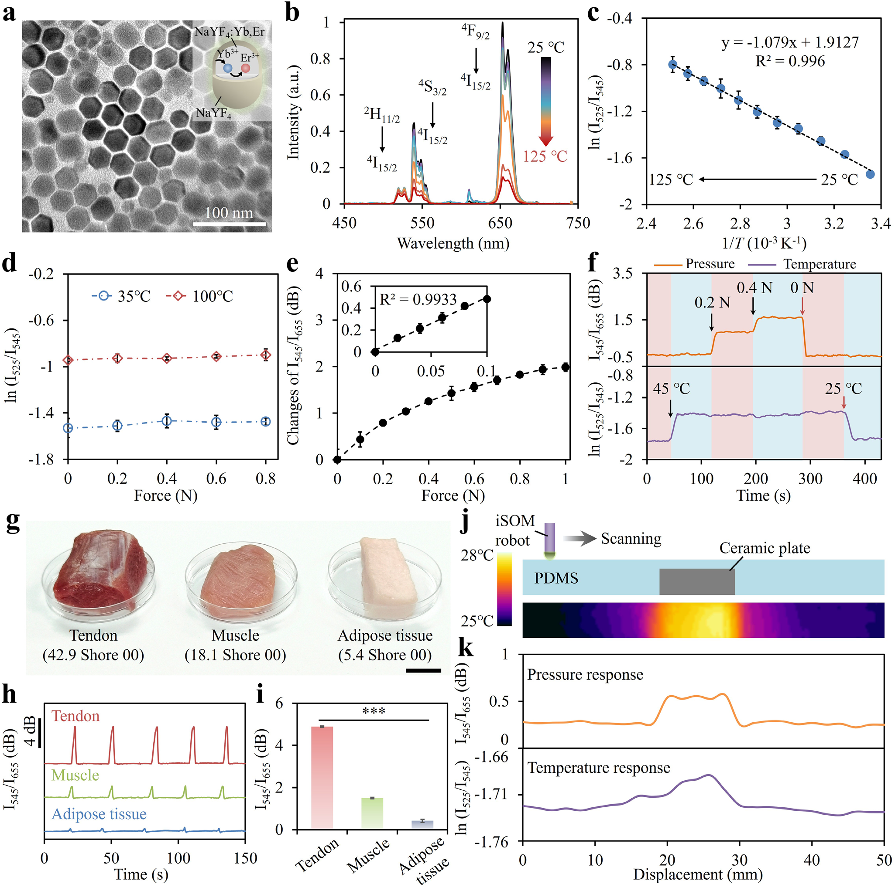
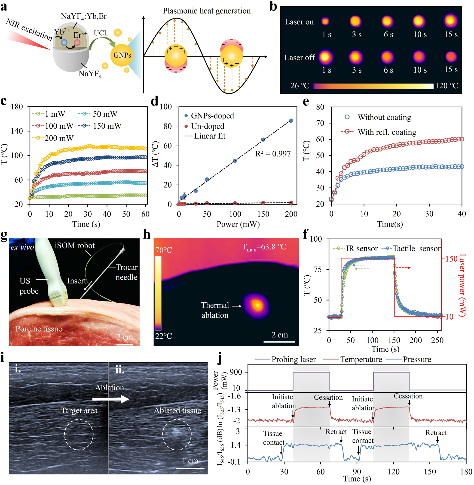
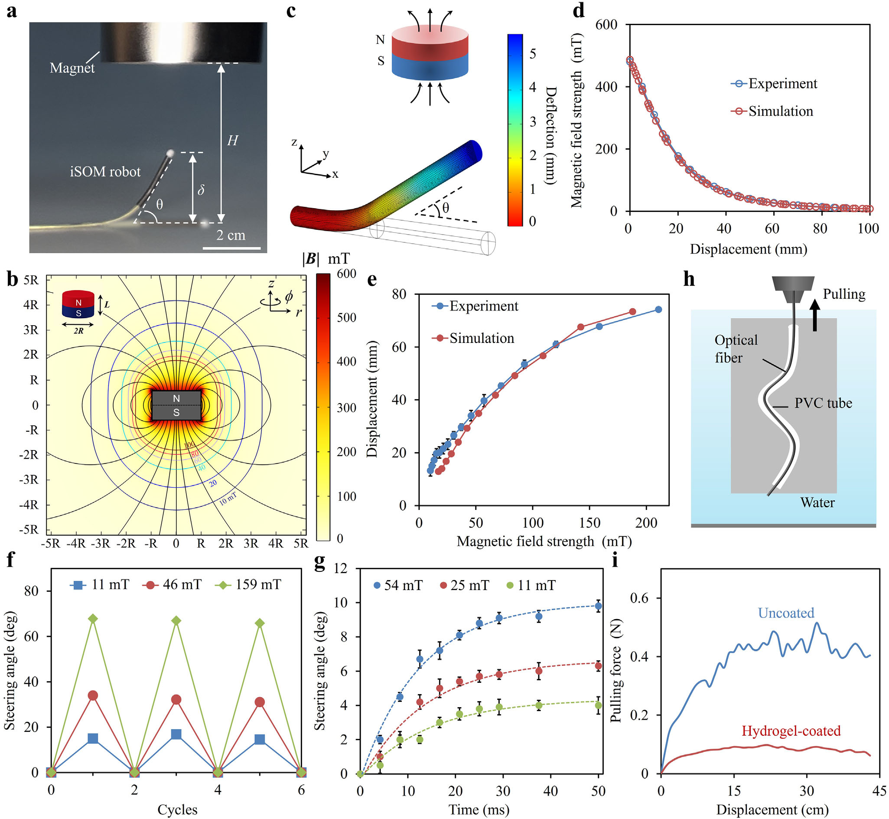
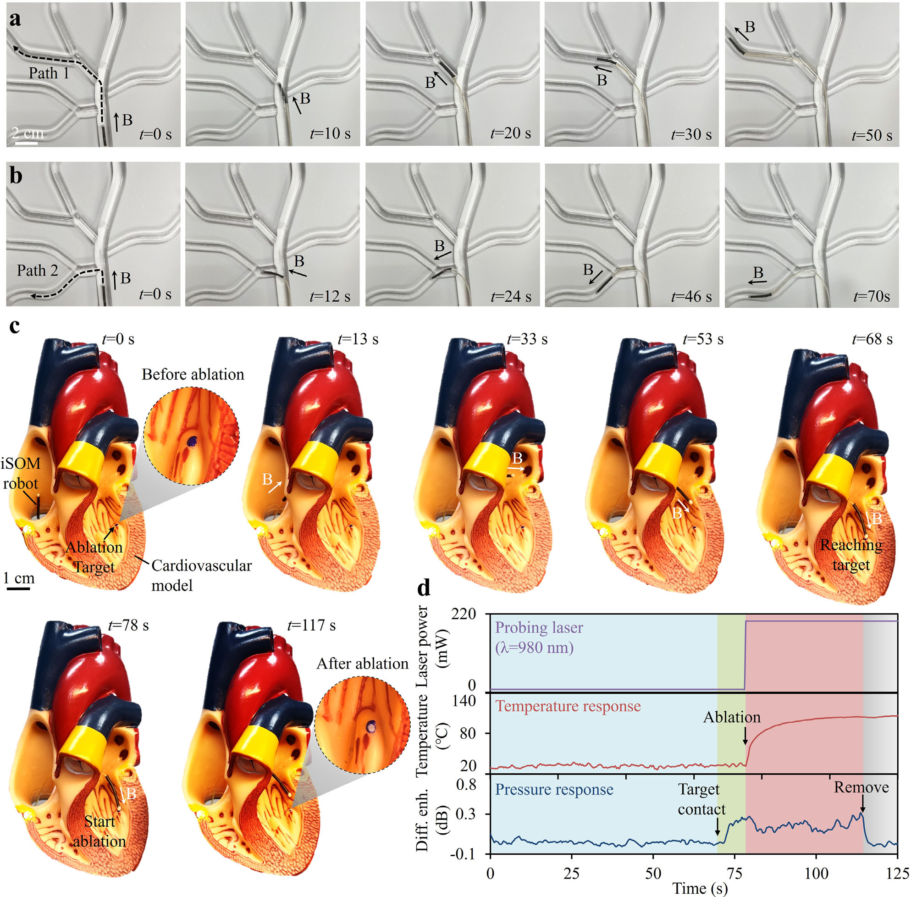
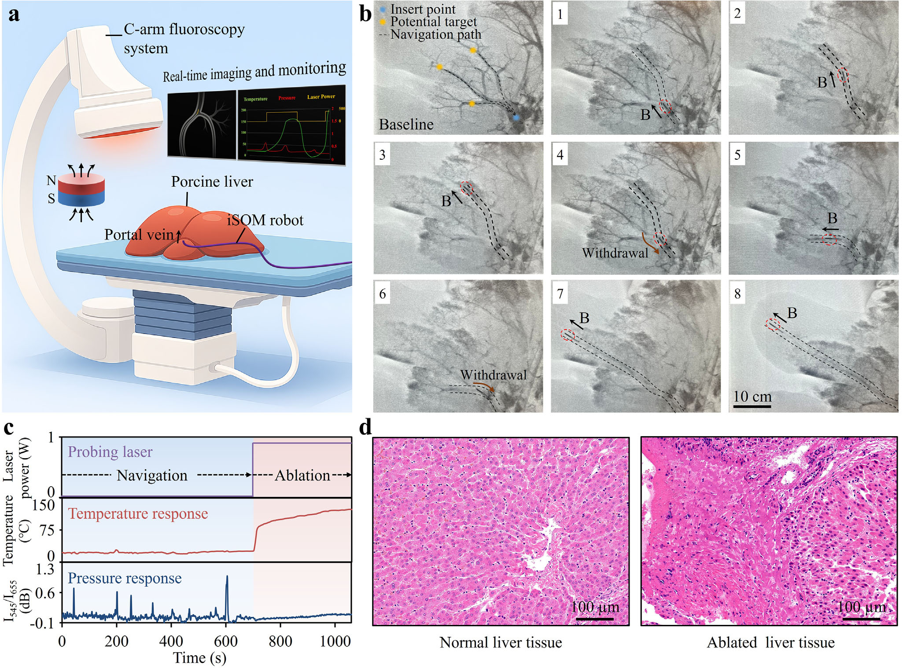

# Intelligent Soft Opto-Magnetic Robot for Minimally Invasive Interventional Therapy 精读笔记

> **论文**：Intelligent Soft Opto‐Magnetic Robot for Minimally Invasive Interventional Therapy（面向微创介入治疗的智能软体光磁机器人）
> **作者**：Jingjing Guo、Xiaoyan Guo、Jian Wei（三人共同第一作者）、Miaowen Jiang、Qifa Su、Xian Xia、Zhuozhou Li、Rong Cai、Jianguo Ma、Bo Fu、Ming Li、Jing Zhong、Lijun Xu、Xunming Ji
> **期刊**：Advanced Science（Wiley-VCH），2026; 0: e20344。DOI: [10.1002/advs.202520344](https://doi.org/10.1002/advs.202520344)
> **投稿时间线**：2025-10-14 收稿 → 2025-12-30 修回 → 2026-01-14 接收
> **单位**：北京航空航天大学 仪器科学与光电工程学院 / 杭州国际创新研究院 / 医工交叉学科群；首都医科大学附属北京友谊医院 介入放射科；首都医科大学 北京脑重大疾病研究院；首都医科大学宣武医院 神经内科与神经外科
> **基金**：国家自然科学基金（62575010、62175008）；北京市自然科学基金（L252182）；北京市科技新星计划；中央高校基本科研业务费
> **开放获取**：**CC BY**（可自由复制、分发、改编，需署名）。© 2026 The Author(s)，Wiley-VCH GmbH
> **数据与代码**：论文声明"评估结论所需的全部数据均在正文与补充材料中"；补充材料含 1 份 Word 文档 + 3 段视频，无公开代码仓库
> **利益声明**：J. Guo、X. Guo、Z. Li、L. Xu 已就本设计申请专利

---

## 一、一句话看懂这篇论文

**一句话**

在一根 **1.5 mm 粗、25 cm 长**的软塑料管里，塞进 7 根头发丝细的光纤；管子末端做成一个**半球形的"果冻头"**，果冻里混着两种纳米颗粒——**金纳米颗粒**负责"吸光变热"和"受压变亮"，**稀土上转换颗粒**负责"把看不见的红外光翻译成看得见的绿光和红光"。于是一束 980 nm 的红外激光同时干三件事：**当温度计、当压力计、当手术刀**。体外再用一块永磁铁晃一晃，管子前端就能在血管里转弯。这台机器人于是能一边转弯、一边"摸"血管壁、一边量自己的体温，到了病灶就开足功率把它烧掉。

**为什么这件事值得发表（Advanced Science 是 Wiley 旗下综合性顶刊之一）**

过去做"能钻进血管的软体机器人"，通常是**一台机器只干一件事**：要么只会磁导航（只会走），要么只会传感（只会摸），要么只会消融（只会烧）。要把三件事塞进一根**外径 1.5 mm**的管子里，最大的障碍是"**传感器和手术刀抢地方**"——传统消融导管末端是金属电极，传统触觉传感器要贴在表面，传统温度计要单独一根线。本文的做法是：**让同一小块材料同时当传感器和手术刀**。金纳米颗粒吸光会发热（这是刀），而它吸光的多少会随材料被压扁而改变（这是压力计）；同一束光激发的稀土发光，两个波长的强度比随温度变化（这是温度计）。三件事共用一条光路、一颗激光器、一个探头。

**但这句话必须加三个限定**（这是我读完后的判断，论文没有这样写）

第一，"实时监测温度"测的是**机器人自己尖端的温度**，不是病灶组织的温度。这两者在消融时会差很多（第四章 4.6 节和第七章 7.2 节会展开）。

第二，所谓"磁导航"是**医生用手搬动一块 5 cm 粗的永磁铁**，不是闭环控制的电磁系统。定位靠肉眼和 X 光，不是靠算法。

第三，全文最硬的数据是**离体猪肝**和**兔子胃**，不是人体。它证明的是"这条路走得通"，不是"这已经能上手术台"。

---

## 二、背景与动机

### 2.1 先看清楚临床问题：今天的"微创介入"到底是怎么做的

要理解这篇论文在解决什么，必须先知道**医生今天是怎么治一个肝脏肿瘤的**。整个过程大致是：

1. 病人躺在 CT 或 X 光机（C 形臂）下面。
2. 医生在腹股沟（大腿根）或者手腕上开一个几毫米的小口，把一根**导管**（catheter，一根 1–3 mm 粗的软塑料管）从血管里捅进去。
3. 医生盯着屏幕上的 X 光影像，**用手推、用手转**导管尾端，让导管尖端在血管分叉处拐弯，一路走到肝脏的供血血管里。
4. 走到肿瘤旁边以后，从导管里伸出一根**消融针**或者从导管尖端放出能量（射频、微波、激光），把肿瘤"烫死"。
5. 整个过程 1–3 小时，医生穿着十几斤重的铅衣站在机器旁边。

**这里面有三个"看不见"**，而这三个"看不见"，正好就是本文要补的三个洞。

| 缺口            | 具体表现                                                         | 后果                                                     |
| ------------- | ------------------------------------------------------------ | ------------------------------------------------------ |
| **看不见"力"**    | 医生在体外推导管，导管尖端顶到血管壁有多大力，医生**只能靠手感猜**。导管在体内弯曲、摩擦，力的传递被"稀释"了几十倍 | 用力过猛会**捅穿血管**；用力不足则消融头贴不紧病灶，热量传不过去                     |
| **看不见"温度"**   | 消融时组织到底烧到多少度，医生看不到。只能按"功率 × 时间"的经验公式估                        | 温度不够 → **肿瘤没烧干净，复发**；温度过高 → **烧穿到邻近器官**（肝肿瘤挨着胆囊、肠道、膈肌） |
| **看不见"组织性质"** | 肿瘤比正常肝组织硬、也比正常组织温度略高，但医生**摸不到**（手在体外）                        | 找不到小的、深部的病灶；分不清肿瘤边界                                    |

**这三个缺口有一个共同的根源**：微创手术的本质是"**隔着 30 厘米的管子做手术**"，医生失去了手直接接触组织时获得的全部信息。传统开放手术里，外科医生用手指一摸就知道"这块硬、那块软"，这个动作叫**触诊**（palpation）。微创手术把触诊彻底拿掉了。

### 2.2 再看"热消融"：它到底在物理上做了什么

论文的三大功能之一是**热消融治疗**（thermal ablation therapy，论文缩写 TAT）。这个词听起来抽象，其实物理上极其简单：

> **把一小块组织加热到 50 °C 以上并维持一段时间，这块组织的蛋白质就会永久变性、细胞死亡。**

为什么是 50 °C？人体正常体温 37 °C。蛋白质（酶、结构蛋白）的空间结构靠**氢键**这类弱相互作用维持，这些键的能量很低。温度升高时分子热运动加剧，当热运动的能量超过氢键的结合能，蛋白质就会"散架"——这个过程叫**变性**（denaturation）。变性是不可逆的：煮熟的鸡蛋清不会再变回透明。

人体组织大约在 **42–45 °C 开始出现可逆的热损伤**，**50 °C 以上开始出现不可逆的凝固性坏死**（coagulative necrosis），**60 °C 以上蛋白质迅速凝固、细胞在几秒内死亡**，**100 °C 以上组织里的水沸腾、产生气泡和"爆裂"**（这叫碳化、汽化，临床上是要避免的，因为气泡会把热量带走、还会让组织粘连在探头上）。

**所以热消融的"安全窗口"其实很窄**：

```
  37 °C ──── 正常体温
   ↓
  42 °C ──── 开始有可逆热损伤（"温热疗法"区间）
   ↓
  50 °C ──── 不可逆凝固性坏死开始  ← 论文反复引用的门槛
   ↓
  60 °C ──── 几秒内细胞死亡（理想消融温度）
   ↓
  80–90 °C ── 组织脱水、皱缩
   ↓
 100 °C ──── 水沸腾，气泡、碳化，开始有害
```

**这个窗口只有大约 30–40 °C 宽，而探头到病灶的距离可能只有 2–3 mm。** 换句话说：**温度高 20 °C 就烧穿，低 10 °C 就没烧干净。** 这就是为什么"实时测温"在消融里不是锦上添花，而是刚需——这也是本文第一个核心卖点的来历。

### 2.3 版图：能钻进人体的"软体机器人"分几类

在讨论本文之前，先把整个领域摊开。**任何一台"能钻进血管的机器人"，都可以用三个互相独立的问题去定位它**：靠什么力气转弯？靠什么知道自己在哪、摸到了什么？靠什么治病？

三个问题各有一个答案，三个答案一组合，就定位了这台机器人。**以后看到任何一篇血管机器人/腔内机器人的文章，都可以拿这个三问框架去套。**

#### 维度一：靠什么力转弯

| 方式              | 原理                             | 优点                         | 硬伤                                         |
| --------------- | ------------------------------ | -------------------------- | ------------------------------------------ |
| **拉线（肌腱驱动）**    | 管壁里埋几根钢丝，拉一根它就往那边弯——和提线木偶一个道理 | 成熟、力矩上限高、便宜，临床上已经用了几十年        | 只能弯不能"自己走"；钢丝会磨损、会断；弯曲半径约 5–10 倍管径；长弯路径上有回差                 |
| **形状记忆合金（SMA）** | 镍钛合金丝通电发热 → 相变 → 收缩，断电冷却 → 复原  | 体积小、力大                     | 靠加热工作，**在体内发热是危险的**；响应慢（秒级）；反复弯折会疲劳        |
| **磁驱动**         | 把磁性颗粒混进软材料，外加磁场一拉，材料就弯         | **不用电线、尖端无金属、不发热、能穿透人体**；毫米级也能做 | 力随距离急速衰减（梯度 ∝ 1/r⁴）；永磁体只能靠"搬"来改变，不能编程；一段磁化只能弯成一条弧；体内有铁磁植入物者禁用 |
| **液压/气压**       | 往腔道里打水/打气，让软体结构鼓起来或弯下去         | 力大、柔顺                      | 需要管路，压力高了会**爆管**（在血管里是灾难）                  |
| **光驱动**         | 光照射光热材料 → 发热 → 材料形变            | 非接触、可精准照射                  | 光穿不透组织，**只能在表面或透明介质里用**                    |

**本文选的是磁驱动**。原因在第 2.3 节论文里写得很清楚：磁场"安全且能穿透深层组织"，而且**不需要在体内通电、不需要在体内发热**——这一点对一根要塞进血管的东西至关重要。

**这张表里有两格值得单独讲透**：**拉线**是临床上真正在用、最成熟的那一套；**磁驱动**是本文选的那一套。前者的原理决定了一条合格导管为什么长成那个样子，后者的代价决定了本文能走多远、走不进哪里。把它们讲开，本文的全部取舍就都在桌面上了。

**（一）一根可控弯导管，其实是一台机器**

先说一个容易误解的地方：临床上的"拉线导管"不是"一根管子里穿了根线"，而是**四层同心结构**加上一套手柄。

| 层 | 材料 | 作用 | 没有它会怎样 |
| --- | --- | --- | --- |
| **内衬** | PTFE（聚四氟乙烯，不粘锅涂层） | 内壁极滑，导丝、器械在里面推得动 | 器械推不动，还容易挂住血栓 |
| **编织层** | 不锈钢丝编织网 | 把尾端的"转"原样传到尖端；抗打折 | 转手柄，尖端不跟着转——塑料会"拧麻花" |
| **外鞘** | Pebax、尼龙、聚氨酯 | 外形、柔性、表面光洁度 | — |
| **拉线腔** | 管壁里预留的一个小孔 | 走一根 0.1–0.3 mm 的钢丝 | — |

**编织层这一条最值得注意。** 一根光溜溜的塑料管，医生在尾端转 90°，尖端可能只转了 40°——因为管身软，扭转被"吃掉"了。加了编织层之后，整根管子变成一个**扭转上的近似刚体**，转多少传多少。**这就是为什么导管看起来像一根普通塑料管，摸起来却"不软不硬"。**

再看两个关键零件：

```
     尾端（体外）                          尖端（体内）
   ┌──────────┐                        ┌──────────────┐
   │   旋钮   │── 螺杆/滑轮 ── 钢丝 ──▶│  拉环（锚点）│
   └──────────┘   （把"转"变成"收"）    └──────────────┘
                                              │
                                      弯曲段：激光切割的
                                      金属管（切出一圈圈
                                      斜缝，像弹簧）
```

- **弯曲段**：靠近尖端的一小段（1–3 cm）是一根**激光切割的金属管**——用激光切出一圈圈斜缝，刚性骤降，但扭转和推送仍然传得过去。**"哪里弯"是切出来的，不是选出来的。**
- **拉环**：钢丝的远端焊死或卡死在一个小金属环上，环固定在弯曲段的远端。**所有弯曲力矩都从这里灌进管子。**

**（二）拉一根线，为什么管尖就弯了**

**关键只有一句话：钢丝不在管子的中轴线上，它偏在一边。**

```
        管子的中轴线 = 中性轴（弯的时候既不拉长也不缩短）

        ┌────────────────────────────┐
        │                            │ ← 中性轴
        │  ●  钢丝（偏离轴线 e）     │
        └────────────────────────────┘
              ↑
             往下拉 F
```

一根偏心的轴向拉力，可以拆成两件事：

1. **沿轴线的那一份**——想把管子往回收（压缩）；
2. **离轴造成的"转"**——这个趋势的大小等于**力 × 偏心距**：

```
M = F × e
```

**这就是全部原理。** 用门来类比：推门轴，门不动；推门把手（离轴远），门就转。**同样大的力，作用点离轴越远，转动效果越强。**

有了弯矩，管子就弯。弯多少，由"弯矩"和"管子有多硬"的比值决定：

```
曲率 κ = M / EI          （EI 叫弯曲刚度：E 是材料的弹性模量，I 是截面的形状因子）
弯曲半径 R = 1/κ = EI / (F × e)
```

**这个式子说明有三个旋钮可以调**：

| 旋钮 | 变大时 | 后果 |
| --- | --- | --- |
| **拉力 F** | 弯得更狠 | 但钢丝有破断力上限 |
| **偏心距 e** | 弯得更狠 | 但 e 最大只能到管壁——1.5 mm 的管子里大约 0.5 mm |
| **弯曲刚度 EI** | 弯得更松 | 太软就推不动、会打折 |

**一次量级估算（我做的，论文不涉及）**：取 e ≈ 0.5 mm、F = 3 N，得 M ≈ 1.5 × 10⁻³ N·m。再取软 PVC 管的 EI ≈ 5 × 10⁻⁶ N·m²（外径 1.5 mm、内径 1.1 mm、E ≈ 30 MPa），则

```
R = 5×10⁻⁶ / 1.5×10⁻³ ≈ 3.3 mm
```

**3 mm 的弯曲半径，对一根 1.5 mm 的管子来说是合理量级**——真实导管会比这个数大一些，因为它们用的是更软的弯曲段、更小的拉力。**这个估算的价值不在于数字准，而在于它告诉你：拉线弯弯的"力度"是可以靠手上的力直接算出来的，没有隐藏环节。**

**（三）为什么"只能拉，不能推"——以及双向弯是怎么做出来的**

一根细钢丝受压时会**屈曲**（向侧面鼓出去），就像你推一根绳子，它不会笔直前进，只会打弯；力还没传到尖端，线已经顶在管壁上了。**所以一根拉线只能产生一个方向的弯曲。**

**单向弯是什么样。** 最常见的导管只有一根拉线、一个拉环、一段软铰链。医生转手柄，尖端往一个方向勾；松手，管子靠弹性自己回直。**这类"单弯导管"今天仍在大范围使用。**

**单向弯有三个绕不过去的限制：**

| 限制 | 具体表现 |
| --- | --- |
| **够不着对面** | 病灶落在弯曲段的"反手"一侧时，只能靠转整根管子去凑，而转管在迂曲血管里并不可靠 |
| **勾过头没法纠** | 一旦顶过头，唯一的手段是松手让它回弹，而**回弹量由材料弹性决定，不可控** |
| **贴不住内壁** | 在 S 形路径上，尖端只能被推着"贴着外壁滑"，无法主动压向另一侧——**要勾进分支口，必须能主动往里压** |

**双向弯，就是为这三条加的第三根东西：第二根拉线。**

```
        剖面（沿管子看过去）

         A 线  ●───────────────●  B 线
                 ╲         ╱
                  ╲       ╱     两根线相隔 180°，
                   ╲     ╱      各自锚在弯曲段的远端
                 管子截面

      拉 A → 向 A 侧弯（B 侧被拉长，B 线自动松弛）
      拉 B → 向 B 侧弯（A 线自动松弛）
```

**这里有一个容易被忽略的力学细节，它正是"双向"能只靠两根线就成立的原因：**

管子往 A 侧弯时，**A 侧被压缩、B 侧被拉伸**。B 线贴在 B 侧，它的路径跟着变长——**于是 B 线自己就松了，不需要任何人去"推"它**。反过来也一样。**也就是说：两根线轮流工作，任何时候只有一根在受拉，另一根永远是松的。** 没有一根线需要承受压力，所以"线不能推"这条限制**并不妨碍双向弯**。

```
   手柄里的差动机构：一个旋钮，正转收 A 放 B，反转收 B 放 A

              旋钮
               │
        ┌──────┴──────┐
        │  差动滑轮    │
        └──┬───────┬──┘
      收 A │       │ 收 B
           ▼       ▼
      （一边收，另一边同步放——医生单手就能左右摆）
```

**那么，弯的时候在对抗什么？** 不是另一根线（它松着），而是**管子自己的弹性**。这带来两个后果：

- **要保持某个弯角，手必须一直用力拉着。** 一松手，弹性立刻把它顶回去。
- **弯角与拉力成正比**（在弹性范围内）：想要 30° 和想要 60°，手上的力不一样；而且这个比例会随温度、使用次数、材料蠕变而漂移。

> **这一点和磁驱动的差别值得记下来**：拉线是"**用力顶住**"，磁驱动是"**对准一个方向**"。磁驱动要保持某个弯角，只要**磁铁放在那里不动**就行，手不用使劲；拉线要保持同样的弯角，医生的手必须**一直拉着**。**维持的成本不同**——这直接决定了长时间操作的疲劳程度。

**双向弯仍然不是全向弯。** A、B 两根线定义了**一个平面**，管子只能在这个平面里左右摆，摆不到"上下"。要换平面，只有一条路：**转动整根管子。**

**这就把（一）里那层编织网的第二个作用接上了**：

> 编织层让"转管身"如实传到尖端 → 于是"**双向弯 + 转整根管**"在操作上等价于"全向弯"。

**这是临床最常用的做法**，也是为什么大量消融导管只做"双向"而不做"四向"——**多一个自由度，不如把已有的两个自由度用扎实。**

**四向弯/全向弯**是另一条路：两根正交的线对（4 根线），或 3 根呈 120°，尖端可以连续指向任意方位角。代价是 4 根线 + 4 个拉环 + 一套能记清"每根线拉多少"的手柄，以及被吃掉的截面。

**双向弯的四种失效模式**（这一段是我从工程角度补的，论文不涉及）：

| 失效 | 机理 | 后果 |
| --- | --- | --- |
| **同时拉两根** | 两侧都受拉 → 只剩轴向压缩，管壁像柱子一样失稳 | **打折**，管腔闭合。这是最容易被操作者犯的错 |
| **换向空行程** | 从 A 切到 B，要先把 B 的松弛量吃掉才动 | 回差；手柄的"中立位"必须做标记 |
| **拉环处断线** | 反复双向弯折，应力集中在锚点 | 断在体内 = 失去转向 + 留一根断丝 |
| **蠕变漂移** | 长期保持弯曲，聚合物分子链缓慢重排 | "中立位"逐渐偏移，回中不再笔直 |

**和磁驱动一比，差距在这里：**

```
   拉线做双向弯： 2 根线 + 2 个拉环 + 1 套差动机构 + 只能在一个平面内
   磁驱动做全向： 0 根线 + 0 个拉环 + 0 套机构 + 方位角连续可调
```

**这是本文最容易被低估的一处"免费午餐"**：磁性段只认"场的方向"，不认"线的拉力"，所以它在三维空间里可以**连续地指向任意方位角**——而拉线要达到同样的自由度，需要四根线、四个拉环和一套复杂的手柄。

代价当然也有：拉线是**机械锁定**，手柄转到哪、尖端就在哪，方向由机构保证；磁驱动的方向由**体外磁铁的位置**决定，磁铁一偏、尖端就跟着偏，中间没有任何机械约束来"兜底"。

**最后补一个数量级核对**：本文的管子里，7 根光纤束径 330 µm、内径约 1.1 mm，**环向剩余面积约 0.87 mm²**；两根 0.1 mm 的拉线加起来只占 **0.016 mm²**。**所以"装不下"从来不是理由**——真正的理由在（七）那三条。

**（四）弯曲半径有下限：三个约束**

**第一条：材料应变。** 管子弯成半径 R 的弧，外侧要走更长的路，内侧走更短，只有中轴线长度不变。离中轴线 d/2 处的那一层，应变是

```
ε = (d/2) / R = d / (2R)
```

代入 d = 1.5 mm：R = 5 mm 时内壁要压缩 **15%**，R = 10 mm 时是 **7.5%**。**对大多数塑料，15% 已经接近极限。**

**第二条：打折（kinking）。** 曲率再大，截面会先从圆变成椭圆，然后塌陷——**像一根被弯到极限的吸管**。一旦打折，管腔闭合，导管就废了。编织层的作用之一就是把"塌陷"推迟。

**第三条：铰链长度。** 弯曲段越短，同样的角度就需要更大的曲率。切得太短，应变集中在一点，更容易断。

**经验数字**：普通聚合物管的**最小弯曲半径大约是管径的 5–10 倍**；用激光切割的金属铰链可以做到 2–3 倍。

> **这里有一个值得注意的巧合（我的推断，论文没有讨论）**：本文的磁性段长 2 cm，在 159 mT 下弯到 67°（1.17 rad），对应弯曲半径 **20 mm ÷ 1.17 ≈ 17 mm，约等于管径的 11 倍**——正好落在"普通塑料管的经验极限"附近。而实测的 11 → 46 → 159 mT 对应 15° → 33° → 67°，是**越来越"钝"的（次线性）**，也就是"再加磁场，也弯不动多少了"。**这提示：本文的 67° 可能不是"磁场不够"，而是"管子本身到极限了"。** 验证方法很简单——把磁场加到 300 mT 以上，看角度还涨不涨。论文只测到 159 mT，没有回答。

**（五）长而弯的路径上，拉线会"失灵"——绞盘效应**

钢丝在管壁的小孔里滑动，不是无摩擦的。**而摩擦在弯曲路径上是"按指数累积"的**，这就是船工把缆绳在系缆桩上绕两圈就能拉住一条船的道理——**绞盘效应**（capstan effect）：

```
T_出 = T_入 × e^(−μ × θ)
```

| 符号 | 含义 |
| --- | --- |
| **T_入 / T_出** | 手柄端的拉力 / 传到尖端还剩的拉力 |
| **μ** | 钢丝与内衬之间的摩擦系数（有涂层时 0.05–0.1，无涂层 0.2 以上） |
| **θ** | 钢丝累计"绕过"的总角度（弧度） |

**代入一组数**：如果导管已经在体内累计拐了 540°（三次 90° 弯，在主动脉弓 + 髂动脉这类路径上很常见），θ ≈ 3π ≈ 9.4：

| μ | 尖端还剩多少拉力 |
| --- | --- |
| 0.05（有亲水涂层 + PTFE 内衬） | **63%** |
| 0.10 | **39%** |
| 0.20（无涂层） | **15%** |

**这解释了临床上很多"手感"问题**：为什么导管越往里走，手柄越"发软"；为什么有的手柄要设计成"行程很长"；为什么导丝和导管内壁要用亲水涂层。**不是医生手劲不够，是路太弯。**

> **和本文的连接**：图 5h、5i 测的是**整根机器人在弯曲软管里被拉动时所需的力**——未涂覆时 0.4–0.5 N，涂了水凝胶之后显著下降。它测的不是"线在鞘里滑"，但背后的物理是同一类：**弯曲路径上的摩擦会指数放大，而降低摩擦系数是唯一不改结构就能改善的办法。** 本文把这件事做在了"管子外表面"，拉线导管把它做在了"管子内壁"。

**（六）拉线的四个硬伤**

| 硬伤 | 具体表现 | 为什么难解决 |
| --- | --- | --- |
| **断线** | 钢丝在弯曲段的拐点反复弯折，几万次后疲劳断裂；断口在拉环焊点处最集中 | 断在体内 = 失去转向 + 一根断丝留在血管里 |
| **回差（迟滞）** | 手柄转了 10°，尖端可能只动 5°；反向时先"空走"一段 | 来自钢丝松弛、鞘壁压缩、摩擦——三者都是路径依赖的，标定不出来 |
| **金属** | 钢丝、拉环、激光切割的金属铰链 | 与 MRI 不兼容，与"体内不留金属"的设计哲学冲突 |
| **占截面** | 拉线腔要占管壁厚度 | 管子越细，这笔开销占比越大 |

**（七）为什么本文没有用拉线——不是装不下，是不该装**

这里要说一句公道话：**1.5 mm 的管子里，7 根光纤只占 330 µm，环向其实还有空间塞一两根 0.1 mm 的钢丝。** 所以"装不下"不是主要理由。真正的理由有三条：

**第一，锚点会毁掉传感头。**

拉线必须在"要弯的那一段"的远端固定——而本文能弯的那一段，最远端紧挨着**果冻头**。把金属拉环装在那里，会造成三件事同时发生：

- 果冻头被金属环支撑住 → **压不扁了** → LSPR 压力传感失效（它靠凝胶被压扁改变吸收）；
- 金属环挡住 6 根接收光纤的收光面；
- 980 nm 激发光在金属表面产生反射和散射，破坏"同一块材料既是刀又是温度计"的架构。

**第二，和"把金属从体内拿走"的哲学正面冲突。**

全文的设计钥匙是"只留光和磁"。一根钢丝、一个金属拉环、一段激光切割的金属铰链——三样都是金属。**这不会让机器人不能用，但会让它退化成"又一根导管"。**

**第三，最容易被忽略的一点：本文的磁驱动替换掉的是"拉线"，不是"整根导管"。**

论文读起来容易给人一种印象："这机器人在体内是无线遥控的。"**不是。** 医生仍然从体外推 25 cm 的管身，机器人仍然靠"后面推"前进；磁驱动只负责**转弯**这一件事。所以本文真正买到的是：

> **尖端不含金属、没有拉环、转向不靠机械传动**——而不是"体内没有东西"。

**这个区分很重要**，因为它是判断"这篇论文的价值在哪"的关键：它的贡献不在"驱动力更强"，而在于**把转向这件从尖端手里拿走了，把尖端完整地留给"感知 + 消融"**。这和 2.5 节说的"一个模块一鱼三吃"是同一个设计思路的两个侧面。

**（八）为什么用转矩，不用梯度力——先把"均匀场"这个说法澄清**

**本文用的不是"均匀场"。** 一块永磁体产生的是偶极场，越远越弱，图 5b 的等值线和图 5d 的 1/r³ 曲线都是证据。**准确地讲，本文用的是"一个非均匀场里的一个特定分量：转矩"。**

也就是说：**作者只走式 (2) 的转矩通道，基本不走式 (3) 的梯度力通道。**

**为什么这两件事可以分开。** 一个磁矩在磁场里会受到两种作用：

```
   ① 转矩    τ = M × B      → 让它"转"到与 B 同向
   ② 梯度力  f = (M · ∇)B   → 把它"拉"向磁场更强的地方
```

**理想的均匀场里只有①；有梯度的场里①和②同时存在。** 所以"用转矩"和"用均匀场"在效果上接近，但严格说不是一回事——**本文的场是有梯度的，只是作者希望①占主导。**

**为什么选转矩，五条理由，从表到里：**

| # | 理由 | 具体含义 |
| --- | --- | --- |
| 1 | **转矩给"朝向"，梯度力给"位移"** | 血管里要的是"尖端朝哪"，不是"尖端被拽到哪"。位移由医生从体外推，那才是可控的 |
| 2 | **衰减速度差一档** | B ∝ 1/r³，∇B ∝ 1/r⁴。距离从 20 mm 拉到 80 mm，转矩掉 64 倍，梯度力掉 256 倍。**先失效的一定是力** |
| 3 | **方向可控性** | 转矩的方向由 B 的方向决定——转磁铁就转尖端，任意方位可选；梯度力的方向被"场变强的方向"锁死，你只能往磁铁那边拽 |
| 4 | **控制律（最本质的一条）** | 转矩 → 尖端的方位角 ≈ 磁铁的方位角，**开环就能用**；梯度力 → 位移，是位置控制，**必须有反馈**。本文没有闭环，物理上就只能选转矩 |
| 5 | **副作用** | 梯度力把尖端往磁铁方向拉，与"从后面推"合成侧向挤压，增加血管壁受力（5.3 节，图 7c 的压力尖峰很可能来自这里） |

**第 4 条值得多说一句。** 医生手上只有一块磁铁，没有传感器、没有算法、没有屏幕上的力反馈。在这种条件下，**只有"方向 → 方向"这种直接映射能用**：磁铁转到 3 点钟方向，尖端就朝 3 点钟。如果改成用梯度力控制，医生的操作就变成"我要把它往哪边拽多少毫米"——这需要知道尖端的实时位置，而本文的定位靠肉眼和 X 光，做不到。**驱动通道的选择，实际上被"有没有闭环"这一个条件锁死了。**

**但要说清楚：完全"只用转矩"是做不到的。** 在 20–80 mm 处，2 cm 长的一段上磁场变化是显著的，所以梯度力一定存在。作者做的是**让转矩占主导，并把梯度力的后果压到可接受**，手段有三条：

| 手段 | 为什么有效 |
| --- | --- |
| **磁段短**（只 2 cm） | 受力的体积小，梯度力就小 |
| **工作距离近**（20–80 mm） | 在这个范围里转矩还够用，力的绝对值也还压得住 |
| **低摩擦包覆** | 梯度力造成侧向挤压，最终表现为"顶住血管壁"；水凝胶皮肤把这一项的后果降了一个数量级。**这就是本文为什么要花一整节讲摩擦——摩擦是抗"侧向挤压"的第一道防线** |

**顺带说一个背景**：在磁微机器人领域，"转矩驱动"和"力驱动"是两条并行的技术路线，工程上用两类线圈分别实现：

| 线圈构型 | 中心区域的场 | 给机器人的是什么 | 典型用途 |
| --- | --- | --- | --- |
| **亥姆霍兹对**（两个线圈电流同向） | 近似均匀 | 纯转矩 | 让螺旋机器人旋转、让铰链机器人摆动 |
| **麦克斯韦对**（两个线圈电流反向） | 中心场为零，梯度线性 | 纯力 | 捕获、牵引，把机器人拉到位 |
| **一块永磁体（本文）** | 偶极场，两者都有 | 转矩为主 + 少量力 | 手动转向一根有鞘的连续体 |

**本文属于第三类**：不用线圈、不追求"纯"，而是用一块现成的永磁体，靠**几何和距离**把两者的比例调成"转矩够用、力不添乱"。**这是一个便宜、可用的折中，不是最优解**——最优解是电磁线圈阵列，但它进不了普通手术室（两者对比见本章（九）末尾的表）。

**（九）磁驱动的代价：四条物理上限 + 四条系统代价**

**先说结论**：磁驱动不是"更好"，是"换来换去的另一种选择"。它有四条**不能通过做得更好来消除**的物理上限。

**上限一：力随距离急剧衰减。** 一块磁铁在远处的场，近似按**距离的三次方倒数**下降：

```
B ∝ 1 / r³          梯度 ∇B ∝ 1 / r⁴
```

**每远离一倍，场掉到 1/8，梯度力掉到 1/16。** 这就是为什么本文的工作距离只写 **20–80 mm**——不是设计者保守，是物理只有这么大余地。从 20 mm 退到 80 mm（4 倍），梯度力理论上掉到 **1/256**。

> 严格说，50 mm 的磁铁在 20–80 mm 处还属于"近场"，实际衰减比 1/r³ 慢一些；但"距离翻倍、力掉一个数量级"这个量级判断是稳的。**深部病灶（比如心脏后壁、肝内深部、脑内）是磁驱动最难够到的地方。**

**上限二：均匀磁场只转不移——磁驱动在这篇文章里不负责"前进"。** 由式 (3)，f = (M·∇)B：**只有梯度才产生力。** 而一旦有梯度，机器人就被"往磁铁方向拉"，这又引出后面那条副作用。所以"往前走"这件事，本文交给医生从体外推。

**上限三：转矩正比于体积。** τ = M × B，M 是磁化强度、正比于磁性材料的体积。**直径减半，转矩降到 1/8。** 这就是为什么 0.5 mm 级的磁导航导丝需要格外强的场——越细，这条路越贵。

**上限四：一段磁化，只能弯成一条弧。** 一块沿轴向磁化的材料放在均匀场里，**整段的磁矩方向相同**，所以它只会弯成一个圆弧（C 形）。**它做不出 S 形，也做不出两个独立关节。** 而真实血管的分叉往往需要"S 形贴近再拐进去"。要做多关节，必须让不同段有不同的磁化方向（所谓"可编程磁化"），代价是更强的场、更复杂的控制——本文没有做。

**再说四条系统代价：**

| 代价          | 具体表现                                                                    |
| ----------- | ----------------------------------------------------------------------- |
| **永磁体不可编程** | 场的形状固定在一块磁铁上，医生能做的只有"搬动和转动它"。做不到 1° 步进、做不到恒力、做不到自动补偿                    |
| **没有闭环**    | 磁 → 弯 → 接触 → 摩擦 → 实际形状，这条链上没有测量。同一块磁铁放在同一位置，管子在不同弯曲血管里的形状不同（7.2 第 14 条） |
| **对接触极敏感**  | 弯不弯得动还取决于血管壁给的反力。**这正是本文要做水凝胶皮肤的原因**——降摩擦不只是为了好推，更是为了让"同样的场"产生"更可预测的弯"  |
| **梯度力的副作用** | 磁铁把尖端往自己方向拉，与"往后推"合成一个侧向挤压，增加血管壁受力（5.3 节已论述，图 7c 导航期间的压力尖峰很可能来自这里）      |

**永磁体与电磁系统，是一组必须知道的对比**，因为它决定了"磁导航"能做到多智能：

|      | 永磁体（本文）     | 电磁线圈阵列        |
| ---- | ----------- | ------------- |
| 场强   | 高，但形状固定     | 可编程，可任意塑形     |
| 体积   | 一块 5 cm 的圆片 | 通常是一间屋子那么大的装置 |
| 控制   | 人手搬         | 计算机，可闭环       |
| 成本   | 低           | 极高（含冷却、电源、屏蔽） |
| 与手术室 | 可以搬走        | 难与 C 形臂、麻醉机共存 |

**本文选了永磁体**——这是工程现实：电磁系统能把"磁导航"做到闭环，但它进不了普通手术室。**所以本文的"智能"，指的是多模态感知，不是自主导航。**

**最后是本文特有的三条：**

1. **MRI 自相矛盾**：论文展望"未来可与 MRI 兼容"，但 30 vol% 的 NdFeB 磁段本身就是一块强磁体，在 MRI 里会被场和梯度撕扯并产生巨大伪影（7.2 第 9 条）。**这不是"还没做"，是"材料上就冲突"。**
2. **患者禁忌**：体内有心脏起搏器、脑深部刺激器、人工耳蜗、动脉瘤夹的人，不能用强磁场（6.3 节）。这是一条**写在适应证里、永远消不掉**的限制。
3. **颗粒本身的物理代价**：30 vol% 的填充让那 2 cm 变硬；5 µm 的颗粒强烈散射光，**所以磁性段不能覆盖在光学尖端上，只能后撤 2 cm**（概念 14）。**这是"磁"和"光"在同一根管子里互相让路的具体表现**——不是设计失误，是必须接受的约束。此外，钕铁硼不是可植入材料（钕有细胞毒性），全靠外层 PVC 完整包封；**包封一旦破裂，后果比单纯的机械破损严重得多**（6.4 节）。

**（十）拉线与磁驱动：一张对照表**

| 维度               | 拉线（肌腱驱动）                 | 磁驱动（本文）                 |
| ---------------- | ------------------------ | ----------------------- |
| **弯曲力矩的上限由什么决定** | 钢丝的破断力（几十牛量级）——**与距离无关** | 体外能产生多强的场——**随距离四次方衰减** |
| **力能加多大**        | 想加就加，加大拉力即可              | 受限于磁铁大小和距离，加不上去         |
| **可编程性**         | 机械标定，有回差但可重复             | 永磁体不可编程，只能靠人搬           |
| **尖端是否含金属**      | 含（钢丝 + 拉环 + 金属铰链）        | 不含（只靠磁性颗粒）              |
| **能否多关节**        | 可以，多组拉线分别控制              | 难，一段磁化只能成一条弧            |
| **MRI**          | 不行                       | **也不行**（自己就是磁体）         |
| **是否占用管腔**       | 占管壁截面                    | 不占，但会让那一段变硬             |
| **成熟度**          | 几十年临床，消融导管、内镜、手术机器人都在用   | 实验室到早期临床                |

**一句话结论**：

> **没有一种驱动方式在这里全面占优。** 拉线在力、多关节、可重复性上领先，代价是尖端必须有金属；磁驱动在"尖端无金属、无机械传动"上独占优势，代价是力随距离急速衰减、不可编程、只能弯一条弧。**本文选磁驱动，是用"力"和"可控性"换"把整个尖端留给感知和消融"。**

#### 维度二：靠什么"知道"

| 方式 | 能提供什么信息 | 硬伤 |
| --- | --- | --- |
| **X 光 / CT（C 形臂）** | 血管形态、导管的二维投影位置 | **电离辐射**，医生和病人都在吃剂量；只有二维；软组织对比度差 |
| **超声** | 组织形态、血流、消融后的回声变化 | 需要探头贴着；深部血管看不清；操作者依赖强 |
| **MRI** | 三维、软组织对比度极好、无辐射 | 设备昂贵、实时性差、**强磁场会把含铁的器械吸走** |
| **光纤传感器** | 力、温度、形状 | 只能测"贴着它的东西"，信息维度少；过去一台只能测一个量 |

**本文选的路线是"光纤传感器 + 磁 + 光"**：既要在体内有感知，又要**不含金属、不进电路**，这样才有可能将来和 MRI 兼容（论文的展望部分提到了这一点，但这里埋着一个矛盾，见 7.2 节第 9 条）。

#### 维度三：靠什么治病

| 能量 | 原理 | 温度特点 |
| --- | --- | --- |
| **射频（RF）** | 高频电流在组织里产生离子振荡发热 | 用得最广；需要电极接触；**金属电极，MRI 不兼容** |
| **微波** | 电磁波让水分子转动发热 | 加热体积大、穿透深；同样需要金属天线 |
| **激光** | 光被组织吸收 → 发热 | **可以用光纤传输，全程无金属**；穿透深度浅（1–5 mm） |
| **冷冻** | 低温让细胞内结冰、细胞破裂 | 需要冷媒；冻融循环慢 |
| **高强度聚焦超声** | 体外聚焦声波在焦点处发热 | 完全无创；但对气体和骨很敏感 |

**本文选的是激光**，理由和维度一、二完全一致：**光可以用光纤送进去，光纤是玻璃（二氧化硅），不含金属、不导电、不怕磁场**。这三条路线（磁 + 光纤 + 激光）是**同一个设计哲学的三个侧面**：

> **把"电"和"金属"从体内彻底拿走，只留下"光"和"磁"。**

这就是理解整篇论文的钥匙。

#### 本文在版图里的位置

```
                      靠什么治病
                           │
        射频/微波 ─────────┼───────── 激光
             │             │            │
   传统消融导管 ●          │            │
   （有金属、有电极）       │            │
                           │            │
             │             │      本文 ●  ← 激光 + 磁 + 光纤传感
             │             │      （无金属、无电极、可弯曲、能感知）
             │             │            │
             └─────────────┴────────────┘
                    靠什么转弯
              拉线 ────── 磁 ────── 液压
```

**一句话定位**：本文不是"发明了一种新的消融方式"，而是**把三种已经各自成熟的技术（磁导航、光纤传感、激光消融）第一次塞进同一个 1.5 mm 的管子里，并且让它们共用同一条光路、同一颗激光器、同一块材料。**

### 2.4 每一类现成方案的天花板

论文的引言里点了几个具体的"前辈"，值得一个个看清楚它们差在哪：

| 前人工作 | 做到了什么 | 缺了什么 |
| --- | --- | --- |
| **Kim et al. 2019, Science Robotics**："铁磁软连续体机器人" | 把钕铁硼颗粒混进硅胶，做出能在脑血管里全向转弯的软机器人 | **只会走，不会感知，不会治病** |
| **Gopesh et al. 2021, Science Robotics**：软体可操纵微导管 | 用软材料做出能进脑动脉的微导管 | 同样只有导航功能 |
| **Rogatinsky et al. 2023, Science Advances**：多功能心脏介入软机器人 | 集成了多种功能 | 尺寸更大、且未实现"温度 + 压力"的同点同源感知 |
| **传统热消融导管（RF/微波）** | 成熟、临床在用 | 末端是**金属**；MRI 不兼容；**没有触觉反馈**；温度靠经验估 |
| **光纤形状/力传感器**（如 FBG 光纤布拉格光栅） | 能测形状和力 | 一台只能测一个物理量；且大多需要多路解调，体积大 |

**共同的缺口**：**"感知"和"治疗"从来没有真正待在同一个点上。** 传统导管是"末端一个金属球（治疗）+ 旁边贴一个传感器（感知）"，两者间距几毫米，测到的永远不是加热点的真实状态。而本文的做法是让**同一块材料既是加热体又是传感器**——这是它在概念上真正的不同（第十一章"巧思"会专门讲这一点）。

### 2.5 本文的破局点：用"一束光"同时干三件事

要理解这个破局点，先把整台机器的"信息流"画出来。**注意：下面这张图里的每一路信号，最终都走同一根光纤、回到同一台光谱仪。**

```
        体外                                          体内（机器人尖端）
  ┌──────────────┐
  │ 980 nm 激光器 │───┐
  └──────────────┘   │
                     ▼
              ┌─────────────┐        ┌──────────────────────┐
              │ 中心发射光纤 │───────▶│  半球形"果冻头"       │
              │ (1 根)      │        │  ┌────────────────┐  │
              └─────────────┘        │  │ 金纳米颗粒 GNP │  │
                     ▲               │  │  + 上转换 UCNP │  │
                     │               │  │  + PDMS 基底   │  │
              ┌──────┴──────┐        │  └────────────────┘  │
              │ 6 根接收光纤 │◀───────│   外面包一层       │
              └──────┬──────┘        │   TiO2/PDMS 反射膜  │
                     │               └──────────────────────┘
                     ▼
              ┌─────────────┐
              │ 850 nm 短通  │  ← 把 980 nm 的激发光滤掉
              │ 滤光片       │
              └──────┬──────┘
                     ▼
              ┌─────────────┐
              │ 光谱仪 CCS100│
              └──────┬──────┘
                     ▼
        ┌────────────┼────────────┐
        ▼            ▼            ▼
   525/545 nm    545/655 nm   532 nm 反射
   → 温度        → 压力       → 压力（另一条路）
```

**为什么一束光能干三件事？** 因为"光"这个物理量有三个独立的自由度：**波长、强度、时间**。三种功能分别挂在不同的自由度上：

| 功能 | 挂在哪个自由度上 | 具体机制 |
| --- | --- | --- |
| **测温** | **波长**（两个波长的强度**比值**） | 稀土离子两个近邻能级的热布居比随温度变 |
| **测压** | **强度**（同一波长的衰减量） | 果冻头被压扁 → 光在染料里走的路变短 → 吸收变少 |
| **消融** | **强度**（总功率） | 金纳米颗粒把吸收的光变成热 |

**关键在于"测温用比值、测压用绝对强度"这个不对称设计。** 比值天然抵消了"激光功率抖动、光纤弯折损耗、探头贴合程度"这些共模干扰，所以温度通道特别稳；而压力通道故意用绝对强度，因为它要的就是"衰减量"这个绝对量。两者放在一起，才能解耦（第三章概念 10、13 会详细讲）。

**用一个类比说清楚**：这就像一间屋子里同时开着空调和暖气，你想知道"温度"和"人有没有靠在墙上"。测温你用**两支温度计读数之差**（比值，不怕温度计本身不准）；测压力你用**墙被压陷了多深**（绝对形变）。两者互不干扰。

### 2.6 一句话概括本文的定位

> **本文把"磁导航 + 光纤触觉 + 激光消融"三件事压缩进一根 1.5 mm 的软管，并让它们共用同一束 980 nm 激光；核心技术是"金纳米颗粒的等离激元共振"这一个物理现象被同时用作压力传感器、温度读出通道和热源。**

这句话里最值得记住的是最后半句：**一个物理现象，三种用途**。这不是三个独立模块拼起来，而是**一个模块被"一鱼三吃"**。这既是本文最大的创新，也是本文最大的风险来源（同一个物理量同时被三个功能依赖，耦合和对串扰的怀疑天然存在，见 7.2 节）。

---

## 三、核心概念：读懂这篇论文需要的全部前置知识

> 这一章是全文最长的一章。**如果你只有 30 分钟，请只读概念 0、6、9、10、12**——这五个是全文真正的骨架，其余是支撑。

### 概念 0：先把全文的物理链条画成一条线

读任何一篇"多功能器件"论文，第一件事是**把它的因果链画出来**。画不出来，说明还没读懂。本文的链条是这样的：

```
  【体外】
    980 nm 激光
        │  （中心光纤送进去）
        ▼
  【尖端：金纳米颗粒 GNP】
        │
        ├──▶ ① 吸收光子 → 电子集体振荡（LSPR）→ 无辐射弛豫 → 发热 → 消融
        │
        └──▶ ② 吸收多少光，取决于"光在金颗粒里走了多远" → 被压扁就变短 → 反射变强 → 测压力
        │
  【尖端：上转换颗粒 UCNP】
        │
        └──▶ ③ 980 nm → 525 / 545 / 655 nm 三个可见光峰
                       │
                       ├─ 525 与 545 的比值 → 温度
                       └─ 545 与 655 的比值 → 压力（545 被 GNP 吸收，655 不被）
        │
        ▼
  【6 根接收光纤 → 滤光片 → 光谱仪 → 三路信号】

  【体外】
    手搬永磁铁 → 磁场 → 磁性聚合物受磁转矩 → 管子弯曲 → 导航
```

**这条链上有三个"钳口"（关键节点）**，每一个都是本文的技术核心：

| 钳口 | 是什么 | 一句话 |
| --- | --- | --- |
| 钳口 A | 金纳米颗粒的等离激元共振 | 一个现象同时提供"热"和"压力信号" |
| 钳口 B | 稀土离子的热布居 | 让"温度"变成一个可以用"比值"读出来的数 |
| 钳口 C | 用 655 nm 当"参照物" | 把压力和温度从同一束光里拆开 |

**这三个钳口，就是第三、四、五章要反复讲的东西。** 剩下的（光纤、磁、水凝胶、反射膜）都是"工程配套"，不难，但每一个都影响成败。

### 概念 1：光纤是什么——光为什么会被困在一根玻璃丝里

**先从一个日常现象说起。** 站在游泳池边往下看，水面在某个角度看过去会变成一面**镜子**——你能看到水面反射的天空，看不到水底。这个现象叫**全反射**（total internal reflection）。

原因很朴素：光从水（折射率约 1.33）射向空气（折射率 1.0）时，会"偏离法线"向外弯；当入射角大到一定程度，折射光就再也出不去了，100% 被反射回来。这个临界角叫**临界角**。

**光纤就是把这个现象用到极致**：一根玻璃丝，中间叫**纤芯**（core，折射率高），外面包一层折射率稍低的玻璃，叫**包层**（cladding）。光在纤芯里前进，每次碰到"纤芯—包层"界面时入射角都很大，于是被 100% 反射回来，一路"撞墙前进"，可以走几十米、几公里而几乎不损失。

```
        包层（折射率低）
   ┌───────────────────────────┐
   │  ╲                        │
   │   ╲   ╱╲    ╱╲    ╱╲      │   纤芯（折射率高）
   │    ╲ ╱  ╲  ╱  ╲  ╱  ╲     │
   │     ╳    ╲╱    ╲╱    ╲    │   光以很大的入射角撞墙
   │    ╱ ╲                  ╲ │   → 每次都被 100% 反射
   │   ╱   ╲                  ╲│
   └───────────────────────────┘
        包层（折射率低）
```

**本文用的光纤规格**（方法 4.1 节原话）：

- **纤芯 / 包层直径 = 100 / 110 µm**
- **数值孔径 NA = 0.22**
- 材质：石英（silica）

**100 µm 是什么概念？** 一根头发大约 70–100 µm。**所以本文的每一根光纤，粗细和一根头发差不多。** 7 根这样的光纤捆在一起，外径约 330 µm——**比一根 0.5 mm 的自动铅笔芯还细。**

**为什么纤芯要 100 µm 这么"粗"？** 因为要"多模"。光纤按能传输的光的"模式"数量分两类：

| 类型 | 纤芯直径 | 特点 |
| --- | --- | --- |
| **单模光纤** | 5–10 µm | 只能走一种"光路"，光束质量极好；但**芯太细，进光难、出光少** |
| **多模光纤** | 50–1000 µm | 能走成百上千种光路，**进光容易、出光多**；但光束会散开 |

本文要的是"**尽可能多地把光送进去、尽可能多地把光收回来**"，不是"光束要多漂亮"。所以用多模光纤是对的。论文里把 MMF 写成 "multimodal optical fibers"（多**模态**光纤），而图 2a 里又标 "Silica MMFs"——**MMF 在光学界的标准缩写是 multimode fiber（多模光纤）**，这两个词在这里指的是同一个东西，但用词不统一。

### 概念 2：NA = 0.22 是什么意思——"只收正对着回来的光"

**数值孔径**（numerical aperture，NA）是光纤最重要的一个参数，它决定"**光以多大的角度射进来，才进得去**"。

定义是：

```
NA = n × sin(θ_max)
```

其中 n 是光纤外面介质的折射率（空气里 n ≈ 1），θ_max 是**光能进去的最大半角**。

**代入本文的数字**：

```
sin(θ_max) = 0.22
θ_max ≈ 12.7°
```

**这个数字非常小。** 也就是说，**只有几乎正对着光纤轴射过来的光（偏离轴不超过 12.7°）才能进去**。整个接收锥的顶角只有约 25°。

**这看起来是缺点，但在本文里恰恰是优点。** 为什么？

因为本文的接收光纤要收的是"**从尖端反射回来的、沿着光纤轴往回走的光**"。任何斜着射进接收光纤的光都是**杂散光**（比如管壁的反光、组织的散射光）。NA 小 → 视场窄 → **天然过滤掉大部分杂散光**。

**换句话说**：NA = 0.22 相当于给每根接收光纤装了一个"**长焦镜头**"，只盯着正前方。这正好配合了本文的"半球形反射膜"设计——反射膜把光"打回原路"，而原路正是 NA 0.22 能收的那一小锥。

**这里有一个后来要反复用的推论**：光纤的收光锥很窄，意味着**只有"原路返回"的光能被高效收集**。这就是为什么反射膜那么重要（概念 14 会讲）：没有反射膜，光从半球表面漏出去、散射到四面八方，能"原路返回"的只有极少数。

### 概念 3：为什么是"1 根发射 + 6 根接收"

本文的 7 根光纤是这么排的：**中间 1 根负责把激光送进去，周围 6 根均匀围成一圈负责把光收回来。**

```
             ┌─────────────────────────────┐
             │      ●        ●             │
             │   ●     ┌───┐    ●          │
             │         │ ◎ │               │   ◎ = 中心发射光纤
             │   ●     └───┘    ●          │   ● = 6 根接收光纤（正六边形排布）
             │      ●        ●             │
             └─────────────────────────────┘
                          ↑
               7 根捆在一起，外径约 330 µm
```

**为什么这么排？** 三条理由，一条是物理的，两条是工程的：

**（1）收发必须分开——否则激发光会"淹没"微弱信号**

上转换发出的可见光极其微弱（纳瓦级），而激发光有 10 mW（毫瓦级）——**强了一百万倍**。如果发射和接收是同一根光纤，回来的信号里会混进大量被光纤端面直接反射回来的激发光，微弱的上转换信号根本分辨不出来。

分开以后，接收光纤只接收"从尖端反射/散射回来的"光，再在光谱仪前面加一片 **850 nm 短通滤光片**（只让波长短于 850 nm 的光通过），把残余的 980 nm 激发光彻底滤掉。**两级过滤**：几何上分开 + 光谱上滤掉。

**（2）6 根而不是 1 根——为了"凑够信号"**

单根接收光纤能收的光太少了。6 根并联，收集立体角大约增加 6 倍（实际略少，因为外围光纤看到的角度分布不同）。这是纯工程考虑：**信噪比不够，就多接几根。**

**（3）正六边形排布——最省空间的捆法**

7 根等径的圆，最紧凑的排法就是"1 个居中 + 6 个环绕"，这叫**六方密堆**（hexagonal close packing）。这个排法在光纤束、电缆、蜂窝里到处都是，因为它在给定外径下塞进去的根数最多。

**一个必须说清楚的限制**：这种"1 发 6 收"的排布，本质上是一个**极粗糙的共聚焦结构**。理想情况下，发射和接收应该有"空间重叠区域"，只有重叠区里的信号才能被有效收集。本文的重叠区就是整个半球形尖端——**它没有空间分辨能力，只能给出"整个尖端平均的信号"**。所以它测不出"尖端哪一侧顶到了东西"，只能测"总压力"。这一点论文没有强调，但它是后面 7.2 节第 3 条局限的来源。

### 概念 4：光在材料里走会变弱——比尔-朗伯定律

**这是理解"压力怎么变成信号"的唯一钥匙。**

想象你端着一杯淡红色的果汁。杯子薄的时候，颜色浅；杯子厚的时候，颜色深。**同样浓度的染料，光穿过的距离越长，被吸收得越多。**

这就是**比尔-朗伯定律**（Beer–Lambert law）：

```
I = I₀ × exp(−α × L)
```

| 符号 | 含义 | 单位 |
| --- | --- | --- |
| I₀ | 进入材料前的光强 | W（瓦）或 mW |
| I | 穿过材料后的光强 | 同上 |
| α | 吸收系数，由"染料浓度 × 染料本身的吸收能力"决定 | 1/m |
| L | 光在材料里走过的**路径长度** | m |

**注意 exp 前面的负号**：L 越大，I 越小（越暗）。

**现在把这句话翻译成本文的语言**：

> 果冻头里均匀混着金纳米颗粒。532 nm 的光进去，一路被金颗粒吸收。**光走的路越长，被吃掉得越多，反射回来的越少。**
>
> 当果冻头被**压扁**，它的厚度变小 → 光走的路变短 → 被吃的少 → **反射回来的光变强**。

**信号方向由此确定**：**压力越大 → 反射光越强。** 这解释了为什么图 2g 的曲线是往上走的。

**再把 dB 的定义代进去**（概念 5 会讲 dB）：

```
反射光增强量（dB） = 10 × log₁₀(I_加压 / I_未加压)
                   = 10 × log₁₀[ exp(α·L₀ − α·L_加压) ]
                   = 10 × log₁₀(e) × α × (L₀ − L_加压)
                   ≈ 4.34 × α × ΔL
```

**这条式子说明了一件很重要的事**：**在 dB 坐标下，反射光增强量和"厚度变化量 ΔL"是线性关系。** 而"厚度变化量"在弹性范围内又正比于压力（胡克定律）。**所以 dB 对压力是线性的**——这正是图 2h 插图里那条 R² = 0.9981 的直线为什么这么直的物理原因。

**（上面这段推导是我自己补的，论文只给了式 (1)–(4)，没有写比尔-朗伯定律。但它的结论——dB 线性——在图 2h 插图和图 3e 插图里被实验证实了。这是"从物理推回公式"的一次很好的练习。）**

**一个可以自己验算的估算**：图 2g 里 0.2% 金纳米颗粒的样品，压力从 0 加到 1 N，反射光增强了约 9 dB。9 dB 意味着光强变成原来的 10^0.9 ≈ **7.9 倍**。要让透射光强变化 8 倍，吸收项 (α·L) 必须变化 ln(8) ≈ 2.1。也就是说，**未受压时这束光本来就被吃掉了 90% 以上，加压后被吃得少了，才可能"变亮 8 倍"**。这个数量级是合理的——说明果冻头里的金颗粒确实相当浓（0.2 wt% 听起来少，但纳米颗粒的比表面积巨大，光学上非常"黑"）。

### 概念 5：dB 是什么，为什么全文到处是 dB

**dB（分贝）本质上是一个"比较方便的比值单位"。** 它把"乘除法"变成"加减法"，因为人耳、人眼对强度的感知本来就是对数的（声音大 10 倍，人听起来只是"响了一倍"）。

**定义**（对功率/光强这类量）：

```
dB = 10 × log₁₀(P₁ / P₂)
```

**必须记住的换算表**：

| dB 值 | 强度比 | 含义 |
| --- | --- | --- |
| 0 dB | ×1 | 没变化 |
| 3 dB | ×2 | 强了一倍（约） |
| 10 dB | ×10 | 强十倍 |
| 20 dB | ×100 | 强一百倍 |
| −3 dB | ×0.5 | 弱了一半 |
| −10 dB | ×0.1 | 只剩十分之一 |

**为什么这篇论文到处用 dB？** 三个理由：

1. **动态范围大**。信号从"几个光子"到"上百万个光子"，用线性坐标画不下，用 dB 一压就舒服了（图 2g 的纵轴 0–12 dB，覆盖了 16 倍的强度范围）。
2. **线性化**。如概念 4 所推，比尔-朗伯定律在 dB 下变成线性，看图更直观。
3. **仪器默认**。光谱仪、光功率计、激光器的软件几乎都默认输出 dB 或 dBm，实验记录本来就是这个单位。

**一个容易踩的坑**：dB 是**比值**，不是绝对值。**"9 dB"本身没有意义，必须问"相对于什么"。** 本文的约定是"**相对于 0 压力时的反射光强**"，所以 0 dB 就代表"还没加压"。读图时必须先找到这个基准点，否则数字会被理解错。

### 概念 6：金属纳米颗粒为什么是彩色的——局域表面等离子体共振（LSPR）

**这是全文最重要的一个概念。** 看懂它，全文的技术核心就懂了一半。

**先从一个现象开始**：教堂的彩色玻璃窗。几百年前的工匠把**金粉**掺进玻璃里，烧出来的玻璃是**红宝石色**的。可金块明明是金黄色的，为什么磨成粉末就变红了？

答案不是"颜色被磨掉了"，而是**纳米尺度的金，吸收光的规律完全变了**。

**金属里的电子是什么样的？** 金属之所以导电，是因为它的原子把最外层的电子"交出来"，这些电子在整个金属里自由流动，形成一片"**电子海**"（自由电子气）。金也一样。

**现在把一块金缩小到 10 纳米。** 这块金只有几千个原子，电子海被关在一个极小的"笼子"里。当一束光的电场扫过来时：

```
       光的电场方向：  ←──────→  （每秒振荡几亿亿次）

   金纳米颗粒：
        ┌───────────────┐
        │  ●  ●  ●  ●   │   ← 电子海整体被推着来回晃
        │ ●  ●  ●  ●  ● │
        │  ●  ●  ●  ●   │
        └───────────────┘
             ↑
        正电荷骨架留在原地
```

**整片电子海相对于正电荷骨架来回振荡**，就像一个**果冻里的果冻在晃**。这个振荡有一个**固有频率**（共振频率）——就像钟摆有固有频率一样。

**当入射光的频率正好等于这个固有频率时，共振发生了**：电子振荡的幅度变得极大，颗粒表面的电场被放大几十到上百倍，**光被强烈地"抓住"并吸收/散射**。

这个现象叫**局域表面等离子体共振**（localized surface plasmon resonance，**LSPR**）：

- **局域**（localized）：发生在纳米颗粒的局部，不是整块金属；
- **表面**（surface）：振荡发生在颗粒表面；
- **等离子体**（plasmon）：指"电子海"这种集体振荡的准粒子；
- **共振**（resonance）：频率匹配时振幅极大。

**共振频率由什么决定？** 三个因素：

| 因素 | 影响 |
| --- | --- |
| **材料** | 金、银、铜的电子密度不同，共振位置不同。银在 400 nm 左右（偏蓝紫），金在 520 nm 左右（绿光） |
| **尺寸和形状** | 球越小、共振越偏蓝；拉长成棒、变成星形，共振会移到红外 |
| **周围介质** | 周围材料的折射率越大，共振越往红移（这就是"**折射率传感**"的原理） |

**金球在 520 nm 附近共振，意味着什么？** 意味着**绿光被它吃得最狠**。白光（含所有颜色）照上去，绿光被吃掉，剩下的红光和黄光反射出来——**所以金纳米颗粒的胶体看起来是红宝石色的**。这就是彩色玻璃窗的秘密。

**本文的数字对上了**：金颗粒约 **8.4 nm**，吸收峰在 **532 nm**（图 2f）。532 nm 是**绿光**（氪离子激光器和倍频 Nd:YAG 激光器的标准波长，实验室里到处都是）。

---

#### 本文的金颗粒是怎么"长"进去的——原位还原

方法 4.1 节写得很简略，但值得展开，因为这里有一个漂亮的小设计：

> "GNPs were synthesized in situ within the PDMS via reduction of gold salt (HAuCl₄), with the Si−H groups in the PDMS serving as the reducing agent."

翻译：**把氯金酸（HAuCl₄，含 Au³⁺）直接混进还没固化的 PDMS 里，靠 PDMS 自身的 Si−H 基团把 Au³⁺ 还原成金原子，金原子再聚成 8.4 nm 的颗粒。**

**为什么要"原位"合成，而不是买现成的金纳米颗粒混进去？**

| 做法 | 问题 |
| --- | --- |
| **买现成的金溶胶，混进 PDMS** | 金颗粒表面通常包着一层柠檬酸或 CTAB 稳定剂，混进疏水的 PDMS 里会**团聚**（颗粒粘成一坨），一坨就不是 LSPR 了，是"一块金" |
| **原位还原** | 金原子在 PDMS 网络里**就地成核、就地长大**，被聚合物链隔开，**天然分散均匀**。图 2b 的 TEM 照片证实了这一点：颗粒大小均匀、分布稀疏、没有大团簇 |

**Si−H 从哪来？** 这里有个细节值得注意：论文写的 PDMS 配比是 **"monomer/curing agent, 5:1"**，而道康宁 Sylgard 184 的标准配比是 **10:1**。**curing agent（固化剂，B 组分）里含的就是 Si−H 交联剂**。把比例从 10:1 改成 5:1，就是**故意多加交联剂，故意多留 Si−H 基团当还原剂**。

**这是一个"配比即工艺"的例子**：同一个牌子的硅胶，改一下 A:B 比例，就从"结构材料"变成了"化学反应器"。代价是交联密度变高、材料变硬——这也是为什么后面金颗粒浓度不能无限制提高（0.2 wt% 以上会破坏交联、材料变脆，见正文 2.2 节）。

---

### 概念 7：金纳米颗粒在本文里的"一鱼三吃"

这是**全文最值得反复回味的设计**。同一批金纳米颗粒，同时承担三个完全不同的角色：

```
                    ┌─────────────────────────────┐
                    │   金纳米颗粒（8.4 nm）       │
                    │   吸收峰 = 532 nm            │
                    └──────────┬──────────────────┘
                               │
          ┌────────────────────┼────────────────────┐
          ▼                    ▼                    ▼
   ┌─────────────┐      ┌─────────────┐      ┌─────────────┐
   │  角色一：刀  │      │ 角色二：压力计│      │ 角色三：参照系│
   │             │      │             │      │             │
   │ 吸收 980 nm │      │ 被压扁时，光 │      │ 545 nm 被它  │
   │ 激发的能量  │      │ 走过的路变短 │      │ 吃掉多少，随  │
   │ → 变成热    │      │ → 反射变强   │      │ 压力变；655 nm│
   │ → 消融      │      │ → 读压力     │      │ 不被吃 → 当基准│
   └─────────────┘      └─────────────┘      └─────────────┘
```

**角色一：刀（光热转换）**——金颗粒吸光后不发光，吸收的能量几乎 100% 变成热。这是所有金纳米颗粒光热治疗的共同原理。

**角色二：压力计**——这是本文的第一层巧思。传统的光纤压力传感器需要在尖端做一个"法布里-珀罗腔"（两片反射镜夹一层空气），靠腔长变化测压力。本文**没有腔**：整个果冻头本身就是"腔"，金颗粒就是"吸收介质"，**压扁它 = 缩短光程 = 改变吸收**。

**角色三：参照系**——这是本文的第二层巧思，也是最难想到的一层。见概念 12。

**为什么"一鱼三吃"是优点而不是缺点？**

优点：**三个功能共用一个物理位置**。"测温度的点"和"加热的点"是**同一个点**，中间没有几毫米的间距，也没有热传导延迟。对比传统导管（金属电极加热 + 旁边贴一个热电偶测温），本文的"同点同源"在原理上更接近真实。

缺点：**三个功能互相耦合**。金颗粒吸光的量同时被"压力"和"温度"影响（LSPR 峰位随温度漂移、PDMS 热膨胀改变颗粒间距），所以"解耦"不是天然成立的，而是必须靠设计去压制。论文用"两个波长取比值"来压制，但**压制 ≠ 消除**（见 7.2 节第 5 条）。

---

### 概念 8：光热转换——被吸收的光子去哪了

**一句话：光能被吸收后，不是消失了，而是变成了原子的"抖动"，也就是热。**

过程分四步，时间尺度从飞秒到皮秒：

```
① 光子被吸收（~10⁻¹⁵ s）
   金颗粒里的电子海吸收一个光子 → 某个电子被激发到高能态

② 电子-电子散射（~10⁻¹³ s）
   被激发的"热电子"与其它电子碰撞，能量迅速在电子海中摊平
   → 电子温度升高（此时晶格还是冷的！"电子比晶格热"）

③ 电子-晶格耦合（~10⁻¹² s）
   热电子把能量交给晶格（原子核）→ 晶格振动加剧 → 真正的"热"

④ 热扩散（~10⁻⁹ s 到 秒级）
   热从金颗粒传到 PDMS，再传到组织
```

**关键点一：金几乎没有荧光。** 半导体吸收光子后会发荧光（把能量以光的形式还回去），但金是金属，**没有能隙，激发态无法以光子形式释放**，所以吸收的能量几乎全部变成热。这就是为什么金纳米颗粒是极好的光热剂。

**关键点二：升多少温，取决于"进的热"和"出的热"谁快。**

```
       ┌──────────────┐
       │   果冻头      │
       │              │
  进热 ─┤  P_吸收      │─ 出热：传导到组织 + 对流（血液）+ 辐射
       │              │
       └──────────────┘
```

稳态时（温度不再上升）：

```
P_吸收 = h × A × (T − T_环境)
```

| 符号 | 含义 |
| --- | --- |
| P_吸收 | 真正被材料吸收的光功率（不是激光输出功率） |
| h | 换热系数（水和空气差 100 倍） |
| A | 表面积 |
| T − T_环境 | 温升 |

**所以温升 = P_吸收 ÷ (h × A)。** 这个式子解释了三件事：

1. **为什么功率翻倍温度不一定翻倍**——因为 h 也随温度变化（高温时辐射和对流都变强）。但本文实测是线性的（图 4d，R² = 0.997），说明在这个温度区间 h 基本恒定。
2. **为什么在空气里能烧到 112 °C，在组织里只有 63.8 °C**——组织是热的良导体（水的导热系数是空气的 25 倍），热量被迅速带走。**这是本文一个被忽略的重要事实**，第六章 6.1 节和 7.2 节会展开。
3. **为什么关激光后降温只要 15 秒**——热量一小，热容也小。果冻头只有几毫克，热时间常数在秒级。

**关键点三：反射膜为什么能提高光热效率？**

论文的解释是：反射膜"把激光束困在尖端里，延长了激发光与金颗粒的作用长度"（正文 2.4 节）。

**翻译成直白的话**：没有反射膜时，光射到半球表面就直接透出去了，只走了一遍；有反射膜时，光在半球内壁被弹回来，**来回走好几遍**，每一遍都被金颗粒吸收一点。**走的遍数多了，吸收的总量自然多。**

实测：同样的功率下，**有反射膜 60 °C，没反射膜 42 °C**（图 4e）。温升分别是 35 °C 和 17 °C——**差了一倍多**。

**这里有一个必须自己算一遍的推论**（论文没算）：如果反射率是 70%（正文给的数字），那么光第一次穿过后有 30% 漏出去、70% 被反射回来再走一遍……**等效光程大约是原来的 1/(1−0.7) ≈ 3.3 倍**。吸收如果本来就接近饱和（比如第一次就吃掉 80%），那提升倍数会远小于 3.3；实测只有 2 倍多，**这个数量级是自洽的**。

---

### 概念 9：上转换发光——为什么必须"两个光子叠成一个"

**概念 9 到 12 是一条链，拆开看就会断。** 所以先看整条路：

```
 ① 980 nm 激光从中心那根光纤射出来
        │
        ▼
 ② 先穿过掺金的 PDMS 层 ──→ 一部分被金颗粒吃掉，变成热
        │                    （这是"刀"，消融用；概念 6、7、8）
        ▼  剩下的一路往里走
 ③ 照到上转换颗粒（UCNP，直径 28.3 nm）
        │
        ▼
 ④ Yb³⁺ 抓住 980 nm 光子 → 把能量转交给旁边的 Er³⁺
        │                                    ┐
        ▼                                    │  概念 9 讲这里
 ⑤ Er³⁺ 连爬两级 → 停在某个能级 → 回落时发出可见光
        │   （525、545、655 nm）              ┘
        ▼
 ⑥ 这些可见光要"出门"，路上又穿过掺金层
        │   → 525 和 545 被金颗粒"再吃一次"，655 几乎不被吃
        ▼                                    ┐
 ⑦ 进 6 根接收光纤 → 光谱仪读出三个峰的强度  │  概念 10、11、12 讲这里
        │                                    │
        ▼                                    │
 ⑧ 两个除法：  I₅₂₅ / I₅₄₅ → 温度              │
              I₅₄₅ / I₆₅₅ → 压力             ┘
```

**这张图里有一句话必须先记住**：

> **金颗粒在光路里出现了两次。** 进门时当加热器，出门时当"可变滤镜"。

**整个温度—压力解耦，就是围绕"第二次"做文章。** 现在看不懂没关系，概念 12 会回到这里。

下面从第 ④ 步开始，一步一步走。

#### 第 1 步：先算一笔能量账——一个光子根本不够

**光的能量由波长决定**，换算公式只有一行：

```
E(eV) = 1240 / λ(nm)
```

| 光 | 波长 | 一个光子的能量 |
| --- | --- | --- |
| 本文用的激发光 | 980 nm | 1240 ÷ 980 = **1.27 eV** |
| 要发出来的绿光 | 545 nm | 1240 ÷ 545 = **2.28 eV** |
| 要发出来的绿光 | 525 nm | 1240 ÷ 525 = **2.36 eV** |

**现在问题来了。** Er³⁺ 想发 545 nm 的光，它必须先"爬到"比基态高 **2.28 eV** 的地方。可是一个 980 nm 光子只带来 **1.27 eV**——**连一半都不到。**

```
   发 545 nm 需要：2.28 eV
   一个 980 nm 给：1.27 eV     ← 不够，差 1.01 eV
```

**这就是为什么这里不能用普通的荧光。**

普通荧光叫**下转换**：吸收一个**高能**光子（比如紫外，3.5 eV），放出一个**低能**光子（比如蓝光，2.7 eV）。能量从高往低走，符合直觉。

可本文手上只有**低能**光子（980 nm，1.27 eV）。**想发出更高能的光，只能攒。**

```
   下转换（普通荧光）：
        高能光子（紫外）──▶ 低能光子（可见光）+ 热

   上转换（本文）：
        低能光子₁（980 nm）─┐
                            ├──▶ 高能光子（545 nm）
        低能光子₂（980 nm）─┘
                1.27 + 1.27 = 2.54 eV  ≥  2.28 eV  ✓
```

**这就是"上转换"三个字的全部含义：把两个低能光子叠成一个高能光子。** 能量可以攒，不能凭空变出来。

> **为什么这件事在生物医学里重要？** 980 nm 的红外光能穿透组织几毫米到几厘米，可见光只能穿几百微米。用 980 nm 去"激发"、在体内产生可见光信号，相当于**在体内装了一个不需要电的小灯泡**——而且这个灯泡的亮度还带着温度信息。

#### 第 2 步：两个光子怎么"叠"到同一个 Er 上——Yb 当搬运工

**现实困难**：Er³⁺ 自己对 980 nm 的吸收很弱（比别的离子弱一个数量级）。如果等它自己慢慢攒两个光子，发光效率低到没法用。

**所以要请一个"专门抓光子的搬运工"**：Yb³⁺。

```
   Yb³⁺：抓光子能力强（比 Er³⁺ 强约 10 倍）—— 角色是"天线"
        │
        │  吸收 980 nm 光子 → 自己变成激发态
        │
        │  走到旁边的 Er³⁺，把能量"递"过去，然后自己回到地面
        ▼
   Er³⁺：收到能量，升一级 —— 角色是"发光体"
```

**注意"两个光子"不是同时到达的**，是**先后两次**：

- 第一个 Yb 递一次 → Er 升一级；
- 另一个 Yb 再递一次 → Er 再升一级。

这个接力过程叫**能量传递上转换**（energy transfer upconversion，ETU）。

**所以颗粒里必须同时有 Yb 和 Er，而且必须挨得极近。** 这就是"NaYF₄:Yb,Er"这个写法的意思——**基质是 NaYF₄，里面掺了 Yb 和 Er**。

```
        ┌─────────────────────────────┐
        │   外壳：纯 NaYF₄（不掺杂）    │  ← 惰性壳，保护核心
        │   ┌─────────────────────┐   │
        │   │  核心：NaYF₄:Yb,Er  │   │
        │   │                     │   │
        │   │   Yb³⁺：负责"吸光"   │   │
        │   │   Er³⁺：负责"发光"   │   │
        │   └─────────────────────┘   │
        └─────────────────────────────┘
                直径约 28.3 nm，六方相
```

#### 第 3 步：爬到顶之后，还要"往下滑一点点"

**这一步是最容易卡住的地方。** 完整的顺序是这样的：

```
   基态 ⁴I₁₅/₂（地板，0 eV）
      │
      │  ＋1 个 980 nm 光子（1.27 eV）
      ▼
   ⁴I₁₁/₂（一楼，约 1.27 eV）
      │
      │  ＋1 个 980 nm 光子（再 1.27 eV）
      ▼
   ⁴F₇/₂（二楼，累计约 2.54 eV）
      │
      │  ★ 关键：这里不发光，而是"往下滑一小段"，能量变成热
      ▼
   ┌──────────────┬──────────────┐
   │   ²H₁₁/₂     │    ⁴S₃/₂     │  ← 这两个"房间"挨得极近
   │   发 525 nm  │    发 545 nm  │     相距只有约 0.09 eV
   └──────────────┴──────────────┘
      │
      │  发出可见光，回到地板
      ▼
   基态 ⁴I₁₅/₂
```

**"下滑"掉多少？** 爬到了 2.54 eV，发 545 nm 只需要 2.28 eV，**多出来的约 0.26 eV 不发光，直接变成热**。这一步叫**无辐射弛豫**（non-radiative relaxation，NR）。

**为什么非要有这一步？** 因为 Er³⁺ 的能级是"固定的楼层"，不能随便停在哪儿。爬两次正好落在 ⁴F₇/₂，而这个楼层**离下面那两个能发光的小房间很近**——近，才滑得过去。滑过去之后，离子就住在这两个挨得极近的房间之一。

> **一句话记住这个过程**：**爬两级 → 滑一小段 → 从两个挨着的房间里发光。**
>
> **那两个"挨着的房间"，就是概念 10 的全部主角。**

#### 第 4 步：三个出口，三种颜色，三种用途

| 发射 | 来自哪个能级 | 颜色 | 在本文里干什么 |
| --- | --- | --- | --- |
| **525 nm** | ²H₁₁/₂（上面那个房间） | 绿 | 温度通道的**分子** |
| **545 nm** | ⁴S₃/₂（下面那个房间） | 绿 | 温度通道的**分母**；压力通道的**分子** |
| **655 nm** | ⁴F₉/₂（另一条路下来的） | 红 | **参照物** |

**注意 655 nm 的来历不一样。** 它不是从二楼那两个房间下来的，而是**另一条支路**（⁴F₉/₂）直接回地面。**它和 525/545 不是"兄弟"。**

**这一点极其重要，先记住结论**：**正因为不是兄弟，它不会因为温度"重新分人"而大幅波动，所以适合当压力通道的分母。**

**但要立刻补一句防止误读**：655 **本身会被热猝灭，温度一升它掉得还很厉害**（4.5 节从图 3b 量出来约 5 倍）。**它当参照物的资格不来自"它不变"，而来自"它变的方式和 545 几乎一样"——两样一起变，相除抵消。** 概念 10 和 12 都会回到这里。

#### 第 5 步：这些奇怪的符号到底怎么读

你会在全文反复看到 ⁴I₁₅/₂、²H₁₁/₂、⁴S₃/₂ 这类写法。**好消息是：你不需要会算，只需要把它当成"楼层地址"。**

| 写法 | 位置 | 含义 |
| --- | --- | --- |
| **⁴ / ²** | 左上标 | 自旋多重度（2S+1），楼层编号的一部分 |
| **I / H / S / F** | 字母 | 轨道角动量的代号（S、P、D、F、G、H、I …），楼层编号的一部分 |
| **15/2、11/2、3/2** | 右下标 | 总角动量 J，楼层编号的一部分 |

**读法示例**：⁴I₁₅/₂ 读作"四、I、十五分之二"。**把它当成"3 号楼 15 层"这样的地址就行**——名字本身不重要。

**真正重要的是**：

1. **每个能级是一个固定高度的楼层**，这是铒离子本身的属性，**不随温度、压力改变**；
2. **楼层之间的距离是固定的**（比如 ²H₁₁/₂ 和 ⁴S₃/₂ 之间约 0.09 eV）；
3. **会变的只有"每一层住着多少个离子"**——这正是概念 10 的全部内容。

#### 第 6 步：为什么要包壳，为什么必须是六方相

**这三个原因都是"减少能量浪费"**：

| 原因 | 具体机制 |
| --- | --- |
| **防表面猝灭** | 纳米颗粒表面原子排列不完整，有大量"悬挂键"，会把激发态能量以热的形式耗散掉。包一层同质材料（NaYF₄）把发光中心"藏"到离表面更远处，猝灭就少 |
| **防水分子猝灭** | 水里的 O−H 键振动频率很高，能高效地把 Er³⁺ 的能量"抖"走。壳层把水挡在外面 |
| **提高效率** | 实测有壳比无壳亮 5–10 倍（文献常见值） |

**为什么必须是"六方相"？** NaYF₄ 有两种晶体结构：立方相（α）和六方相（β）。**六方相的发光效率比立方相高一个数量级**，因为晶格对称性更低，稀土离子周围的环境更有利于辐射跃迁。

**图 3a 的 TEM 照片里那些六边形小片，就是六方相的直接证据**——六方晶格沿某些晶面长得快，最终长成六棱柱，投影下来就是六边形。

#### 第 7 步：这些光还没"出门"

到这里，**光已经在颗粒里生成了**。但它要回到光谱仪，还得**原路返回，再穿过一遍掺金的 PDMS**。

**而这一遍，和进来的那一遍完全不同**：

- 进来的是 980 nm，金颗粒对它的吸收是"加热"用的；
- 出去的是 525 / 545 / 655 nm，**其中 525 和 545 正好落在金颗粒的吸收峰（532 nm）附近**。

**于是"金颗粒吃多少"这件事，第二次出场时变成了一个可调的"滤镜"**——而这个滤镜的厚度，随压力变化。

**这就是概念 11 和 12 要讲的事。**

---

### 概念 10：温度为什么会改变"哪个更亮"

**一句话**：温度不改变楼层的高度，只改变**每一层住多少离子**。

#### 第 1 步：什么是"布居数"

**布居数**（population）就是**处在某一个能级上的离子个数**。

用楼房的比喻：一栋楼有很多层，每层住着人。**布居数 = 这一层住了多少人。**

**温度是什么？** 温度是"分子的平均抖动量"。**可以把它想成：有人在不停地摇晃这栋楼。**

```
        温度低（轻轻摇）              温度高（使劲摇）
     ┌─────────────┐              ┌─────────────┐
     │  ²H₁₁/₂  ●  │  1 个         │  ²H₁₁/₂ ●●● │  3 个
     │             │              │             │
     │  ⁴S₃/₂  ●●●●│  9 个         │  ⁴S₃/₂ ●●●● │  7 个
     └─────────────┘              └─────────────┘
        上下两层挨得很近            晃得厉害，上面那层也有人了
```

**摇晃的结果**：晃得越厉害，越多的离子被"晃"到上面那层去。**但这不是随便晃——稳定下来之后，上下两层的人数比是一个固定值，只由温度和两层的间距决定。**

#### 第 2 步：为什么偏偏是 ²H₁₁/₂ 和 ⁴S₃/₂ 这一对

**关键在于"挨得近"。** 这两个能级的能量差 ΔE 大约 **700–800 cm⁻¹**（约 **0.09 eV**）。

**要和"热能"比一比**：

```
   两层的间距：ΔE ≈ 750 cm⁻¹ ≈ 0.093 eV
   室温的热能：kT ≈ 207 cm⁻¹ ≈ 0.026 eV
   ─────────────────────────────────────
   ΔE / kT ≈ 3.6
```

**这个比值只有 3.6，意味着"摇晃"完全有能力把离子从下层"抛"到上层。**

**反过来看**：如果两个楼层相差 3.5 eV（比如紫外能级），ΔE/kT ≈ 135，**热根本抛不上去**，上层永远是空的，也就不会有"温度改变亮度"这回事。

> **所以"挨得近"不是巧合，是这类测温材料的选材标准。** 找一对间距在几倍 kT 的能级，才有温度敏感性。

#### 第 3 步：温度升高时，屏幕上到底发生了什么

**低温时**：几乎全在 ⁴S₃/₂ → **545 nm 亮，525 nm 很暗**。

**温度升高**：越来越多的离子被抛到 ²H₁₁/₂ → **525 nm 相对变亮、545 nm 相对变暗**。

**注意这句话的措辞**：**不是"某个能级变亮"，而是"两个能级的比例变了"。** 这个区别是概念 11 的全部基础。

**图 3b 就是这件事的直接照片**：从 25 °C 到 125 °C，545 nm 从约 0.43 掉到约 0.12（约 4 倍），525 nm 只从约 0.08 掉到约 0.06。

**注意两条都在往下掉**——加热会让所有谱线一起变暗（热猝灭，见 4.5 节）。**但 545 掉得快得多，所以 I₅₂₅/I₅₄₅ 这个比值是升的**：从约 0.19 升到约 0.50。

#### 第 4 步：写成公式（论文的式 1）

热平衡时，两层的人数比服从**玻尔兹曼分布**：

```
N_上 / N_下 = exp( −ΔE / kT )
```

**这个式子在说什么**：两层人数之比，只由"层间距 ÷ 热能"决定。间距越大，上层越空；温度越高，上层越满。

**而发光强度正比于离子数**（每个离子独立发光，N 个离子就发 N 份光），所以把人数换成亮度：

```
I₅₂₅ / I₅₄₅ = A × exp( −ΔE / kT )        ← 论文的式 (1)
```

| 符号 | 含义 | 说明 |
| --- | --- | --- |
| I₅₂₅, I₅₄₅ | 两个波长的发光强度 | 光谱仪直接读出 |
| A | 常数（含两个跃迁的"分支比"等） | 由拟合得到 |
| ΔE | 两层的间距 | 约 0.093 eV（我按拟合斜率反推，见下） |
| k | 玻尔兹曼常数 | 1.38 × 10⁻²³ J/K |
| **T** | **绝对温度（开尔文）** | **必须用 K，不能用 °C！** |

**但这里有一个必须补上的修正。** 上面那句"亮度正比于人数"只在**同一个跃迁内部**成立。换到另一根谱线，比例常数就变了——因为两个跃迁的"发光概率"（分支比）不同：同样 100 个离子待在上层，能发出 525 nm 的只是一部分；待在下层发出 545 nm 的是另一部分。

**所以式 (1) 里必须有 A。A 不是"误差修正"，它就是两个跃迁效率之比。**

**用论文自己的拟合值可以把这个数算出来**：图 3c 的拟合截距是 1.9127，取指数得

```
A = e^1.9127 ≈ 6.8
```

**意思是：同样多的离子，走 525 nm 这条路发光，比走 545 nm 那条路强约 6.8 倍。**

**这就引出一个必须记住的区分**：

| 你看到的 | 它代表什么 |
| --- | --- |
| I₅₂₅ / I₅₄₅ = 0.17（25 °C，图 3c） | **亮度比** |
| 上层人数 / 下层人数 = e^(−3.6) ≈ 0.027 | **人数比** |

**两者差 6.8 倍。** 所以"用亮度比读温度"是成立的（温度只通过人数比去影响亮度比）；**但"用亮度比直接读人数"是错的**，除非先除以 A。

**顺带解释了图 3b 上一个看着奇怪的地方**：525 nm 这根峰明明只有 2.7% 的离子在发，却仍然看得见——因为它的单离子效率比 545 nm 高 6.8 倍。**不乘这个因子，你会以为图上的高度就是人数。**

**最后一行是经典的翻车点**：25 °C = 298 K，125 °C = 398 K。**把摄氏度直接代进去，整个结果全错。**

#### 第 5 步：为什么画出来是一条直线

两边取自然对数：

```
ln( I₅₂₅ / I₅₄₅ ) = ln(A) − (ΔE/k) × (1/T)
```

**这是一个"y = 截距 + 斜率 × x"的形式**，只要令 **y = ln(比值)、x = 1/T**，就是一条直线。

**论文图 3c 正是这么画的**：横轴 1/T，纵轴 ln(I₅₂₅/I₅₄₅)，拟合出

```
y = −1.079x + 1.9127 ，  R² = 0.996
```

**两个读图要点**：

- **横轴是从左到右变大的 1/T，也就是温度从右到左变高**。图上标了 "125 °C ← 25 °C" 的箭头，**不看清容易把方向读反**。
- **R² = 0.996 说明玻尔兹曼模型在这个区间成立**，这条直线不是硬凑的。

#### 第 6 步：用论文自己的斜率反推一个物理常数

**这一步论文没做，但它是最好的"验真"手段。**

横轴单位是 10⁻³ K⁻¹，所以斜率 −1.079 对应

```
ΔE/k = 1.079 × 10³ K = 1079 K
ΔE = 1.381×10⁻²³ × 1079 = 1.49×10⁻²⁰ J = 0.093 eV ≈ 750 cm⁻¹
```

**文献里 Er³⁺ 的 ²H₁₁/₂–⁴S₃/₂ 能隙是 700–800 cm⁻¹。完全对得上。**

**这说明图 3c 的数据是真实的、拟合是对的。** 这种"用论文自己的拟合参数反推物理常数、再和文献对照"的检查，是精读论文最有效的手段之一。

#### 第 7 步：这个性质为什么"天生"适合测温

**因为它不依赖任何外部硬件**：

- 不需要参考电极；
- 不需要已知温度点；
- 不需要补偿电路。

**材料本身就把"温度"翻译成了"两个峰的亮度比"。** 你只要读光谱、做一次除法。

**但这里立刻出现一个问题**：亮度比，是"两个峰各自的强度"除出来的。**而这两个峰的绝对强度，会被一大堆东西影响**——激光功率、光纤弯折、探头贴得紧不紧、金颗粒浓度……

**如果这些影响对两个峰不一样，比值就不可信。** 概念 11 就是来解决这个问题的。

---

### 概念 11：为什么必须用"比值"——共模抑制

#### 第 1 步：先看"绝对强度"有多不可靠

**一个日常场景**：你拿一支快没电的手电筒照墙，想知道墙有多白。手电筒忽明忽暗，你根本判断不了。

**本文的装置里，有六种"手电筒忽明忽暗"**：

| 干扰源 | 会让读数怎么变 | 影响 525 吗 | 影响 545 吗 |
| --- | --- | --- | --- |
| **激光器功率漂移** | 激发光强变 → 两个峰一起变 | ✅ | ✅ |
| **光纤弯折** | 传输损耗变 → 两个峰一起变 | ✅ | ✅ |
| **光纤与尖端的耦合** | 进光量变 → 两个峰一起变 | ✅ | ✅ |
| **探头贴合程度** | 回光量变 → 两个峰一起变 | ✅ | ✅ |
| **颗粒浓度/批次差异** | 整体亮度变 → 两个峰一起变 | ✅ | ✅ |
| **金颗粒的整体吸收** | 整体被吃掉多少变 → 两个峰一起变 | ✅ | ✅ |
| **温度** | **比值**变（布居比） | ⬆ | ⬇ |

**看最后一行**：前面六种，**两个峰一起变**；只有温度，**让一个升、一个降**。

#### 第 2 步：比值把这些"一起变"全部约掉

假设外界干扰给所有波长乘上同一个因子 K：

```
I₅₂₅(实测) = K × I₅₂₅(真值)
I₅₄₅(实测) = K × I₅₄₅(真值)

         I₅₂₅(实测)     K × I₅₂₅(真值)     I₅₂₅(真值)
比值 = ───────────── = ───────────────── = ────────────
         I₅₄₅(实测)     K × I₅₄₅(真值)     I₅₄₅(真值)
                              ↑
                          K 被约掉了
```

**这就是"共模抑制"**（common-mode rejection）：**共同的干扰被除法消掉，只有"差异"留下来。**

**图 3d 就是它的实验证明**：压力从 0 加到 0.8 N，`ln(I₅₂₅/I₅₄₅)` 两条线（35 °C 和 100 °C 各一条）**各自保持水平**。压力改变了整体亮度，但没改变比例。

#### 第 3 步：一个容易想不通的地方——温度不是也改变整体亮度吗？

**是的。** 温度升高时，金颗粒的吸收峰也会移动、展宽，**整体亮度确实会变**。

**那为什么比值还能测温度？** 因为两件事的性质不同：

| | 温度做了什么 | 比值之后 |
| --- | --- | --- |
| **对"两个峰的比例"** | 改变布居比（一个升一个降） | **保留** ← 这就是温度信号 |
| **对"整体亮度"** | 改变金吸收（两个一起变） | **约掉** |

**换句话说：温度同时做了两件事，比值只留下其中能把温度翻译出来的那一件。** 这不是"消除温度影响"，而是"只保留温度里可用的那一部分"。

#### 第 4 步：这个办法成立的前提

**前提只有一条，但很硬**：

> **两个波长的光，在到达探测器之前，必须走"完全同一条路"。**

如果 525 nm 的光比 545 nm 多走了一段、多拐了一个弯、多穿过一层吸收介质，**那么 K 对两个波长就不一样**，除法就约不干净。

**而本文恰好"故意"打破了这个前提**——因为金颗粒在 532 nm 有一个吸收峰，525 和 545 分居两侧，**被吃的程度本来就不完全相同**。

**表面上看，这是这个方案的致命伤。**

**实际上，这是本文最聪明的一步棋**：它没有去"消除"这个缺陷，而是**把它变成了第二个传感器**。

---

### 概念 12：解耦——同一个金颗粒，第二次出场当"滤镜"

#### 第 1 步：金颗粒在光路里出现了两次

**这是本节的核心，也是理解全文的关键。**

```
   ① 进门：
       980 nm 激光 ──▶ [ 掺金 PDMS ] ──▶ 剩下的照到 UCNP
                          │
                          └─ 吸收 → 变热 → 消融（"刀"）

   ② 出门：
       UCNP 发出的 525 / 545 / 655 nm
                    │
                    ▼
             [ 掺金 PDMS ]  ← 525 和 545 在这里被"再吃一次"
                    │            655 几乎不被吃
                    ▼
             接收光纤 → 光谱仪
```

**进去的时候，金颗粒是"加热器"；出来的时候，金颗粒是"可变滤镜"。**

**而"滤镜的厚度"随压力变化**——因为压力会把果冻压扁。

#### 第 2 步：压力怎么改变"吃掉多少"

**回顾 4.4 节的机制**（图 2a）：

```
   未受压：                         受压：
   ┌──────────────┐              ┌──────────────┐
   │  掺金层 厚   │              │  掺金层 变薄  │
   │  ●   ●   ●   │              │  ● ● ● ● ●   │
   │    ●   ●     │              │   ● ● ● ●    │
   └──────────────┘              └──────────────┘
        光走的路长                    光走的路短
       → 被吃掉得多                 → 被吃得少
```

**一句话**：**压扁 → 光在掺金层里走的路变短 → 被吸收的光变少 → 透过去的光变多。**

**这也是为什么图 2g 里"反射光增强量随压力上升"**——被吃得少了，回来的自然多了。

#### 第 3 步：三条谱线分别落在 532 nm 的哪一边

```
   强度
     │                       ╭─╮  金纳米颗粒的吸收峰（532 nm）
     │                     ╭─╯ ╰─╮
     │       ╭╮          ╭─╯       ╰╮
     │      ╱  ╲        ╱             ╲
     │     ╱    ╲      ╱               ╲
     └────┴──────┴────┴─────────────────┴──────▶ 波长
          525    545 532     655
          ▲      ▲
       距峰 7nm  13nm
```

| 谱线 | 距 532 nm 多远 | 被金吸收的程度 | 受压时变化 |
| --- | --- | --- | --- |
| **525 nm** | 约 7 nm（很近） | 较强 | 明显 |
| **545 nm** | 约 13 nm（较近） | 较强（略弱于 525） | 明显 |
| **655 nm** | 约 123 nm（很远） | **几乎为零** | **几乎不变** |

**655 nm 是天然的"参照物"**：它离共振峰足够远，**不管怎么压，金颗粒都不吃它**。所以压力不会改写它。

**这里必须补一句，否则会误读**：加热确实会让 655 变暗，而且掉得最狠（约 5 倍，见 4.5 节的热猝灭）。**但那是材料整体变暗，不是金颗粒吃掉的**；而且 545 也在同样地变暗，**两者相除，温度的影响就基本被约掉了**。它当参照物的资格来自"对压力不敏感"，不是"对什么都敏感"。

#### 第 4 步：于是有了两个比值，各管一件事

```
   ┌────────────────────────────────────────────────────────┐
   │  比值一：  I₅₂₅ / I₅₄₅   →   温度                       │
   │                                                         │
   │  两条线都在共振峰附近，被吃的程度"差不多"               │
   │  → 压力对两者的影响近似相等 → 除法把压力约掉            │
   │  → 剩下唯一让"一升一降"的因素：温度（玻尔兹曼比）       │
   └────────────────────────────────────────────────────────┘

   ┌────────────────────────────────────────────────────────┐
   │  比值二：  I₅₄₅ / I₆₅₅   →   压力                       │
   │                                                         │
   │  545 在共振峰附近 → 受压时被吃的量变化                  │
   │  655 远离共振峰   → 无论怎么压都不被吃（当"基准"）      │
   │  → 比值直接反映"545 被吃了多少" → 反映压力              │
   │  → 同时 655 当分母，抵消激光功率、光纤弯折等干扰        │
   └────────────────────────────────────────────────────────┘
```

**这就是"解耦"的全部秘密。** 它不靠两个独立传感器，不靠复杂算法，而是**靠"选哪两条谱线配对"这一个设计决定**。

#### 第 5 步：为什么压力通道用 545，不用 525

**直觉上 525 更好**：它离 532 只有 7 nm，比 545（13 nm）更靠近共振峰，**受压时变化应该更大、更灵敏**。

**但 525 有一个致命缺点：它是最上面那个房间。** 温度一升，它的人数变化最剧烈（概念 10）。**如果用它测压力，温度会严重污染压力读数。**

**545 是这一对里"靠下"的那个房间**，人数随温度的变化小得多。**所以 545 是"灵敏度"和"温度稳定性"之间的折中。**

> **这是我的推断，论文没有明说。** 但从"用了 545/655、没用 525/655"这个选择，以及图 3b 里 545 随温度只"略降"这两点，可以反推出来。

#### 第 6 步：这两条比值各自对什么敏感——一张总表

| | 温度变化 | 压力变化 | 激光功率抖动 |
| --- | --- | --- | --- |
| **I₅₂₅ / I₅₄₅** | **变化**（布居比） | 几乎不变（两者同受影响） | 不变（比值抵消） |
| **I₅₄₅ / I₆₅₅** | 略有影响 | **变化**（545 被吃的量变） | 不变（比值抵消） |

**为什么 I₅₄₅/I₆₅₅ 对温度不太敏感？** 两个理由叠在一起：

1. 545 来自 ⁴S₃/₂、655 来自 ⁴F₉/₂，**这两个能级差得远，不构成"热耦合对"**，它们的布居比几乎不随温度变；
2. 更关键的是，**两者都会被热猝灭，而且猝灭的倍数很接近（图 3b 上量出来都是 4–5 倍）**——**除法把这一大块共同变化约掉了。**

**只剩约 1.4 dB 的残差（我按图 3b 估的），这就是这个通道承受的温度串扰。**

**这一条正好呼应概念 9 第 4 步那句话**：**655 不是 525/545 的兄弟**——所以它不会因为温度重新分配人数而大幅波动，**它只跟着"整体亮度"走，而"整体亮度"恰好是 545 也在走的那部分**。拿它当分母，正好把整体亮度这件事除掉。到这里，那句"不是兄弟"终于兑现了。

#### 第 7 步：这个设计付出了什么代价

**代价一：压力通道的灵敏度掉了 4.5 倍。**

对比两张图：

| 通道 | 1 N 时的信号 | 用什么当光源 |
| --- | --- | --- |
| 图 2g（外部激光测压力） | **约 9 dB** | 532 nm 激光，1 mW |
| 图 3e（上转换光测压力） | **约 2 dB** | 545 nm 上转换发射，可能只有纳瓦–微瓦级 |

**整整弱了 4.5 倍。** 原因有三条：光源功率天差地别；545 nm 不如 532 nm 本身贴得紧；上转换发射有谱宽，把变化"平均"掉了一部分。

**这是"多功能集成"必须付的代价**：为了不再加一根激光、不再加一台探测器，灵敏度降了四倍多。**论文没有比较这两个数字，也没有讨论这个代价**（7.2 节第 7 条）。

**代价二：串扰不是零，只是"小于噪声"。**

**两个前提都只是近似**：

1. "525 和 545 对压力的响应几乎相同"——**不完全相同**，因为它们距 532 分别是 7 nm 和 13 nm；
2. "655 对温度不太响应"——**说的是两者相除之后**。655 本身其实掉得最狠，只是 545 也在掉，才被约掉。

**图 3f 里 200–320 s 那一段就能看见**：温度曲线有一个约 0.05 的台阶波动，正好发生在压力变化的时候。**论文写 "negligible crosstalk"（可忽略的串扰），但图上确实看得出来。**

**"漂移小于噪声"和"不存在漂移"是两个不同的说法。** 论文用的是前者，读的时候不要误读成后者。

#### 第 8 步：整章收束——这个设计到底漂亮在哪

> **同一束光、同一块材料、同一台光谱仪，靠"把哪两条谱线配对"这一个决定，把温度和压力拆成了两个独立的读数——不增加任何硬件，只增加一次除法。**

**但它成立的方式很特别**：不是"让两个量互不影响"，而是**"让每个比值只对一个量敏感"**。这是工程上一种很经济的思路——**不去消除耦合，而是选择一种"耦合不到一起去"的读法。**

**代价同样清楚**：灵敏度打折（4.5 倍），串扰只是被压小而不是被消除。**这两条都该在引用这篇论文时一起说出来。**

---

### 概念 13：磁驱动——磁铁怎么让一根管子转弯

**先破除一个常见误解**：磁场**不会**"吸引"一个没有磁性的东西。一杯水、一根塑料管，放在强磁铁旁边纹丝不动。**要让磁场施力，材料本身必须带"磁矩"。**

**磁矩（magnetic moment）是什么？** 可以想成一个"**微小的指南针**"：它有一个方向、有一个大小。磁场对这个指南针的作用有两种：

```
   ① 转矩（让它转向）
        磁场想把这个小指南针转到和磁场同向

          ↑ B
          │
          │      ↙ 指南针（原本斜着）
          │    ╱
          │  ╱
          │╱        → 磁场把它"掰"到竖直

   ② 力（把它拉向磁场更强的地方）
        如果指南针所在位置的磁场"左边强、右边弱"，
        它会被拉向强的一侧
```

**用公式写出来就是论文的式 (2) 和式 (3)**：

```
τ = M × B          （式 2，转矩）
f = (M · ∇)B       （式 3，力）
```

| 符号 | 含义 | 单位 |
| --- | --- | --- |
| **M** | 磁化强度：单位体积的磁矩，方向沿机器人轴向 | A/m |
| **B** | 外加磁感应强度 | T（特斯拉） |
| **∇B** | 磁场的空间梯度（"磁场变化得多快"） | T/m |
| **×** | 叉乘（向量积），结果仍是一个向量，方向垂直于 M 和 B | — |
| **·∇** | "梯度算子与 M 的点乘"，本质是"沿 M 方向求方向导数" | — |

**这两条式子分别说了什么？**

**式 (2) 说的是**：转矩的大小 = M × B × sin(夹角)。**当 M 和 B 垂直时转矩最大；当它们平行时转矩为零。** 这就像用扳手拧螺丝——力臂垂直于螺丝时才最省力。

**式 (3) 说的是**：力只在**磁场不均匀**的地方才存在。均匀磁场里（∇B = 0），物体只转不移动。**这解释了一个反直觉的事实**：把一块磁铁放进一个完全均匀的强磁场里，它不会"被吸过去"，只会"转个方向"。

**本文的磁场是哪种？** 是一块**圆柱形永磁铁**（N42，直径 50 mm、厚 30 mm）产生的**非均匀场**——越靠近磁铁越强（图 5b、5d）。所以机器人**既受转矩（转弯），也受梯度力（被吸向磁铁）**。

**"转弯"具体是怎么发生的？**

```
        ┌──────────────┐
        │   永磁铁 N    │  ← 医生用手搬这块磁铁
        │              │
        │   永磁铁 S    │
        └──────────────┘
              ↕ H（工作距离 20–80 mm）

                    ╱‾‾‾‾╲     ← 机器人远端 2 cm 是磁性的
                   ╱      ╲       被转矩"掰"向 B 的方向
                  ╱        ╲
                 │          │   ← 剩下 23 cm 是非磁性的柔性管
                 │          │       跟着弯
                 │          │
                 ▼
              （体外，医生的手在推）
```

**关键在"只有远端 2 cm 是磁性的"**。如果把整根 25 cm 都做成磁性，磁铁一靠近，整根管子都会被吸过去，根本没法控制。**只在最前面 2 cm 加磁性，等于给管子装了一个"可以被遥控转向的指尖"，而身体其余部分保持被动柔顺。**

**这个设计有一个天然的限制**：磁性段只有 2 cm，所以**能施加的转矩有限**（转矩 ∝ 体积）；而 23 cm 的被动段又提供了一个**恢复力矩**（弹性回正）。两者相抵，**决定了"最大能弯多少度"**。论文实测：159 mT 时约 67°，这就是这个平衡点的结果（图 5f）。

---

### 概念 14：磁化——为什么要把 NdFeB 放在 3 T 的磁场里"训"一遍

**钕铁硼（NdFeB）是"硬磁材料"**。它的特点不是"能被磁铁吸"，而是**"一旦被磁化，就永久记住这个方向"**——即使撤掉外磁场，它的磁矩也不会消失。这叫**剩磁**（remanence）。

**这和"软磁材料"正好相反**：

| 类型 | 例子 | 撤掉外场后 | 用途 |
| --- | --- | --- | --- |
| **软磁** | 铁、硅钢、坡莫合金 | 磁矩立刻消失 | 变压器铁芯、电磁铁 |
| **硬磁** | 钕铁硼、钐钴 | **磁矩永久保留** | 永磁铁、本文的磁性涂层 |

**为什么本文要用硬磁？** 因为**手术时体外只有一块永磁铁，没有"充磁机"**。机器人身上的磁矩必须是"自带"的，不能依赖外场感应出来。用硬磁颗粒，机器人出厂时就带着磁矩，进体内以后**随时可以被外场转向**。

**"磁化"这一步在做什么？**

```
   磁化前：                         磁化后：
   颗粒的磁矩方向随机              所有磁矩排成同一方向
      ↗  ↖  ↑  ↘                      ↑  ↑  ↑  ↑
     ↖  ↗  →  ↙          ──3 T──▶     ↑  ↑  ↑  ↑
      →  ↙  ↑  ↗                      ↑  ↑  ↑  ↑
   （互相抵消，整体磁矩 ≈ 0）      （叠加，整体磁矩很大）
```

**在 3 T 的强场里，所有 NdFeB 颗粒的磁矩被"掰"到同一个方向（轴向），然后固化锁死。** 3 T 是什么概念？医院 MRI 一般 1.5–3 T，冰箱贴约 0.005 T。**3 T 是冰箱贴的 600 倍。**

**为什么必须沿"轴向"磁化？** 因为转弯靠的是转矩 τ = M × B = M·B·sinθ。**如果 M 沿轴向，那么当 B 垂直于轴时，sinθ = 1，转矩最大，转弯最有效。** 如果磁化方向乱七八糟，平均转矩就接近零。

**为什么是 30 vol% 的填充量？** 这是一个典型的"两头堵"的工程权衡：

| 填充量 | 磁力矩 | 柔顺性 | 结果 |
| --- | --- | --- | --- |
| 太低（<10%） | 太小，弯不动 | 很好 | 无法导航 |
| **30%** | **够用** | **仍可弯曲** | **本文的选择** |
| 太高（>50%） | 很大 | 变硬、变脆、易开裂、难加工 | 失去"软体"的意义 |

**为什么颗粒是 5 µm 而不是纳米级？** 这是一个常被忽略的细节：**NdFeB 的颗粒如果小到几十纳米，会变成"超顺磁"**——热运动足以让磁矩随机翻转，剩磁消失。所以硬磁材料必须保持一定的颗粒尺寸（通常 >100 nm，本文用 5 µm 很稳妥）。代价是：**5 µm 的颗粒比可见光波长（0.5 µm）大 10 倍，会强烈散射光**——所以这层磁性聚合物**不能覆盖在光学尖端上**，只能包在"离尖端远一点"的 2 cm 段。**这就是为什么图 1a 里磁性段和发光尖端是分开的两截。**

---

### 概念 15：水凝胶皮肤——为什么"水"能当润滑剂，为什么它能"长"在塑料上

**这一节讲的是论文里最"材料学"的部分，但原理其实很朴素。**

**问题**：一根 1.5 mm 的管子要在 2–5 mm 的血管里穿过，还要拐 90° 的弯。**摩擦是致命的**——摩擦大了，医生推不动；硬推，就会把血管壁顶破。

**水凝胶（hydrogel）是什么？** 一个**三维的聚合物网**，网眼里灌满了水。果冻、隐形眼镜、尿不湿里的吸水珠，都是水凝胶。**它的含水量可以到 90% 以上。**

**为什么水凝胶特别滑？** 两个机制：

1. **它表面永远有一层水膜**。两个固体直接接触时，摩擦来自"微观凸起互相咬合"；中间隔一层水，就变成了"**流体润滑**"——两个面在水膜上"滑水"，摩擦系数可以降到 0.01 量级，比冰面还滑。
2. **它的弹性模量极低**（几十到几百 kPa，比橡皮还软）。软的表面在受压时会**主动让开**，而不是"硬碰硬"。

**实测效果**（论文 2.5 节）：

- 摩擦系数降低 **>70%**（摩擦仪测量，图 S13）
- 在 **2 mm 内径的弯曲软管**里拉动，所需拉力降低 **4 倍**（图 5i）

**但这里有一个大难题**：**水凝胶是水做的，塑料（PVC）是疏水的。水凝胶根本"粘"不到 PVC 上。**

而且就算涂上去，一弯就掉——因为水凝胶和 PVC 之间没有化学键，只有微弱的物理吸附。

**本文用的办法叫"界面互穿"（interfacial interpenetration）接枝**，步骤是这样的：

```
  ① 把 PVC 泡进"二苯甲酮（benzophenone）/ 乙醇"溶液 1 分钟
        │
        │  二苯甲酮是疏水的，能"溶胀"进 PVC 表层（像把海绵泡胀）
        ▼
  ② 擦掉多余溶液，泡进"丙烯酰胺（30 wt%）+ Irgacure 2959（1 wt%）"水溶液
        │
        │  丙烯酰胺是亲水的，进不去 PVC，只能停在表面
        ▼
  ③ 紫外光（365 nm，5 mW/cm²）照 60 分钟
        │
        │  ① 里的二苯甲酮被紫外激发 → 从 PVC 链上"揪"下一个氢原子
        │     → PVC 链上留下一个自由基
        │  ② 表面的丙烯酰胺就从这些自由基开始聚合
        ▼
  ④ 聚丙烯酰胺（PAM）链的一端"焊"在 PVC 上，另一端长成网络
        → 水凝胶不是"涂"上去的，是"长"上去的
```

**这个方法的精妙之处在于**：**两种引发剂分管两件事**。

| 引发剂 | 亲/疏水 | 在哪里 | 干什么 |
| --- | --- | --- | --- |
| **二苯甲酮** | 疏水 | 渗进 PVC 表层 | 在 PVC 链上**制造自由基"锚点"** |
| **Irgacure 2959** | 亲水 | 留在水相 | 引发丙烯酰胺**聚合成网** |

**如果只用一种引发剂会怎样？** 只用亲水的 → 全在水里聚合，形成一层"浮"在表面的凝胶，一搓就掉。只用疏水的 → 只在 PVC 里产生自由基，但单体进不去，聚合不起来。**必须两种都有，才能"一头扎进 PVC、一头长出凝胶"。**

**厚度 30–50 µm** 是什么概念？一根头发丝的一半。**薄到不影响 1.5 mm 的整体尺寸，厚到足以形成连续的水膜。**

**一个必须指出的隐藏代价**（论文没提）：水凝胶在体内会**失水**。血液是等渗的，但水凝胶的网络会慢慢和周围交换水分；如果失水，它就变硬、变粗糙、失去润滑性。**长期（几小时到几天）浸泡后的性能，论文没有测。** 这在 7.2 节会被列为一条局限。

---

## 四、逐节精读

> 这一章按论文原来的顺序走一遍。**每一节都做三件事**：先复述论文说了什么，再解释它为什么这么说，最后指出它没说、但读者应该知道的事。

### 4.1 摘要（Abstract）

论文摘要的核心句子翻译如下：

> 微创介入（MII）通过减少创伤、加快恢复、改善预后改变了外科实践。但其有效性受限于三点：**狭窄空间内缺乏触觉反馈、对医生手工技巧的依赖、对基于辐射的影像的依赖**。能同时集成的远程控制微型软体机器人是突破口，但"在单一器件里实现这种多功能性"尚未实现。本文提出 iSOM 机器人，把磁驱动、仿皮肤触觉感知、光热消融集成在毫米级设计中……并在猪组织光热消融、心血管体模心脏消融、离体与在体解剖系统中验证。

**摘要里最值得抄下来的三个短语**：

| 短语 | 翻译 | 它其实是全文的"问题定义" |
| --- | --- | --- |
| **lack of tactile feedback in confined spaces** | 狭窄空间内缺乏触觉反馈 | 对应"压力传感"这个卖点 |
| **reliance on manual dexterity** | 依赖医生的手工技巧 | 对应"磁驱动 + 自动化"这个卖点 |
| **dependence on radiation-based imaging** | 依赖辐射影像 | 对应"光纤传感替代 X 光"这个卖点 |

**摘要里刻意没说的事**（读摘要时最该警惕的）：

1. **没有说"血压流动"**。全部演示都在静态的水或组织里，没有血流。
2. **没有说"人体"**。最接近临床的是离体猪肝和活体兔子。
3. **没有说"闭环控制"**。磁铁是手搬的。
4. **没有说"长期生物相容性"**。小鼠植入只有 30 分钟。

**这四条不是"造假"，而是"边界"**。摘要里每一个动词都恰好在它的证据范围内，但读者如果不自己去查 Methods，很容易把"proof-of-concept"读成"临床可用"。

---

### 4.2 引言（Introduction）精读

引言的四段，正好是**"问题 → 现有方案 → 现有方案的缺口 → 本文的答案"**这个经典结构。

**第一段：热消融是什么，为什么它重要又危险**

论文列出热消融的三种能量源（微波、射频、激光），并给出关键数字：**组织温度超过 50 °C → 不可逆凝固性坏死**。

然后它说了一句非常关键的话：

> "TAT demands a high level of precision due to the risk of damaging surrounding healthy tissues, and the precision required for successful ablation is highly operator-dependent, making it susceptible to fatigue and human error."

翻译：**消融的精度高度依赖操作者，容易受疲劳和人为失误影响。** 这是全文"要自动化、要实时监测"的动机来源。

**第二段：缺口一——没有触觉**

> "the loss of tactile feedback during minimally invasive procedures limits the surgeon's ability to accurately assess the tissue being treated, potentially leading to inadvertent injuries"

**第三段：缺口二——依赖辐射影像**

> "the reliance on imaging modalities such as X-rays or CT scans for real-time guidance during ablation introduces risks associated with radiation exposure for both surgeons and patients"

**这一段有一个容易被忽略的细节**：论文说的是"**医生和病人**都受辐射"。**医生的累积剂量其实是职业病的重灾区**——介入医生常年穿十几斤铅衣站在 X 光机旁，白内障、颈椎病、下肢静脉曲张是行业公认的职业病。这一点让"减少辐射"这个动机变得非常具体。

**第四段：现有软体机器人差在哪**

论文点了三个具体工作（Kim 2019、Gopesh 2021、Rogatinsky 2023），然后给出本文的判断：

> "the integration of dynamic monitoring, tactile perception, and ablation therapy into a millimeter-scale robot that allows active steering and remote control, while ensuring the necessary softness, flexibility, and biocompatibility for minimally invasive procedures, remains a significant and unresolved challenge."

**这句话里塞了六个要求**：动态监测、触觉感知、消融治疗、毫米级、主动转向、远程控制、柔软、柔性、生物相容（其实是九个）。**一篇论文同时满足九个要求，这就是它的"贡献声明"。**

**引言里埋着的一个矛盾（我在读第二遍时才发现）**：

引言先说 **MRI 是最理想的驱动与成像方式**（"MRI is particularly ideal, as it can provide high-resolution imaging without ionizing radiation"），紧接着说 **"conventional thermal ablation probes typically involve metallic components, which are incompatible with MRI environments"**——**传统消融探头因为含金属，所以跟 MRI 不兼容**。

**然后本文的机器人末端含 30 vol% 的钕铁硼（一种强磁性金属间化合物）。**

**这是本文逻辑链上的一个真实裂缝**：它用"传统探头含金属→MRI 不兼容"来论证自己的优势，但它自己的磁性段含的金属只会更多、磁性只会更强。结论章又说"未来可以用 MRI 来驱动"——**这句话在物理上是不成立的**（钕铁硼在 MRI 的强场里会产生巨大的伪影和转矩，是 MRI 的绝对禁忌）。详见 7.2 节第 9 条。

---

### 4.3 第 2.1 节：iSOM 机器人的设计与制造（图 1）



#### （1）整体构成（图 1a）

图 1a 是全文的"总图"。它画了一个人体躯干，机器人在血管里走，周围有四个圆形放大图。**这四个放大图就是整台机器的四个组成部分**，从外到内依次是：

```
   ┌──────────────────────────────────────────────┐
   │  ④ 水凝胶皮肤（Hydrogel skin）                 │  ← 最外层，润滑
   │  ┌────────────────────────────────────────┐  │
   │  │  ③ PVC 松套管（PVC loose tube）         │  │  ← 结构层，外径 1.2 mm
   │  │  ┌──────────────────────────────────┐  │  │
   │  │  │  ② 多模光纤束（7 根）              │  │  │  ← 光路层
   │  │  │  ┌────────────────────────────┐  │  │  │
   │  │  │  │  ① 半球形感知/消融尖端       │  │  │  │  ← 功能层
   │  │  │  │     UCNP + GNP + PDMS       │  │  │  │
   │  │  │  └────────────────────────────┘  │  │  │
   │  │  └──────────────────────────────────┘  │  │
   │  └────────────────────────────────────────┘  │
   └──────────────────────────────────────────────┘
```

**图 1a 里四个放大图分别在说：**

- **左上（聚合物网络）**：放大了尖端的材料结构——紫色线条是 PDMS 的聚合物链，绿色圆点是上转换颗粒（UCNPs），黄色小点是金纳米颗粒（GNPs）。**这张图想传达的核心信息是"两种颗粒均匀地嵌在同一个聚合物网里"，不是分层涂的。**
- **右上（水凝胶皮肤）**：紫色的是水凝胶层，下面是 PVC 管。**注意它画在"侧面"，不包住尖端**——因为尖端要接触组织、要出光，包住就失效了。
- **左下（漫反射）**：尖端表面那一圈白色小颗粒是 TiO₂。箭头显示光射进去后被**漫反射**回来。**这张小图是全篇最重要的"光学设计"，没有它，信号会弱 10 倍（图 2e）。**
- **右下（磁性聚合物）**：远端 2 cm 外面包的一层深色材料，旁边有一个 **B** 箭头，表示磁化方向沿轴向。

**图 1a 的躯干部分**：机器人画在一个**血管**里（不是肠道），旁边隐约可见肺、心、肝、肠。**这是"示意"，不是"实验结果"**——本文真正做过的在体实验是**兔子的胃**，不是人的血管。读者要分清"图里画的"和"实验做过的"。

#### （2）三重功能（图 1b、1c、1d）

| 子图 | 内容 | 关键视觉元素 |
| --- | --- | --- |
| **图 1b** | 主动转向与导航 | 血管分叉，机器人沿主干走、在岔口转向；右下方一块红蓝相间的圆柱磁铁（上红下蓝 = N 极朝上、S 极朝下），箭头朝上 |
| **图 1c** | 仿皮肤触觉感知 | 左上红色框里画了两条手绘曲线：上一条平缓（温度刺激 → 慢变信号），下一条振荡（压力刺激 → 快变信号）。右上方是皮肤剖面，标了 **FRE**（游离神经末梢）、**RC**（Ruffini 小体）、**PC**（Pacinian 小体）、**MC**（Meissner 小体） |
| **图 1d** | 光热治疗 | 尖端发出粉色"爆炸"图形，标注 "Plasmonic heat generation"（等离激元产热）；下方画了正常细胞（排列整齐）和癌细胞（形状不规则） |

**图 1c 是全文"仿生"论述的核心**，值得展开。论文引用的人体皮肤感受器有四类：

| 感受器 | 全名 | 中文 | 响应什么 | 适应速度 |
| --- | --- | --- | --- | --- |
| **RC** | Ruffini corpuscle | 鲁菲尼小体 | **持续的压力、皮肤的拉伸** | 慢适应（一直有信号） |
| **MC** | Meissner corpuscle | 迈斯纳小体 | **轻微的触碰、低频振动（约 50 Hz）** | 快适应（只在变化时有信号） |
| **PC** | Pacinian corpuscle | 帕西尼小体 | **高频振动（200–300 Hz）** | 快适应 |
| **FRE** | free nerve ending | 游离神经末梢 | **温度、疼痛** | 慢适应 |

**注意这张表和本文的对应关系**：

- 本文的**温度通道**对应 **FRE**（温度感知）✅
- 本文的**压力通道**对应 **RC**（持续压力）✅
- 本文**没有**对应的：**MC 和 PC（振动感知）** ⚠️

**这是一个"仿生"论述上的过度声称**：论文的标题词是 "skin-mimic"（仿皮肤），但真正的皮肤有**四类**感受器，本文只复现了**两类**。而且本文的压力传感器带宽只有 5 ms 响应，**理论上能测振动，但论文完全没有做振动实验**（没有扫频、没有测频响曲线）。所以"仿皮肤"目前只仿了"温度 + 静态压力"两件事。

**这不是致命缺陷**（微创手术确实主要需要静态力和温度），但**如果在答辩时被问到"你说的仿皮肤，仿到什么程度"，必须能答出这个边界**。

#### （3）实物照片（图 1e、1f）

**图 1e**：一根盘绕成圈的细管，旁边一根黑色短棒标"Ferromagnetic polymer"（磁性聚合物），末端标"Sensing and ablation tip"（感知与消融尖端），比例尺 **2 cm**。

**这张照片传达了两个重要信息**：

1. **整根管子可以盘成一圈**——说明它确实很柔软（曲率半径可以小到几厘米）。
2. **磁性段（黑色）和尖端（浅色）是分开的两段**——印证了概念 14 的推论：5 µm 的钕铁硼颗粒会挡光，不能覆盖在光学尖端上。

**图 1f**：同一根管子，周围标了**三个不同方向的 B 箭头**（左上、右上、左下）。**这是在演示"全向转向"**：改变磁场方向，尖端就朝不同方向弯。比例尺同样 2 cm。

**注意图 1f 里有一个容易被忽略的细节**：三个 B 箭头里，**有两个是"斜着"的**，只有一个是"竖直"的。这说明**尖端能转到的角度是连续的**，不是只有"上和下"两个状态。这一点在图 5f 里被定量验证（11/46/159 mT 分别对应约 15°/33°/67°）。

#### （4）本文"没画出来"的最关键一张图

**整篇论文最核心的结构——7 根光纤怎么捆、每根多粗、中心那根和周围 6 根间距多少——在正文里只有一句话：**

> "a central fiber for laser excitation and six surrounding fibers for collecting emitted light. Each fiber had a core/cladding diameter of 100/110 µm and a numerical aperture (NA) of 0.22."

**没有任何一张结构剖面图。** 图 2a 画了一个"中心一个红点、周围 6 个点"的示意，但那是**高度示意化**的（光纤束被画成一个大圆，中心一个红色发光点）。**真正的光纤束是怎么固定在一起的（胶粘？套管？）、端面怎么和半球尖端耦合的、光怎么从中心光纤"散"到整个半球再被 6 根收回来——这些全部没有画。**

**这是一个真实的空白。** 对一篇以"光学设计"为核心的论文来说，**耦合结构图是应该有的**。它缺失的原因可能有两个：（a）涉及专利，不便公开细节；（b）只是简单的机械装配，作者觉得不值得画。**无论哪种，读者都无法从论文里复现这个关键结构。**

---

### 4.4 第 2.2 节：LSPR 压力传感（图 2）



**这一节要回答一个问题**：一个软的、半透明的果冻头，怎么把"被压了一下"变成光谱仪能读出的数字？

**答案只有一句话**：

> **压力把果冻压薄 → 光在金颗粒里走的路变短 → 被吸收的光变少 → 回来的光变多。**

图 2 的九个格子不是九个独立实验，而是**围绕这一句话一层层加证据**。先看清它们各自在回答什么：

| 格子    | 它要回答的问题           | 一句话结论                  |
| ----- | ----------------- | ---------------------- |
| **a** | 这个机制到底长什么样        | 压薄 → 损耗下降 → 反射光上升      |
| **b** | 金颗粒真的做出来了吗        | 8.4 nm、单分散、嵌在 PDMS 里   |
| **c** | 器件真的长成那样吗         | 半球 + 250 µm 涂层，实物可见、可量 |
| **d** | 涂层真的有用吗           | 光被"关"在尖端里              |
| **e** | 有用到什么程度           | 反射信号放大 3–15 倍          |
| **f** | 金颗粒真的在 532 nm 吸收吗 | 有峰，峰高随浓度上升             |
| **g** | 压力真的能改变信号吗        | 能，而且**必须靠金颗粒**         |
| **h** | 能不能实时、分辨小步、可逆     | 能，0–0.1 N 内高度线性        |
| **i** | 温度会不会混进来          | 20–120 °C 内不混          |

#### 先把两把"读图的钥匙"交代清楚

不先讲这两件事，后面每一个数字都会被读错。

**钥匙一：这些图的"光源"不是同一个。**

| 用在哪            | 光源                 | 探测器   | 看到的是什么                     |
| -------------- | ------------------ | ----- | -------------------------- |
| **图 2e、2f**    | 白光（连续谱）            | 光谱仪   | **光谱形状**：横轴扫波长，纵轴是每个波长上的强度 |
| **图 2g、2h、2i** | **532 nm 激光，1 mW** | 光电探测器 | **单一波长上的强度**，随力/时间/温度怎么变   |

**这是两种完全不同的测量。** 看到"2e 是曲线、2g 也是曲线"就以为它们是一回事，是最常见的读错方式。

**钥匙二：这里的 dB 是什么。**

dB 是把两个量相除再取对数：

```
dB = 10 × log10( I / I₀ )
```

| dB | 意味着光强变成 |
| --- | --- |
| 0 dB | 1 倍（没变） |
| 3 dB | 2 倍 |
| **9 dB** | **约 8 倍** |
| 10 dB | 10 倍 |
| 15 dB | 约 32 倍 |

**为什么用 dB 不用百分比**：光在材料里的衰减是"乘法"关系（走两段路 = 乘两次透过率），取对数后变成"加法"，一条指数曲线就被拉直了（概念 5）。

**注意本节有两个不同的 dB，别混**：

| 名称 | 出现在 | 含义 |
| --- | --- | --- |
| **Absorption (dB)** | 图 2f | **绝对**吸收量。15 dB = 只有 3% 的光透过去 |
| **Light enhancement (dB)** | 图 2g、2h、2i | **有压力时相对无压力时的变化量**。9 dB = 变亮约 8 倍 |

这两个数**可以直接相减**——下面第（5）小节就会用上这一点。

#### （1）图 2a：一条完整的因果链

| 项目 | 内容 |
| --- | --- |
| **图的形式** | 上下两幅剖面示意图 + 左下角一幅小光谱图 |
| **自变量** | 没有连续扫描；上=未受压，下=受压 |
| **因变量（小图）** | Optical loss（光损耗）随波长 λ 的变化 |
| **固定的条件** | 同一个尖端、同一束探测光 |
| **结果** | 受压后**整条损耗曲线下移**，532 nm 附近的峰从高变低 |

**上半部分看什么**：

- 左边灰色管里，红点是光纤束端面；**红色箭头进**（Probing light，探测光）、**蓝色箭头出**（Reflected light，反射光）。
- 右边浅绿球是 PDMS 基底，黄色小点是金颗粒（GNPs），最外面一圈浅蓝是 TiO₂/PDMS 高反射涂层。
- 光从光纤出来 → 穿过整个掺金半球 → 撞到涂层 → 被反射回来 → 再穿过一遍掺金层 → 回到接收光纤。

**下半部分看什么**：多了一个紫色箭头从右侧压过来，**半球的右边界被压得凹进去了**。中间那条竖直虚线标 ΔL，量的就是"厚度变了多少"。

**小图是整个机制的核心**，读法如下：

- 红色实线 = 未受压时的损耗谱，在 532 nm 附近有一个**高耸的峰**（吸收最强）。
- 黑色虚线 = 受压后的同一条曲线，**位置没变，高度降了**。
- 箭头标 "Pressure"，方向是从红到黑。

> **压力把损耗"整体压低"了，所以透过去的光变多、反射回来的光变强。**

**一个极易读错的地方：这不是"峰移位"，是"曲线整体下移"。**

原因很直接：比尔-朗伯定律说吸收量正比于光程长，`A = α × L`。**L 变小，整条曲线按同一个比例缩小**；换成 dB（对数）就变成**整条曲线向上/向下平移**，而峰的位置不动。

**判据**：如果虚线是"往左/往右挪了一点"，那叫峰移位（共振频率变了）；这里虚线明显还是**同一个轮廓、只是矮了一截**——所以是缩放，不是移动。**这个区别在概念 6（LSPR）里很重要：压力改变的是"吸收多少"，不是"吸哪个波长"。**

**ΔL 有多大？** 图里画得夸张，实际是**几十到几百微米**量级。但对一个总厚度只有一两毫米的软果冻来说，这已经是很大的相对变化——这就是它灵敏的原因。

**这张图和后面几张的关系**：2a 画的是"**某一个力**"下的快照；图 2g 就是把这张快照在 0–1 N 上重复画很多次。**先懂 2a，2g 只是同一条道理的量程展开。**

#### （2）图 2b、2c、2d：先证明"东西真的做出来了"

这三张都不是曲线图，**没有横纵轴**，看的是"能不能看出该看到的东西"。它们的作用是：在讨论性能之前，先证明材料和器件是名副其实的。

**图 2b —— 透射电镜（TEM），比例尺 50 nm**

| 项目 | 内容 |
| --- | --- |
| **看到什么** | 黑色小圆点 = 金颗粒；灰色背景 = PDMS 基体 |
| **结果** | 直径约 **8.4 nm**；尺寸分布窄；彼此分开 |
| **判读要点** | ① 没有大块黑色斑片 → **没有团聚**；② 颗粒小且均匀 → LSPR 峰窄而强；③ 颗粒是"嵌在"基体里的 → **原位还原成功** |
| **如果失败会看到什么** | 大块黑色斑片（团聚成团）；或几乎看不到颗粒（还原失败） |

**为什么"没有团聚"这件事值得单独拍一张电镜**：金颗粒一旦团聚，等离激元共振会红移并展宽，532 nm 处的吸收就塌了。**整篇论文的压力和温度两个通道，都建立在"颗粒分散且尺寸一致"上。** 所以 2b 不是一个装饰性的图片，它是在为后面的所有数据担保。

**图 2c —— 尖端实物，比例尺 4 mm**

| 项目 | 内容 |
| --- | --- |
| **看到什么** | 从左到右：PVC 管 → 白色光纤束（MMFs）→ 白色陶瓷插芯（Ceramic ferrule）→ 粉红色半透明半球（Sensor tip） |
| **内插图** | 0.5 mm 比例尺的剖面：粉色核心（掺金 PDMS）+ 外圈白色壳（TiO₂ 反射涂层） |
| **结果** | 半球直径与管子同量级（约 1.5 mm）；涂层厚约 **250 µm** |

**这里有一个几何事实要自己算一遍**：尖端直径 1.5 mm → 半径 **750 µm**；涂层 250 µm → **约占半径的三分之一**。

**这不是"薄薄一层漆"，而是一个相当厚的壳。** 后果有两条：

1. 光的有效路径里有相当一段在壳里（TiO₂ 在可见光基本不吸收，主要是散射反射），**所以"光程"并不只由粉色核心决定**。
2. 压扁的时候壳也在跟着变形，**它同样贡献 ΔL**。

**图 2d —— 白光下的前后对比**

| 项目 | 内容 |
| --- | --- |
| **左边** | Uncoated（未涂覆）：橙红色光斑，光从整个球面漏出去 |
| **右边** | Coated（已涂覆）：粉白色、更集中、边缘清晰 |
| **结论** | 涂层把原本会漏掉的光"关"在了尖端里 |

**2d 是定性的"看得见"，2e 是定量的"多少倍"。** 两张图说的是同一件事。

#### （3）图 2e：涂层到底把信号放大了多少

| 项目 | 内容 |
| --- | --- |
| **自变量（横轴）** | 波长 λ，450–650 nm 连续扫描 |
| **因变量（左轴）** | 反射回来的光强 Intensity (a.u.) |
| **因变量（右轴）** | 放大倍数 = 有涂层 ÷ 无涂层 |
| **固定的条件** | 同一个尖端、同一束白光、同一台光谱仪 |
| **参数（不同曲线）** | 有涂层（蓝实线）、无涂层（红实线）；黑虚线是比值 |
| **结果** | 450 nm 约 3 倍；532 nm 约 10 倍；600 nm 约 15 倍 |

**按这个顺序读**：

1. **先看两条线的绝对高度。** 蓝线从 450 nm 的约 0.20 一路升到 600 nm 的约 1.0；红线全程贴在 0.05–0.08。**差了一个数量级。**
2. **再看右轴的黑虚线。** 它就是蓝线除以红线算出来的，所以形状跟着蓝线走——蓝线涨，倍数也涨。
3. **最后看"倍数是不是恒定的"。** **不恒定**：从 3 倍涨到 15 倍。正文所说的"约 10 倍增强"是一个**概括值**，不是每处都 10 倍（见附二第 4 条）。

**为什么短波方向倍数小**（我的推断，论文没解释）：TiO₂ 的带隙约 3.0–3.2 eV（对应 400 nm 附近），**在 450 nm 附近 TiO₂ 本身还有明显吸收**，所以反射率低、放大倍数小；波长越长 TiO₂ 越透明，反射越好。**若这个推断成立，"450 nm 只有 3 倍"是材料本身的限制，不是设计缺陷。**

**一个必须澄清的物理疑问**：涂层把光"关"住了，可是光每多走一遍就要多穿过一次掺金层，那不是吸收更多、信号更弱吗？

**是的，但净效果仍然是变多。** 因为它拦下的是"原本会从半球侧面漏进组织、再也回不到光纤里"的那部分光。**这笔账是"捞回来的"远大于"多吸收的"。**

**而这个"多走一遍"恰恰是压力能测的前提**：如果涂层只是把光完美地关住、却不让光穿过掺金层，那么压扁就毫无意义。**灵敏度来自"光在金颗粒里走了几遍"，涂层做的正是"让它多走几遍"。**

#### （4）图 2f：金颗粒在 532 nm 到底吸收多少

| 项目 | 内容 |
| --- | --- |
| **自变量（横轴）** | 波长 450–650 nm |
| **因变量（纵轴）** | Absorption (dB)，绝对吸收量 |
| **参数（四条曲线）** | 金浓度 0%、0.05%、0.10%、0.20%（w/v） |
| **固定的条件** | 同一厚度、同一测量方式 |
| **结果** | 峰位固定在 **532 nm**；峰高依次约 2.5 / 7.5 / 12 / 15 dB |

**把 dB 换成"透过去多少"，图就好读了**：

| 浓度 | 532 nm 附近的峰高 | 该波长透过的比例 | 说明 |
| --- | --- | --- | --- |
| 0% | 约 2.5 dB（平坦，无峰） | 约 56% | **底噪**：PDMS 散射 + 端面反射 + 涂层 |
| 0.05% | 约 7.5 dB | 约 18% | 已有明显共振 |
| 0.10% | 约 12 dB | 约 6% | |
| **0.20%** | **约 15 dB** | **约 3%** | 本文选定浓度 |

**三个判读点**：

1. **峰位不动**（四条的峰都在 530–535 nm）。这是"颗粒没有团聚"的又一次证明——团聚会让峰**红移并展宽**。
2. **峰高随浓度上升**。颗粒越多，被吸收的光越多，符合直觉。
3. **0% 那条不是零**，它自己就有约 2.5 dB，而且越往长波越高（650 nm 处约 4.5 dB）。**这部分与金颗粒无关**，是 PDMS 散射和界面反射造成的底。**所以后面所有"金颗粒的贡献"都要先扣掉这个底。**

**为什么浓度停在 0.2%**：正文给了两条理由——

- **再高会破坏交联**（材料变脆、机械稳定性下降）；
- **整体衰减太大**：光被吃光，就没有"变化量"可读了。

第二条更本质：**传感器要的不是"吸收越多越好"，而是"还有余量可以变化的吸收"。** 这是所有吸收型传感器共同的权衡。

#### （5）图 2g：压力怎么变成 dB

| 项目 | 内容 |
| --- | --- |
| **自变量（横轴）** | 法向压力 0 → 1 N |
| **因变量（纵轴）** | Light enhancement (dB)：有压力时相对无压力时变亮了多少 |
| **参数（四条曲线）** | 0%、0.05%、0.10%、0.20%（w/v） |
| **光源与探测** | 532 nm 激光，1 mW；**光电探测器**读数（不是光谱仪） |
| **重复次数** | 每点 n = 3 |
| **结果** | 0.20% → 1 N 时约 **9 dB**（≈8 倍）；0.10% 约 4.2 dB；0.05% 约 2.6 dB；0% 约 0.2–0.3 dB |

**0% 那条线是整张图最重要的东西。** 它代表"同样的尖端、同样的力，但没有金颗粒"。它几乎贴在零上，说明两件事：

- 压力确实改变了光路（有极微弱响应，来自 PDMS 折射率和几何的微小变化）；
- **真正的响应来自金颗粒**——把金颗粒拿掉，信号基本消失。

**这就是为什么"0% 对照"值得单独画一条曲线。** 没有它，作者只能说"压力让光变强了"；有了它，作者能说"**压力让光变强，是因为压力改变了光与金颗粒的作用长度**"。

**为什么曲线是"先快后慢"的**：

- **主要原因：能被压薄的量有上限。** 力越大，接触面积越大、材料越难再变薄，ΔL 趋于饱和，信号自然到头。
- **次要原因：PDMS 是超弹性材料。** 小变形时分子链容易动（模量低），大变形时链被拉直（模量急升），同样的力压出的位移越来越小。

**从这张图读出灵敏度**：0–0.1 N 这一段近似直线，斜率约 **25 dB/N**（0.1 N → 约 2.4 dB）。**这个数后面在 2h、2i 会反复用到，是本节的关键常数。**

**顺带做一次跨图验算**（论文没做）：1 N 时增强 9 dB，而 2f 告诉我们 532 nm 处总共吸收约 15 dB。两者相减，受压后吸收降到约 **6 dB**——相当于光在金颗粒层里走的路缩短到原来的 **40%**。

**这个数字合理吗？** 一个很软的凝胶在 1 N 下被压掉一半多厚度，对低模量材料是可能的；而且光在尖端里来回反射，**同一份位移会被多次遍历放大**。**所以"ΔL 只有几十到几百微米、信号却变化 8 倍"并不矛盾——变的是"累计光程"，不是"一次穿过的厚度"。**

#### （6）图 2h：实时的、能分辨小步的、可逆的

| 项目          | 内容                                 |
| ----------- | ---------------------------------- |
| **自变量（横轴）** | 时间 0–60 s                          |
| **因变量（纵轴）** | Light enhancement (dB)             |
| **操作方式**    | 约每 4–5 s 加一小步，逐步加载到 0.1 N，然后一次性卸载  |
| **浓度**      | 0.20%（w/v，最灵敏的那一档）                 |
| **结果**      | 阶梯上升，0.1 N 时约 **2.6 dB**；卸载后瞬间回到 0 |

**要看清的三个特征**：

1. **台阶是平的。** 每一级加载后信号稳住——"压力不变，读数不变"，这是可用的基本前提。
2. **卸载后完全回到 0。** 没有残余偏移，说明形变是**弹性**的，没有塑性损伤或永久压痕。
3. **每个台阶里有小的过冲和缓慢爬升。** 这是**粘弹性材料的蠕变**：力刚加上去，材料还在继续慢慢变形，读数也在慢慢涨。

**第 3 条对临床有实际意义**：探头压住组织不动时，读数**不是立刻稳定的**，会持续漂几秒。用这个器件做触诊时，必须规定"等多久再读数"。

**插图**：横轴力 0–0.1 N、纵轴增强，直线拟合 **R² = 0.9981**。

**这张图和 2g 是什么关系**：2g 给的是"0–1 N 的全貌"，2h 给的是"0–0.1 N 的细节"。**同一组行为，在大范围看是弯的，在小范围看是直的。**

论文把直的那一段放大成插图——**这不矛盾，但读的时候要知道：论文说的"线性响应"，只在 0–0.1 N 这个小区间成立。** 论文没有在正文里明说这一点（见 7.2 相关条目）。

**为什么这个小区间特别重要**：**4.5 mN 的分辨力只在这里成立。** 到了 0.5 N 以上，曲线已经很平，同样 4.5 mN 的力变化根本读不出来。

#### （7）图 2i：温度会不会混进压力读数

| 项目 | 内容 |
| --- | --- |
| **自变量（横轴）** | 温度 20 → 120 °C |
| **因变量（纵轴）** | 固定压力下的 Light enhancement (dB) |
| **参数（两条线）** | 两个压力水平：0.1 N、0.3 N |
| **重复次数** | n = 3，误差棒是三次的标准差 |
| **结果** | 0.1 N 一条水平线（约 **2.4 dB**）；0.3 N 一条水平线（约 **6.3 dB**）；误差约 ±0.2 dB |

**怎么读**：两条线都**水平**。意思是"温度从 20 °C 升到 120 °C，同一个力给出的读数不变"。

**这正是解耦所需的另一半证据**：图 3d 证明"温度通道不受压力影响"，图 2i 证明"压力通道不受温度影响"。**两张图合起来，才叫解耦。**

**做一次一致性检查（读论文最实用的技巧）**：同样是 0.1 N、0.20% 浓度——

| 图 | 读到的值 |
| --- | --- |
| 2g（0.1 N 处） | 约 2.3–2.4 dB |
| 2h（0.1 N 处） | 约 2.6 dB |
| 2i（0.1 N 处的水平线） | 约 2.4 dB |

**三张独立测量给出同一个数**，说明测量体系是自洽的。**如果三处对不上，就该怀疑这组数据。**

**误差棒还能反推分辨力**：误差约 0.2 dB，斜率约 25 dB/N → 等效噪声约 **8 mN**。论文声明的分辨力是 **4.5 mN**（由噪声标准差算出，图 S7b）。**同一量级，自洽。**

**这张图证明了什么、没证明什么**：

- **证明**：在 20–120 °C 内，同样的力给出同样的读数。
- **没证明**：全量程（只测了两个力水平）；也没覆盖低温段（例如冷藏运输的 4 °C）。

**为什么可能"看起来完全不受温度影响"**（我的推断）：如果每次测量的基准都是"**同一温度下、未受压**的读数"，那么热膨胀会让"受压"和"未受压"两个状态**同时**变厚，在 dB 上互相抵消，比值几乎不随温度变。

**所以 2i 真正测的是"同样的力在不同温度下压出同样的形变"**——即 PDMS 的模量在 20–120 °C 内基本稳定。**这个结论成立，但它的含义与"金颗粒的吸收峰不随温度移动"不是一回事。** 后者并没有被这张图检验。

#### （8）九张图合起来证明了什么

**证据链长这样**：

```
 2b 颗粒做出来了 ──▶ 2f 颗粒确实吸 532 nm ──▶ 2e 涂层让回来的光变多
                                                        │
 2a 机理：压薄 → 损耗降 → 光变多 ──▶ 2g 压力-信号曲线 ──▶ 2h 实时/线性/可逆
                                                        │
                                                    2i 温度不干扰
```

| 论文声称 | 对应图 | 证据强度 | 我的评价 |
| --- | --- | --- | --- |
| 压力可测，且随压力增大信号增强 | 2a、2g | **强** | 0% 对照设计得很好 |
| 响应完全来自金颗粒 | 2g（0% 线） | **强** | 本节最有说服力的一条 |
| 0–0.1 N 内线性 | 2h 插图 | **强** | R² = 0.9981，且三图数值互相印证 |
| 可分辨 4.5 mN | 图 S7b（正文一句） | **中** | 未给信噪比与带宽；与 2i 误差棒反推的约 8 mN 同量级 |
| 响应 5 ms / 恢复 3 ms | 图 S7c | **弱** | 用 532 nm 激光 + 光电探测器测得，**不是**本文实际使用的 980 nm + 光谱仪配置 |
| 10000 次循环后稳定 | 图 S8 | **中** | 正文只给一句，未展示图形细节 |
| 不受温度影响 | 2i | **中** | 只两个力水平、单一浓度，未覆盖全量程 |

**本章最后要记住的一句话**：

> 图 2 证明的不是"这个器件能测压力"，而是"**压力可以被翻译成光强，而且这个翻译过程只依赖金颗粒**"。前半句靠 2g、2h，后半句靠 2g 里那条贴在零线上的 0% 曲线。

**它没有证明的部分也要记住**：这是一套"静态、慢速、单点"的标定——没有血流、没有搏动、没有倾斜加载，也没有把压力与温度同时施加。**那些要到图 3f 才第一次被检验。**

### 4.5 第 2.3 节：温度与压力的同时检测（图 3）



**在看图 3 之前：这里换了一次"光源"**

**图 2 是"借光"，图 3 是"自己发光"。** 这个差别听起来抽象，落到一个很具体的动作上就是：**回来的光，和射出去的光，是不是同一个波长。**

```
   图 2（只测压力）——借光
   ──────────────────────────────────────────
   532 nm 激光（1 mW）
        │
        ▼
   穿过掺金的 PDMS 胶   ← 金颗粒按共振吃掉一部分
        │
        ▼
   撞上 TiO₂/PDMS 反射涂层 → 反射回来
        │
        ▼
   再穿过一遍胶（再被吃掉一点）
        │
        ▼
   光电探测器：还是 532 nm，只是变弱了
```

```
   图 3（同时测温度和压力）——自己发光
   ──────────────────────────────────────────
   980 nm 激光
        │
        ▼
   被 UCNP 吸收 → 发出 525 / 545 / 655 nm   ← 颜色在这里被"造"出来
        │
        ▼
   穿过掺金的胶（545 被吃掉一点）
        │
        ▼
   850 nm 短通滤光片（挡住残余的 980）
        │
        ▼
   光谱仪：收到的是 525 / 545 / 655 nm
```

| | 图 2 | 图 3 |
| --- | --- | --- |
| **进去的光** | 532 nm 激光 | 980 nm 激光 |
| **回来的光** | **532 nm（同一个波长，只是变弱）** | **525 / 545 / 655 nm（新造出来的）** |
| **光扮演什么角色** | 借来的手电筒，只负责照路 | 信号本身 |
| **探测器** | 光电探测器（只量亮度） | 光谱仪（先分色再逐个量） |

**所以两幅图量的其实是两件不同的事**：

> **同波长回来 → 量的是"这束光被吃掉了多少"；不同波长回来 → 量的是"材料发出了多少光"。**

**一句话记法：波长相不相同，就是这两套读法最根本的分界。**

**那 980 nm 会不会混进来？** 会——少量被反射、散射的激发光本来也会回到光纤里。**所以光谱仪前面必须加一片 850 nm 短通滤光片**，只让波长短于 850 nm 的光通过（概念 3 和 4.11 都讲过这件事）。**没有它，10 mW 的泵浦光会直接盖住纳瓦级的信号。**

**最后回答一个自然会冒出来的疑问：图 2 为什么不用 980 nm 当探测光？**

**因为金颗粒在 980 nm 几乎不吃光。** 它们的共振峰在 532 nm，往红外方向掉得极快。**用 980 nm 照过去，压与不压回来的光几乎一样，等于测不出压力。** 探测光必须选在被测物"会吃东西"的那个波长上——这正是图 2 用 532 激光、图 3 用 545 发射的共同理由。

#### （1）上转换颗粒长什么样（图 3a）

**TEM 照片，比例尺 100 nm。** 画面里全是**六边形的小片**，大小高度一致（约 28 nm），排得很密。

**为什么是六边形？** 因为六方相（β 相）NaYF₄ 的晶格本身是六方的，**颗粒沿某些晶面生长得更快，最终长成六棱柱，投影下来就是六边形**。**看到六边形，就说明相是六方的**——这是材料学家一眼就能做的判断。

**右上角内插图**：一个卡通剖面，里面写着 **NaYF₄:Yb,Er**（核心）和 **NaYF₄**（外壳），中间标了 **Yb³⁺** 和 **Er³⁺** 两个小球，还有一个从 Yb 指到 Er 的箭头。

**这个箭头画的是"能量传递"**——Yb³⁺ 吸收 980 nm 后，把能量交给旁边的 Er³⁺（概念 9 讲过的 ETU 过程）。**这张小图是整篇论文里唯一一处画出上转换机制的示意图。**

#### （2）发射光谱与温度（图 3b）

**这张图是全篇最重要的数据图之一，但它画的东西对没有光学背景的人来说是完全陌生的。** 所以先把"光谱"这个东西讲透，再回来看图。

**第一部分：这张图到底在画什么**

**一句话**：横轴是**光的颜色**（严格说是波长），纵轴是**这个颜色有多少亮**。

**怎么得到这样一张图**：把尖端发出来的光，全部送进一台叫"光谱仪"的机器。这台机器的作用相当于**一个能自动扫码的棱镜**——

```
   一束混在一起的光
        │
        ▼
   ┌─────────────┐
   │  光谱仪      │   ① 先把光按颜色分开（像棱镜把白光分成七色）
   │  （棱镜 +    │   ② 再逐个颜色量它的亮度
   │    亮度计）  │
   └─────────────┘
        │
        ▼
   一条曲线：横轴=颜色，纵轴=这个颜色多亮
```

**所以"光谱"就是"这束光里各颜色各有多少"的一份清单。** 就像把一杯果汁送进化验室，得到的报告是"糖 8%、酸 2%、维C 3%"——只不过这里分析的是光，不是果汁。

**不同的光源，光谱长得完全不一样**：

| 光源 | 光谱长什么样 | 直觉 |
| --- | --- | --- |
| **太阳 / 白炽灯** | 一条平滑的连续曲线，所有颜色都有 | 什么颜色都掺一点 |
| **激光** | 一根极细的尖峰，只有一个波长 | 纯粹的单一颜色 |
| **荧光 / 上转换发光** | **几根分离的尖峰** | 只有几个特定颜色，其余全黑 |

**本文的尖端属于第三种。** 图 3b 上那几根又细又尖的峰，就是这个意思。

**第二部分：为什么是"几根尖峰"，而不是一片连续的光晕**

**因为铒离子（Er³⁺）的能级是分立的"楼层"。**

概念 9 讲过：Er³⁺ 只能待在几个固定的能级上，不能待在中间。它从某个楼层跳回地板时，放出的光子能量就等于两层的落差——**而这个落差只有固定的几种取值**。

```
   光子的能量  →  颜色
   E = 1240 / λ(nm)      （概念 9 第 1 步的公式）

   落差只有几种 → 光子能量只有几种 → 图上只有几根峰
```

**如果能量可以连续取任意值，光谱就会是一条连续的光带；正因为楼层是分立的，光谱才是几根分开的尖峰。** 这是量子世界最直观的一个"指纹"。

**但峰并不是无限细的一根线。** 实际峰宽约 5–10 nm，原因有三：

1. 温度本身让离子在抖动，发射的能量有一点涨落（热展宽）；
2. 每颗纳米颗粒周围的晶格环境略有不同（非均匀展宽）；
3. 光谱仪本身的分辨能力有限。

**所以看到"一个峰"，要理解成"一根中心在某个波长、有一定宽度的尖峰"。**

**第三部分：纵轴的 "a.u." 是什么意思**

**a.u. = arbitrary units（任意单位）。** 意思是"这个数没有绝对意义，只用来比较高低"。

**为什么可以这样**：你真正关心的是"525 比 545 亮多少"，而不是"525 有多少瓦"。**只要所有曲线用同一个标准处理，比值就是可信的。**

**这里的具体做法**：把 25 °C 那条曲线上最高的 655 nm 峰**定成 1.0**，然后**所有温度曲线共用这一个纵轴刻度**，谁也不单独归一化。

**这一步很关键，值得停下来想一秒**：如果每条曲线各自把自己的最高峰定成 1，图上所有曲线就会在 655 nm 处**完全重合成一条**，那"温度让光变暗"这件事就彻底看不见了。**现在它们没有重合，恰恰说明用的是同一个刻度。**

**所以图上读到的 0.43、0.20 这些数，是"相对于 25 °C 时 655 nm 峰的高度"**，不是绝对亮度。**这也意味着：曲线整体往下掉这件事本身就是数据**，不是画图的毛病。

**第四部分：图上到底有几根峰，哪根是哪根**

**仔细数，峰比论文用的三根要多。**

| 峰位（约） | 跃迁 | 论文用它吗 | 说明 |
| --- | --- | --- | --- |
| 480–510 nm | 其他 Er³⁺ 跃迁 | ❌ | 很矮的小包，可能是其他能级下来的弱发射 |
| **约 525 nm** | **²H₁₁/₂ → ⁴I₁₅/₂** | ✅ | **温度通道的分子** |
| **约 545 nm** | **⁴S₃/₂ → ⁴I₁₅/₂** | ✅ | **温度通道的分母；压力通道的分子** |
| 约 555 nm | 伴线 / 展宽边 | ❌ | 很小 |
| **约 655 nm** | **⁴F₉/₂ → ⁴I₁₅/₂** | ✅ | **参照物**，是最强的一根 |
| 约 690 nm | 其他弱跃迁 | ❌ | 很小 |

**为什么 655 nm 这根最高**：⁴F₉/₂ 往下跳时，走这条路的分支比最大（大部分离子从这条路走）。**这对本文是好消息——参照物越亮，信噪比越好**（概念 11 讲过，655 是压力通道的分母）。

**读图的经验规则**：论文标了箭头的峰才是它要用的；没标的峰不代表不存在，只是与研究目标无关。**看到图上还有别的尖尖，不要以为看错了。**

**第五部分：那一堆颜色是什么意思**

**一条曲线，就是一个温度下测出来的一张光谱。** 图里叠了**二十来条**，从 25 °C 到 125 °C，每 5–10 °C 一条。

**右边那个竖直的渐变条是色标**：顶上蓝黑 = 25 °C，底下红 = 125 °C，中间是过渡色。**它是给曲线配的图例，不是数据。**

**最关键的一句读法**：

> **不要顺着一条曲线看，要竖着看——同一个波长，在不同颜色下有多高。**

顺着一条曲线看，只能看到"这根峰在这儿"；竖着看，才能看到"这根峰随温度怎么变"。**这是热图/叠图类图表的通用读法。**

**第六部分：竖着看，三根峰都在往下掉，但掉的速度不一样**

**先给结论，再给理由**：

| 峰 | 25 °C | 125 °C | 掉了多少 |
| --- | --- | --- | --- |
| **525 nm** | 约 0.08 | 约 0.06 | **约 1.3 倍**（掉得最少） |
| **545 nm** | 约 0.43 | 约 0.12 | **约 3.6 倍** |
| **655 nm** | 1.00（定标点） | **约 0.20** | **约 5 倍**（掉得最多） |

> **表里每一格都是我从印刷图上量出来的近似值**，误差不小（第十部分讲原因）。**但"三根都在掉""655 掉得最多"这两个方向是确定的，量错一点也不会改变方向。**

**第一件必须纠正的事**：

**655 nm 那根峰不是"不动"的。它从满格 1.0 一路掉到 0.2 左右，是整张图上掉得最狠的一根。**

**为什么容易读错**：655 的起点最高、曲线最粗，温度高的那几条被压在底下叠成一团。**一眼扫过去只看见最上面那根黑线，就以为"它一直是这么高"。** 那根黑线只是 25 °C 那一条。

**第二件事：所以"温度越高越亮"是错的。** 温度越高，整个尖端**越暗**。

**为什么——这叫热猝灭，是所有稀土发光材料的基本行为**：

- 一颗被激发到高能级的离子，有两条路可走：**发光**（辐射跃迁，能量以光子离开），或者**把能量交给晶格振动、变成热**（无辐射弛豫）。
- 温度越高，晶格振动越剧烈，**"变成热"这条路越宽**。
- 结果：同样多的离子被激发上去，**温度高的时候能走到"发光"出口的就少**。所有谱线一起变暗。

```
   离子被激发到高能级
        │
        ├──▶ 发光（辐射跃迁）      ← 温度低时走这条的多
        │
        └──▶ 变成热（无辐射弛豫）   ← 温度高时这条路变宽
```

**这解释了"三根都掉"，但没解释"为什么掉的速度不一样"**——那要看每一根峰的来路。

**第三件事：为什么 525 掉得最少**

**因为 525 在这件事上占了两头的便宜。**

- 它来自最上面那间房（²H₁₁/₂）。温度升高时，**有更多离子被从下面那间房搬上来**（概念 10 的玻尔兹曼分布）——**人数是增加的**；
- 同时它也在挨热猝灭，**亮度是要往下走的**。

**一个往上推、一个往下拉，结果就是"慢慢往下掉"。**

**545 没有这层保护**：它自己的人被搬去楼上（人数减少），同时还要挨热猝灭（亮度打折）——**两个因素同向叠加**，所以掉得又快又狠。

**这就是全部的区别。** 不是"525 不怕热"，而是"525 增加的人数刚好抵掉了一部分热的损失"。

> **读 3b 最容易搞混的地方就在这儿**：温度改变的是"两间房之间怎么分人"，热猝灭改变的是"这批人还能发出多少光"。**两个效应同时存在、方向可以不同。**

**第四件事：那比值为什么还是升的**

| | 25 °C | 125 °C |
| --- | --- | --- |
| I₅₂₅ | 0.08 | 0.06 |
| I₅₄₅ | 0.43 | 0.12 |
| **I₅₂₅ / I₅₄₅** | **≈ 0.19** | **≈ 0.50** |

**比值涨了约 2.6 倍，和 3c 拟合给出的 0.17 → 0.45（同样是 2.6 倍）对得上。** 这是一个很有力的自洽检验：**两幅图是同一批数据，只是换了画法。**

**但"为什么偏偏选这个比值"必须讲透**，否则你会以为随便挑两根谱线相除都行：

```
   I₅₂₅  =  (上层人数) × (525 这条路的单离子效率) × (这对能级的猝灭因子)
   I₅₄₅  =  (下层人数) × (545 这条路的单离子效率) × (几乎同一个猝灭因子)

   相除 ↓
   I₅₂₅ / I₅₄₅ = (效率比) × (人数比) = A × exp(−ΔE / kT)
                 ↑ 猝灭因子被约掉
```

**525 和 545 来自同一对热耦合能级，它们的猝灭因子几乎同比例变化。** 所以不管热猝灭让整个材料暗了多少倍，**除法都会把这一大块共同变化消掉**，只剩温度造成的人数比。

**这就是 A 的全部含义**：

```
   A = 525 这条路的单离子发光效率 ÷ 545 这条路的单离子发光效率  ≈ 6.8
```

**（概念 10 第 4 步用 3c 的拟合截距算过这个 6.8。）**

**而 A 能当成一个与温度无关的常数，前提正是这个"同比例"。** 如果两条路的猝灭速度差很多，除法就约不干净，3c 那条直线也画不直了。**反过来说，3c 的 R² = 0.996 本身就在证明这个前提成立。**

> **"共享猝灭因子"这一条是我从图上反推的，论文没有写。** 论文只解释了 545/655 的分工（下一部分引原话），没有解释 525/545 为什么能约得这么干净。

**第八部分：还有一条同等重要的信息——峰的位置没有动**

**把同一条峰在不同温度下对比：它的横坐标始终在 525、545、655，一动不动。**

| 现象 | 说明什么 |
| --- | --- |
| **峰位不动，峰高变** | **楼层高度没变，住的人变了** |
| 如果峰位移动了 | 那才是"楼层高度变了"（能级本身被改变） |

**这个判据非常好用，值得记下来**：

> **峰移位 = 能量结构变了；峰高变 = 粒子分布变了。**

**为什么值得强调**：很多光学温度传感器走的是另一条路。比如光纤光栅（FBG）传感器，测温度靠的就是"峰位随温度漂移"，温度每升一度，峰挪一个固定的小量。**本文这条路完全不同——它不挪峰，只改高度**。两条路的抗干扰特性也因此不同：

- **峰位漂移**容易被应力、弯曲、折射率变化干扰（因为那些也会挪峰）；
- **高度比**对这些不敏感（因为比值约掉了整体变化），但对"两条谱线被不同程度吸收"敏感（这正是 12 节要利用的）。

**唯一有变化的是 655 nm 那两根紧挨着的子峰（约 650 和约 660 nm）的相对高度**：25 °C 时是 1.00 : 0.78，125 °C 时变成 0.21 : 0.19，**高的那根相对矮了一点，但峰位没有挪。** 这一丝形状变化不影响结论，**但它提醒你：目测"峰有多高"时要先决定取哪一根子峰——这也是精确数字必须来自 3c 拟合、不能靠图上量的原因之一。**

**第九部分：655 掉得最多，凭什么还能当另一个通道的"参照物"**

**这是整张图最容易让人困惑的地方，也是论文真正聪明的地方。**

**先把两件不同的事分开**：

| 655 nm 的强度受谁影响 | 影响多大 |
| --- | --- |
| **金颗粒的吸收**（也就是"压力"这条通道在利用的东西） | **几乎没有**——655 离 532 的吸收峰有 123 nm，太远了 |
| **热猝灭**（整体变暗） | **很大**——掉了约 5 倍 |

**所以"655 不动"这句话，只在"压力"这个意义下成立，在"温度"这个意义下完全不成立。**

**论文自己的原话把分工说得非常具体**：

> "The emission at 545 nm, close to the LSPR peak of GNPs was chosen as the probing light, while the 655 nm emission, situated outside the plasmon resonance, was used as the reference."
>
> 545 nm 的发射靠近金颗粒的等离激元共振峰，被选作"探测光"；655 nm 的发射位于等离激元共振之外，被用作"参照"。

**注意它说的是 plasmon resonance（等离激元共振），不是 temperature（温度）。** 这是一个很具体的理由：**"金颗粒不吃它"，不是"什么都不影响它"。**

**那热猝灭为什么没有毁掉这个参照？**

**因为 545 也在同样地掉。** 两者的猝灭速度很接近（3.6 倍对 5 倍）：

| | 25 °C | 125 °C | 变化 |
| --- | --- | --- | --- |
| I₅₄₅ | 0.43 | 0.12 | ÷ 3.6 |
| I₆₅₅ | 1.00 | 0.20 | ÷ 5 |
| **I₅₄₅ / I₆₅₅** | **0.43** | **0.60** | **只漂了约 1.4 dB** |

**这就是"参照物"真正的工作原理**：不是"分母绝对不变"，而是**"分子分母一起变，相除之后只剩下分子独有的那部分变化"**。

**这个道理到处都在用**：称东西用天平而不用弹簧秤——如果当地重力加速度 g 变了，砝码和物品受到的影响相同，天平上就看不出来。**655 在这里起的就是"砝码"的作用。**

**那温度通道为什么不也拿 655 当分母？**

**因为不够准。** 545 和 655 的猝灭只是"接近"，不是"相同"，剩下的那 1.4 dB 会直接变成温度读数的误差。而 525 和 545 来自**同一对热耦合能级**，两者的猝灭几乎同比例，除完剩下的杂质小得多。

> **分工的这一段推理是我自己做的，论文没有解释温度通道为什么不用 655。** 另外，1.4 dB 这个数是我按图 3b 估的——**它意味着加热 100 °C 会让压力读数自己漂 1.4 dB**。放到体温附近那二十来度，只对应零点几 dB，比 0.4 N 的信号（约 2 dB）小得多，但**不是零**。论文没有量化这个串扰。

**第十部分：这张图的三个"坑"**

**坑一：整张图用的是"统一刻度"，不是"逐条归一化"。**

**如果是逐条归一化**（每条曲线各自把自己的最高点定成 1），所有曲线会在 655 nm 处完全重合成一条，**"热猝灭"这个现象就从图上消失了**。现在没有重合，说明刻度是统一的——**这是好事，因为它让整体变暗变得可见。**

**但这个好处旁边就蹲着一个坑**：正因为 655 的曲线最粗、最显眼，**人眼会不自觉地把"最上面那根黑线"当成"655 的高度"**，于是得出"655 不动"的结论。**这不是读错了某个数，是读错了对象——那根黑线只是 25 °C 一条。**

**正确做法**：在同一个波长上，**数清楚有几条曲线，看最上面和最下面差多少**。

**坑二：图上的峰不止三根。**

如果只盯着三根，会以为"这个材料只发三种光"。实际上这是一个完整的稀土发射谱，还有别的弱峰。**论文只挑了与温度有关的那三根，其余的被忽略——这是合理的取舍，不是造假。**

**坑三：从印刷图上一根一根量高度，精度很差。**

图上量出来的 0.43、0.20 只能精确到这个程度（还容易把子峰取错），误差不小。**论文真正用的是 3c 的拟合结果**（R² = 0.996），而不是从图上直接量的点。

**做一次对得上的核对**——把 3b 上量出来的数和 3c 的拟合对一遍：

| | 从 3b 估读 | 从 3c 的拟合反推 |
| --- | --- | --- |
| 25 °C 的 I₅₂₅/I₅₄₅ | 0.08 / 0.43 ≈ **0.19** | ln 值 ≈ −1.75 → **0.17** |
| 125 °C 的 I₅₂₅/I₅₄₅ | 0.06 / 0.12 ≈ **0.50** | ln 值 ≈ −0.79 → **0.45** |

**两端都对得很齐（0.19 对 0.17、0.50 对 0.45），这本身就说明两幅图出自同一批数据。**

**但要注意这个核对能成立的前提**：它用的是**比值**。图 3b 单独看任何一根峰的高度都不可靠（印刷图、子峰重叠、目测误差），**取比值之后，共同的缩放误差和共同的热猝灭一起被约掉了**，剩下的数才稳。

**这也是读论文的一个通用原则：图给你形状和趋势，拟合给你精确数字；而比值，是让不精确的图形也能给出可靠结论的那件工具。**

**第十一部分：这张图在全文里的位置**

```
   概念 10（原理）：布居比随温度变
        │
        ▼
   图 3b（照片）：三条谱线一起变暗，但 545 掉得比 525 狠 ← 本小节
        │
        ▼
   图 3c（加工）：把比值取对数，画成一条直线          ← 下一小节
        │
        ▼
   图 3d（排除干扰）：压力来了，这个比值不动
```

**所以 3b 不是"一个好看的光谱图"，它是整条温度测量链的实物证据。** 后面所有关于温度的结论，都建立在这张图上那三根峰的不同行为之上。

#### （3）温度标定（图 3c）

**横轴 1/T（10⁻³ K⁻¹），从 2.4 到 3.4；纵轴 ln(I₅₂₅/I₅₄₅)，从 −0.4 到 −2.0。**

**数据点连成一条非常好的直线**，拟合结果为：

```
y = −1.079x + 1.9127
R² = 0.996
```

**这张图有三个值得注意的细节**：

**细节一：横轴的换算。** 1/T = 2.4×10⁻³ K⁻¹ 对应 T = 417 K = **144 °C**；1/T = 3.4×10⁻³ K⁻¹ 对应 T = 294 K = **21 °C**。所以图上从左到右是**从高温到低温**（图上也画了箭头 "125 °C ← 25 °C"）。**横轴越大温度越低**——这个反直觉的方向容易让人看错。

**细节二：R² = 0.996 意味着什么。** 这条直线解释了 99.6% 的数据变异。对于一个"物理模型预测应该是直线"的测量，**这是一个相当好的拟合**——说明玻尔兹曼模型在这里是成立的。

**细节三：可以用斜率反推物理常数。** 我在概念 10 已经算过：**ΔE/k ≈ 1079 K → ΔE ≈ 750 cm⁻¹**，与文献中 Er³⁺ ²H₁₁/₂–⁴S₃/₂ 的能隙（约 700–800 cm⁻¹）吻合。**这一步验算是判断"数据是否可信"的关键**，因为它把论文的拟合参数和独立的物理常数对上了。

#### （4）"温度不受压力影响"（图 3d）

**横轴力 0–0.8 N，纵轴 ln(I₅₂₅/I₅₄₅)。两条水平线：**

- **35 °C**：约 −1.5
- **100 °C**：约 −0.95

**两条线各自完全水平**，误差棒很小。

**这张图和图 2i 是"一对"**：图 2i 证明"压力读数不受温度影响"，图 3d 证明"温度读数不受压力影响"。**两个通道互不干扰，解耦成立。**

**但这里有一个必须指出的问题**：图 3d 的力范围是 **0–0.8 N**，而图 2g 显示在 0.8 N 时，金颗粒对 545 nm 的吸收已经显著改变（约 7 dB，即约 5 倍）。**525 nm 和 545 nm 距共振峰的距离不同（7 nm vs 13 nm），被金吸收的程度本来就不同**，压缩时两者的变化量应该不完全相等。**理论上 ln(I₅₂₅/I₅₄₅) 应该随压力有轻微漂移。**

**图上确实有一点极轻微的斜率**（35 °C 那条线从 −1.50 微升到 −1.48 左右），但小到在误差棒里。**论文说"insensitive"（不敏感），实际是"漂移小于噪声"——这是两个不同的说法。**

#### （5）压力通道（图 3e）

**横轴力 0–1 N，纵轴 "Changes of I₅₄₅/I₆₅₅ (dB)" 0–2 dB。**

- 曲线从 0 单调上升到 **约 2 dB**（1 N 时）。
- **0.1 N 处约 0.35 dB**。
- 插图：0–0.1 N 范围的线性拟合，**R² = 0.9933**。

**这张图是"用上转换光当探测光"的证据**。对比图 2g（用外部 532 nm 激光，1 N 时 9 dB），**图 3e 只有 2 dB**——**整整弱了 4.5 倍。**

**为什么弱这么多？** 三个原因：

1. **光源不同**：外部激光有 1 mW 的功率，而 545 nm 的上转换发射可能只有纳瓦到微瓦级。
2. **波长不同**：545 nm 距共振峰（532 nm）13 nm，不如 532 nm 本身"贴得紧"，所以吸收变化小。
3. **带宽不同**：激光是单色，上转换发射有一定的谱宽，"平均"掉了部分变化。

**这个 4.5 倍的差距，是"多功能集成"必须付的代价**：为了不再加一根激光、不再加一台探测器，灵敏度降了 4 倍多。

**论文没有直接比较这两个数字，也没有讨论这个代价。** 这是一个"读者应该自己算出来"的点（见 7.2 节第 7 条）。

#### （6）同时施加两种刺激（图 3f）

这张图是全篇最有说服力的一张**"解耦"证据**。它把时间轴分成几个彩色区段，上面一条是压力信号（橙色），下面一条是温度信号（紫色）：

```
 压力 (I₅₄₅/I₆₅₅, dB)
 3.5┤                      ┌────────┐
    │           ┌──────────┘        └────
 0  ┼───────────┘                         ← 0.2 N → 0.4 N → 0 N
    └──────────────────────────────────▶
 温度 (ln(I₅₂₅/I₅₄₅))
-0.8┤              ┌─────────────────┐
    │   45°C  ────▶│      保持       │──▶ 25°C
-2.0┤──────────────┘                 └────
    └──────────────────────────────────▶ 时间
```

**读法**：

- **压力**在 t ≈ 100 s 时从 0 跳到 0.2 N（橙色阶梯上升），t ≈ 200 s 又跳到 0.4 N，t ≈ 300 s 回到 0 N。
- **温度**在 t ≈ 40 s 时从 45 °C 变成 25 °C（紫色阶梯下降），在 200–320 s 有个小的扰动区（这个区正好对应压力变化，可能是热传导的影响）。
- **关键**：压力变化时，温度曲线**基本不动**；温度变化时，压力曲线**也基本不动**（按 4.5 节从 3b 量出的数推算，加热 100 °C 会让压力通道漂约 1.4 dB；这里只变 20 °C，对应零点几 dB 的小漂移）。

**这张图给的是"动态解耦"的证据**——静态解耦（图 2i、3d）容易做到，动态解耦才是真本事。

**但注意 200–320 s 那段粉色区域**：温度曲线在那一段**确实有一个约 0.05 的波动**（从 −1.45 到 −1.40 附近）。**这就是"串扰"，虽然小，但不是零。** 论文的文字说"negligible crosstalk"（可忽略的串扰），图上确实可以看出来有一个小台阶。**这是"文字比图更强"的一个典型例子**（见附二第 7 条）。

#### （7）组织触诊（图 3g、3h、3i）

**图 3g**：三张组织照片，下面标了 Shore 硬度：

| 组织 | Shore 00 硬度 | 中文 |
| --- | --- | --- |
| **肌腱（Tendon）** | **42.9** | 猪的肌腱，最硬 |
| **肌肉（Muscle）** | **18.1** | 居中 |
| **脂肪（Adipose tissue）** | **5.4** | 最软 |

**Shore 00 是什么？** 邵氏硬度的一个标尺，专门用于**极软的材料**（橡皮、凝胶、软组织）。**Shore 00 的 0 点大致相当于"几乎没有抵抗力"（比如发泡海绵），100 点相当于"硬橡皮"**。人体软组织一般落在 00 标尺的 10–60 之间。

**图 3h**：三组敲击信号，横轴时间 0–150 s，纵轴 I₅₄₅/I₆₅₅ (dB)，比例尺 **4 dB**。

- **肌腱（红线）**：4 个尖峰，每个约 **4 dB** 高
- **肌肉（黄线）**：4 个小峰，每个约 **1 dB**
- **脂肪（蓝线）**：几乎是一条平线，峰高不到 0.5 dB

**图 3i**：柱状图，肌腱约 4.8 dB、肌肉约 1.3 dB、脂肪约 0.3 dB，顶部标 `***`（p < 0.001）。

**这组数据说明什么？** 说明传感器能**区分不同硬度的组织**。机制在正文里解释得很清楚：

> "Tissues with higher hardness resist deformation and dissipate less energy, resulting elevated contact forces."

翻译：**硬的组织"顶得住"，形变小、耗能少，所以接触力更高。** 换句话说，**硬度是通过"反作用力"被间接测出来的**。

**这里有一个必须警惕的逻辑陷阱**：**传感器测的是"力"，不是"硬度"。** 硬度 = 力 ÷ 变形量。本文的敲击动作**没有控制"压入深度"**（是用手或机械臂敲），所以测到的力同时受"组织硬度"和"敲击力度"影响。

**如果三次敲击的力度不完全一致，这个对比就不严格。** 论文没有给出"敲击力度如何控制"的说明（方法 4.3 里只提到用"motorized loading system"，但触诊实验是否用同一装置控制，没有交代）。

**更严谨的做法**应该是：**固定压入深度**，测力；或者**固定力**，测形变。本文用的是"固定动作、测力"，**隐含假设了每次敲击力度相同**。这个假设在同一个操作者、同一台装置上是近似成立的，但它是一个未被验证的前提（见 7.2 节第 8 条）。

#### （8）体模里的"隐藏异常"（图 3j、3k）

**图 3j**：
- 上方：一个示意图，紫色的小棒是 iSOM 机器人，向右箭头标 "Scanning"（扫描），下面是浅蓝色的 PDMS 方块，中间嵌着一块深灰色矩形"Ceramic plate"（陶瓷加热片）。
- 下方：红外热像图，色标 **25–28 °C**，中间一块**明亮的橙黄色区域**——这就是加热片的位置。
- 左右对比："28 °C"和"25 °C"两个标签。

**图 3k**：两条曲线，横轴 "Displacement (mm)" 0–50，对应机器人的扫描位置。

- **上（压力响应）**：在 0–20 mm 平坦（约 0.2 dB），**20–28 mm 隆起**（升到约 0.7 dB），28 mm 后又回落到 0.2 dB 左右。
- **下（温度响应）**：在 0–18 mm 平坦（约 −1.745），**18–30 mm 隆起**（升到 −1.70），然后回落。

**这张图想说明**：机器人能在扫描时**同时**发现"硬度异常"和"温度异常"。

**必须注意的三个细节**：

1. **温度异常的宽度（18–30 mm，12 mm）明显大于压力异常的宽度（20–28 mm，8 mm）。** 论文解释为"热扩散"（heat diffusion from the center），**这个解释是合理的**：热会向四周扩散，力不会。
2. **两个异常的中心位置几乎重合（约 24 mm）**，这是设计上"故意对齐"的——加热片本身也是硬的，所以它同时是"硬度异常"和"温度异常"。
3. **温差的量级**：红外图上标 25–28 °C，正文说"约 2.5 °C"。**而人体内肿瘤与正常组织的温差通常只有 0.5–1.5 °C。** 所以这个演示的温差**比真实场景还大一倍**，属于"宽松条件下的演示"。

---

### 4.6 第 2.4 节：实时追踪的光热消融（图 4）



#### （1）机制（图 4a）

左边：激光（"NIR excitation"）照进尖端，尖端里画了 NaYF₄:Yb,Er（上转换）和 GNPs（金颗粒），一个黄色箭头标 **UCL**（上转换发光）从颗粒指向金颗粒。

右边：一条**正弦波曲线**，波峰波谷上标着 **+ + +** 和 **− − −**，金颗粒画在两个波峰上，一个蓝色箭头标 "Plasmonic heat generation"（等离激元产热）。

**这条正弦波画的是什么？** 是**光的电场**。峰和谷代表电场方向相反的两个相位。金颗粒里的电子海跟着这个正弦来回振荡，**"+"和"−"表示电子云被推向两侧时的电荷分离**。

**这张图想表达的核心是**：**UCL（可见光）→ 被金颗粒吸收 → 驱动电子振荡 → 产热。** 也就是说，**上转换发光不只是"信号"，它的一部分能量也被金颗粒吃掉了变成了热。**

**这里有一个非常微妙的物理问题，论文完全没有讨论**：

> **如果 545 nm 的上转换光被金颗粒吸收去产热了，那么"测温度"和"加热"就是同一个过程。** 温度越高 → 金颗粒吸收越多（温度升高使 LSPR 展宽）→ 545 nm 被吃掉更多 → 温度读数偏高。

**这是一个正反馈的隐患。** 在低功率（测温模式，10 mW）下，产热可以忽略；但在消融模式（200 mW）下，这个耦合会被放大。**论文的消融实验里，温度读数一直升到 112–120 °C，其中有多少是"真温度"、有多少是"自吸收导致的读数漂移"，论文没有区分。**

#### （2）热像图（图 4b）

**两行五列，共 10 张红外热像。** 色标 **26–120 °C**（从黑紫到白黄）。

- **上行（Laser on）**：1 s、3 s、6 s、10 s、15 s。亮斑从一个小点逐渐变大、变白。
- **下行（Laser off）**：1 s、3 s、6 s、10 s、15 s。亮斑从白热逐渐变暗、变红。

**正文的关键数字**：

> "reaching temperatures above 70 °C in 6 s at a laser power of 200 mW. After turning off the laser, the temperature rapidly decreased to below 45 °C in 15 s."

**图上能看到什么？**

- **"on" 的第 3 张（6 s）**：亮斑核心已经是**黄色偏白**。对照色标（26 黑 → 120 白），黄色大约对应 **70–85 °C**。**这和正文的"6 s 超过 70 °C"吻合。**
- **"off" 的第 5 张（15 s）**：亮斑仍然**明显可见**，颜色是**橙红**。按色标，橙红大约对应 **45–55 °C**。

**这里有一个视觉与文字的轻微张力**：正文说"15 s 内降到 45 °C 以下"，但图上 15 s 的那一帧看起来还在橙色区域。**可能的原因**：（a）色标是非线性的；（b）热像仪测的是"整个视场的最高温"，而亮斑中心仍高于周围；（c）图像经过自动增益调整，不同帧的映射不同。**读者不能只凭肉眼看色块判断温度**，必须以正文数字为准（见附二第 5 条）。

**注意"laser off"行的 1 s 帧**：它几乎和"on"的 15 s 帧一样亮。**这说明关激光的瞬间，温度几乎没有下降**——热惯性是存在的。

#### （3）功率-温度关系（图 4c、4d）

**图 4c**：横轴时间 0–60 s，纵轴温度 20–180 °C，五条曲线：

| 功率 | 60 s 时温度 | 备注 |
| --- | --- | --- |
| **1 mW** | 约 30 °C | **几乎不升温** —— 这就是"探测模式"能用 10 mW 的理由 |
| **50 mW** | 约 62 °C | 刚过消融门槛 |
| **100 mW** | 约 78 °C | 舒适消融区 |
| **150 mW** | 约 87 °C | 偏高 |
| **200 mW** | 约 112 °C | 接近"沸腾"危险区 |

**五个功率点，五条清晰的平台曲线。** 这张图说明**温度可以被功率精确控制**——这是"闭环消融"的基础。

**注意 1 mW 那条线**：它停在 30 °C 左右，比室温（约 26 °C）只高 4 °C。**这直接证明了"低功率探测不会造成热损伤"**——这是本文"边导航边测温"可行性的前提。

**图 4d**：横轴功率 0–200 mW，纵轴 ΔT（温升）0–100 °C，两条曲线：

- **蓝色（GNPs-doped）**：从 0 线性上升到 **约 86 °C**，虚线拟合 **R² = 0.997**
- **红色（Un-doped）**：几乎贴地，**约 1.7 °C**

**这是全文最干净的一张对照实验**：同样的功率、同样的结构，只差有没有金颗粒，**温升差 50 倍**。**这证明了"热完全来自金颗粒的等离激元吸收"，不是来自 PDMS 本身的吸收。**

**注意纵轴是 ΔT 不是 T。** 200 mW 时 ΔT = 86 °C，加上环境温度 26 °C，就是 **112 °C**——正好和图 4c 对上。**读者如果只看正文的"86 °C"，很容易误以为"最高温度是 86 °C"，其实是指"升高了 86 °C"。** 这是一个非常常见的误读点（见附二第 3 条）。

#### （4）反射膜对光热的贡献（图 4e）

**横轴时间 0–40 s，纵轴温度 20–80 °C，两条曲线：**

- **红色（With refl. coating）**：升到 **约 60 °C**
- **蓝色（Without coating）**：升到 **约 42 °C**

温升分别是 34 °C 和 16 °C——**差 2.1 倍**。这和"反射膜把光程延长约 3 倍"的估算在数量级上吻合（概念 8）。

**这张图有一个隐藏的信息**：两条曲线的**形状几乎一样**（都是指数上升、约 10 s 后饱和），只是**平台高度不同**。**形状相同说明"热时间常数"相同**，也就是**热量散出去的速度没变**（反射膜不改变散热），**变的只是"进的热量"**。**这是一个漂亮的推论，论文没有写出来。**

#### （5）传感器 vs 红外相机（图 4f）

**横轴时间 0–250 s，左轴温度 25–100 °C，右轴激光功率 50–150 mW。**

- **红色方波**：激光功率在 10 mW 和 150 mW 之间反复切换（三段）。
- **绿色和蓝色圆点**：分别是"IR sensor"（红外相机）和"Tactile sensor"（本文的传感器）的读数。

**两条温度曲线几乎完全重合**：从约 35 °C 升到约 85 °C，再降回 35 °C，**升降的时间常数也一致**。

**这张图是本文"温度读数可信"的最强证据**——**用一个独立的、商用的温度测量手段验证了自制传感器。** 在论文里，这种"交叉验证"（cross-validation）比任何自证都更有说服力。

**但要注意右轴的范围**：**50–150 mW**。而实验里的低功率状态是 **10 mW**——**10 mW 落在右轴的量程之外**。图上红色方波在低位时，实际上已经"画出图外"了。**这是一个作图上的小瑕疵，读者如果按右轴去读"低功率是多少"，会读错**（见附二第 8 条）。

#### （6）经皮穿刺消融（图 4g、4h、4i）

**图 4g**：一张解剖照片，标了 "ex vivo"（离体）、"Porcine tissue"（猪组织）、"Trocar needle"（穿刺套管针）、"US probe"（超声探头）、"iSOM robot"（机器人）、"Insert"（插入），比例尺 **2 cm**。

**这里的关键信息是"1.7 mm 内径的套管针"**。机器人直径 1.5 mm，**只比套管针内径小 0.2 mm**——**这是一个非常紧的配合**。它说明机器人确实能通过临床标准尺寸的穿刺针。

**图 4h**：红外热像，色标 22–70 °C，标 **T_max = 63.8 °C**。画面中间一个明亮的黄白色圆斑。

**图 4i**：超声对比图，左 "i." 是消融前，右 "ii." 是消融后。虚线圈标出"Target area"。**消融后，靶区变成了一片明亮的白色（"hyperechoic"高回声）**，标 "Ablated tissue"。

**这三张图连起来讲了一个完整的故事**：机器人通过穿刺针进入组织 → 用 0.9 W 烧 1 分钟 → 组织升温到 63.8 °C → 超声上能看到明显的高回声改变。

**但这里有一个大问题必须指出**：

> **射频消融、微波消融在临床上用 60–100 W，而本文用 0.9 W。差了近 100 倍。**

为什么？因为本文是"**局部光热**"，加热体积只有尖端附近几毫米；而射频/微波是"**体积加热**"，要烧掉一个 2–3 cm 的肿瘤。**本文的消融范围（图 S12）远远小于临床需求。**

**63.8 °C 也值得推敲**：正文说"不可逆热损伤通常发生在 50 °C 以上"，所以 63.8 °C "证明了有效性"。**但 63.8 °C 只能杀死尖端紧贴的那一层细胞（约 1 mm 深）。** 对于临床肿瘤（直径 2–3 cm），这个深度**远远不够**。

**这是一个"论文没有明说、但数据自己会说"的事实**：本文的消融能力目前是"点消融"，不是"体积消融"（见 7.2 节第 4 条）。

#### （7）全过程信号（图 4j）

**三条曲线，横轴时间 0–180 s：**

| 曲线 | 纵轴 | 内容 |
| --- | --- | --- |
| **上** | 激光功率 0–900 mW | 两个灰色方波：约 60–80 s 和约 130–150 s 是"高功率"（900 mW），其余是低功率 |
| **中** | ln(I₅₂₅/I₅₄₅) (dB) | 温度信号：两个"台阶"（升高），对应两次消融 |
| **下** | −ln(I₅₄₅/I₆₅₅) (dB) | 压力信号：两个"凹坑"（下降），标注 "Tissue contact"（接触组织）、"Retract"（撤回） |

**图上的关键标注**：
- "Initiate ablation"（开始消融）→ 温度台阶上升
- "Cessation"（停止）→ 温度台阶下降
- "Tissue contact"（接触组织）→ 压力信号上升
- "Retract"（撤回）→ 压力信号下降

**这张图是"整个手术流程"的完整记录**：接触 → 消融 → 停止 → 撤回 → 再接触 → 再消融。**而且做了两次重复**（正文说"two repeated trials to ensure measurement stability and reproducibility"）。

**这张图最值得学习的地方是"信号的时间对齐"**：三条曲线在时间轴上一一对应，**每一个动作都有可识别的信号特征**。这就是"实时监测"在工程上的真实样子——不是"一个漂亮的数字"，而是"一条能读懂动作的信号曲线"。

---

### 4.7 第 2.5 节：低摩擦磁导航（图 5）



#### （1）实验装置（图 5a）

**照片**：上方一块巨大的黑色圆柱（只露出底面），下方一根细管从右侧伸向左侧，**尖端向上弯起**。标了 "Magnet"（磁铁）、"iSOM robot"（机器人）、**H**（工作距离，从磁铁底面到尖端的垂直距离）、**δ**（尖端偏转量）、**θ**（偏转角），比例尺 **2 cm**。

**这张照片传达的最重要的信息是"尺度感"**：**磁铁是 5 cm 粗、3 cm 厚的大家伙，而机器人只有 1.5 mm 粗。两者差 30 多倍。** 这就是"磁驱动"的真实样子：**体外一块巨磁铁，体内一根细软管。**

#### （2）磁场分布（图 5b）

**一张等值线图**，横轴 "r/R"（径向距离除以磁铁半径），纵轴 "z/R"，范围都在 −5R 到 +5R 之间。

- 中心一个灰色矩形，标 N/S（磁铁本体）。
- **彩色背景表示 |B| 的大小**，色标 0–600 mT。磁铁表面最红（接近 600 mT 的上限），往外逐渐变黄、变白。
- **黑色等值线是磁场线**：从 N 极出来，绕一圈回到 S 极，形成典型的**偶极场**形状。
- 右上方有坐标轴示意和 φ（方位角）。

**这张图的物理含义**：**磁场强度随距离迅速衰减**。等值线在近处密、远处疏——**"密"表示变化快**。

**更直观的是图 5d**：

**横轴 "Displacement (mm)" 0–100，纵轴 "Magnetic field strength (mT)" 0–600。**

- 两条曲线（实验蓝点、仿真红圈）**几乎完全重合**。
- 从 0 mm 的**约 480 mT** 迅速降到 100 mm 的**约 5 mT**。

**这就是"偶极场按 1/r³ 衰减"的直接证据**：距离翻倍，场强降到 1/8。**本文的工作距离 20–80 mm，场强大约从 200 mT 降到 30 mT。**

**为什么这个衰减规律重要？** 因为它决定了**"磁驱动只能在很近的距离内工作"**。要驱动深部（比如心脏，距离体表 10 cm），要么用更大的磁铁，要么用电磁系统（MRI 就是这样）。**本文用的是永磁铁，工作距离限制在 8 cm 以内——这是它目前还没法做深部介入的根本原因。**

#### （3）有限元仿真（图 5c）

**一张彩色渲染图**：一根圆柱形的管子从右向左伸出，**弯成一个 S 形**，颜色从红（0 mm）到蓝（5 mm），色标标 "Deflection (mm)"。

**这张图想表达的是**："仿真能算出机器人在给定磁场下弯成什么形状。" 色标表示**每个位置的偏转量**，管口（右端）偏转最大。

**注意这张渲染图的形状**：它是一条**平滑的、单一的 S 曲线**，没有出现"折角"或"自交"。**这说明仿真假设材料是线性弹性的、大变形下不发散。**

#### （4）转向角与响应（图 5e、5f、5g）

**图 5e**：横轴 "Magnetic field strength (mT)" 0–200，纵轴 0–80。两条曲线（实验与仿真）从 (0, 15) 附近升到 (200, 75) 附近。

**这里有一个必须指出的图注错误**：图 5e 的纵轴标签是 **"Displacement (mm)"**，而图注写的是 **"Relationship between the steering angle and magnetic field strength"**（转向角与场强的关系）。**纵轴标签和图注对不上。**

**哪个是对的？** 我用三个证据判断：

1. 图 5a 明确把 **δ** 定义为"尖端偏转"（一个长度），**θ** 定义为"偏转角"（一个角度）。**两个量都存在，所以两个轴都有可能。**
2. 图 5f 的纵轴是 "Steering angle (deg)"，范围 0–80，在 11/46/159 mT 下分别给出约 15/33/67°——**如果 200 mT 时的角度是 ~75°，那正好落在 5f 的量程内**。这与 5e 的 0–80 范围**完全一致**。
3. 图 5g 的纵轴是 "Steering angle (deg)"，范围 0–12，而图注写的是 "Time-resolved tip displacement"。**图注又把角度说成了位移。**

**结论**：**图 5e 的纵轴标签（Displacement）和图 5g 的图注（displacement）中，至少有一个是错的；而 5e 与 5g 的图注文字很可能被互换了。** 最合理的解释是：**5e 画的是角度对场强，5g 画的是角度随时间（瞬态），两条图注的措辞写串了。** 理由：如果 5g 真的是"位移随时间"，那么 50 ms 内位移 10 mm 意味着速度 200 mm/s，对一个手动磁铁驱动来说太快了；而"角度在 50 ms 内升到 10°"是完全合理的（终值约 35°，即 50 ms 时到了 30% 左右，与"约 25 ms 响应时间"的定义自洽）。

**这是这篇论文里唯一一处我能确定"图注与坐标轴矛盾"的地方。读者应以坐标轴为准。**

**图 5f**：横轴 "Cycles"（循环次数）0–6，纵轴 "Steering angle (deg)" 0–80。三条曲线：

| 场强 | 每次驱动达到的角度 |
| --- | --- |
| **11 mT** | 约 15° |
| **46 mT** | 约 33° |
| **159 mT** | 约 67° |

**三个场强、各重复三次，每次回到零、再升到同一高度**——**重复性极好**（几乎没有漂移）。正文说"steering precision of ~1.5°"，指的就是**同一场强下三次之间的离散度**。

**图 5g**：横轴时间 0–50 ms，纵轴 "Steering angle (deg)" 0–12。三条指数上升曲线（11/25/54 mT），约 25 ms 到稳定值的 90%。

**这三张图合起来说明**：**磁转向是"快、准、可重复"的**。25 ms 的响应时间是什么概念？**人眨一次眼约 100–400 ms。** 所以磁转向比人的反应快一个数量级——**这意味着它完全可以跟上医生的手部操作。**

#### （5）摩擦与润滑（图 5h、5i）

**图 5h**：一个示意图，浅蓝色背景（水），灰色方块（软管），中间一条**波浪形的细线**（光纤），标 "PVC tube"、"Optical fiber"、"Pulling"（向上拉）、"Water"。上方一个黑色的夹头（"Pulling"）。

**这是一个很聪明的测试设计**：**用一根 2 mm 内径的波浪形软管，模拟"狭窄且迂曲的血管"；把机器人从里面拉出来，测需要多大的力。**

**图 5i**：横轴 "Displacement (cm)" 0–45，纵轴 "Pulling force (N)" 0–0.6。

- **蓝色（Uncoated，未涂覆）**：从 0 迅速上升，在 **0.4–0.5 N** 之间波动，**全程有锯齿状的抖动**。
- **红色（Hydrogel-coated，水凝胶涂覆）**：从 0 缓慢上升，稳定在 **0.1 N 左右**，**曲线平滑得多**。

**两个观察**：

1. **力的比值**：0.5 N ÷ 0.1 N = **5 倍**。正文说"reduced by four times"（降低 4 倍）。**"降低 4 倍"在中文里通常理解为"降低到 1/4"或"降低了 3/4"——与图上的 1/5 略有出入，但量级一致。** 这是中英文数字表达的一个经典混淆点（见附二第 9 条）。
2. **曲线的平滑度差异**：未涂覆时力在锯齿状波动，涂覆后平滑。**这比"力更小"更有意义**——锯齿意味着**粘滑运动**（stick-slip），也就是"卡一下、滑一下"，这在血管里会造成**抖动和冲击**。涂覆后粘滑消失了，运动变成连续的。**论文没有指出这一点，但它是临床上的一个重要改善**（避免冲击损伤血管壁）。

**为什么 45 cm 之后力没有继续上升？** 因为管子出口离手越来越近？还是因为管子长度只有那么长？**论文没说。** 一个可能的解释是：测试管的总长就是 45 cm 左右，拉到尽头了。

### 4.8 第 2.6 节：血管体模中的导航与心脏消融（图 6）



#### （1）树状血管体模（图 6a、6b）

**体模是什么？** 用 **3D 打印的聚碳酸酯** 做的一套"假血管"，**内径 5–10 mm、拐角最大 90°、里面灌满去离子水**。它的作用是"在体外复现血管的几何形状和流体环境"，让实验可控、可重复。

**这个体模的尺寸意味着什么？**

| 真实血管 | 内径 | 本文体模 |
| --- | --- | --- |
| 冠状动脉 | 2–4 mm | 偏大 |
| 脑动脉 | 1.5–4 mm | 偏大 |
| 股动脉 | 5–8 mm | **接近** |
| 门静脉 | 8–12 mm | 接近 |
| 腔静脉 | 15–20 mm | 偏小 |

**所以这个体模模拟的是"中大型血管"（股动脉、门静脉这一级），不是"心脑血管"这一级。** 这一点很重要：**本文的尺寸（1.5 mm）能做脑动脉，但它演示的场景是中大型血管。**

**图 6a（Path 1）**：五个时间点的连续帧，比例尺 **2 cm**。

- **t = 0 s**：虚线标出 "Path 1"（预设路径：从左下往上走，在第一个岔口向右转，再在第二个岔口转向右分支）。左下角有一个向上的 **B** 箭头。
- **t = 10 s**：机器人在第一个岔口，B 箭头改为斜向左上——**说明医生已经把磁铁转了方向**。
- **t = 20 s**：机器人已经进入右侧分支。
- **t = 30 s**：B 箭头朝左，机器人在第二个岔口处转弯。
- **t = 50 s**：机器人到达目标分支，B 箭头朝左下。

**正文给的三个转角**：**47°（t = 10 s）、37.4°（t = 30 s）、42.2°（t = 50 s）**，总行程约 **15 cm**。

**这里有一个读图上的小疑惑**：图上明明标了 **t = 20 s** 这一帧，但正文只报了 10 s、30 s、50 s 三个角度。**20 s 那一帧没有对应的角度数据**——它可能只是"直行通过"的一个中间状态，没有转弯。**这不矛盾，但读者数一下帧数会发现正文比图少一个数。**

**图 6b（Path 2）**：五个时间点，t = 0、12、24、46、70 s。**这条路径更复杂**——从右下往左上走，在多个岔口处连续转弯，最后向左下走。正文说这条路径演示的是"**90° 大角度偏转和倒退运动**"。

**"倒退"为什么难？** 因为机器人是靠**从后面推**来前进的（正文："the entire body was advanced by pushing the rear part of the robot"）。**推的时候，整根 25 cm 的管子在被推，摩擦力方向是"阻碍前进"；要倒退，就得往回拉，而往回拉时管子会"堆"起来（buckling，屈曲）。** 所以**倒退比前进难得多**——这是所有"推式"软体机器人的通病。

**论文把"能倒退"当作一个亮点，这个亮点是真实的**（很多同类机器人做不到），但它仍然是"手动拉"，不是"自主倒退"。

#### （2）心脏体模（图 6c）

**这是本文最"像手术"的一个演示。**

**体模是什么？** 一个半透明的心脏解剖模型，能看到右心房、右心室（深蓝色）、左心房、左心室（红色）、主动脉（黄色）、下腔静脉、上腔静脉。比例尺 **1 cm**。

**手术路径**（正文原话）：

> "The robot entered the right atrium via the inferior vena cava (t = 13 s), traversed the atrial septum into the left atrium (t = 33 s), and passed through the left atrioventricular valve to reach the target ablation site in the left ventricle (t = 68 s)."

**翻译成一条路线**：

```
   下腔静脉（从下往上）
        │  t = 13 s
        ▼
   右心房（RA）
        │  t = 33 s  ← 穿过房间隔（atrial septum）
        ▼
   左心房（LA）
        │  t = 68 s  ← 穿过二尖瓣（左房室瓣，left AV valve）
        ▼
   左心室（LV）  ← 目标位置
        │  t = 78 s
        ▼
   开始消融
```

**这条路径在临床上意味着什么？** 这正是**房间隔穿刺**（transseptal puncture）的路径——**房颤射频消融的标准入路**。医生从股静脉进去，经下腔静脉到右房，**用针穿过房间隔**到左房，再进左房。**本文复现的正是这个路径。**

**但必须指出一个关键差异**：**真实的房间隔穿刺需要用针"扎穿"房间隔**（卵圆窝处的一层薄膜）。**本文的体模里，房间隔是"预先打通的孔"还是"可以自行穿过的软膜"？** 论文没有说明。**如果是预打通的孔，那这个演示就跳过了整个手术中最难、最危险的一步。**

**这是一个必须问清楚的问题**（见 7.2 节第 10 条）。

**图 6c 的两个圆形放大插图**（"Before ablation" / "After ablation"）：
- **Before**：淡黄色组织，中间一个**深色小点**（机器人尖端）。
- **After**：同样的组织，但深色点周围**出现了一圈浅色/褪色的区域**。

**这是什么？** 正文说：

> "The target region was coated with thermochromic ink that changed color from blue above 55 °C."

**热致变色墨水**——一种温度超过 55 °C 就变色的颜料。**这是"消融有效"的视觉证据**：变色了，说明确实到了 55 °C 以上。

**这个设计很聪明**：它提供了一个**不需要任何仪器、肉眼可判**的"成功指标"。比"我们测到温度升了"更有说服力，因为它是**不可否认的物理痕迹**。

**但它也有一个局限**：**热致变色只告诉你"超过 55 °C"，不告诉你"到了多少度、持续了多久"。** 而且**墨水的变色可能是可逆的**（很多热致变色材料冷却后会恢复原色），本文没有说明这种墨水是否不可逆。**如果可逆，"After"那张图的颜色会随时间褪去**——这在实际手术记录里是个麻烦。

#### （3）全过程信号（图 6d）

**三条曲线，横轴 0–125 s：**

| 曲线 | 纵轴 | 内容 |
| --- | --- | --- |
| **上（探测激光）** | 0–220 mW | 浅蓝色区（0–75 s）是 **10 mW**，红色区（78–118 s）是 **约 200 mW** |
| **中（温度响应）** | 20–140 °C | 前 75 s 稳定在 **20–22 °C**（室温），78 s 后**指数上升**到约 **110 °C** |
| **下（压力响应）** | −0.1 到 0.8 dB | 前 75 s 在 **−0.05 dB** 附近小幅波动，75 s 后**升到 0.3–0.35 dB** |

**图上的三个区段标注**：
- **浅蓝（导航期）**：10 mW，温度 20 °C，压力 −0.05 dB
- **浅绿（Target contact，靶点接触）**：约 72–76 s，压力开始上升
- **浅红（Ablation，消融）**：78–118 s，温度飙升
- **灰色（Remove，撤出）**：118 s 之后

**这张图讲了一个非常完整的故事**：**导航时功率低、不发热；接触靶点后压力信号先动；确认接触后开高功率；温度上升；消融结束后撤出。**

**"压力信号先于温度信号"这个时序，是整个手术逻辑的核心**：**必须先确认"贴上了"，才能开火。** 如果没贴紧就开火，热量会散到血液里（血液是流动的散热器），既烧不到靶点，又可能烫伤途中的组织。

**图 6d 的三个值得注意的细节**：

1. **温度曲线的起点是 20–22 °C，而不是 37 °C（体温）。** 因为这是**体外体模**，室温。**真实手术里起点是 37 °C，热裕度会小一些。**
2. **压力曲线在导航期有细小的波动**（±0.02 dB），在接触后跳到 0.3 dB——**跳变幅度约 0.32 dB**。这个"跳变"就是"接触判定"的依据。
3. **消融期间温度到 110 °C**，而**图 4h 里经皮消融只有 63.8 °C**。**同样的 200 mW 级功率，差这么多？** 原因：**体模里的靶点是"干"的（浸在室温水里），而活体组织里有血流灌注**，散热强得多。**这个对比本身就是一个重要的物理事实**（见 4.9 节和 7.2 节）。

---

### 4.9 第 2.7 节：离体与在体介入验证（图 7）



#### （1）为什么选"门静脉"

正文给的理由非常专业，值得抄下来：

> "Targeted ablation via the portal venous system offers unique clinical value in the management of hepatic malignancies. It holds particular relevance for treating hepatocellular carcinoma (HCC) adjacent to major portal branches, portal vein tumor thrombus (PVTT), and deep-seated or residual metastatic lesions that are otherwise inaccessible by percutaneous or surgical approaches."

**翻译**：经门静脉做靶向消融，对三类肝病特别有价值：

1. **紧贴大血管的肝细胞癌（HCC）**——从体外穿刺进去会伤到大血管，从血管里面烧就安全。
2. **门静脉癌栓（PVTT）**——癌细胞长进了门静脉里，**只能从血管内部处理**。
3. **深部或复发的转移灶**——体外穿刺够不着。

**这是一个非常好的"临床需求论证"**：它没有泛泛地说"肝癌很可怕"，而是**精确指出了"经血管入路"相对于"经皮穿刺"的独特优势**。**这是整篇论文里最像临床论文的一段。**

#### （2）装置与影像（图 7a、7b）

**图 7a**：一台 **C 形臂 X 光机**（"C-arm fluoroscopy system"），下方一个手术台，台上放着一个**猪肝**（标 "Porcine liver"），一根紫色管子从肝脏伸出来（"Portal vein"门静脉），旁边一块红蓝色的圆柱磁铁（N/S）。上方还有一个小屏幕，显示"实时影像 + 三条信号曲线"。

**这张图把"本文设想的临床场景"画全了**：**C 形臂看路 + 磁铁转向 + 实时信号监测。**

**图 7b**：8 张 X 光影像，比例尺 **10 cm**。

- **Baseline**：造影剂注入后的血管影像。标了三个图例：**蓝点 = "Insert point"（插入点）**、**黄点 = "Potential target"（潜在靶点）**、**虚线 = "Navigation path"（导航路径）**。
- **1–8**：机器人沿路径前进的连续帧，每一帧都标了 **B 箭头**（表示当时磁铁的方向）和**红色虚线圈**（机器人尖端的位置）。
- **第 4 帧**和**第 6 帧**标了 **"Withdrawal"（回撤）**——说明中途做了"退回来再走"的动作。

**从这 8 帧能看出什么？**

1. **机器人确实在血管里**——它沿着造影剂显示的血管走，没有"跑到血管外"。
2. **路径是分叉的**——从主门静脉分到左支，再分到更细的分支。
3. **有"回撤"动作**——说明医生在走错时会退回来重走，这是真实手术的常态。
4. **比例尺 10 cm**——整张图覆盖约 20–25 cm，**猪肝的尺寸大约是人的一半**。

**正文的终点描述**：

> "It ultimately reached the distal end of the medial segment of the left hepatic lobe via the terminal branch of the left portal vein, where localized ablation was successfully performed at 0.9 W for 6 min."

**翻译**：最终到达**左肝叶内侧段的远端**，经**左门静脉的终末支**，在那里做了 **0.9 W、6 分钟**的消融。

**这个描述的专业程度值得注意**：它用的是**解剖学分段命名**（medial segment of the left hepatic lobe），不是笼统的"肝脏深处"。**这说明作者团队里有真正做介入的人（第三作者 Jian Wei 就是北京友谊医院介入放射科的）。**

#### （3）信号（图 7c）

**三条曲线，横轴 0–1000 s（约 17 分钟）：**

| 曲线 | 纵轴 | 内容 |
| --- | --- | --- |
| **上（激光功率）** | 0–1 W | 前 700 s 是 "Navigation"（导航），约 0.01 W；700 s 后是 "Ablation"（消融），**0.9 W** |
| **中（温度）** | 0–150 °C | 前 700 s 稳定在约 **5 °C**（室温或更低？），700 s 后**快速上升到约 120 °C** |
| **下（压力）** | −0.1 到 1.3 dB | 全程有**大量尖锐的尖峰**（最高到约 1.0 dB），消融期间也有波动 |

**这张图最重要的信息是"压力尖峰"**：

> "distinct pressure spikes were observed during navigation, corresponding to transient contact or collision with the vessel wall."

**翻译**：导航期间出现了明显的压力尖峰，对应**与血管壁的瞬时接触或碰撞**。

**这正是"触觉反馈"在临床上的价值所在**：**如果医生能看到这些尖峰，就知道"我刚才顶到血管壁了"，从而减小推力。** 没有这个反馈，医生只能凭"推不动了"来猜，而**推不动的时候往往已经顶得很重了**。

**这张图也有一个疑点**：**温度在导航期间显示约 5 °C。** 5 °C 是什么？**离体猪肝在室温（约 20 °C）下，不该是 5 °C。** 可能的原因：
- （a）纵轴刻度从 0 开始，曲线贴在底部，**实际值可能是 20 多度**，只是视觉上接近底部；
- （b）标定曲线（式 1）在 25–125 °C 范围外推到的值不可靠——**如果温度低于标定下限，读数就不可信**；
- （c）猪肝在实验前冷藏过，温度较低。

**无论是哪种，都说明一个问题**：**这个温度传感器在"低于体温"的区间没有标定**，而临床上从室温器械进入 37 °C 体内的过程，正好发生在这一段。**这是一个真实的标定盲区**（见 7.2 节第 11 条）。

#### （4）组织学（图 7d）

**两张 H&E 染色（苏木精-伊红染色）的组织切片，比例尺各 100 µm。**

**左（Normal liver tissue，正常肝组织）**：
- 粉红色是细胞质（伊红染），蓝紫色是细胞核（苏木精染）
- 能看到规则的**肝小叶结构**、**中央静脉**、放射状排列的肝细胞索
- **细胞核圆而居中，染色均匀**

**右（Ablated liver tissue，消融后肝组织）**：
- **细胞边界模糊**，细胞质深染（粉红色更重）
- **细胞核出现三种变化**（正文原话）：
  - **核固缩（pyknosis）**：核缩成深染的小黑点
  - **核碎裂（karyorrhexis）**：核碎成几块
  - **无定形嗜酸性碎片（eosinophilic debris）**：细胞完全解体，变成一片粉红色的"碎屑"
- **正常的小叶结构消失**

**这张图是"消融有效"的金标准证据。** 它比温度曲线更有说服力，因为**它直接看到了细胞死亡。**

**正文的结论句**：

> "These observations underscore the therapeutic efficacy of the ablation and its ability to induce well-localized tissue damage with minimal collateral effects."

**翻译**：这些观察证实了消融的疗效，以及它"诱导出界限清楚的局部损伤、对周围组织影响很小"的能力。

**但请注意 "well-localized"（界限清楚）这个词。** 图上确实能看到"坏死区"和"正常区"的对比，**但图上没有画出两者的"分界线"**——两张图是分别拍的，**读者无法从图上判断"坏死区有多大、边界有多锐利"**。要证明"well-localized"，需要一张"**包含边界**"的低倍全景图，而这张图没有提供（见附二第 10 条）。

#### （5）在体实验（图 7 之外，只有文字）

**正文对在体实验的描述极简**（不到一段），我把它完整翻译出来：

> 为了在活体条件下进一步验证 iSOM 机器人，在**内镜引导下**对**兔子**进行了**胃部介入**（图 S17）。一根**小型内窥镜**经口腔进入胃部，机器人**在内镜旁边同步送入**，全程在内镜直视下。进入胃腔后，机器人被磁驱动执行**前向和反向偏转**，展示了**在生理运动（呼吸、胃蠕动）干扰下的稳定导航能力与位置控制**。随后对**胃壁**施加局部光热消融，同时连续记录温度和压力信号。这些结果证实 iSOM 机器人能在活体腔道环境中稳健工作，展示了导航、感知、治疗的一体化能力。

**这段文字里值得注意的几点**：

| 项目 | 论文的信息 | 缺失的信息 |
| --- | --- | --- |
| **动物** | 新西兰白兔，约 2.3 kg | 只用了 **1 只**（n = 1） |
| **入路** | 口腔 → 食管 → 胃 | — |
| **导航** | "前向和反向偏转" | **没有量化角度、没有量时间** |
| **消融** | "局部光热消融" | **没有给功率、时间、达到的温度、病灶大小** |
| **结果** | "稳健工作" | **没有任何定量数据** |

**这是全文最弱的一节。** 一个"在体实验"的段落里**没有一个数字**（除了兔子体重），全部是定性描述。**它的证据等级，大致相当于"我们试过，没出事"。**

**而且它不在正文图里，只在补充材料图 S17。** 正文只放了一张图 7（离体猪肝）。

#### （6）生物安全性（只有文字）

正文一句：

> "the hydrogel skin endowed the robot with good biocompatibility, as evidenced by in vitro cell viability assays (Figure S14) and in vivo local biosafety evaluation in mice, where no exacerbated inflammatory response or abnormal pathological changes were observed compared with control tissue (Figure S15)."

**方法 4.6 节**给了细节：

- **BALB/c 小鼠，15–17 g**
- **背部肩胛间区**开一个 5 mm 切口，**钝性分离**做一个"浅层肌肉口袋"
- 机器人远端插入肌肉层，**留置 30 分钟**
- 取出、缝合
- **一只观察 1 周**（存活与伤口愈合）
- **另一只 24 小时后处死**，取组织做病理
- **一只对照鼠**做同样切口但不放机器人

**这个实验设计有三个明显的问题**：

1. **n 太小**：**观察用 1 只、病理用 1 只、对照 1 只。** 这在统计学上什么都证明不了。
2. **时间太短**：**30 分钟**。而临床介入手术可能持续几小时，且"生物相容性"关注的是**数天到数月**的反应。
3. **部位不对**：**肌肉**不是血管内壁。**血管内皮的相容性和肌肉完全不同**（血栓形成是血管内器械的首要风险，而肌肉实验测不到这个）。

**所以"good biocompatibility"这个结论，证据强度很弱。** 论文自己用的是 "evidenced by"（由……所证明），语气上还算克制，但读者必须知道这个证据的分量。

---

### 4.10 结论（Conclusions）

结论章复述了全文的贡献，然后放了一段"展望"。**展望里有两句值得单独拎出来**：

**第一句（关于磁控）**：

> "For magnetic steering, a single permanent magnet was used to generate the required magnetic fields by manually adjusting its position and orientation. To further improve steering precision, more advanced magnetic field control systems, such as MRI or electromagnetic field generation systems, could be employed. MRI is particularly promising, as it facilitates both magnetic actuation and imaging guidance without ionizing radiation."

**翻译**：目前用单块永磁铁手动调整；未来可以用 MRI 或电磁系统提高精度；MRI 尤其有前景，因为它**既能驱动又能成像，且无电离辐射**。

**这句话里有一个逻辑上的自相矛盾**，我在 4.2 节已经指出：**本文的磁性段是 30 vol% 的钕铁硼（强硬磁材料）**。把它放进 MRI 的 1.5–3 T 场里会发生两件事：

- **巨大的磁转矩**：机器人的磁矩会被瞬间"掰"到与主磁场对齐，**可能划伤血管**；
- **巨大的磁化率伪影**：钕铁硼在 MRI 图像上会形成一个**几十厘米的黑洞**，把周围组织全部遮住。

**所以"未来用 MRI"这个展望，在物理上不成立——除非换掉磁性材料（比如改用电场、液压或光纤驱动）。** 这不是一个小瑕疵，而是**本文"磁 + 光"路线的一个根本性矛盾**。

**第二句（关于成像）**：

> "Additionally, due to the small size and versatility of optical fiber, the functionality of the robot could be further enriched by integrating microscale fiber-optic imaging technologies such as optical coherence tomography (OCT) or photoacoustic imaging (PAI), enabling real-time tissue imaging during minimally invasive treatments."

**翻译**：光纤又细又万能，未来可以集成 OCT（光学相干断层成像）或 PAI（光声成像），实现治疗中的实时组织成像。

**这个展望是合理且可行的**——**7 根光纤里拿出 2–3 根做成像，剩下的做感知和治疗，在技术上完全做得到。** 而且这是一个"**已经在路上**"的方向（OCT 导管、光声内窥镜都是成熟技术）。

**这可能是本文最有价值的一句话**：它把"光纤"这个平台的价值说清楚了——**光纤不只是"送光的管子"，它同时是"传像的管子"。** 未来一台设备可以同时做"看、摸、量、烧"，全部共用一根 1.5 mm 的管子。

---

### 4.11 实验部分（Methods）速读

方法部分共 7 小节，我把"读者最需要知道、但正文没强调"的东西挑出来。

#### 4.1 制造（Fabrication of the iSOM Robot）

**七个步骤，按顺序**：

| 步骤 | 操作 | 关键参数 |
| --- | --- | --- |
| 1 | 等离子清洗 PVC 管 | 约 2 min（PDC-001, Harrick） |
| 2 | 灌磁性聚合物（PE 管模具，内径 1.5 mm） | PDMS 10:1 + **30 vol% NdFeB（5 µm）** |
| 3 | **在 3 T 磁场下轴向磁化** | 强场取向 |
| 4 | 80 °C 固化 **5 小时**，水压脱模 | — |
| 5 | 二苯甲酮/乙醇溶胀 **1 min** | 10 wt% 二苯甲酮 |
| 6 | 浸入丙烯酰胺 + Irgacure 2959，**UV 365 nm，5 mW/cm²，60 min** | 30 wt% 单体 + 1 wt% 引发剂 |
| 7 | 滴 **2 µL** 尖端前驱液，重力成形，**120 °C 固化 30 min**，再浸涂 TiO₂/PDMS，**120 °C 30 min** | 2 wt% UCNP，4.5 wt% TiO₂ |

**两个容易被忽略的工艺细节**：

**（a）"等离子清洗 2 分钟"** 是做什么的？等离子体（通常是氧等离子）会把 PVC 表面的碳氢链打断，**接上羟基（−OH）**，让原本疏水的表面变得亲水。**这有三个作用**：清洗污染物、提高润湿性、为后续接枝提供"抓手"。**这是所有高分子表面改性的标准第一步，但论文只用一句话带过。**

**（b）"2 µL 前驱液，重力成形"** 是做什么的？**把 2 微升的粘稠液体滴在管子端面，靠表面张力自然形成一个半球**，然后固化。**这叫"重力和表面张力成形"，是最简单也最巧妙的半球制造方法**——不需要模具、不需要光刻、不需要飞秒激光。**这本身就是一个很好的"巧思"**（第十一章会提）。

#### 4.2 光学装置

| 部件 | 型号/参数 |
| --- | --- |
| 激发激光 | 980 nm，光纤耦合 |
| 光谱仪 | Thorlabs CCS100 |
| 滤光片 | **850 nm 短通**（挡住 980 nm 激发光） |
| 导航功率 | **约 10 mW** |
| 消融功率 | **>200 mW**（离体肝实验用 0.9 W） |

**"850 nm 短通"是什么意思？** "短通"（short-pass）表示**只让波长短于 850 nm 的光通过**。980 nm 的激发光被挡掉，525/545/655 nm 的上转换光全部通过。**这是一个简单但必需的措施**——没有它，10 mW 的激发光会直接打进光谱仪，把微弱的纳瓦级信号彻底淹没。

#### 4.3 仪器

| 仪器 | 用途 |
| --- | --- |
| JEM-2100F TEM（论文写 "JOL"，应为 **JEOL** 日本电子） | 纳米颗粒形貌 |
| Gemini SEM 560（ZEISS） | 表面形貌 |
| Bruker D8 XRD | UCNP 晶相 |
| Nicolet 6700 FT-IR | TiO₂/PDMS 化学键合 |
| Ocean Optics HL-2000 | 白光吸收谱 |
| Handpi 拉力机（10 N 传感器） | 力学性能 |
| Shor 00 硬度计 | 组织硬度 |
| FLIR Pro 红外相机 | 温度分布 |
| Keysight DSOX1024G + Aigtek ATA-1220D | 压力加载信号源 + 功率放大器 |
| GE INNOVA 3100 C 形臂 | X 光引导 |

**这里有一个可以验证的细节**：**"JOL" 是 "JEOL" 的笔误**（日本电子株式会社，TEM 领域的两大厂之一，另一家是 FEI/Thermo）。**这是一个明显的拼写错误**，说明论文在最后校对时不够仔细（见附二第 12 条）。

#### 4.4 摩擦测试

**用 200 g 的砝码在湿润的 PVC 片上以 100 mm/min 拖动**，测摩擦力。**这是最经典的"斜面/拖块"摩擦测试**，简单、可重复。

**注意它是"平面上的拖块"，不是"管子在管子里的拖拽"。** 平面测试能给出"摩擦系数"，但不能反映"弯曲管道里的真实阻力"——所以论文**又做了图 5h 的"弯曲管拖拽"实验**来补。**两个实验互补，这个设计是对的。**

#### 4.5 磁驱动测试

- 磁铁：**N42，直径 5 cm，厚 3 cm**
- 磁场测量：**高斯计 F.W.BELL 5180**，沿中心线测不同工作距离
- 转向角和偏转量：**高速相机**记录
- 关键一句：**"Magnetic steering ... was achieved by manually adjusting the magnet's position and orientation"**——**手动**。

**"手动"这两个字，是理解本文自动化程度的钥匙。** 整个"导航"过程是：**医生看着屏幕，手搬磁铁，同时手推管子尾端。** 这和"机器人"这个词给人的想象（自主、闭环、算法控制）有相当的差距。**论文标题里的 "Intelligent"（智能），目前的实际含义是"多模态感知"，不是"自主决策"。**

#### 4.6 动物实验

已在 4.9 节详述。**这里补充两个伦理与规范上的观察**：

- 兔子的麻醉方案（氯胺酮 35 mg/kg + 赛拉嗪 3 mg/kg，耳缘静脉）和小鼠的（氯胺酮 80 mg/kg + 赛拉嗪 10 mg/kg，腹腔）**都是标准方案**，剂量合理。
- 伦理批件来自 **"北京通和立泰生物科技有限公司 IACUC"**——一家**商业 CRO（合同研究组织）**，不是大学或医院的动物伦理委员会。**这不违规**（国内很多实验外包给 CRO），但读者应该知道**这是一个"外包的动物实验"**，作者团队可能没有自己的动物房。

#### 4.7 统计分析

- 数据以 **mean ± SD** 表示
- **Student's t 检验**（GraphPad Prism 7）
- **p < 0.05** 为显著

**这个方法学选择有两个可议之处**：

1. **t 检验只适合"两组比较"**。而图 3i 是**三组比较**（肌腱/肌肉/脂肪），标准做法应该是 **ANOVA + 事后检验**（比如 Tukey）。用两两 t 检验做三组比较，会**放大假阳性率**（多重比较问题）。
2. **样本量 n = 3** 在多数图里。**n = 3 做 t 检验，统计功效很低**——换句话说，**"p < 0.001" 在 n = 3 时能成立，说明效应量确实很大**（肌腱 vs 脂肪差了 15 倍），这一点反而是可信的。但如果效应量小，n = 3 就会漏掉。

**总体评价**：**统计方法基本规范，但在"多组比较"这一处用了不够严格的方法。** 这是一个"审稿人应该指出、但没有被指出"的问题。

---

## 五、数学建模（只讲"表达了什么关系"，不推导）

> 论文正文一共只给了 **4 个编号公式**（式 1–4）。这一章逐个讲它们"在说什么"，然后补三个论文没写、但读者必须自己建立的关系。

### 5.1 关系一：温度 = 两个能级的"布居比"（式 1）

```
I₅₂₅ / I₅₄₅ = A × exp(−ΔE / kT)
```

**这个公式表达了什么关系？**

> **两个能级的粒子数之比，随温度按指数规律变化；而发光强度正比于粒子数，所以"两个波长的亮度比"就是一个温度计。**

**逐个符号说清楚**：

| 符号 | 读法 | 含义 | 单位 | 本文的取值 |
| --- | --- | --- | --- | --- |
| I₅₂₅ | "I 五二五" | 525 nm 那条发射线的强度 | 任意单位（a.u.） | 光谱仪读出 |
| I₅₄₅ | "I 五四五" | 545 nm 那条发射线的强度 | 同上 | 光谱仪读出 |
| A | "A" | 一个常数，包含两个跃迁的"分支比"、探测器响应等 | 无量纲 | 由拟合得到 |
| ΔE | "德尔塔 E" | ²H₁₁/₂ 与 ⁴S₃/₂ 两个能级的能量差 | 焦耳（J）或波数（cm⁻¹） | ≈ 750 cm⁻¹（我反推的） |
| k | "k" | 玻尔兹曼常数 = 1.381 × 10⁻²³ J/K | J/K | 物理常数 |
| T | "T" | **绝对温度** | **开尔文（K）** | 298–398 K |

**三条必须记住的读法**：

1. **T 必须是开尔文。** 25 °C = 298 K。**代摄氏度进去会得到荒谬的结果。**
2. **指数里的负号**：T 越大，−ΔE/kT 越接近 0，exp 越接近 1，**比值越大**。也就是说，**温度升高 → 525 相对 545 更亮**。这与图 3b 完全一致。
3. **A 不是"随便一个常数"**：它包含了"两个能级各自向基态跃迁的概率"（爱因斯坦 A 系数）之比。**这个比值由量子力学决定，不随温度变。**

**取对数以后变成直线**：

```
ln(I₅₂₅/I₅₄₅) = ln(A) − (ΔE/k) × (1/T)
```

**纵轴对 1/T 作图是一条直线，斜率 = −ΔE/k。** 这就是图 3c 的画法。

**这个公式的"灵敏度"是什么？** 对 T 求导：

```
d[ln R] / dT = (ΔE/k) / T²
```

代入本文的数字（ΔE/k = 1079 K）：

- 在 **25 °C（298 K）**：1079 / 298² = 1079 / 88804 ≈ **0.0122 /K**，即**每升高 1 °C，ln 比值变化 1.2%**
- 在 **125 °C（398 K）**：1079 / 398² = 1079 / 158404 ≈ **0.0068 /K**，即**每升高 1 °C 只变化 0.68%**

**这是一个非常重要的推论**：**这个温度计的灵敏度随温度升高而下降，而且降得很快（按 1/T²）。** 高温端（消融时）的灵敏度只有室温端的一半。

**这解释了为什么论文的检测限 0.4 °C 是在 25 °C 附近测的**（正文："calculated from the standard deviation of the signal drift around 25 °C"）。**在 120 °C 时，同样的噪声对应的检测限大约是 0.7 °C。** 论文没有给这个数，但可以从公式直接算出来。

### 5.2 关系二：转矩让机器人转向（式 2）

```
τ = M × B
```

**这个公式表达了什么关系？**

> **一块带磁矩的材料放在磁场里，会感受到一个"把它转到与磁场同向"的转矩；转矩的大小等于磁化强度和磁场的叉乘。**

**逐个符号**：

| 符号 | 含义 | 单位 | 本文的量级 |
| --- | --- | --- | --- |
| **τ** | 磁转矩（一个矢量） | N·m（牛·米） | 见下文的估算 |
| **M** | 磁化强度（单位体积的磁矩，方向沿机器人轴向） | A/m | 约 3 × 10⁵ A/m |
| **B** | 外加磁感应强度（一个矢量） | T（特斯拉） | 0.02–0.48 T |
| **×** | 叉乘：结果垂直于两者，大小 = MB·sinθ | — | — |

**叉乘的大小**：

```
|τ| = |M| × |B| × sin(θ)
```

θ 是 M 和 B 之间的夹角。

**这个式子告诉我们三件事**：

1. **M 和 B 平行时（θ = 0），转矩为零。** 也就是说，**当机器人已经"对准"磁场方向时，磁场就"不再推它"了**。这就是为什么"转向"总是发生在"磁场方向改变的那一瞬间"。
2. **M 和 B 垂直时（θ = 90°），转矩最大。**
3. **转矩随 B 线性增长**，所以"磁场越强，转得越厉害"（图 5f 里 11/46/159 mT 对应 15°/33°/67°，大致是单调上升）。

**一次量级估算（我做的，论文没有）**：

磁性段：长 2 cm、直径 1.5 mm，体积 V ≈ 3.5 × 10⁻⁸ m³。
NdFeB 的饱和磁极化约 1.3 T，30 vol% 填充 → 整体的 μ₀M ≈ 0.39 T → **M ≈ 3.1 × 10⁵ A/m**。
磁矩 m = M × V ≈ **1.1 × 10⁻² A·m²**。

在 B = 0.16 T（对应 67° 那个实验点）下：

```
τ = m × B ≈ 1.1 × 10⁻² × 0.16 ≈ 1.8 × 10⁻³ N·m（即 1.8 mN·m）
```

**1.8 mN·m 是什么概念？** 用手指捏着一支笔，转一下手腕，大约就是这个量级的力矩。**很小，但对一根 1.5 mm 粗的软管来说足够了。**

### 5.3 关系三：梯度力（式 3）

```
f = (M · ∇) B
```

**这个公式表达了什么关系？**

> **只有当磁场"不均匀"时，磁性物体才会被"拉"；拉力的大小取决于"沿磁化方向，磁场变化得多快"。**

**读法**：把 (M · ∇) 理解成"**沿 M 的方向求方向导数**"，再乘上 B。

**这个式子最关键的含义是"均匀磁场不产生力"**：

- 如果磁场处处相同（∇B = 0），那么 f = 0，**物体只会转，不会动**。
- 只有磁场"一头强、一头弱"时，物体才会被拉向强的一侧。

**这条性质在工程上极其重要**，因为：

**（a）它让"转向"和"平移"可以分开控制。** 想让它转 → 改变 B 的方向；想让它平移 → 改变 B 的梯度。两者独立。

**（b）它也解释了为什么"永磁铁的场"比"电磁铁的场"难控制。** 永磁铁的场形是固定的（偶极场），你只能靠"移动磁铁"来改变梯度；电磁系统可以**独立编程每一个线圈的电流**，从而独立控制 B 和 ∇B。

**在本文里，梯度力的作用是什么？** 论文没有展开。**我的判断是**：**梯度力是"有害的"而不是"有用的"**。因为在血管里，机器人靠"从后面推"前进，如果磁铁又把尖端往一边拉，两者方向不一致就会产生"侧向挤压"，**增加血管壁的受力**。**这就是为什么图 7c 里导航期间会出现那么多压力尖峰**——它们很可能就是"梯度力 + 推力的合成"造成的侧向接触。

### 5.4 关系四：磁 Cauchy 应力（式 4）

```
σ = −B ⊗ F M
```

**这是全文最抽象的一个式子，也是唯一一个"不是给读者看的"式子。**

**它表达了什么关系？**

> **磁场对磁性材料的"作用"，可以等效成材料内部的一个"应力张量"；把这个应力交给有限元软件，就能算出材料怎么变形。**

| 符号 | 含义 |
| --- | --- |
| **σ** | 应力张量（一个 3×3 的矩阵，描述"每个面上每个方向受多少力"） |
| **B** | 磁感应强度（矢量） |
| **F** | 变形梯度（描述"材料被拉伸/旋转了多少"，也是一个矩阵） |
| **M** | 磁化强度（矢量） |
| **⊗** | **并矢积**（dyadic product）：两个矢量相乘得到一个矩阵 |

**为什么要这么写？** 因为**有限元软件（COMSOL）的输入格式是"应力"**，不是"转矩"。要把"磁场对材料的作用"喂给 COMSOL，必须先把它**翻译成应力张量**。

**这个式子的价值不在物理，而在"接口"**：它是**"磁学"和"固体力学"之间的翻译官**。有了它，磁驱动的软体机器人就可以**像普通弹性体一样，用标准的有限元方法求解**。

**读者需要知道的一件事**：**式 (4) 不是这篇论文提出的**，它引自参考文献 [39]（Zhao et al., *JMPS* 2019, "硬磁软材料的力学"）。**这是一篇领域内的奠基性论文，几乎所有"磁性软材料"的有限元仿真都用这套框架。** 本文只是"用了它"，不是"发明了它"。

### 5.5 论文没写的三个关系（我补的）

论文只给了 4 个公式，但**整个器件的物理其实依赖另外三个关系**。把它们补上，读者才能自己"从原理推到数据"。

#### 补充一：比尔-朗伯定律与"dB 线性"

```
I = I₀ exp(−α L)
dB = 10 log₁₀(I/I₀) ≈ 4.34 × α × ΔL
```

**含义**：**在 dB 坐标下，反射光增强量正比于"厚度减少量"，而厚度减少量正比于压力 —— 所以 dB 对压力是线性的。**

这条关系解释了图 2h 插图的 R² = 0.9981 为什么这么直。**详细推导见第三章概念 4。**

#### 补充二：热平衡与热时间常数

```
稳态：  ΔT = P_吸收 / (h A)
瞬态：  T(t) = T₀ + ΔT × [1 − exp(−t/τ)]，τ = C / (h A)
```

**含义**：**温度最终升到多高，取决于"进热"和"散热"的比值；升得多快，取决于"热容"和"散热"的比值。**

**一次量级估算（我做的）**：

- 半球尖端半径约 0.75 mm，体积 V ≈ 8.8 × 10⁻¹⁰ m³
- PDMS 复合材料的密度约 1100 kg/m³ → 质量 ≈ 9.7 × 10⁻⁷ kg
- 比热容约 1500 J/(kg·K) → **热容 C ≈ 1.5 × 10⁻³ J/K**

实测在 200 mW 下 ΔT ≈ 86 K。若假设其中约 100 mW 被真正吸收，则

```
h A = P / ΔT = 0.1 / 86 ≈ 1.2 × 10⁻³ W/K
τ = C / (h A) ≈ 1.5 × 10⁻³ / 1.2 × 10⁻³ ≈ 1.3 s
```

**实测的时间常数大约在 3–5 s**（图 4c 在 20–30 s 达到平台）。

**我的估算偏小了大约 2–3 倍。** 最可能的原因是我的**热容算少了**：集总模型只算了半球本身，但真正被加热的还有 **250 µm 厚的 TiO₂ 涂层、光纤束的端面、以及紧挨着的一小段 PVC**——真实的等效热容比 1.5 × 10⁻³ J/K 大好几倍，τ 自然更长。

**这个偏差本身是有信息量的**：它说明"简单集总参数模型不足以描述这个系统"，**真实的散热是三维的、有路径依赖的**。论文用有限元而不是集总模型，是对的。

#### 补充三：弯曲刚度与响应时间

```
    悬臂梁的一阶固有频率：f₁ ≈ 0.56 × √(EI / (ρA L⁴))
    弯曲曲率：            κ = τ / (EI)
```

**含义**：**一根梁越硬（EI 大），越难弯，但弯起来也越快；越长、越重，越好弯，但动起来越慢。**

**用实测数据反推刚度（我做的）**：

图 5f 里 159 mT 对应约 67°（= 1.17 rad）。磁性段长 20 mm，受转矩 τ ≈ 1.75 × 10⁻³ N·m。

```
EI = τ × L / θ = 1.75×10⁻³ × 0.02 / 1.17 ≈ 3.0 × 10⁻⁵ N·m²
```

截面的惯性矩 I = π d⁴/64 = π × (1.5 mm)⁴/64 ≈ 2.5 × 10⁻¹³ m⁴，于是

```
E ≈ 3.0×10⁻⁵ / 2.5×10⁻¹³ ≈ 1.2 × 10⁸ Pa = 120 MPa
```

**软质 PVC 的弹性模量一般在 10–100 MPa 之间，120 MPa 完全在合理范围内。** 这个数反过来支持了"材料参数是真实的"。

**再算响应时间**：

```
ρA ≈ 1100 × π(0.75 mm)² ≈ 1.9 × 10⁻³ kg/m
f₁ ≈ 0.56 × √(3.0×10⁻⁵ / (1.9×10⁻³ × 0.02⁴)) ≈ 0.56 × √(3.0×10⁻⁵ / 3.1×10⁻¹⁰) ≈ 0.56 × 311 ≈ 174 Hz
周期 ≈ 5.7 ms
```

**无阻尼估算给出约 6 ms，实测是 25 ms**——**慢了约 4 倍**。这个差距**正好对应"在水中被粘性阻尼拖慢"的效果**：水的运动粘度是空气的 15 倍、密度是 800 倍，**阻尼系数会大幅增加**，把响应时间拉长数倍是完全合理的。

**这一段的意义**：**它说明论文报的 25 ms 不是"编出来的"，而是和物理规律自洽的。** 如果实测是 0.25 ms 或 250 ms，反而更可疑。

### 5.6 一张表：本文所有公式的"定位"

| 公式 | 属于哪个学科 | 谁提出的 | 在本文明什么 | 可信度 |
| --- | --- | --- | --- | --- |
| 式 (1) 玻尔兹曼比 | 原子物理 / 统计物理 | 玻尔兹曼（19 世纪） | 温度计的原理 | **极高**（百年验证） |
| 式 (2) 磁转矩 | 电磁学 | 洛伦兹 / 经典电磁学 | 转弯的原理 | **极高** |
| 式 (3) 梯度力 | 电磁学 | 同上 | 平移的原理（本文未用） | **极高** |
| 式 (4) 磁 Cauchy 应力 | 连续介质力学 | Zhao et al. 2019 | 仿真的接口 | **高**（领域标准） |
| 比尔-朗伯（未编号） | 光学 | 朗伯、比尔（18–19 世纪） | 压力信号的原理 | **高**（但在强散射介质里是近似） |
| 热平衡（未编号） | 传热学 | 牛顿冷却定律的推广 | 温升与散热 | **中**（集总模型是近似） |
| 弹性梁（未编号） | 固体力学 | 欧拉-伯努利 | 弯曲与响应时间 | **中**（大变形下不准确） |

**这张表的用处**：**当有人问"这篇论文的数学创新是什么"时，答案是"没有"。** 它用的全是百年老公式 + 一个 2019 年的领域标准。**本文的创新在"器件"和"架构"，不在"公式"。** 这不是缺点——**一篇好的工程论文本来就该用成熟公式解决新问题**——但读者不能把"用了公式"误认为"有理论贡献"。

---

## 六、风险（安全与危害）

> 这一章讨论的是"如果这台上人体，会出什么事"。**每一条都按"危害 → 机理 → 本文的处理 → 我认为不够的地方"来写。**

### 6.1 热失控：最直接、最致命的风险

**危害**：消融温度过高 → 烧穿靶器官 → 穿孔、出血、邻近器官损伤。

**机理**：本文的尖端在**空气**里 200 mW 就能到 **112 °C**（图 4c）。而组织的散热能力比空气强**20 倍以上**（水的导热系数 0.6 W/(m·K)，空气 0.026 W/(m·K)）。**这意味着"同样的功率，在体内的温度会低很多"——但反过来，"如果尖端离开了组织、悬在血液或空气里，温度会突然飙升"。**

**本文的处理**：
- 用 UCNP 测温，声称可以"闭环控制"
- 200 mW 时 6 s 到 70 °C，关掉 15 s 降到 45 °C 以下（有热惯性，但仍然很快）

**我认为不够的地方**：

1. **测的是"尖端温度"，不是"组织温度"。** 消融时尖端本身在发热，它与组织之间必然有温差。**用尖端温度当"组织温度"，系统性偏高**——这在安全上是"保守"的（宁高勿低），但在疗效上是"乐观"的（以为烧到了，其实没有）。
2. **没有"超温自动切断"的保护逻辑。** 论文说"can be precisely controlled via the laser power"（可以通过功率精确控制），但**控制是靠人，不是靠算法**。真正的闭环应该有"温度 > 90 °C 就自动降功率"的硬件保护。
3. **没有讨论"尖端离体"（lift-off）的情况。** 如果尖端在消融中途脱离组织，温度会瞬间飙到 200 °C 以上，**碳化组织、产生气泡、粘连**。这是所有热消融的经典故障模式，论文没有测。

### 6.2 激光安全：980 nm 是"看不见的杀手"

**危害**：980 nm 属于近红外，**人眼看不见**。这意味着：
- 眼睛不会因为"太亮"而眨眼躲避（**眨眼反射对 980 nm 无效**）
- 但视网膜仍然会吸收它（虽然比可见光弱，但晶状体仍会聚焦）
- **长时间照射会造成不可逆的视网膜灼伤**

**机理**：激光安全标准（IEC 60825）对 980 nm 的"最大允许照射量"（MPE）很低。**10 mW 的 980 nm 激光如果直射眼睛，可以在几十毫秒内造成损伤。**

**本文的处理**：**完全没有讨论激光安全问题。**

**我认为不够的地方**：

1. **没有说明光纤的"失效模式"。** 如果 1.5 mm 的管子里的光纤在体内**折断**，激光会从断口射出，**直接照到血管壁或组织上**，而医生完全看不见（980 nm 不可见）。**这是光纤激光器械最危险的一种故障。**
2. **没有说明"体外端"的防护。** 手术室里所有 980 nm 激光设备都必须配防护眼镜、光路封闭、急停按钮。**论文的方法部分对"手术室安全流程"只字未提。**
3. **探测光（10 mW）和消融光（900 mW）差 90 倍，但用的是同一个激光器。** 如果软件在"导航模式"下误触发消融功率，后果严重。**没有任何"双保险"的设计描述。**

### 6.3 磁场风险：一块 5 cm 的强磁铁放在了手术台边

**危害**：
- **对患者**：如果患者装有**心脏起搏器、脑深部刺激器、人工耳蜗、磁性义齿**，强磁场会导致设备失灵甚至损坏。
- **对医生**：手动搬动一块表面场强约 480 mT 的磁铁，**如果夹到手指，会造成严重的挤压伤**（两块 NdFeB 磁铁相吸的力可以达到几十公斤）。
- **对器械**：会**吸住手术台上的任何铁磁物品**（镊子、剪刀、针头），造成"飞弹"伤害。

**本文的处理**：**完全没有讨论。** 论文只说了"磁场安全、能穿透深层组织"（指对生物组织本身无害），**但这只是磁场风险的一小部分。**

**我认为不够的地方**：

1. **没有提到"患者筛查"**（MRI 安全检查的那一套流程）。任何使用强磁场的介入手术，都必须先确认患者没有铁磁植入物。
2. **没有提到"磁铁的固定方式"。** 手动搬一块 5 cm × 3 cm 的 N42 磁铁悬在病人上方，**如果脱手，会直接砸在病人身上**。这在真实手术室里是绝对不可接受的——必须有机械臂夹持。
3. **没有讨论"磁铁对手术团队"的长期健康影响。** 这是一个尚无定论的问题（有研究认为长期暴露于强静态磁场与某些症状相关，但证据不足），但至少应该提及。

### 6.4 材料风险：一堆"纳米材料"进了血管

**危害**：纳米材料在体内的长期命运不明。

**逐项分析**：

| 材料 | 已知风险 | 本文的处理 | 我的评价 |
| --- | --- | --- | --- |
| **钕铁硼（NdFeB）** | 含稀土钕，**在水中会腐蚀**，释放钕离子和颗粒；钕有肺毒性（尘肺） | 包在 PDMS 里 | **PDMS 是透水的**（水蒸气透过率不低），长期浸泡必然腐蚀。**论文只测了 30 分钟** |
| **金纳米颗粒（8.4 nm）** | 一般认为生物相容性好，但**会在肝、脾蓄积**；8 nm 处于"能穿过某些生物屏障"的尺寸区间 | 包在 PDMS 里 | 只要不脱落就没问题，但**论文没有测"金颗粒会不会从 PDMS 里渗出来"** |
| **上转换颗粒（含稀土 Yb、Er）** | 稀土元素的长期毒性数据有限 | 包在 PDMS 里 | 同上 |
| **聚丙烯酰胺（PAM）水凝胶** | **丙烯酰胺单体是 2A 类致癌物 + 神经毒素**。聚合不完全时，残留单体可能渗出 | 用去离子水冲洗 | **"冲洗"不能保证没有残留**。**论文没有测残留单体含量** |
| **二苯甲酮（光引发剂）** | 疑似内分泌干扰物 | 只用 1 分钟，擦掉多余 | **残留在 PVC 表层的量没有测** |

**最值得警惕的是"丙烯酰胺残留"**：这是**本文水凝胶工艺的一个真实风险点**。30 wt% 的丙烯酰胺浓度很高，如果聚合度只有 95%，就有 1.5 wt% 的单体残留——**而 PAM 水凝胶用于人体植入时，残留单体必须严格控制。**

**本文的生物相容性测试**（细胞活力 + 30 分钟小鼠植入）**不足以回答这个问题**，因为它们测的是"短时间、局部"的反应，不是"长期、全身"的暴露。

### 6.5 机械风险：穿孔与断裂

**危害一：血管穿孔。**

**机理**：1.5 mm 的管子，前端弯曲半径有限。如果血管突然变小、或者有斑块，**尖端可能"顶"而不是"滑"**，把血管顶破。

**本文的处理**：水凝胶润滑（摩擦降 70%）、磁转向（能主动避开）、压力传感（能"感觉"到顶住了）。

**我的评价**：**这是本文做得最好的一个风险点**——三个措施恰好对应"减少摩擦、主动避让、实时反馈"三个层次。**但缺少最关键的一环：力的量程。** 文献里报道的"组织穿刺/撕裂力阈值"大多在 **0.1–1 N** 这个量级（不同血管、不同壁厚差异很大，这个区间只是**量级参考，不是精确值**），而本文的压力传感器量程是 **0–1 N**，**恰好覆盖了这个区间**。**论文没有把这两个数字放在一起说，这是一个遗憾——如果说了，说服力会强很多。**

**危害二：光纤断裂与栓塞。**

**机理**：7 根 100 µm 的石英光纤被打包在 PVC 管里。如果管子被过度弯折（比如在急弯处），**光纤可能断裂**。断掉的一小段石英（100 µm × 几毫米）**如果从管子里掉出来，就是一个"栓塞物"**。

**本文的处理**：**没有讨论。**

**我的评价**：这是一个**低概率但高后果**的风险。**石英在血管里是"异物"，会引发血栓。** 而且**断裂还会导致激光从断口泄漏**（见 6.2）。**论文应该做"极限弯曲测试"——把管子弯到失效，看光纤会不会断、断在哪里。** 这个测试没有做。

### 6.6 灭菌与重复使用：论文完全没提的一章

**危害**：任何进入人体的器械都必须无菌。灭菌方法的选择，直接决定了器械能不能用。

**本文的器械对灭菌极其挑剔**：

| 灭菌方式 | 能不能用 | 为什么 |
| --- | --- | --- |
| **高压蒸汽（121 °C）** | ❌ | **水凝胶会脱水、塌陷**；PDMS 会老化；NdFeB 会氧化 |
| **干热（160 °C+）** | ❌ | 同上，更严重 |
| **环氧乙烷（EO）** | ⚠️ | 低温可用，但 **EO 会溶进水凝胶里**，残留解析需要长时间通风，而水凝胶会在这期间失水 |
| **辐照（γ 或电子束）** | ⚠️ | 会**交联或降解 PAM**；会**损伤 UCNP 的发光**；金颗粒可能团聚 |
| **过氧化氢等离子** | ⚠️ | 对长细管（25 cm × 1.5 mm）**穿透性差**，管腔内部可能灭不彻底 |

**结论**：**这台器械目前没有一个"干净"的灭菌方案。** 最现实的路线是"**一次性使用 + EO 灭菌 + 严格的残留检测**"，但**论文对此只字未提**。

**这是一个"工程上必答、论文里却不答"的问题**——它不影响论文的科学价值，但**直接影响"能不能变成产品"**。

---

## 七、局限性

> 这一章分三部分：**论文自己承认的**、**我独立发现的**、**一条"元层面"的观察**。三者的区别很重要——前者是作者的诚实，后者是读者的功课。

### 7.1 论文承认的局限（3 条）

**（1）磁导航靠手搬永磁铁，精度受限**

> "For magnetic steering, a single permanent magnet was used to generate the required magnetic fields by manually adjusting its position and orientation. To further improve steering precision, more advanced magnetic field control systems, such as MRI or electromagnetic field generation systems, could be employed."

**论文的态度**：承认"手动"，把它归为"未来的改进空间"。

**（2）缺少治疗过程中的实时组织成像**

> "the functionality of the robot could be further enriched by integrating microscale fiber-optic imaging technologies such as optical coherence tomography (OCT) or photoacoustic imaging (PAI)."

**论文的态度**：承认"目前只有感知、没有成像"。

**（3）所有演示都是"概念验证"**

> "The robot was validated through proof-of-concept demonstrations..."

**论文的态度**：明确用了 "proof-of-concept" 这个词，**没有夸大成"临床前验证"**。这一点是诚实的。

**（4）一个隐含的承认**

结论章第一句用 "**Among the few studies** demonstrating simultaneous pressure and temperature detection..."（**是少数几个**演示了温压同时检测的研究之一）。**"among the few" 是一个谨慎的措辞**——它没有说"首个"，而是说"少数之一"。**这说明作者知道有竞争工作存在**。

### 7.2 我独立发现的局限（14 条）

> 以下全部是我的判断，**论文没有提**。每一条都尽量给出"为什么这是问题"和"怎么才能证明不是问题"。

#### 第 1 条：测的是"尖端温度"，不是"组织温度"

**问题**：UCNP 埋在机器人的尖端里，它测的是**自己所在位置的温度**。而消融时，**尖端是热源，组织是热汇**，两者之间必然存在温差。

**为什么这是问题**：临床上真正决定疗效的是**组织温度**，不是"探头温度"。用探头温度当组织温度，会**系统性高估疗效**。

**证据**：图 4h 里，0.9 W 烧 1 分钟，红外相机测到组织表面 **63.8 °C**；而图 4c 里同样的功率在**空气**中能到 112 °C。**这两个数字说明"尖端"和"组织"确实差很多**——但论文没有把它们放在一起讨论。

**怎么才能证明不是问题**：在同一组织里埋一根**独立的热电偶**，同时记录"尖端温度"和"组织温度"，给出两者的对应关系曲线。

#### 第 2 条：同一束光既加热又测温，存在自吸收正反馈

**问题**：545 nm 的上转换光**正好落在金颗粒的吸收峰附近**。这意味着"测温用的光"本身也被金颗粒吃掉了一部分，而吃掉的部分**变成了热**。

**为什么这是问题**：温度越高 → 金颗粒的 LSPR 展宽 → 吸收更多 → 更多的 545 nm 被吃掉 → **温度读数偏高**。这是一个正反馈。

**量级估算（我做的）**：在 10 mW 探测模式下，这个效应可以忽略（产生的热量只有微瓦级）。**但在 200–900 mW 消融模式下，它可能不可忽略**——因为此时金颗粒同时被 980 nm 的强光"点燃"，其电子温度远高于晶格温度，LSPR 的响应会偏离标定条件。

**怎么才能证明不是问题**：在消融功率下，用**独立的热电偶**同时测温，比较"UCNP 读数"和"热电偶读数"的偏差。

#### 第 3 条：没有空间分辨能力——"1 发 6 收"只能给出平均值

**问题**：7 根光纤的排布决定了它只能收集"整个半球反射回来的光的总和"。**它无法分辨"是半球的左侧顶到了血管壁，还是右侧"。**

**为什么这是问题**：在血管里，"哪一侧碰到了"是**最关键的信息**——医生需要知道"我该往哪个方向调"，而不是"我总共顶了多大劲"。

**对比**：真正的"仿皮肤"触觉传感器（比如人手的指尖）有**空间分辨**，能分辨"针尖扎在哪里"。本文的传感器更像"一个压力锅的压力表"，而不是"一只手指"。

**怎么才能改进**：把 6 根接收光纤**分别接独立的探测器**，通过比较不同光纤的强度，反推"受压的方向"（这本质上是"多通道差分"的思路）。**硬件已经具备，只差读出方式。**

#### 第 4 条：消融能力是"点消融"，不是"体积消融"

**问题**：本文的消融功率是 **0.9 W**，而临床射频/微波消融的功率是 **60–100 W**。差了近两个数量级。

**为什么这是问题**：临床上要治疗的肝肿瘤直径 2–3 cm，**需要"烧掉一整个球体"**。而本文的消融深度大约只有 **1–2 mm**（从 63.8 °C 的等温面推算），**是"在肿瘤表面烫一个点"，不是"把肿瘤烧透"**。

**这不是"本文做得不好"，而是"光热消融的固有局限"**：光在组织里的穿透深度只有 1–5 mm（取决于波长和色素含量）。**想烧得深，必须提高功率或改用"散射增强"的策略（比如往组织里注射散射颗粒）。**

**论文没有正面讨论这个问题**，而这恰恰是"能不能临床用"的核心。

#### 第 5 条：解耦只是"近似"，串扰没有被定量

**问题**：论文用 "negligible crosstalk"（可忽略的串扰）来描述温度/压力的相互影响，**但没有给出任何数字**。

**为什么这是问题**：在工程上，"可忽略"必须有定义。**是 1%？5%？10%？** 没有数字，就无法判断"在 100 °C 下测 0.1 N 的力，误差是多少"。

**证据**：图 3f 的 200–320 s 区段，温度曲线确实有一个**可见的小台阶**（约 0.05 的 ln 值变化）。**这就是串扰，它不是零。**

**怎么才能改进**：做一张 **2D 标定矩阵**——在温度（25–125 °C）× 压力（0–1 N）的网格上，逐点测量两个通道的读数，画出"误差等高线图"。这是所有多模态传感器的标准做法，本文没有做。

#### 第 6 条：压力通道的"温度无关"可能是巧合

**问题**：图 2i 显示压力读数在 20–120 °C 完全不变。**但从物理上看，这不太可能完全成立**。

**为什么**：温度升高时，PDMS 会热膨胀（线膨胀系数约 3×10⁻⁴ /K，100 K 的温升对应 3% 的线性膨胀）。**3% 的厚度变化，在 9 dB 的量程上应该对应约 0.27 dB 的信号**——这已经超过图上的误差棒了。

**我的推断**：**热膨胀（让厚度增加、信号下降）和 LSPR 热漂移（让吸收减弱、信号上升）可能刚好抵消。** 如果是这样，那么"温度无关"就是一个**脆弱的平衡**——一旦换了材料批次、换了颗粒尺寸，平衡就会被打破。

**怎么才能证明**：做**两个对照**——(a) 只有 PDMS 不含金颗粒的样品，测热膨胀对信号的影响；(b) 只有金颗粒不含 UCNP 的样品，测 LSPR 热漂移。**两者分开测，才能知道"抵消"是不是巧合。**

#### 第 7 条：用上转换光测压力，灵敏度降了 4.5 倍——这个代价没有被承认

**问题**：图 2g（外部 532 nm 激光测压力）在 1 N 时给出 **9 dB**；图 3e（用上转换 545 nm 测压力）在 1 N 时只给出 **2 dB**。**差了 4.5 倍。**

**为什么这是问题**：论文把这当作"用一束光实现多功能"的成功，**但没有承认"多功能"的代价是"灵敏度下降"**。这在工程上是一个重要的权衡，应该明说。

**诚实的写法应该是**："通过牺牲约 4 倍的力灵敏度，我们省去了一路独立的探测激光和探测器，使系统尺寸缩小了 X%，成本降低了 Y%。"

#### 第 8 条：触诊实验没有控制压入深度

**问题**：图 3h 的"硬度感知"是**敲击**实验。传感器测到的是"峰值力"，而硬度 = 力 ÷ 变形量。**在压入深度不受控的情况下，测到的力同时受"硬度"和"敲击力度"影响。**

**为什么这是问题**：如果三次敲击的力度不同（比如操作者手抖），结果就不可比。**论文没有说明"敲击是如何被控制的"**——方法 4.3 提到了 "motorized loading system"，但**没有明确说触诊实验就是用这个系统做的**。

**怎么才能改进**：固定压入深度（比如 700 µm，就像图 3j 的体模实验那样），测力；或者固定力，测深度。**本文在体模实验里用了固定深度（700 µm），但在组织触诊里没有——这是一个不一致。**

#### 第 9 条：MRI 展望与自己的材料相矛盾

**问题**：结论说"未来可以用 MRI 驱动和成像"，但机器人的磁性段是 **30 vol% 的钕铁硼**——一种**强铁磁材料**。

**为什么这是问题**：钕铁硼在 MRI 的 1.5–3 T 主磁场里会：
- 产生**巨大的磁化率伪影**（图像上出现几十厘米的黑洞，把周围解剖结构全部遮住）
- 承受**巨大的转矩**（瞬间被"掰"到与主磁场对齐，可能划伤血管）

**这不是"可能需要改进"的问题，而是"物理上不成立"的问题。** 本文在引言里用"传统探头含金属 → MRI 不兼容"来论证自己的优势，**但自己的磁性材料含的金属更多、磁性更强**。**这个逻辑上的自相矛盾，是全文最值得被审稿人追问的一点。**

**可能的出路**：换成**超顺磁的氧化铁纳米颗粒（SPION）**——它在没有外场时没有剩磁，在 MRI 里伪影小得多，但**磁矩也小得多，驱动能力会大幅下降**。这是一个真实的权衡。

#### 第 10 条：心脏体模的"房间隔"是不是预先打通的？

**问题**：正文说机器人"traversed the atrial septum into the left atrium"（穿过房间隔进入左心房）。但在真实手术里，**房间隔是一层需要"扎穿"的薄膜**（在卵圆窝处），这是整个手术中**最难、最危险的一步**（有心脏压塞的风险）。

**为什么这是问题**：如果体模里的"房间隔"是**预先开好孔的软膜**，那么机器人只是"从一个已有的洞钻过去"，**这一步的难度被完全绕过了**。**论文没有说明体模是怎么做的。**

**怎么才能澄清**：给出体模的制造细节（房间隔的厚度、材料、是否有预开孔），或者干脆展示"穿过完整隔膜"的过程。

#### 第 11 条：温度标定只在 25–125 °C，低于体温的区间没有标定

**问题**：图 3c 的标定范围是 **25–125 °C**。但图 7c 里，导航期间的温度读数显示在 **约 5 °C**——**这已经远低于标定下限。**

**为什么这是问题**：
- 离体猪肝在室温下不可能是 5 °C；
- 这说明要么是纵轴刻度误导（曲线其实在 20 多度，只是贴着底），要么是**外推到标定范围之外的读数不可靠**。

**临床上，"从室温器械进入 37 °C 体内"这个过程中，温度读数会经过 20–37 °C 这一段——而这一段恰好是标定的边缘。** 如果这一段读数不准，"接触判定"和"基线校准"都会受影响。

#### 第 12 条：所有演示都是静态的——没有血流、没有呼吸

**问题**：血管体模里灌的是**去离子水**，不是血液，而且**静止不流动**。

**为什么这是问题**：
- **真实血流速度在主动脉是 1 m/s，在静脉是 0.1–0.3 m/s。** 这个流速产生的**流体拖曳力**可能远大于磁转矩，**会把机器人的尖端冲得"转向失灵"**。
- **血液的粘度是水的 3–4 倍**（血细胞比容 45% 时），阻尼更大，响应更慢。
- **血液是极好的散热器**，消融时会大量带走热量，**温度会比体模里低得多**。

**兔子的胃实验**提到了"呼吸和胃蠕动的干扰"，但**没有任何定量数据**。**这是全文最大的"体内外差距"。**

**怎么才能改进**：做一个**带搏动血流（比如用蠕动泵模拟 60–100 次/分）的体模**，测"转向角度"和"温度"在流动条件下的变化。

#### 第 13 条：25 cm 的长度不够人体使用

**问题**：机器人长 **25 cm**。而从**股静脉**到**左心室**的距离，成年人约 **90–100 cm**；从**股动脉**到**冠状动脉**约 **100–110 cm**。

**为什么这是问题**：本文的体模和猪肝实验都是"短距离"，**从未验证过 1 米级的推送**。而长距离推送会带来三个新问题：
- **推送效率急剧下降**（"推"的力在弯道里被摩擦吃掉，容易屈曲打弯）
- **扭转传递失效**（转尾端，尖端不一定跟着转）
- **前端感知的信号要传 1 米**（光纤损耗可以忽略，但机械耦合会变）

**这不是"做不出来"，而是"还没有做"**。**扩到 1 米是一个不小的工程问题，不是简单的"加长"。**

#### 第 14 条：没有闭环控制

**问题**：整个系统里，**磁铁是手搬的、功率是手调的、前进是手推的**。所谓"智能"（intelligent），目前指的是"多模态感知"，不是"自主决策"。

**为什么这是问题**：这决定了它目前的定位是"**一个更好的工具**"，而不是"**一个机器人**"。真正的闭环应该是：
- 温度 > 90 °C → 自动降功率
- 压力 > 阈值 → 自动停止推进
- 检测到血管分叉 → 自动规划路径

**这三条一条都没有实现。** 但必须公平地说：**在一个只有 1.5 mm 的器件上实现这些，本身就是下一篇文章的工作量。**

### 7.3 一条"元层面"的观察

读完这篇论文，我有一个整体判断：**它是一篇典型的"集成型"（integration）论文，而不是"发现型"（discovery）论文。**

**这个区别很重要，因为它决定了"应该用什么标准评价它"。**

| | 发现型论文 | 集成型论文（本文） |
| --- | --- | --- |
| 核心贡献 | 发现一个新现象、新原理 | 把已有的原理组合到一个前所未有的尺寸/形态 |
| 评价标准 | 现象是否真实、机理是否清楚 | **集成度、尺寸、性能的权衡是否合理** |
| 典型风险 | 数据不可重复 | **每一项单项指标都不是最强的** |
| 典型命运 | 被后续工作反复引用 | 被后续工作"吸收"（成为别人的一个模块） |

**本文的每一项单项指标，都不是世界第一**：

- 压力灵敏度：不如专门的光纤压力传感器
- 温度精度：不如热电偶（0.1 °C vs 0.4 °C）
- 消融能力：不如射频/微波（0.9 W vs 60 W）
- 磁转向精度：不如电磁系统
- 尺寸：1.5 mm 很细，但不是最细的（有 0.5 mm 的磁导航导丝）

**但"同时做到"这五件事，且只有 1.5 mm——这是它的真正贡献。**

**所以对这篇论文的公正评价应该是**：

> **它的价值不在于"每一项都最好"，而在于"在一个 1.5 mm 的截面上，第一次把'看路、摸路、量温、烧病灶'四件事塞了进去，并且用的是同一条光路。"**

**这个评价既不过分拔高，也不低估。** 它承认了"集成"本身是一种工程贡献，也承认了"集成"必然带来的性能妥协。

---

## 八、可进一步发展的方向

### 8.1 论文提出的（2 条）

| 方向 | 论文原话 | 我的评价 |
| --- | --- | --- |
| **更先进的磁场控制系统** | "MRI or electromagnetic field generation systems" | 电磁系统可行；**MRI 与 NdFeB 矛盾**（见 7.2 第 9 条） |
| **集成光纤成像** | "OCT or photoacoustic imaging (PAI)" | **最可行、最有价值的方向**（见下） |

**关于 OCT/PAI 集成，值得多说两句**：

- **OCT**（光学相干断层成像）的分辨率是 1–10 µm，穿透深度 1–3 mm。**它正好能看清"消融边界在哪里"**——这是目前消融手术最缺的信息。
- **PAI**（光声成像）能同时看到"血管"和"光吸收体"（比如金纳米颗粒本身）。**如果金颗粒被注射进肿瘤，PAI 就能直接"看到"肿瘤边界。**
- **两者的共同点是：都用光纤传输、都是光学方法、都不需要金属。** 所以**和本文的平台天然兼容**。

**我的判断**：**这是本文最现实的下一步**，而且实现难度不高——7 根光纤里拿出 2–3 根，接上 OCT 或 PAI 的探头，就能做出来。

### 8.2 我补充的（8 条）

#### （1）硬件级的安全联锁

**做什么**：在激光器和控制软件之间加一层"看门狗"——当温度超过 95 °C 或压力超过 1.5 N 时，**硬件直接切断激光**，不经过软件。

**为什么**：这是所有医疗激光设备的**强制要求**（IEC 60601-2-22）。本文目前是"纯软件控制"，**在医疗认证上是通不过的**。

#### （2）血流/搏动体模

**做什么**：用蠕动泵在血管体模里制造 60–100 次/分、0.1–1 m/s 的搏动水流（用甘油水溶液模拟血液粘度）。

**为什么**：这是"离体 → 在体"之间**最关键的一步**。没有它，所有的"导航"和"消融"数据都不能外推到活体。

#### （3）二维标定矩阵

**做什么**：在"温度 × 压力"的网格上（比如 8 × 8 = 64 个点），逐点测两个通道的读数，画出误差分布。

**为什么**：这是把"negligible crosstalk"从定性变成定量的唯一办法（见 7.2 第 5 条）。

#### （4）多通道读出，实现"空间分辨"

**做什么**：把 6 根接收光纤分别接到 6 个光电探测器（而不是合并成一个光谱仪通道），比较它们的强度差。

**为什么**：硬件已经具备，**只需要改读出方式，就能从"一个压力值"升级到"一个压力和方向"**。这是**投入产出比最高的一次升级**。

#### （5）消融体积的放大

**做什么**：三条路——(a) 提高功率（但受光纤损伤阈值限制）；(b) 把尖端做大或做成"环状多点"；(c) 联合"散射增强"（往组织里注射散射颗粒或纳米壳）。

**为什么**：本文的消融是"点消融"，而临床需要"体积消融"（见 7.2 第 4 条）。

#### （6）电/声驱动替代磁驱动，换取 MRI 兼容

**做什么**：用**光纤传输的超声**（声流驱动）或**光纤传输的光**（光热驱动）替代磁驱动。

**为什么**：**只要去掉 NdFeB，MRI 兼容才有可能**（见 7.2 第 9 条）。代价是驱动力会下降，但换来的是"驱动 + 成像一体"的巨大好处。

#### （7）一次性化与灭菌流程设计

**做什么**：把整台器械设计成"一次性使用"，走 EO 灭菌路线，并做"EO 残留 + 水凝胶失水"的加速老化测试。

**为什么**：这是"从论文到产品"必须跨过的一道坎（见 6.6）。

#### （8）与现有介入工作流的集成

**做什么**：把机器人做成"能穿过标准导管鞘"的形态（比如先装在一根 5F 鞘里，到位后再伸出来）。

**为什么**：**医院里现有的设备（导管鞘、导丝、C 形臂）不会因为一篇论文而改变。** 新技术要么"适配现有流程"，要么"改变流程"——后者几乎不可能。**本文的 1.5 mm 尺寸其实已经能穿过 5F 鞘（1.67 mm），这是一个现成的优势，论文没有利用。**

---

## 九、与相近研究的对比

> **说明**：下表中的数字，**标"论文"的来自本文正文/图，标"文献"的来自本文引用的参考文献，标"估计"的是我的推断。** 凡是我无法核实的，都标了"未核实"。

### 9.1 与现有消融技术的横向对比

| 技术 | 能量源 | 典型功率 | 加热深度 | 温度反馈 | 触觉反馈 | MRI 兼容 | 柔顺性 |
| --- | --- | --- | --- | --- | --- | --- | --- |
| **射频消融（RF）** | 高频电流 | 60–100 W（文献） | 1–3 cm | 无（靠经验） | 无 | ❌（金属电极） | 差（硬电极） |
| **微波消融** | 微波 | 60–100 W（文献） | 2–4 cm | 无 | 无 | ❌ | 差 |
| **冷冻消融** | 冷媒 | — | 2–4 cm | 有（温度探针） | 无 | ⚠️ | 差（刚性探针） |
| **传统激光消融** | 激光 | 5–30 W（文献） | 0.5–1 cm | 无 | 无 | ✅（光纤无金属） | 中（裸光纤硬、导管软） |
| **本文 iSOM** | 980 nm 激光 | **0.9 W** | **约 1–2 mm**（估计） | **✅ 0.4 °C** | **✅ 4.5 mN** | **❌（NdFeB）** | **✅ 可盘成圈** |

**这张表最扎眼的一列是"功率"**：本文 0.9 W，比 RF/微波低 **两个数量级**。**这不是"退步"，而是"不同的定位"**——本文做的是"贴着病灶的精准点消融"，RF/微波做的是"大体积快速灭活"。**两者短期不构成竞争关系。**

**第二扎眼的是"MRI 兼容"**：**传统激光消融是 MRI 兼容的（只用光纤），而本文反而不兼容（加了 NdFeB）。** **本文为了"磁驱动"付出的代价，是丢掉了"MRI 兼容"这个原本属于激光消融的最大优势。** 这是一个必须被指出的权衡。

### 9.2 与同类软体机器人的对比

| 工作 | 尺寸 | 驱动 | 感知 | 治疗 | 最大特点 |
| --- | --- | --- | --- | --- | --- |
| **Kim et al. 2019**（Science Robotics） | 亚毫米级 | 磁 | ❌ | ❌ | 铁磁软连续体，全向转弯 |
| **Gopesh et al. 2021**（Science Robotics） | 约 1 mm | 液压 + 磁 | ❌ | ❌ | 软体可操纵微导管，进脑动脉 |
| **Rogatinsky et al. 2023**（Science Advances） | 毫米级 | 液压 | 部分 | ✅（RF） | 多功能心脏介入软机器人 |
| **Liu et al. 2024**（Science Robotics） | 微纤维 | 磁 | ❌ | ✅（栓塞） | 磁软微纤维机器人做栓塞 |
| **本文 iSOM 2026** | **1.5 mm** | **磁** | **✅ 温度 + 压力** | **✅ 光热** | **单束激光同时驱动感知与治疗** |

**这张表说明本文的独特位置**：**它是少数几个"感知 + 治疗"同时具备的工作**，而且是**唯一一个"感知和治疗共用同一束光、同一块材料"的**。

**但要公平**：Rogatinsky 2023 也做到了"感知 + 治疗"（而且是 RF，临床更成熟）。**本文相对它的优势是"同点同源"和"更小"，不是"从零到一"。**

### 9.3 一句话定位

> **如果把现有的介入器械比作"一根会转弯的盲杖"，本文想做的是"一根会转弯、会摸路、会量体温、还自带火柴的盲杖"——它没有让盲杖变聪明（还是人在操作），但它让盲杖第一次有了"感觉"。**

---

## 十、老师可能问的问题（Q&A）

> 分三档：**A 档考"你懂不懂原理"，B 档考"你读得细不细"，C 档考"你会不会批判"。**
> 每道题给一个"标准答案"，再给一个"加分项"（答出这个说明你真的想过）。

### A 档：理解原理

**A1. 用一句话说清这篇论文做了什么。**

**答**：它把"磁导航、光纤触觉、激光消融"三件事压缩进一根 1.5 mm 的软管，并用**一束 980 nm 激光同时当温度计、压力计和手术刀**——核心是让金纳米颗粒的等离激元共振"一鱼三吃"。

**加分项**：补一句"它的贡献是**集成度**，不是**新原理**——所有物理现象都是已知的"。

---

**A2. 为什么用 980 nm 的激光，而不是可见光？**

**答**：三个理由。

1. **980 nm 能激发上转换颗粒**（Yb³⁺ 对 980 nm 的吸收特别强）。
2. **980 nm 的组织穿透比可见光深**（近红外"生物窗口"）。
3. **980 nm 不可见**，不会干扰手术视野。

**加分项**：补一句"但 980 nm 不可见也意味着**眼睛不会眨眼躲避**，所以激光安全反而更麻烦"——这体现你想到了"风险的另一面"。

---

**A3. 为什么同一个尖端能同时测温度和压力？它们不会互相干扰吗？**

**答**：靠"**选哪两条谱线配对**"。

- **温度**用 **I₅₂₅/I₅₄₅**：两个波长都在金颗粒共振峰附近，被压力影响的程度差不多，比值就把压力抵消了，只剩下温度效应（玻尔兹曼布居）。
- **压力**用 **I₅₄₅/I₆₅₅**：545 在共振峰上、655 远离共振峰，所以比值只反映"545 被吃了多少"，也就是压力。

**加分项**：补一句"这个'抵消'是**近似**的，不是严格的——论文说 negligible crosstalk，但没给数字"。

---

**A4. 为什么压力会让"光变强"？这个方向是不是反了？**

**答**：不反。因为金颗粒吸收光，**光在材料里走得越远、被吃得越多、反射回来得越少**。压扁了尖端，**光程变短，被吃得少，反射变强**。

**加分项**：引出比尔-朗伯定律 I = I₀exp(−αL)，并说明"在 dB 坐标下这是线性的"。

---

**A5. 磁铁为什么能让管子转弯？它会不会"吸"住整根管子？**

**答**：磁场对磁性材料产生**转矩**（τ = M × B），让磁性段转向磁场方向。但**只有远端 2 cm 是磁性的**，其余 23 cm 是普通 PVC，所以只有"指尖"会被掰弯，身体保持柔顺。

**加分项**：补一句"如果是**均匀**磁场，只有转矩没有力（f = 0）；本文用的是**非均匀**场（永磁铁的偶极场），所以还额外受到一个梯度力——这个力是**有害的**，会造成侧向挤压"。

---

**A6. 为什么要给管子涂一层水凝胶？**

**答**：因为管子要在狭窄、弯曲的血管里滑动，**摩擦是主要阻力**。水凝胶含水 90% 以上，表面形成水膜，把"固体摩擦"变成"流体润滑"，摩擦降低 70% 以上，弯曲管里的拉力降低约 4 倍。

**加分项**：补一句"而且涂覆后**粘滑（stick-slip）消失了**——曲线从锯齿变成平滑，这在临床上意味着不会'一顿一顿'地冲击血管壁"。

---

**A7. 什么叫上转换？为什么它比普通荧光"高级"？**

**答**：普通荧光是"吸收一个高能光子，放出一个低能光子"（下转换）。上转换反过来：**吸收两个低能光子（980 nm 红外），放出一个高能光子（525/545 nm 绿光）**。它的价值在于：**用能穿透组织的红外光，在组织深处"造"出可见光信号。**

**加分项**：补一句"这相当于在体内装了一个**不需要电的小灯泡**"。

---

**A8. 反射膜为什么能让信号强 10 倍？**

**答**：没有反射膜时，光射到半球表面就直接透出去，**只走一遍**；有反射膜时，光被弹回内壁，**来回走好几遍**，每一遍都被金颗粒吸收一点，**等效光程变长了**。

**加分项**：补一个估算——反射率 70% 时，等效光程约是原来的 1/(1−0.7) ≈ 3.3 倍；实测光热提升 2.1 倍（图 4e），量级自洽。

### B 档：追问细节

**B1. 机器人多大？里面的光纤多粗？为什么是 7 根？**

**答**：整体外径 **1.5 mm**、长 **25 cm**；PVC 鞘外径 **1.2 mm**；每根光纤芯/包层 **100/110 µm**、**NA 0.22**；**1 根中心发射 + 6 根环绕接收**。

7 根的原因：**收发必须分开**（否则强激发光会淹没微弱的上转换信号），**6 根接收是为了凑信噪比**，**正六边形是最紧凑的捆法**。

**加分项**：补一句"NA 0.22 意味着接收半角只有 12.7°，**这是个很窄的锥**——它天然滤掉了大部分杂散光，正好配合反射膜的'原路返回'设计"。

---

**B2. 温度检测限是多少？为什么灵敏度会随温度下降？**

**答**：检测限 **0.4 °C**（在 25 °C 附近测得）。灵敏度正比于 ΔE/(kT²)，**随 T² 反比下降**。

在 25 °C 时是每度 1.2%，在 125 °C 时只剩 0.68%。**所以高温端的精度会变差约 2 倍**——论文没有指出这一点。

**加分项**：补一句"这意味着**消融时（100 °C 以上）的测温精度不如标定时好**"。

---

**B3. 为什么金颗粒是 8.4 nm？这个尺寸有什么讲究？**

**答**：三个原因。

1. **小于光的波长（532 nm）**，才能产生"局域"等离激元共振（而不是宏观金属的反射）。
2. **足够小，比表面积大**，同样的质量提供更多的吸收。
3. **大到能稳定存在**（<2 nm 的金团簇性质会变，甚至失去 LSPR）。

**加分项**：补一句"再大（>50 nm）就会出现明显的散射而不是吸收，光热效率反而下降"。

---

**B4. 磁性颗粒为什么是 5 µm 的，而不是纳米级？**

**答**：因为 **NdFeB 是硬磁材料，颗粒小到几十纳米会变成"超顺磁"**——热运动会让磁矩随机翻转，**剩磁消失，就驱动不了了**。5 µm 能稳稳保住硬磁性。

**加分项**：补一句"代价是**5 µm 比可见光波长还大 10 倍，会强烈散射光**，所以磁性段必须和光学尖端分开——这就是图 1e 里黑色段和浅色尖端分处两截的原因"。

---

**B5. 水凝胶只有 30–50 µm 厚，为什么能降低那么多摩擦？**

**答**：摩擦的降低**不靠厚度，靠"水膜"**。水凝胶表面永远有一层水，把"固体-固体接触"变成"固体-水-固体"，摩擦系数可以从 0.5 降到 0.01 量级。**30 µm 已经足够形成连续的水膜。**

**加分项**：补一句"而且它的**模量极低（几十到几百 kPa）**，受压时会主动变形让开，而不是硬碰硬"。

---

**B6. 图 4c 里 200 mW 的曲线到了 112 °C，正文却说温升是 86 °C，矛盾吗？**

**答**：**不矛盾。** 图 4c 画的是**绝对温度 T**，图 4d 画的是**温升 ΔT**。112 − 26（室温）≈ 86。**两个数字说的是同一件事。**

**加分项**：补一句"但这是一个非常容易误读的地方——**看到'86 °C'千万不要以为最高温度是 86 °C**"。

---

**B7. 为什么在体实验只用了兔子，而且只有一段文字？**

**答**：因为这是一个**工程论文**，在体实验只是"可行性验证"，不是"疗效研究"。作者的资源主要投在了"材料 + 器件 + 体模 + 离体"上。

**加分项**：但必须指出——**这一段没有一个数字**（除了兔子体重），证据等级相当于"我们试过，没出事"。**这是全文最弱的一节。**

---

**B8. 为什么猪肝实验选了"门静脉"？**

**答**：因为经门静脉入路对三类肝病有独特价值：

1. **紧贴大血管的肝细胞癌**（从外面穿刺会伤血管）
2. **门静脉癌栓 PVTT**（只能从血管内部处理）
3. **深部/复发转移灶**（经皮够不着）

**加分项**：补一句"这段论证是全文最'临床'的一段，因为它精确指出了**这条路相对于别的路的独特优势**，而不是泛泛说'肝癌很可怕'"。

### C 档：挑刺批判

**C1. 说"实时监测温度"，但测的到底是哪里的温度？**

**答**：测的是**机器人尖端的温度**，不是**组织的温度**。

**为什么这是问题**：消融时尖端是热源、组织是热汇，两者之间必然有温差。**用尖端温度当组织温度，会系统性高估疗效。**

**证据**：同样的 0.9 W，在空气里尖端能到 112 °C，在组织里红外测到只有 63.8 °C——**这个 50 °C 的差距就是"热被组织带走"的证据**。论文没有讨论这个差距。

---

**C2. 论文说"未来可以用 MRI 驱动"，这成立吗？**

**答**：**不成立。**

**为什么**：机器人的磁性段是 **30 vol% 的钕铁硼**，一种强铁磁材料。放进 MRI 的 1.5–3 T 主磁场里会：
- 产生巨大的**磁化率伪影**（把周围解剖结构全遮住）
- 承受巨大的**转矩**（可能划伤血管）

**更讽刺的是**：本文引言正是用"传统探头含金属 → MRI 不兼容"来论证自己的优势——**但它自己的磁性材料含的金属更多、磁性更强。** 这是全文最明显的逻辑矛盾。

---

**C3. 说"解耦"，但串扰到底有多大？**

**答**：**论文没有给数字**，只说了 "negligible crosstalk"。

**为什么这是问题**：工程上的"可忽略"必须有定义。**1%？5%？10%？** 没有数字，就无法判断"在 100 °C 下测 0.1 N 的力，误差是多少"。

**证据**：图 3f 的 200–320 s 区段，温度曲线确实有一个**可见的小台阶**（约 0.05 的 ln 变化）。**串扰不是零，只是小。**

**怎么补**：做 2D 标定矩阵（温度 × 压力网格），画出误差分布。**这是多模态传感器的标准做法，本文没做。**

---

**C4. 0.9 W 的消融功率，跟临床的 60–100 W 差两个数量级，这能治病吗？**

**答**：**目前不能治"大肿瘤"，只能做"微小病灶的点消融"。**

**为什么**：光在组织里的穿透深度只有 1–5 mm，**提升功率也只能在"浅层"烧得更狠，不能烧得更深**。而临床的射频/微波是"体积加热"，能烧掉 2–3 cm 的球体。

**这不是本文的错**，而是"光热"这条路线的固有局限。**但论文没有正面讨论这一点，而是用"不可逆损伤发生在 50 °C 以上"绕过去了。**

---

**C5. 所有实验都是静态水或离体组织，血流呢？呼吸呢？**

**答**：**没有。**

- 血管体模里是**静止的去离子水**，不是流动的血液。
- 兔子实验提到了"呼吸和胃蠕动"，**但没有任何定量数据**。

**为什么这是问题**：真实血流速度 0.1–1 m/s，产生的流体拖曳力**可能大于磁转矩**，会让转向失灵；血液粘度是水的 3–4 倍，**消融温度会低得多**。

**这是"离体 → 在体"之间最关键、也最缺失的一环。**

---

**C6. 这个机器人能进人体吗？**

**答**：**目前不能**，至少有三道坎：

1. **长度不够**：25 cm，而经股静脉到心脏需要 90–100 cm。
2. **灭菌无解**：水凝胶怕高温、怕辐照、怕 EO 残留；NdFeB 怕腐蚀。
3. **没有闭环**：磁铁手搬、功率手调、前进手推——"智能"目前只是"多模态感知"。

**加分项**：补一句"但它的**尺寸（1.5 mm）已经能穿过 5F 鞘**（1.67 mm）——这是一个现成的优势，论文没有利用"。

---

**C7. 生物相容性"good"这个结论，证据够吗？**

**答**：**很弱。**

- **n = 1**（观察用 1 只、病理用 1 只、对照 1 只）
- **只有 30 分钟**（临床器械要植入几小时，相容性要看几天到几个月）
- **部位是肌肉，不是血管**——而血管内器械的首要风险是**血栓**，肌肉实验测不到

**论文用 "evidenced by" 这个词，语气上还算克制，但读者必须知道这个证据的分量。**

---

**C8. 如果让你改进这篇工作，你会先做什么？**

**答**（这道题考的是"抓主要矛盾"）：

**我会先做三件事，按优先级**：

1. **二维标定矩阵**（温度 × 压力）——**成本最低、说服力提升最大**。现在"解耦"是定性的，做完就变成定量的。
2. **多通道读出**（6 根光纤各接一个探测器）——**硬件已具备、只改软件**，能把"一个压力值"升级成"压力 + 方向"，直接补上"没有空间分辨"这个最大短板。
3. **血流体模**——这是"离体 → 在体"之间绕不过去的一步。

**这三件事的共同点是：不需要做新的材料、不需要新的工艺，只是在"已有的东西上多测一点"。** 这是工程论文改进的典型思路——**先把已有的证据做扎实，再谈新功能。**

---

## 十一、设计巧思：那些"不显眼但很关键"的地方

> 这一章讲的是论文里那些**作者没强调、但真正体现"设计功力"**的地方。**读懂这些，比记住所有数字更有用。**

### 巧思一：一个物理现象，三种用途

**这件事在概念 7 已经讲过，但值得再看一遍**：

```
                     金纳米颗粒的 LSPR
                            │
        ┌───────────────────┼───────────────────┐
        ▼                   ▼                   ▼
   吸收 980 nm 的光      被压扁时吸收变少      在 545 nm 处吸收
   → 变成热 → 消融       → 反射变强 → 压力     → 当"内置滤波器"
```

**为什么这是巧思？** 因为**它把"要三个模块"变成了"要一个模块"**。

在一个 1.5 mm 的截面上，**每多一个模块，就要多分一份面积**。如果按常规思路做：

- 压力传感器 → 需要一个法布里-珀罗腔（两片反射镜 + 空气层）→ **至少 500 µm**
- 温度传感器 → 需要一根热电偶或荧光探头 → **至少 200 µm**
- 消融头 → 需要一个金属电极或光纤端面 → **至少 300 µm**

**加起来 1 mm，再加上光纤束本身 330 µm 和包层——1.5 mm 根本装不下。**

**本文的做法是"让它们叠在一起"**：金颗粒既是加热体又是压力敏感元件又是温度通道的一部分。**这不是"三个模块拼起来"，而是"一个模块长出三个功能"。**

**这是整篇论文最核心的设计思想**，也是最值得学的一点：**当空间是硬约束时，不要问"怎么把三个东西塞进去"，要问"有没有一个东西能同时干三件事"。**

### 巧思二：不算温度，算"两盏灯的亮度比"

**常规思路**：测温度 → 找一个"随温度变化的量" → 标定它 → 用它读数。

**本文的思路**：**不测任何单条谱线的绝对强度，只测两条谱线的比值。**

**为什么这是巧思？** 因为**绝对强度太脆弱了**：

- 激光功率飘 5%，信号就飘 5%
- 光纤弯一下，耦合效率变 10%，信号就变 10%
- 探头贴得松一点，回光少 20%，信号就少 20%

**这些干扰全都比"温度引起的 1.2%"大一个数量级。** 如果测绝对强度，**温度信号会被淹没在噪声里。**

**取比值之后，所有"乘性干扰"全部被约掉**，只剩"比值本身的变化"。**这是一个用数学换物理的经典操作**——不改进硬件，只改测量方式。

**这个思路在别的领域到处都是**：双光束分光光度计、比率型荧光探针、双光栅应变传感器……**但把它用在"1.5 mm 的消融头上"，是本文的贡献。**

### 巧思三：把上转换颗粒变成"埋在管子里的光源"

**常规思路**：压力传感需要一束"探测光"，那就**再加一根激光器、再加一根光纤**。

**本文的思路**：**上转换颗粒本身就在发 545 nm 的光，为什么不直接用它当探测光？**

**这一步的价值在于"省掉一整套硬件"**：

| 常规方案 | 本文方案 |
| --- | --- |
| 980 nm 激光（激发 UCNP） | ✅ 需要 |
| 532 nm 激光（探测压力） | ❌ **省掉** |
| 两根发射光纤 | ✅ 只留一根 |
| 两个探测器 | ✅ 只留一个 |
| **两路光路的对准、同步、标定** | ✅ **全部省掉** |

**而且还有一个额外的好处**：**545 nm 的光是从颗粒内部发出来的，它天然"就在金颗粒旁边"**——它走过的路径正是"金颗粒最密集的地方"。**这比"从外面打一束激光进去"更贴近真实的吸收环境。**

**代价是灵敏度降了 4.5 倍**（9 dB → 2 dB）。**但换来的是"整个系统少一半硬件"，这个交换是划算的。**

### 巧思四：用"白"把光关住——TiO₂ 反射膜

**问题**：光射进半球尖端，大部分从表面**漏出去**了。漏掉的光既不能被金颗粒吸收（少了热），也不能回到接收光纤（少了信号）。

**常规思路**：把半球表面抛光、镀一层金属反射膜（比如银、铝）。

**问题**：**金属膜是刚性的**，一弯曲就裂；而且**金属在 MRI 里是禁忌**（虽然本文已经不能用 MRI 了，但作者显然想保留这个可能性）。

**本文的思路**：**用 TiO₂ 颗粒混进 PDMS，做一层"白色橡皮"**。

**为什么"白"能反光？** 因为 TiO₂ 的折射率（2.64）远高于 PDMS（1.4），**两者界面上的菲涅尔反射很强**；而且颗粒尺寸（<5 µm）接近可见光波长，**会强烈散射**。**大量散射 + 强反射，宏观上就是"白色"。**

**这层膜的两个优点**：

1. **它是弹性的**——和 PDMS 同族，弯曲时跟着变形，不会开裂。
2. **它不含金属**——不导电、不怕磁场。

**效果**：可见光区反射率 >70%，信号增强约 10 倍，光热温升从 16 °C 提到 34 °C（图 4e）。

**用一句更通俗的话总结这个巧思**：**它没有"镀镜子"，而是"刷了一层白漆"——而白漆恰好比镜子更适合一根要弯的管子。**

### 巧思五：靠表面张力"长"出半球

**问题**：尖端要一个**半球形**。怎么做？

**常规思路**：
- **模具成型**：做一个半球形的阴模，灌进去，固化，脱模。→ **模具要精密加工，脱模会损伤，而且每换一个尺寸就要重做模具。**
- **光刻/飞秒激光**：加工精度高，但设备贵、速度慢、只能做平面。
- **3D 打印**：可以做，但材料受限，而且表面粗糙（会影响光学）。

**本文的思路**：**滴 2 µL 液体在管子端面上，靠表面张力自然形成一个半球，然后固化。**

**为什么这能行？** 因为液体在固体表面上的形状，由**表面张力**和**接触角**决定。**如果管子端面的直径足够小（1.5 mm），滴上去的液滴会自然形成一个近乎完美的球冠**——就像一个水珠落在荷叶上。

**这个方法的精妙之处**：

1. **零模具**——不需要任何加工。
2. **自对准**——液滴会自动"找"到端面的中心。
3. **尺寸可调**——改变液滴体积，就改变半球大小。
4. **表面极光滑**——因为液体的自由表面天然是光滑的（这是表面张力的本质：它总是让表面积最小）。

**代价**：**只能做出"球冠"，不能做任意形状**；而且**液体粘度必须合适**（太稀会流走，太稠不圆）。

**这是一个"用物理规律代替加工精度"的典型例子**——**不是"做得更准"，而是"让自然帮你做准"。**

### 巧思六：两种引发剂，一个扎进塑料、一个长出凝胶

**问题**：水凝胶（亲水）要"长"在 PVC（疏水）上，**两者根本不兼容**。

**常规思路**：涂一层"底漆"（偶联剂），再把水凝胶粘上去。→ **底漆是薄弱环节，一弯就脱层。**

**本文的思路**：**用两种光引发剂，分别管"界面"和"体相"。**

```
        二苯甲酮（疏水）                 Irgacure 2959（亲水）
              │                                  │
              │ 溶胀进 PVC 表层                    │ 留在水相
              ▼                                  ▼
     UV 照射 → 从 PVC 链上"揪"下 H              UV 照射 → 引发丙烯酰胺聚合
              │                                  │
              └──────────┬───────────────────────┘
                         ▼
              聚丙烯酰胺链的"根"埋在 PVC 里，
              "身"长成三维网络 —— 不是"粘"上去的，是"长"上去的
```

**为什么这是巧思？** 因为**它把"粘接问题"变成了"接枝问题"**。

- **粘接**：两个材料的界面靠**分子间作用力**（范德华力、氢键）——弱，而且怕水。
- **接枝**：两个材料之间是**共价键**——强，不怕水，不怕弯。

**这把"界面"从一个"薄弱层"变成了"连续体"**——从 PVC 到 PAM 中间没有任何"接缝"，所以怎么弯都不会脱层。

**这个方法不是本文发明的**（引用的是 Yu et al. 2019, *Advanced Materials*，"多功能水凝胶皮肤"），**但本文把它用在了"1.5 mm 的管子上"，并且证明了它在反复弯折下不脱落**——这是工程上的价值。

---

## 十二、自测清单

> **用法**：合上笔记，逐条回答。**能答出 25 条以上**，说明这篇论文你已经吃透了。

### 原理层（12 条）

- [ ] **1.** 用一句话说清 iSOM 机器人把哪三件事集成到了一起。
- [ ] **2.** 说出"1.5 mm、25 cm、7 根、100/110 µm、NA 0.22"这五个数字分别指什么。
- [ ] **3.** 解释为什么发射光和接收光必须走不同的光纤。
- [ ] **4.** 解释 LSPR 是什么，以及为什么金纳米颗粒是红色的。
- [ ] **5.** 解释为什么压力增大会让反射光变强（用比尔-朗伯定律）。
- [ ] **6.** 解释上转换发光与普通荧光的区别，以及为什么用 980 nm 激发。
- [ ] **7.** 解释 ²H₁₁/₂ 与 ⁴S₃/₂ 两个能级为什么能当"温度计"。
- [ ] **8.** 说清"取比值"为什么能消掉激光功率、光纤弯折这些干扰。
- [ ] **9.** 说清为什么温度通道选 525/545、压力通道选 545/655。
- [ ] **10.** 解释磁转矩 τ = M × B 和梯度力 f = (M·∇)B 的区别。
- [ ] **11.** 解释为什么磁性段只有远端 2 cm，而不是整根。
- [ ] **12.** 解释水凝胶为什么滑，以及为什么它能"长"在 PVC 上。

### 细节层（12 条）

- [ ] **13.** 说出光热温升在 200 mW 下 6 s 内达到多少度。
- [ ] **14.** 说出有/无金颗粒在 200 mW 下的温升对比（86 °C vs 1.7 °C）。
- [ ] **15.** 说出反射膜让光热温升从多少提到多少（16 °C → 34 °C，即 42 °C → 60 °C）。
- [ ] **16.** 说出温度检测限（0.4 °C）和压力检测限（4.5 mN）。
- [ ] **17.** 说出温度/压力的响应时间（6 s / 8 s 和 5 ms / 3 ms），并说明它们测的**不是同一个装置**。
- [ ] **18.** 说出三种组织的 Shore 00 硬度（42.9 / 18.1 / 5.4）和对应的信号（约 4.8 / 1.3 / 0.3 dB）。
- [ ] **19.** 说出心脏体模的完整路径（下腔静脉 → 右房 → 房间隔 → 左房 → 二尖瓣 → 左室）和三个时间点（13/33/68 s）。
- [ ] **20.** 说出经皮穿刺用的套管针内径（1.7 mm）和深度（2.5 cm）。
- [ ] **21.** 说出猪肝实验的功率/时间（0.9 W / 6 min）和最高温度（约 120 °C）。
- [ ] **22.** 说出水凝胶厚度（30–50 µm）、摩擦降低（>70%）、拉力降低（约 4 倍）。
- [ ] **23.** 说出磁铁参数（N42，50 mm × 30 mm，Br 1.32 T）和工作距离（20–80 mm）。
- [ ] **24.** 说出磁转向精度（约 1.5°）和响应时间（25 ms）。

### 批判层（8 条）

- [ ] **25.** 说出"测的是尖端温度而不是组织温度"为什么是个问题，并给出证据。
- [ ] **26.** 说出为什么"未来用 MRI"这个展望在物理上不成立。
- [ ] **27.** 说出"negligible crosstalk"缺少什么（定量数字 / 2D 标定矩阵）。
- [ ] **28.** 说出本文的消融功率（0.9 W）与临床（60–100 W）的差距，以及这个差距的物理原因。
- [ ] **29.** 说出"没有空间分辨"这个局限，以及怎么用现成硬件改进它。
- [ ] **30.** 说出生猪/兔子的在体实验为什么证据等级低（n = 1，无定量数据）。
- [ ] **31.** 说出这台器械的灭菌难题（水凝胶 + NdFeB + UCNP 都不耐常规灭菌）。
- [ ] **32.** 说出本文"集成的代价"是什么（灵敏度降 4.5 倍、丢掉 MRI 兼容性、每一项都不是最强）。

**如果你能答出 25 条以上，你已经可以在组会上讲这篇论文了。如果能答出 30 条以上，并且能对第 25–32 条给出自己的判断，你可以直接拿去写综述的一节。**

---

## 附一、词汇表

> **按"材料 / 光学 / 感知 / 机器人 / 临床"五类排列**，每一条给一句"人话"解释。

### 材料与化学

| 缩写 / 英文 | 中文 | 一句话解释 |
| --- | --- | --- |
| **PDMS** | 聚二甲基硅氧烷 | 最常见的"硅胶"，透明、柔软、生物相容；Sylgard 184 是道康宁的牌号 |
| **PVC** | 聚氯乙烯 | 最常见的塑料之一；医用软质 PVC 加了增塑剂，所以很软 |
| **NdFeB** | 钕铁硼 | 最强的永磁材料，磁性极强、一旦磁化就永久保留 |
| **GNP** | 金纳米颗粒 | 8.4 nm 的金球，吸收峰在 532 nm，负责"吸光变热"和"受压变色" |
| **UCNP** | 上转换纳米颗粒 | NaYF₄:Yb,Er，把 980 nm 红外变成 525/545/655 nm 可见光 |
| **Ln** | 镧系（稀土） | 元素周期表第 57–71 号，发光性能极好 |
| **PAM** | 聚丙烯酰胺 | 水凝胶的骨架材料；注意其**单体**有神经毒性 |
| **TiO₂** | 二氧化钛 | 白色颜料（防晒霜里也有），折射率 2.64，用来做反射膜 |
| **HAuCl₄** | 氯金酸 | 金的前驱体，溶于水呈黄色，被还原后变成金颗粒 |
| **benzophenone** | 二苯甲酮 | 疏水光引发剂，能溶胀进 PVC，在紫外下"揪"氢原子产生自由基 |
| **Irgacure 2959** | 光引发剂 2959 | 亲水光引发剂，生物相容性好，用于水凝胶聚合 |
| **Shore 00** | 邵氏 00 硬度 | 测极软材料（软组织、凝胶）的硬度标尺，数值越大越硬 |

### 光学

| 缩写 / 英文 | 中文 | 一句话解释 |
| --- | --- | --- |
| **MMF** | 多模光纤（论文写作"多模态光纤"） | 芯径 100 µm，能同时传很多种"光路" |
| **NA** | 数值孔径 | 0.22，表示只能收"偏离轴 12.7° 以内"的光 |
| **LSPR** | 局域表面等离子体共振 | 金属纳米颗粒里的电子海集体振荡，让它在特定波长强烈吸光 |
| **UCL** | 上转换发光 | 吸收两个低能光子、放出一个高能光子 |
| **NIR** | 近红外 | 780–2500 nm，能穿透组织 |
| **dB** | 分贝 | 比值单位；3 dB = 2 倍，10 dB = 10 倍 |
| **短通滤光片** | short-pass filter | 只让波长短于某值的光通过；本文用 850 nm 挡掉 980 nm |
| **CCS100** | — | Thorlabs 的一款微型光谱仪 |
| **LSPR 峰** | — | 吸收最强的那个波长，本文是 532 nm |
| **漫反射** | diffuse reflection | 光打在粗糙表面后向各个方向散开（本文用来"关住"光） |

### 感知与物理

| 缩写 / 英文 | 中文 | 一句话解释 |
| --- | --- | --- |
| **比尔-朗伯定律** | Beer–Lambert law | 光穿过材料后变弱，变弱的程度随"浓度 × 路径长度"指数增长 |
| **玻尔兹曼分布** | Boltzmann distribution | 热平衡时，高能级的粒子数按 exp(−ΔE/kT) 减少 |
| **热耦合能级** | thermally coupled levels | 两个能量差接近 kT 的能级，它们的布居比随温度变 |
| **共模抑制** | common-mode rejection | 取比值把"同时影响两个通道的干扰"除掉 |
| **FT-IR** | 傅里叶变换红外光谱 | 看化学键的振动，用来证明 TiO₂ 和 PDMS 之间形成了键 |
| **XRD** | X 射线衍射 | 看晶体结构，用来证明 UCNP 是六方相 |
| **TEM** | 透射电镜 | 看纳米颗粒的形状和大小 |
| **SEM** | 扫描电镜 | 看表面形貌 |

### 机器人与驱动

| 缩写 / 英文 | 中文 | 一句话解释 |
| --- | --- | --- |
| **磁化强度 M** | magnetization | 单位体积的磁矩，单位 A/m |
| **磁矩 m** | magnetic moment | 一个"小指南针"的强度，单位 A·m² |
| **磁转矩 τ** | magnetic torque | 让磁性体转向磁场方向的力矩，τ = M × B |
| **梯度力 f** | magnetic force | 非均匀磁场对磁性体的拉力，f = (M·∇)B |
| **Cauchy 应力** | Cauchy stress | 描述材料内部受力的 3×3 矩阵；式 (4) 是"磁"与"力学"的翻译接口 |
| **COMSOL** | — | 一款多物理场有限元仿真软件 |
| **FEM** | 有限元方法 | 把连续体切成小网格，逐块求解 |
| **粘滑（stick-slip）** | — | 摩擦时"卡住—突然滑动"的反复，表现为锯齿状力曲线 |
| **屈曲（buckling）** | — | 长细杆被推时"弯出去"，推不动了 |
| **界面互穿** | interfacial interpenetration | 两种材料在界面处互相"长进去"，形成共价连接 |

### 临床

| 缩写 / 英文 | 中文 | 一句话解释 |
| --- | --- | --- |
| **MII** | 微创介入 | 通过自然孔道或小切口，用长器械在体内操作 |
| **TAT** | 热消融治疗 | 把组织加热到 50 °C 以上，让蛋白质变性、细胞死亡 |
| **凝固性坏死** | coagulative necrosis | 高温导致的细胞死亡形态：细胞轮廓保留但核消失 |
| **核固缩 / 核碎裂** | pyknosis / karyorrhexis | 细胞死亡的两种核形态变化（缩成黑点 / 碎成几块） |
| **HCC** | 肝细胞癌 | 最常见的原发性肝癌 |
| **PVTT** | 门静脉癌栓 | 癌细胞长进门静脉里形成"塞子" |
| **门静脉** | portal vein | 把肠道血液送到肝脏的大静脉 |
| **房间隔穿刺** | transseptal puncture | 用针从右心房穿过隔膜进入左心房（房颤消融的标准入路） |
| **C 形臂** | C-arm fluoroscopy | 手术室里那种"C"形 X 光机，能实时透视 |
| **热致变色墨水** | thermochromic ink | 超过某个温度就变色的颜料 |
| **触诊** | palpation | 用手摸来判断组织的软硬、温度、边界 |
| **高回声** | hyperechoic | 超声上"更亮"的区域；消融后组织变性会出现 |
| **穿刺套管针** | trocar | 一根中空的粗针，用来建立"通道" |
| **IACUC** | 实验动物管理与使用委员会 | 审批动物实验的机构 |

---

## 附二、图-文核对

> **这一节做的事**：把"图里画的"和"文字说的"逐条对照，**找出对不上的地方**。
> 目的不是"找茬"，而是**训练一种阅读习惯**：**论文里的图和文字，是两个人写的，它们经常不一致。**

### (a) 图 5e 与 5g 的图注可能被互换了

**图注 (e)** 写的是 "Relationship between the steering angle and magnetic field strength"（转向角与场强的关系）。
**但图 (e) 的纵轴标签是 "Displacement (mm)"**（位移）。

**图注 (g)** 写的是 "Time-resolved tip displacement"（时间分辨的尖端位移）。
**但图 (g) 的纵轴标签是 "Steering angle (deg)"**（转向角）。

**我的判断**：**两条图注的措辞写串了，坐标轴本身是对的。** 理由：

1. 图 5a 明确定义了 δ（位移）和 θ（角度）两个量，**两个都可能被画**；
2. 图 5f 的纵轴范围是 0–80° ，而 5e 的纵轴范围也是 0–80——**如果 5e 画的是角度，200 mT 时约 75° 正好和 5f 的 159 mT ≈ 67° 连成趋势**；
3. 如果 5g 真是"位移随时间"，那 50 ms 内移动 10 mm 意味着速度 200 mm/s，**对手动磁铁驱动来说太快了**；而"角度在 50 ms 内升到 10°（终值 35° 的 30%）"完全合理。

**读者该怎么做**：**以坐标轴为准，不要以图注为准。**

### (b) 图 3i 的纵轴不是"压力"

**图注**说 "(i) Peak pressure recorded for different tissues"（不同组织的峰值压力）。
**但图 3i 的纵轴标签是 `I₅₄₅/I₆₅₅ (dB)`**——这是一个**光强比值**，不是压力单位（N 或 Pa）。

**为什么重要**：读者如果按"压力"去理解，会以为"肌腱的峰值压力是 4.8 N"。**实际上它是 4.8 dB 的光信号变化，对应的压力大约在 0.2–0.3 N 量级**（从图 3e 的标定曲线反推）。

**这是一个"单位错误"，不是"数据错误"。** 但它会影响读者对"量级"的判断。

### (c) "86 °C" 是温升，不是温度

**正文**说 "The GNPs-doped tip exhibited a significant temperature increase of approximately 86 °C at a pumping power of 200 mW"。

注意 **"temperature increase"（温度升高）**——**86 °C 是 ΔT，不是 T。**

**图 4c** 显示 200 mW 时绝对温度约 **112 °C**。112 − 26（室温）≈ 86。**两者自洽。**

**但正文的其他地方**（比如摘要和图注）多次出现"达到 70 °C""63.8 °C"这样的**绝对温度**。**读者很容易在同一种记法里把"温升"和"温度"混淆。**

### (d) 图 2e 的"约 10 倍增强"是一个代表值

**正文**说 "an approximately 10-fold enhancement in reflected signal intensity across the visible range"（在整个可见光范围内约 10 倍增强）。

**图 2e 的右轴**显示：450 nm 处只有 **3 倍**，600 nm 处高达 **15 倍**。

**"约 10 倍"在 450–650 nm 的范围内大概是一个中间值**，但**"across the visible range"（整个可见光范围）这个说法过强了**——在短波端只有 3 倍。

**我的推断**：短波端增益低，是因为 **TiO₂ 在 400–450 nm 附近本身有吸收**（带隙约 3.0–3.2 eV），削弱了反射。

### (e) 图 4f 的右轴从 50 mW 开始，而低功率状态是 10 mW

**图 4f 的右轴**（Laser power）刻度是 **50、100、150 mW**——**没有 0，也没有 10**。

**但正文说**：激光在 **10 mW 和 150 mW** 之间切换。

**所以低功率段（10 mW）的红色方波，实际上被画在了坐标轴的范围之外**（低于 50）。**读者如果按右轴去读"低功率是多少"，会读错。**

**这是一个"为了突出高功率段而牺牲量程完整性"的作图选择**——常见，但不严谨。

### (f) 图 2f 的 dB 基准没有说明

**图 2f 的纵轴是 "Absorption (dB)"**，但**dB 是比值，必须说明"相对于什么"**。

论文没有写。合理的猜测是"相对于同样厚度的纯 PDMS"，但**这只是猜测**。

**为什么要紧**：如果基准不同，**"0% 浓度有 2.5 dB 吸收"这个数字的含义就不同**——它可能是"PDMS 本身的吸收"，也可能是"端面反射损失"。

### (g) 图 3f 里能看到串扰，"negligible" 是定性描述

**正文**说 "negligible crosstalk"（可忽略的串扰）。

**图 3f** 的 200–320 s 区段（压力从 0.2 N 变到 0.4 N 的那段时间），**温度曲线确实有一个约 0.05 的小台阶**（从 −1.45 到 −1.40 附近）。

**0.05 的 ln 变化，按灵敏度 0.0122/K 换算，对应约 4 °C。** **这不完全是"可忽略"的。**

**结论**：**"negligible" 是一个文字判断，图上能看到相反的证据。** 读者应该相信图，而不是形容词。

### (h) 图 2i 的"完全水平"与热膨胀估算不符

**图 2i** 显示压力读数在 20–120 °C **完全不变**。

**但 PDMS 的线膨胀系数约 3×10⁻⁴ /K**，100 K 的温升对应 **3% 的尺寸变化**。按图 2g 的 9 dB/1 N 量级，3% 的厚度变化大约对应 **0.27 dB**——**这已经超过图上的误差棒了。**

**所以"完全水平"背后一定有一个"抵消机制"**（我的推断：热膨胀让信号下降、LSPR 热漂移让信号上升，两者相抵）。

**论文没有讨论这个"巧合"。** 如果它真是巧合，那么**换一批材料，这个"温度无关"就可能消失**。

### (i) 图 5i 的"4 倍"和图上看到的"5 倍"

**正文**说 "the pulling force required by the hydrogel-coated robot was reduced by four times"（拉力降低了 4 倍）。

**图 5i**：未涂覆约 **0.45–0.5 N**，涂覆约 **0.1 N**。**比值约 4.5–5。**

**"降低 4 倍"在中文里通常理解为"降低到 1/4"或"降低了 3/4"，而图上更接近"降低到 1/5"。** 中英文的"reduced by N times"本身就有歧义（英文里应该写 "reduced by a factor of four" 或 "to one-fourth"）。

**量级一致，措辞含混。** 这不是错误，但是一个值得注意的表达问题。

### (j) 图 7d 的组织学没有给出"边界"

**正文**说消融"induces well-localized tissue damage with minimal collateral effects"（造成界限清楚的局部损伤，对周围影响很小）。

**图 7d** 只给了**两张分别拍的高倍图**（各 100 µm 视野），**一张是正常区、一张是坏死区，但没有一张"包含边界"的低倍全景图**。

**没有边界图，"well-localized"（界限清楚）就无法被读者验证。** 这是本文组织学证据的一个真实缺口。

### (k) 正文的 "4.5% w/v" 与方法的 "4.5 wt%" 不一致

**正文 2.2 节**："The concentration of TiO₂ was optimized at **4.5% w/v**"。
**方法 4.1 节**："dispersing TiO₂ particles in PDMS at a concentration of **4.5 wt%**"。

**w/v（质量/体积）和 wt%（质量分数）是两个不同的单位。** 在同一篇论文里混用，至少有一处是错的。

**同样的问题出现在金颗粒上**：正文说 "**0.2 wt%**"，图 2f/2g 的图例写 "**0.2% (w/v)**"。

**这类单位不一致在材料类论文里非常常见**，但**它会直接影响复现**——按 w/v 配和按 wt% 配，浓度可能差 20% 以上。

### (l) "MMF" 的定义不统一

**正文**："a bundle of **multimodal** optical fibers (MMFs)"。
**图 2a**："Silica **MMFs**"。
**方法**："a bundle of MMFs"。

**MMF 在光学界的标准缩写是 multimode fiber（多模光纤）**，而"multimodal"（多模态）是一个**完全不同的词**（指"能感知多种物理量"）。

**本文的 100 µm 芯径确实是多模光纤**，所以"multimode"才是对的。**"multimodal"可能是作者想表达"这种光纤束承担多种功能"，但它和标准缩写撞车了，读起来容易误解。**

### (m) 仪器名 "JOL" 是 "JEOL" 的笔误

方法 4.3 节："TEM and SEM imaging were conducted using a JEM-2100F TEM (**JOL**) and a Gemini SEM 560 (ZEISS)."

**JEOL（日本电子株式会社）** 是 TEM 领域的两大厂之一（另一家是 FEI/Thermo）。**"JOL" 显然是漏了一个 E。**

**这是一个纯拼写错误，不影响科学结论**，但它说明论文在校对时不够仔细——**而这一点，恰恰是读者判断"这篇论文有多严谨"的一个小线索**。

### (n) 图 4b 的 "Laser off 15 s" 与"降到 45 °C 以下"看起来有张力

**正文**说关激光后 15 s 降到 45 °C 以下。
**图 4b** 的 "Laser off" 第 5 帧（15 s）**仍显示明显的橙红色亮斑**。

按 26–120 °C 的色标，**橙红大约对应 45–55 °C**。

**这不一定矛盾**：（a）色标映射可能非线性；（b）热像图可能经过自动增益；（c）"45 °C 以下"指的是**整个视场的最高温**，而亮斑中心可能刚好在边缘。

**但读者只凭眼睛看图，会得到"还热着"的印象。** 这是一个"图不如文字精确"的例子。

### (o) 图 6a 有 5 帧，正文只报了 3 个角度

**图 6a** 标了 t = 0、10、20、30、50 s（5 帧）。
**正文**只报了三个转角：47°（t = 10 s）、37.4°（t = 30 s）、42.2°（t = 50 s）。

**t = 20 s 那一帧没有对应的数据。** 它大概是"直行通过"的状态，没有转弯。**这不矛盾，但读者会疑惑"为什么少一个"。**

### (p) 图 7c 的温度读数显示约 5 °C

**图 7c** 的中间面板，导航期间的温度曲线贴近纵轴底部，**看起来只有 5 °C 左右**。

**但离体猪肝在室温（约 20 °C）下不可能是 5 °C。**

**最可能的解释**：（a）纵轴刻度从 0 开始，曲线其实在 20 多度，只是视觉上贴底；（b）**温度低于标定下限（25 °C）时读数不可靠**。

**无论是哪种，都暴露了同一个问题**：**这个温度计在"低于体温"的区间没有标定**——而这正是"器械从室温进入 37 °C 体内"所经过的区间。

### 小结：这张"图-文核对表"有什么用

看完这 16 条，你会发现一个规律：**没有一条是"数据造假"。**

它们全是**"图和文字由不同的人写、在不同的时间校对"**造成的：图注写串了、单位混用了、缩写撞车了、量程没对齐。

**这恰恰是真实论文的常态。** 一篇完全没有这类问题的论文，反而可能可疑（说明它被反复打磨到"无懈可击"，或者根本没人细读）。

**所以"图-文核对"的目的不是"抓错"，而是**：

1. **训练你"不轻信任何一句话"的习惯**——包括图注；
2. **判断这篇论文的"严谨程度"**——16 条里没有致命错误，说明它的**核心数据是可靠的**；
3. **学会"以坐标轴为准、以原始数据为准"**——图注和形容词都可能出错，**只有坐标轴上的数字和拟合参数不会撒谎**。

---

## 附三、一页纸速览

### 1. 这篇论文解决了什么问题

**一句话**：在 1.5 mm 的管子里，第一次把"磁导航 + 触觉感知 + 光热消融"三件事同时塞进去，而且**用同一束激光同时干三件事**。

### 2. 器件长什么样

```
   体外                                    体内（1.5 mm 粗，25 cm 长）
 ┌────────┐
 │980nm激光│──┐
 └────────┘  │      ┌──────────────────────────────────────────┐
             │      │ ①水凝胶皮肤（30–50 µm，润滑）             │
             │      │ ②PVC 鞘（外径 1.2 mm）                   │
             │      │ ③7 根光纤（100/110 µm，NA 0.22）          │
             │      │    └─ 1 根发射（中心）+ 6 根接收（环绕）  │
             │      │ ④远端 2 cm：磁性聚合物（30 vol% NdFeB）    │
             │      │ ⑤尖端：UCNP + GNP + PDMS 半球              │
             │      │    └─ 外包 TiO₂/PDMS 反射膜（约 250 µm）   │
             │      └──────────────────────────────────────────┘
             ▼
        光在尖端反射回来 → 6 根接收 → 850 nm 滤光片 → 光谱仪
```

### 3. 怎么工作的（一条光的旅程）

```
980 nm 激光进尖端
    │
    ├─▶ 被金颗粒吸收 ──▶ 变热 ──▶ 消融（200–900 mW 时）
    │
    ├─▶ 激发上转换颗粒 ──▶ 发 525 / 545 / 655 nm
    │                          │
    │                          ├─ I₅₂₅/I₅₄₅ → 温度（0.4 °C）
    │                          └─ I₅₄₅/I₆₅₅ → 压力（4.5 mN）
    │
    └─▶ 反射回来 → 6 根光纤 → 光谱仪

体外一块 N42 永磁铁（50 mm × 30 mm）手动移动 → 磁转矩 → 尖端转弯（1.5° 精度，25 ms 响应）
```

### 4. 关键数字（背下来）

| 类别 | 数字 |
| --- | --- |
| **尺寸** | 外径 **1.5 mm**，长 **25 cm**，PVC 鞘 **1.2 mm**，光纤 **100/110 µm**，**NA 0.22** |
| **材料** | GNP **8.4 nm**（峰 532 nm），UCNP **28.3 nm**（六方相），NdFeB **5 µm / 30 vol%** |
| **温度** | 检测限 **0.4 °C**，响应 **6 s / 8 s**，标定 **25–125 °C** |
| **压力** | 检测限 **4.5 mN**，响应 **5 ms / 3 ms**，**10000 次**循环 |
| **光热** | 200 mW 下 **6 s 到 70 °C**，ΔT 最大 **86 °C**，无金颗粒只有 **1.7 °C** |
| **反射膜** | 反射率 **>70%**，信号增强约 **10 倍**，温升从 **16 °C 提到 34 °C** |
| **磁** | 精度 **1.5°**，响应 **25 ms**，工作距离 **20–80 mm** |
| **摩擦** | 摩擦降 **>70%**，弯曲管拉力降约 **4 倍** |
| **离体** | 猪肝门静脉，**0.9 W / 6 min**，最高 **120 °C**，组织学见凝固性坏死 |
| **经皮** | 套管针 **1.7 mm**，深 **2.5 cm**，**0.9 W / 1 min**，**63.8 °C**，超声见高回声 |

### 5. 三个核心创新（答辩就讲这三条）

**创新一：一个物理现象，三种用途。**
金纳米颗粒的 LSPR 同时提供"热（消融）"、"压力信号（光程压缩）"和"温度通道的一部分（545 nm 吸收）"。**这不是模块堆叠，是一个模块长出三个功能。**

**创新二：用"选谱线"实现解耦，不用增加任何硬件。**
温度用 I₅₂₅/I₅₄₅（两线都在共振附近，压力影响被比值约掉）；压力用 I₅₄₅/I₆₅₅（一线在共振上、一线在共振外）。**只增加一个除法，就从一个探测器里拆出两个物理量。**

**创新三：把上转换颗粒变成"埋在管子里的光源"。**
不再需要第二颗 532 nm 激光来测压力——545 nm 的发射光本身就可以当探测光。**代价是灵敏度降 4.5 倍，收益是系统少一半硬件。**

### 6. 三个致命局限（答辩也要讲这三条）

**局限一：测的是"尖端温度"，不是"组织温度"。**
同样的 0.9 W，在空气里尖端 112 °C，在组织里只有 63.8 °C。**这个 50 °C 的差距，就是"实时监测"目前还名不副实的原因。**

**局限二：MRI 的展望与自己材料矛盾。**
30 vol% 的钕铁硼是强铁磁材料，**放进 MRI 会产生巨大伪影和转矩**。而论文引言正是用"传统探头含金属 → MRI 不兼容"来论证自己的优势。

**局限三：所有实验都是静态的。**
水不流、血不动、没有呼吸搏动。**而真实血流产生的拖曳力很可能大于磁转矩。**

### 7. 一句话定位

> **它不是一个"会自己做手术的机器人"，而是一根"第一次有了触觉和体温计的消融导管"——它最大的贡献不是"智能"，而是"集成"。**

---

### 附：全文最值得记住的七个"物理直觉"

**直觉一：纳米尺度的金属，颜色由"电子海怎么晃"决定，不由"金是什么颜色"决定。**
8 nm 的金是红的，金块是黄的。**不是涂层的关系，是共振的关系。**

**直觉二：光在染料里走得越远，被吃得越多。**
这一句解释了三件事：为什么压扁会变亮、为什么薄片比厚片浅、为什么光纤越长信号越弱。

**直觉三：任何"绝对强度"都不可靠，"比值"才可靠。**
因为激光会飘、光纤会弯、探头会松。**除一下，全没了。**

**直觉四：温度不是"测"出来的，是"比"出来的。**
Er³⁺ 的两个近邻能级在热里"来回搬人"，温度就是"搬过去多少"。

**直觉五：均匀磁场只让东西转，不让东西动。**
要有力，必须有梯度。**这一条区分了"转向"和"平移"两种控制。**

**直觉六：热的平衡是"进"和"出"的比赛。**
进气一样，组织比空气吐得快 20 倍，所以**同样的功率，体内温度低得多**。

**直觉七：润滑不是"更滑的材料"，是"隔一层水"。**
水凝胶的价值不在它本身，在它表面那层永远存在的水膜。
