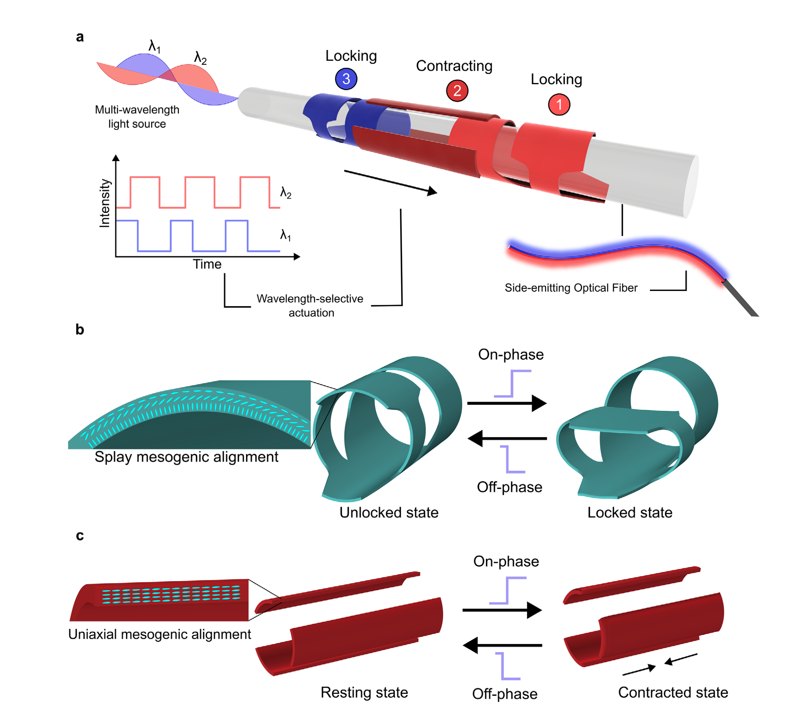
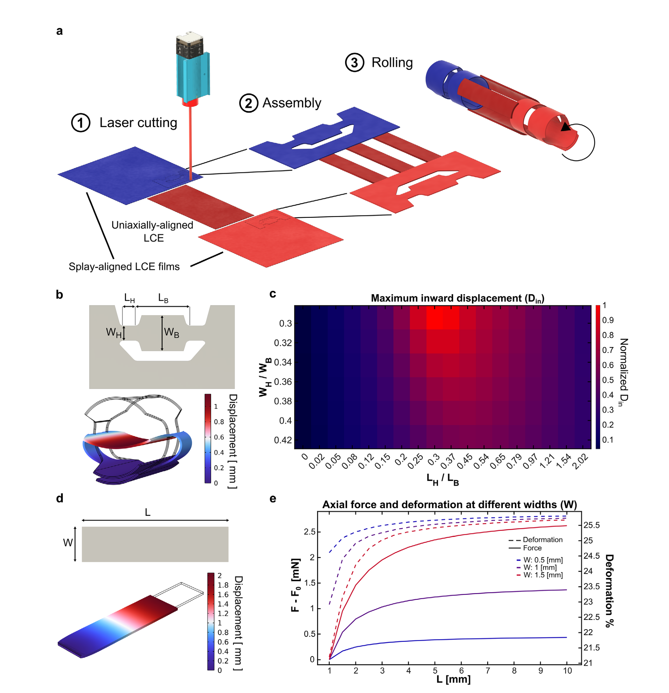
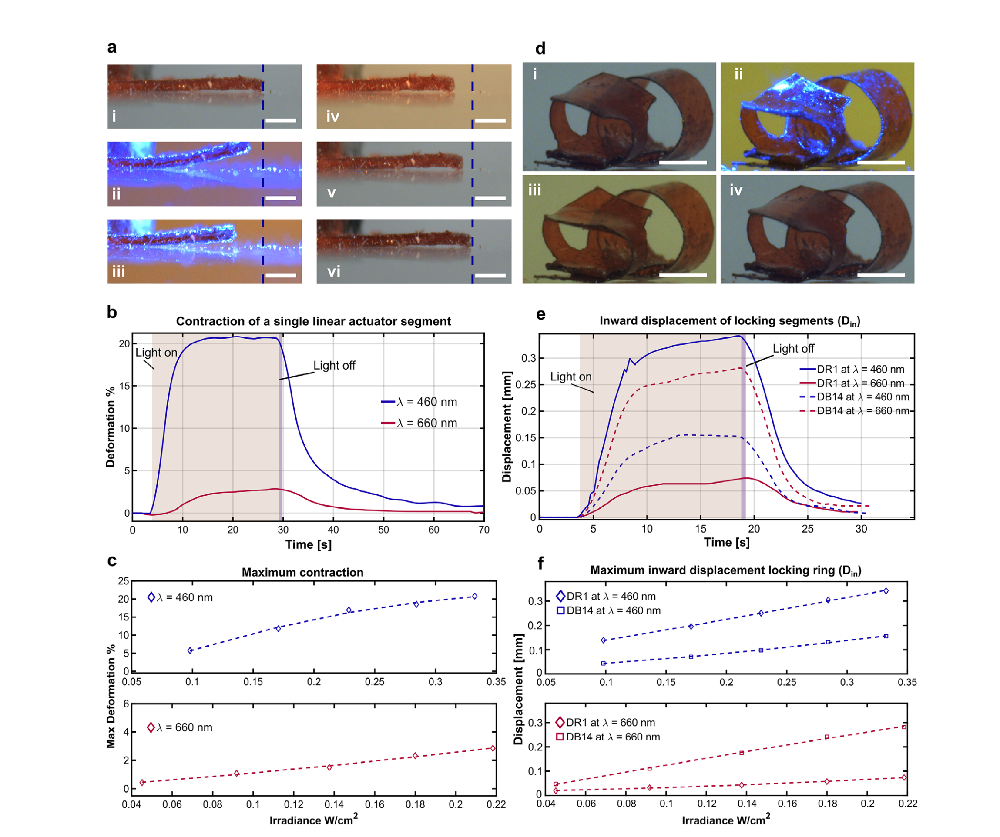
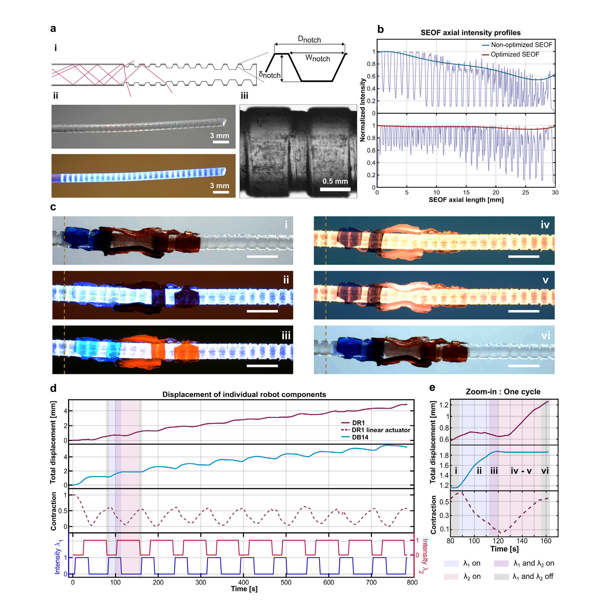

# Light-Actuated Fiber-Climbing Inchworm Robot Toward Endoluminal Navigation 精读笔记

> **论文**：Light-Actuated Fiber-Climbing Inchworm Robot Toward Endoluminal Navigation（光驱动的沿光纤爬行尺蠖机器人，面向腔内导航）
> **作者**：Antonio Lobosco、Leilei Song、Fan Liu、Yu-Hsiang Lin、Venkatasubramanian Kalpathy Venkiteswaran、Hao Zeng、Sarthak Misra
> **期刊**：Advanced Functional Materials（Wiley-VCH），2026; 36: e75627。DOI: [10.1002/adfm.75627](https://doi.org/10.1002/adfm.75627)
> **投稿时间线**：2026-02-25 收稿 → 2026-04-11 修回 → 2026-04-17 接收
> **单位**：荷兰特文特大学 生物力学工程系 外科机器人实验室；芬兰坦佩雷大学 工程与自然科学学院 Light Robots 课题组
> **基金**：欧盟"地平线 2020"欧洲研究理事会（ERC）Grant No. 866494（项目 MAESTRO）；ECIU 研究流动基金
> **开放获取**：**CC BY 4.0**（可自由复制、分发、改编，需署名）
> **数据与代码**：论文声明"数据可向通讯作者合理索取"，未提供公开仓库


---

## 一、一句话看懂这篇论文

**一句话**

一根 1.5 mm 粗的光纤，沿侧面开了一串越来越深的 V 形小口，光就从这些口子里漏出来；研究人员在这根光纤外面套了一个**由液晶弹性体薄膜剪裁、卷成圆筒的三段式小机器人**，用"蓝光"和"红光"两束光按顺序开关，让它的**前脚夹紧 → 身体收缩 → 后脚夹紧 → 身体伸展**，于是一步一步**沿着光纤向前爬**，一步约 0.6 mm。

**为什么这件事值得发表（Advanced Functional Materials 是 Wiley 旗下材料类顶刊之一）**

以往的光驱动机器人几乎都要求"**看得见**"——光源在外面，光束要直直地照到机器人身上。可一旦进了人体，光进不去、也照不到。本文把光源**塞进了光导纤维里**：光不再是从外面照过来，而是**从机器人所依附的这根光纤的内部、沿程漏出来**。这就把"光驱动"从"需要视线"变成了"不需要视线"。

**但这句话必须加一个限定**（这是我读完后的判断，论文没有这么写）：机器人爬的是**光纤**，不是**血管壁**。它夹住的是那根光纤，靠的是"松开/夹紧光纤"来完成步进。所以它解决的是"**光怎么送到深部**"，还没有解决"**机器人怎么自己钻进弯曲的管道**"。这两件事差别很大，第七章会展开。

---

## 二、背景与动机

### 2.1 先看清楚临床问题：人身体里的"管道"是什么样

人体内有很多"管子"：血管、胆管、输尿管、肠道、气管、输卵管。它们有三个共同特点：

| 特点 | 具体表现 | 对器械的要求 |
| --- | --- | --- |
| **深** | 胆管在肝脏下方，距离口腔 60–80 cm；冠脉在心脏表面 | 器械必须又细又长 |
| **窄** | 冠脉内径 2–4 mm；胆管 5–8 mm；输尿管 3–4 mm | 器械外径必须远小于管腔 |
| **弯** | 走行迂曲，常出现 90° 以上的急弯 | 器械必须极其柔软、可弯曲 |

**现有的办法**：把一根**光纤**（光导纤维）从体外送进去，一直送到病灶旁边，然后从光纤末端射出激光，做**激光消融**、**光动力治疗**、或者只是**照明和成像**。

**这里埋着一个关键事实**：内窥镜、荧光内镜、激光消融、光动力治疗——这些临床操作**本来就已经在人体深处有一束强光了**。本文的出发点就是一句话：

> **既然那束光已经在那里了，为什么只拿它照明？为什么不顺便用它驱动机器人？**

### 2.2 先看版图：光驱动机器人一共有几类

在讨论本文之前，先把整个领域摊开。**任何一个光驱动机器人，都可以用三个互相独立的问题去定位它**：光怎么变成力？光怎么送到它身上？它能干什么？

三个问题各有一个答案，三个答案一组合，就定位了这台机器人。**后面看到任何一篇光驱动机器人的文章，都可以套这个框架去问。**

#### 维度一：光怎么变成力

| 机制 | 原理 | 典型形变 | 速度量级 | 特点 |
| --- | --- | --- | --- | --- |
| **光化学型** | 分子吸收光子后**自身改变形状**（最典型是偶氮苯 azobenzene：顺式↔反式异构，分子首尾距离变化约 30%），分子一变，宏观就弯 | 1–10% | 毫秒–秒 | 快、可循环；但必须用特定波长，反复照射会疲劳 |
| **光热型** | 染料吸收光子 → **无辐射弛豫**（能量不移交给荧光，全部变成分子振动，即热）→ 温度升高 → 材料相变或有序度下降 → 形变 | **20–40%** | 秒–分钟 | **力大、应变大**；但速度被散热卡死 |
| **光动量/光泳型** | 直接用光的辐射压，或光照局部加热流体产生温差驱动（马兰戈尼效应、热气泳） | — | — | 只在微米级有效，力极小 |

**本文属于光热型。** 这一点决定了它后面所有的性能数字：20% 的大应变来自光热，慢也来自光热。

光热的链条可以写成一行等式：

```
光子被染料吸收 → 染料分子的电子被激发到高能级
→ 电子不通过发光掉回低能级（这叫"无辐射弛豫"）
→ 这部分能量全部变成晶格振动（热）
→ 局部升温 → LCE 从"有序"变"无序" → 宏观收缩
```

**关键推论：速度不由光速决定，由散热决定。** 加热要几秒（靠导热），冷却要几十秒（靠对流）。本文一个周期 85 秒，其中"开灯"是瞬间的，85 秒几乎全是"等热"。

#### 维度二：光怎么送到机器人身上

| 方式 | 说明 | 致命问题 |
| --- | --- | --- |
| **自由空间照射**（free-space） | 光源在外面，隔空照过来 | 必须有**视线**；可见光穿不透组织（毫米级）；必须打开体腔 |
| **远端供能**（waveguide photoactuator） | 光在光纤里走，从**末端**一个点射出来驱动尖端 | 只有尖端有光，机器人只有"一个关节"能动 |
| **侧向供能**（side-emitting） | 光边走边从侧壁漏出，整段都有光 | 需要改造光纤（本文的做法） |

论文引言对前两类的局限有明确表述：

> "The actuation of such robots conventionally relies on a **free-space illumination configuration**, where a movable light source and an **unobstructed line-of-sight** are required."

#### 维度三：它们能干什么

论文引用的工作，按功能归类：

| 功能 | 代表工作（论文引文编号） | 说明 |
| --- | --- | --- |
| **光纤机器人做腔内操作** | [3] Zhou et al., *Sci. Adv.* 2024，"Submillimeter Fiber Robots … Decoupled Macro-Micro Motion" | 亚毫米光纤机器人，毫米级宏动 + 微米级精动解耦。**目前最接近临床的一类** |
| **光纤 + LCE 做体内导航与激光消融** | [4] Luo et al., *Adv. Mater.* 2026 | 生物相容 LCE 光纤执行器，活体腔镜导航 |
| **光控微机器人（综述）** | [5] Jamil et al., *Appl. Sci.* 2022 | 系统梳理 light-controlled microbots |
| **LCE 的生物医学应用** | [6] Hussain et al., *Nanomaterials* 2021；[15] Shiralipour 2024 | — |
| **剪纸/折纸放大幅值** | [10] Chen et al., *Adv. Intell. Syst.* 2022；[11] Cheng et al., *Adv. Mater.* 2020，"Kirigami-Based Light-Induced Shape-Morphing and Locomotion"；[12] Liu et al., *CEJ* 2025 | [11] 是"光驱动 + 剪纸 + 爬行"的直接前身。**本文的剪纸血统来自这里** |
| **多波长选择性驱动** | [13] Zhang et al., *Soft Matter* 2022；[14] Marshall & Terentjev, *Soft Matter* 2013；[17] Yang et al., *CEJ* 2026，"Four-Waveband-Modulated LCE Actuators" | [17] 已经做到**四个波段**。本文只用了两个——这是后面"只能单向"的病根 |
| **波导式光执行器** | [24] Wani et al., *Nat. Commun.* 2017，人工捕蝇草；[25] Cheng et al., *Adv. Opt. Mater.* 2025，亚毫瓦光纤尖端微夹爪；[26] Xi et al. 2025（综述）；[27] Liu et al., *Adv. Mater.* 2025，LCE 光纤人工肌肉 | **全部是尖端型** |
| **管内巡检机器人** | [29] Tang et al., *Sci. Robot.* 2022，"A Pipeline Inspection Robot … Sub-Centimeter Scale" | 非光驱动，但功能对标（在细管内爬行） |
| **尺蠖式软机器人** | [30] Wang et al., *Biomimetics* 2023，多响应双层膜尺蠖 | 非光驱动，但运动模式对标 |

#### 本文在版图里的位置

三个维度一组合，空白点就露出来了：

```
                    光化学型            光热型 ←──────── 本文（20.5% 应变）
                        │                  │
自由空间照射 ───────────┼──────────────────┼─── 绝大多数 LCE 爬行机器人
                        │                  │
远端供能（尖端） ───────┼──────────────────┼─── [3][4][24][25][27]
                        │                  │
侧向供能（沿程） ───────┼──────────────────┼─── ★ 本文（空白点）
```

论文自己总结的空白只有一句：

> "Most works focus on steering the orientation of the device tip based on the control of output light intensity from the optical fiber. **Nevertheless, no demonstration of robotic movement or locomotion has been reported.**"

翻译：**已有的"光纤 + 光执行器"全都只在光纤末端装一个关节，让它点头、转弯、夹东西。没有一个能让整个机器人身体沿着光纤走过去。**

为什么这是空白？因为末端型机器人只有**一个自由度**。机器人自己不会移动，只能靠医生把光纤往前推。**而光纤在迂曲腔道里是推不动的——推力全被弯道"吃掉"，甚至顶穿管壁。**

本文的赌注就押在这里：**如果机器人能自己沿光纤爬，"深入腔道"就不再依赖"把光纤推直"。**

#### 同时必须说清楚：它比所有对标品都慢

| 类别 | 典型速度量级 |
| --- | --- |
| 自由空间照射的 LCE 爬行机器人 | **mm/s 到 cm/s**（量级估计，未逐篇核实） |
| 磁驱动腔内机器人 | **mm/s** 量级 |
| 管内巡检机器人 [29] | **cm/s** 量级 |
| **本文** | **约 0.39 mm/min**（我由 4.6–5.0 mm / 800 s 换算，论文未给） |

**差 2–3 个数量级。** 原因不是设计差，是物理决定的：

```
光热型 → 加热靠导热（秒级）→ 冷却靠对流（几十秒）
→ 加上并排条带每步只产生约 0.5 mm 行程
→ 85 秒走 0.5 mm
```

所以对它的准确评价是：**它证明了一个此前不存在的运动模式，而不是提供了一个可用的运动速度。** 论文没有回避这一点，但也没有量化（全文没有给速度值，只给总位移和总时间）。

#### 版图里的第一道墙：光必须能"走直线"

版图里格子最多、工作最成熟的那一类，是**自由空间照射 + 液晶弹性体（LCE）**（第三章详细讲）。这类机器人的工作方式通常是：

```
外部光源（LED / 激光） → 空气或透明介质 → 照到机器人 → 机器人变形
```

**这条链路有一个致命前提：光必须能"走直线"到达机器人。** 这叫**视线（line-of-sight，简称 LOS）**。没有视线，光就到不了。

在实验室里这完全不是问题——把 LED 架在机器人上方就行。但放到人体里，三个问题同时出现：

1. **组织不透光**。皮肤、肌肉、血液对可见光的穿透深度大约是 **毫米级**（红光稍好，蓝光最差）。光从体外照进去，走不了几毫米就衰减殆尽。
2. **没有视线**。管腔是弯的，机器人在转弯之后，外面根本照不到。
3. **深部空间狭小**。就算光源能靠近，也没有空间摆放灯。

**所以"光驱动"在体外演示得很好，一到体内就基本失效。** 这就是本文要解决的矛盾。

**注意这道墙的边界。** 它拦住的是"光从外面照进来"这条路，而**不**拦"光从里面送进来"这条路。所以下一步自然是：既然外面照不进来，那把光**运进去**。这就是 2.3 节。

### 2.3 已知的解法：用光纤把光"运"进去

光纤的作用是**搬运光**，不是**投递光**。它能把光从体外几乎无损地送到体内深处任何位置，只要这根纤维能顺着管道弯过去。

于是很自然的一个思路出现了：

> **把液晶弹性体直接做在光纤的末端（distal tip）上。** 光从末端射出来，照在 LCE 上，LCE 变形，带动光纤末端弯曲或张合。

这类器件在文献里叫 **waveguide photoactuator（波导光驱动器）**，已经有一批工作（即上一节表里 [24][25][26][27] 那一行）：光纤末端做微夹爪、做微型捕蝇草、做可弯曲的尖端。**共同点是全部只用光纤的"末端一个点"。**

**但这条路只走了一半。** 论文原话点明了这个空白：

> "Most works focus on steering the orientation of the device tip based on the control of output light intensity from the optical fiber. **Nevertheless, no demonstration of robotic movement or locomotion has been reported.**"

翻译：以前几乎所有工作都只是**让光纤的尖端动一动**（转个方向、夹一下），**没有任何一篇演示过"机器人整体移动"**。

**为什么做不到？** 因为"尖端转向"只需要一个执行器，而"移动"需要**至少两个执行器按顺序配合**——一个负责夹住、一个负责伸缩，而且两者必须**互不干扰地单独控制**。用一束光同时照所有部件，它们会一起动，什么也做不成。

### 2.4 本文的破局点：把光"沿路撒下去"，并让不同位置的部件"只听自己那一束"

本文做了两件事，缺一不可：

**第一件事：把光纤从"末端出光"改成"沿程出光"。**

在光纤侧面用激光刻一排 V 形小槽，把原本被"关"在纤维里全反射前进的光**沿途漏出来**。这种光纤叫 **side-emitting optical fiber（SEOF，侧发光光纤）**。

这样一来，套在光纤外面的任何位置上的部件，**都能被照亮**，而不再只有末端那一小段。

**第二件事：让不同部件对不同颜色"挑食"。**

在 LCE 里掺入两种不同的**染料**：

- **DR1（分散红 1）** 强烈吸收 **460 nm 蓝光**
- **DB14（分散蓝 14）** 强烈吸收 **660 nm 红光**

染料吸收光 → 局部发热 → 该部件变形。**因为它只对自己吸收的那个波长发热，所以只对那个波长响应。**

于是同一条光纤、同一个光源，只要**切换颜色**，就能**单独点亮某一个部件**。这是全文的技术核心：**用"波长"当"地址"，用"颜色"当"控制通道"。**

### 2.5 于是就有了"尺蠖"

两个"锁定环"（前、后各一个）加一个"直线执行器"（中间），配上两束光按顺序开关，就能做出**尺蠖式步进**：

```
蓝光亮 →  前环夹紧光纤 + 中间收缩  →  身体被拉向前
红光亮（蓝光仍亮）→ 后环夹紧      →  防止前环打滑
蓝光灭 →  前环松开 + 中间伸展      →  前端被推向前
红光灭 →  后环松开                →  完成一步
```

这个循环重复，机器人就沿着光纤一步步往前爬。

### 2.6 一句话概括本文的定位

> **本文不是在发明新的驱动原理，而是在解决"光驱动怎么进入看不见的地方"这个工程瓶颈**——用侧发光光纤解决"光到不了"，用双染料波长选择解决"部件不能分别控制"。

**它能做什么**：在一条既有的医疗光纤上，让一个小机器人沿着光纤爬到指定位置，执行局部动作（理论上还能携带工具）。
**它还不能做什么**：自己钻进弯曲的管道、在液体里工作、快速移动、反向爬行。这些第五章之后会逐条讲清楚。

---

## 三、核心概念：读懂这篇论文需要的全部前置知识

### 概念 0：先把全文的物理链条画成一条线

在展开任何细节之前，先记住这条链。**后面所有概念，都是为了解释这条链上的某一环。**

```
① 外部 LED 发出蓝光或红光
        ↓
② 光被耦合法兰送进光纤，在纤芯里靠"全反射"前进
        ↓
③ 光纤侧面刻了 V 形槽 → 光从槽口漏出来（侧发光）
        ↓
④ 漏出的光被 LCE 里的染料吸收（DR1 吃蓝光，DB14 吃红光）
        ↓
⑤ 染料把光变成热 → 局部温度升高
        ↓
⑥ LCE 因为升温而收缩或弯曲（分子有序度下降）
        ↓
⑦ 前环夹紧 / 中段收缩 / 后环夹紧，按顺序发生
        ↓
⑧ 机器人沿光纤向前爬行一步
```

**这条链上任何一环断掉，整个器件就动不了。** 因此本文的工作量也正好分布在这条链上：③ 是光纤工程，④⑤⑥ 是材料化学，⑦⑧ 是机械设计。

---

### 概念 1：尺蠖怎么爬——"各向异性摩擦"是全部秘密

**先看生物。** 尺蠖（inchworm）是尺蛾的幼虫。它走路的样子很特别：身体拱成一个 Ω 形，前端固定，把后端拉过来；然后后端固定，把前端推出去。

**它为什么能往前走，而不是原地来回蹭？** 因为它的**前后两对脚对地面的"抓地力"不一样**：

- **前脚**（真正的胸足）有趾钩，抓得牢
- **后脚**（腹足）是吸盘状，抓得松

**抓得牢的那一端当"锚"，抓得松的那一端当"滑动端"。** 收缩时，滑动端被拉过来；伸展时，锚点不变，前端推出去。**"锚"和"滑"的角色每半个周期交换一次。** 这样每一步都有净位移。

这个原理在机器人学里叫 **各向异性摩擦驱动（anisotropic friction locomotion）**，也有人叫"棘轮式推进"。

**本文的实现方式：**

| 生物     | 本文              |
| ------ | --------------- |
| 前脚抓地   | **前锁定环**夹紧光纤    |
| 后脚抓地   | **后锁定环**夹紧光纤    |
| 身体肌肉收缩 | **中间直线执行器**收缩   |
| 肌肉放松   | 执行器**回弹**（弹性恢复） |

**关键点：这里的"地面"是光纤的表面，不是血管壁。** 所以严格说，这是**沿光纤爬行**，而不是**在管腔里爬行**。这个区别在第七章会反复出现。

---

### 概念 2：为什么非要"三个部件"？三个部件又要几个"颜色"？

假设只有一个执行器，会怎样？

- 它一收缩，整个机器人一起缩——但两端没有锚点，结果是**原地收缩，没有任何位移**（因为没有东西"顶住"）。
- 它一放松，又弹回原样。

**所以位移的必要条件是：收缩的同时，两端的"抓地状态"必须不同。** 这就至少需要 **1 个执行器 + 2 个可控的锁定器**。

再进一步：如果三个部件**同时**被同一束光照亮，它们会**同时**动作——

```
前环夹紧 + 后环夹紧 + 中间收缩
= 三个点同时钉住 + 中间想缩
= 结构只会被扯紧，不会前进
```

**所以"能否分别控制"不是锦上添花，而是这个机器能不能动的充要条件。**

本文用**两个波长**来提供"分别控制"这件事。因为只有两个波长，而部件有三个，所以有一个波长必须**同时控制两个部件**（蓝光同时管前环和中间执行器）。这也直接导致了后面那个"只能单向"的后果。

#### 先弄清"颜色"在这里扮演什么角色

它的角色是**寻址（address）**——在一根总线上，决定"现在轮到谁动"。

这一点必须从物理上想清楚，因为它是全文最容易被想当然的一环：

> **所有部件都在同一根光纤上，都泡在同一片光里。** 光纤侧壁漏出来的光，不管哪个部件都照得到。没有电线可以分别通电，没有任何机械开关可以分别拨动。**唯一能被单独改变的物理量，就是光的波长。**

而不同染料有不同的吸收谱：某种染料只吃某个波长带的能量，别的波长的光打上去它"看不见"（不吸收 → 不发热 → 不动）。本文用的两种：

| 染料 | 名称里的颜色 | 实际吸收 | 响应波长 |
| --- | --- | --- | --- |
| Disperse Red 1（DR1） | "红" | 蓝紫区 | **460 nm（蓝）** |
| Disperse Blue 14（DB14） | "蓝" | 红区 | **660 nm（红）** |

> **这两个名字是反的。** 这是染料行业的命名习惯：按"染出来看上去的颜色"命名，而染料的颜色是它**不吸收**的那部分光。DR1 染出来是红的，说明它吸收了蓝光；DB14 染出来是蓝的，说明它吸收了红光。**"红光染料吃蓝光、蓝光染料吃红光"**，这一点不搞清楚，后面全乱。

所以：**一种染料 = 一个独立的控制通道 = 一根"隐形的电线"。**

#### 三个部件，为什么只要两个通道

先数清楚"需要几个独立自由度"。直觉上你会说：三个部件，应该三个颜色。**但自由度的数目不等于部件的数目。**

尺蠖步态里，①前环和②执行器的开关时刻**永远重合**：

| 相位 | 蓝光 | 红光 | 发生什么 |
| --- | --- | --- | --- |
| ① | **亮** | 灭 | 前环夹紧 **+** 执行器收缩——身体前半段被拉向前 |
| ② | 亮 | **亮** | 后环夹紧——身体"锁"在缩短状态 |
| ③ | **灭** | 亮 | 前环松开 **+** 执行器伸展——前部被推向前方 |
| ④ | 灭 | **灭** | 后环松开——完成一步 |

看蓝光那一列：亮的时候，前环抓 + 身体缩，**同时发生**；灭的时候，前环松 + 身体伸，**同时发生**。**它们从来没有需要"一个开一个关"的时刻。**

而且这不是随便选的，是物理逼出来的：

> **身体一缩，如果前环没抓住，整个机器人就会整体向后滑（打滑），这一缩白费。**
> **前环抓住了身体却不缩，前环抓了个寂寞。**
> **"抓住前面"和"缩短身体"必须是一个不可分割的动作。**

所以正确的计数方式是：

```
需要独立控制的"自由度"数 = 2
  自由度 1：{前环 + 执行器} ← 蓝光
  自由度 2：{后环}           ← 红光
不是"3 个部件 → 3 个颜色"
```

**让蓝光同时管前环和执行器，不损失任何控制能力，因为这两者的开关表本来就完全一样。** 这是本文"用最少的通道做最多的事"的地方，也是它的材料限制（只有两种染料合用时）下的最优解。

#### 但这个绑定也正好杀死了"倒车"

把步态倒过来。正向和反向的差别只有一处：**第一步谁先抓。**

| | 正向（前进） | 反向（后退） |
| --- | --- | --- |
| 第 1 步 | **前环抓** | **后环抓** |
| 第 2 步 | 缩身（后部被拉近） | 缩身（前部被拉近） |
| 第 3 步 | 后环抓 | 前环抓 |
| 第 4 步 | 前环松 + 伸身 | 后环松 + 伸身 |
| 第 5 步 | 后环松 | 前环松 |

反向的第 1、2 步合起来是：**"后环抓住，身体缩短，同时前环保持松开"。**

这句话里含有一个**物理上不可能出现的组合**：

```
需要：  前环 = 松   +   执行器 = 缩
但：    只要蓝光亮，前环就自动夹紧
        要执行器缩，必须蓝光亮
⇒  "前环松 + 执行器缩" 无法实现
```

**蓝光把前环和执行器焊死，而反向运动的第一步恰恰要求把这两个拆开、让它们朝相反方向走。** 这就是"只能单向"的根因。论文在结论里承认了这个后果，但没有把它拆解到这一步（原话见第七章 7.1 第 3 条）。

#### 要双向，必须解绑——三条路

| 解法 | 做法 | 代价 |
| --- | --- | --- |
| **第三色（最直接）** | 再掺一种染料，吸收 ~530 nm（绿）或 808 nm（近红外），给前环单独用 | 第三色必须与另两色吸收谱分得开（串扰小）；染料要能扩散进 LCE 且不破坏配方；LED 要多一路。**论文说找不到合适的第三染料——见 7.1** |
| **时延编码** | 同一个波长，靠热惯性不同来区分：前环薄（50 µm，热得快）、执行器厚（100 µm，热得慢），用短脉冲只热前环 | 时间窗口极窄，余量小，环境温度一变就失效 |
| **机械预载/双稳态** | 用结构（卡扣、预弯）让前环"抓住后自锁"，不靠持续光照 | 结构复杂，且释放需要另一套机构 |

**注意 [17] Yang et al. 2026 已经做到了"四波段 LCE 执行器"。** 也就是说第三、第四色在技术上是可行的，本文没有做。这是"单向"这个局限的一个可能出路。

#### 为什么偏偏选蓝 + 红这一对

不是随便挑的，是被三个客观条件同时锁定的：

1. **波长要分得开。** 460 与 660 差 200 nm，两种染料吸收谱重叠最小。波长靠得近，会互相"串门"——一开蓝光红染料也微微发热，时序全乱（本文已实测到这种串扰，见概念 9）。
2. **塑料光纤在这两个窗口损耗低。** POF 在可见光区透光好，红光尤其好。
3. **LED 便宜、成熟、好合束。** 460 nm 蓝光 LED 和 660 nm 红光 LED 是最普通的两种，用二向色镜合束进一根光纤也容易。

如果真要加第三色，最优窗口是 **808 nm 近红外**——离 460/660 都远，POF 在 808 nm 的损耗也可接受。代价是近红外光子能量低、染料吸收弱，需要更高功率，而本文的功耗余量本来就紧。

---

### 概念 3：光怎么变成力——光热效应的三步

**光本身没有"推力"。** 光压确实存在，但在这种功率下小到可以忽略（比一个蚊子翅膀的重量还小几个数量级）。**LCE 的光驱动全部是"间接"的，中间一定要经过"热"。**

三步走：

**第一步：吸收。**
材料里的染料分子把光子的能量"吃"进去。一个 460 nm 的蓝光光子能量约 2.7 eV（电子伏特）。染料分子吸收后，电子被激发到高能级。

**第二步：弛豫成热。**
激发态的电子不会一直在高能级待着，它会通过**非辐射跃迁**（把能量转成分子振动）回落到基态。**分子的振动 = 温度的升高。** 这一步叫 **光热转换（photothermal conversion）**。

> **为什么光热转换和"光化学"不一样**：光化学是光子直接打断化学键或引发反应；光热是光子只负责"加热"。本文是纯光热，**没有任何化学键被光打断**——这一点对生物安全性很重要（见第六章）。

**第三步：升温触发变形。**
局部温度升高 → LCE 的分子有序度下降 → 材料收缩或弯曲（概念 6、7、8）。

**关键推论：响应速度由"散热速度"决定，而不是由"光速"决定。**

光速是每秒三十万公里，但机器人从"光照到"到"变形完"，用了 **5–10 秒**（图 3b、3e）。**慢的不是光，是热。**

- 升温要时间：薄膜有热容，染料产生的热量要累积起来才能升温
- 降温更要时间：光一关，热量只能靠空气对流慢慢散掉

**这就是为什么本文的驱动周期长达 85 秒**——不是光源切换慢，而是**材料"凉下来"需要时间**。这一点是理解全文性能上限的关键。

---

### 概念 4：液晶是什么

**"液晶"这个名字听起来矛盾，其实它描述的是一个"中间态"。**

物质的三种基本状态按"有序程度"排：

```
晶体（完全有序，分子位置和方向都固定）
   ↓ 加热
液晶（位置乱了，但方向还有序）  ← 关键中间态
   ↓ 继续加热
各向同性液体（位置和方向全乱）
```

**"液晶"就是：分子可以流动（像液体），但分子的朝向保持整齐（像晶体）。**

### 什么样的分子能形成液晶？

**形状必须"细长"或"扁片"**。本文用的是**棒状分子（rod-like mesogen）**。

想象一把意大利面：

- 倒进锅里乱成一团 → **各向同性液体**
- 用手把它们都捋成一个方向 → **液晶（更准确说，向列相）**

**"向列相（nematic phase）"** 就是本文涉及的那种液晶态：**分子位置随机，但长轴大致朝同一个方向。**

这个"共同朝向"用一个单位向量表示，叫 **指向矢（director，符号 n）**。

### 为什么"方向有序"这件事如此重要？

因为**它把"各向同性"变成了"各向异性"**：

| | 各向同性（普通橡胶） | 向列相液晶弹性体 |
| --- | --- | --- |
| 沿某个方向拉伸 | 和任何方向一样 | 沿指向矢方向**更容易**变形 |
| 加热后膨胀 | 各方向一样 | **沿指向矢收缩，垂直方向膨胀** |

**"加热时沿分子长轴收缩"——这就是整个论文的动力来源。** 记住这一条，后面全部能推出来。

---

### 概念 5：液晶弹性体（LCE）——把液晶的"方向"冻进橡皮筋

**单纯液晶是液体，会流走，没法做机器人。** 所以要把它的有序"锁"进一个**交联网络**里。

做法（本文用的）是：

1. 把**液晶单体**（RM82 / RM257，长棒状分子，两端带反应基团）和**交联剂**混在一起
2. 让它们在**取向控制**下聚合，形成**三维网状高分子**
3. 网眼里还留着一层"液晶有序"

结果是一种**橡胶一样的弹性体，但内部带着永久的分子取向**——这就是 **LCE（liquid crystal elastomer，液晶弹性体）**。

### LCE 的独特之处：它是"橡皮筋"和"液晶"的合体

| 成分 | 提供什么 |
| --- | --- |
| 交联高分子网络 | **弹性**：拉得动、能回弹、不变形疲劳 |
| 液晶有序 | **各向异性**：加热沿特定方向收缩，且幅度巨大 |

普通橡皮筋加热只会热胀（各方向都变大一点，约 0.1%）。**LCE 加热可以沿一个方向收缩 20–40%**，而且**可逆**。论文实测：单个执行器段收缩约 **20%**（图 3b、3c）。

> **这就是为什么 LCE 是光驱动软体机器人最主流的材料**：**变形幅度大 + 可逆 + 可以"编程"变形方向**。变形方向由你当初怎么排列分子决定——这叫 **"取向编程"**。

#### 那么"取向编程"具体怎么做？——液晶盒

上面第 2 步只写了四个字："**在取向控制下聚合**"。这四个字是整篇论文的工艺基础，必须展开。

**先看液晶的一个关键性质：分子会"跟着容器内表面走"。**

贴近玻璃表面的液晶分子，如果表面做了某种处理，它们会采取某个特定的角度排列；然后这个角度会一层层"传染"给离表面远一点的分子。**所以控制表面，就等于控制整层。**

**而液晶盒（liquid crystal cell）就是为此存在的装置：**

> **液晶盒 = 两片平行玻璃 + 中间一层固定厚度的液晶 + 两片玻璃内表面各涂一层"取向层"。**

```
        ┌──────────────────────────────────┐
        │         玻璃基板（上）           │
        │──────────────────────────────────│ ← 取向层 A
        │                                  │
        │        液  晶（夹层）            │ ← 厚度 = 间隔物直径
        │                                  │
        │──────────────────────────────────│ ← 取向层 B
        │         玻璃基板（下）           │
        └──────────────────────────────────┘
                 ●        ●        ●          ← 间隔物微球（spacer）
```

**间隔物（spacer）是什么？** 就是掺在胶里的、直径已知的**微球**（本文用 50 µm 和 250 µm 的球形微粒）。压合两片玻璃时，微球把两片玻璃顶住，**盒子的厚度就被微球的直径钉死了**。这比"靠压力控制厚度"精确得多，是制造上最简单可靠的办法。

#### 两种取向层，决定分子的"躺"与"站"

| 取向层 | 处理方式 | 贴着它的液晶分子 | 名字 |
| --- | --- | --- | --- |
| **PVA**（聚乙烯醇，5 wt% 水溶液） | 旋涂 3000 RPM、90 °C 烘 10 min，然后用绒布**沿一个方向擦**（rubbing，摩擦取向） | **沿着摩擦方向平躺** | **planar（平面取向）** |
| **PI**（聚酰亚胺） | 旋涂 3000 RPM、180 °C 烘 20 min 固化 | **头尾朝外站立**，垂直于玻璃面 | **homeotropic（垂直取向）** |

**表面处理怎么变成"方向指令"的？** 摩擦会在 PVA 表面拉出沿摩擦方向的分子链沟槽，液晶分子顺着沟槽躺；PI 的化学性质则让液晶分子的极性头尾与表面结合、身体立起来。

**关键在组合：**

| 两面取向层的组合 | 中间液晶的排布 | 名字 | 受热后怎么变形 |
| --- | --- | --- | --- |
| **两面都 PVA，同方向** | 从上到下全部**平躺且同向** | **单轴（uniaxial）** | 沿指向矢方向**整体收缩** |
| **一面 PVA，一面 PI** | 从**平躺**连续**旋到站立** | **展曲（splay）** | **弯**（一面缩一面胀） |

```
单轴取向（两面都平躺）              展曲取向（上躺下站）

  ───   ───   ───                     ───   ───   ───    ← PVA：平躺
  ───   ───   ───                     ╱     ╱     ╱
  ───   ───   ───                    ╱     ╱     ╱       ← 中间逐渐旋转
  ───   ───   ───                   │     │     │
                                     │     │     │        ← PI：站立

  → 受热：整体沿"───"方向缩短         → 受热：上缩下胀 ⇒ 弯
```

> **本文的全部材料巧思就在这张表里：同一种材料、同一道工序，只靠"换一面玻璃的涂层"，就做出了两种完全不同的运动模式。** 这是概念 7 与概念 8 的工艺来源。

#### 灌液晶、聚合、开盒、染色——锁定环那一路的七个步骤

| # | 步骤 | 要点 |
| --- | --- | --- |
| 1 | **配液晶混合物** | RM82 + 6-氨基-1-己醇 + 十二胺 + 光引发剂 Irgacure 651 |
| 2 | **100 °C 熔融灌入** | 混合物在 100 °C 是液态，靠毛细作用灌进盒子 |
| 3 | **以 1 °C/min 缓慢降到 65 °C** | 慢降是为了给分子时间排整齐。**降快了会冻结成多畴（取向乱）** |
| 4 | **63 °C 保温 24 小时** | 让 aza-Michael 加成反应完成，长出低聚物链。**此时还没交联，膜仍可处理** |
| 5 | **UV 固化**（365 nm，180 mW/cm²，10 min） | 引发交联。**交联把液晶的"有序"冻结成弹性体的记忆** ——LCE 就在这一步诞生 |
| 6 | **刀片撬开盒**（open the cell） | 膜粘在一片玻璃上，撬开就脱离 |
| 7 | **染料热扩散** | 把 1 mg DR1 或 DB14 粉末撒在膜表面，100 °C 热板 10 min，让染料扩散进聚合物网络 |

**第 5 步是整件事的核心：** 交联把"分子已排好队"这个瞬时状态永久锁住。从此以后，材料记住的是"有序"形状；加热变无序时，它就会据此形变，而冷却后又能弹回。**"记忆"就是这么来的。**

> ⚠️ 第 7 步值得多想一秒：染料不是化学键合进去的，是**物理扩散掺杂**。这意味着染料可能缓慢渗出——尤其在液体中。**论文没有测染料渗出，而本文恰恰面向体液环境。** 这是一个我在第七章会提到的空白（染料一旦渗出，既失去驱动力，又是潜在的生物安全风险）。

#### 执行器那一路为什么多了"拉伸"这一步

对比方法 4.1.1（锁定环）和 4.1.2（执行器），会发现执行器的流程**完全不同**：

| | 锁定环（4.1.1） | 执行器（4.1.2） |
| --- | --- | --- |
| 玻璃涂层 | 一面 PVA、一面 PI | **两面都 PVA** |
| 盒厚 | 50 µm 微球 | 250 µm 微球 |
| 取向手段 | **表面取向层**（自然形成展曲） | **先做各向同性预聚物，再机械拉伸** |
| 交联时机 | 灌完直接 UV 固化 | **先 60 °C 保温 24 h 成预聚物 → 泡水洗掉 PVA → 单轴拉伸 → 再 UV 固化** |
| 最终厚度 | 50 µm | **100 µm** |
| 染色 | 干粉热扩散 | 浸泡 DR1/异丙醇溶液 |

**为什么不用"两面 PVA 摩擦"来做单轴，而非要拉伸？**

PVA 摩擦只能告诉分子"你要平躺，并且朝这个方向"，但当盒厚达到 250 µm 时，表面取向在这么厚的层里传播会不均匀、洗掉 PVA 后还会松弛。所以它换了策略：**先做成各向同性（无取向）的预聚物，再像拉橡皮筋一样机械拉长**——分子被拉到沿拉伸方向对齐，此时再光固化，取向就被"冻"住了。**物理原理一样（分子对齐），手段换成了力学的。**

**顺带解释了一个数字：为什么最终厚度是 100 µm 而不是 250 µm。** 预聚物从 250 µm 的盒子里取出后要被拉伸，拉伸使长度增加、厚度变薄（近似体积不变：拉伸约 2.5 倍，厚度变为 1/2.5 = 100 µm）。**这是我从两个数字反推出来的，论文没有明说这一点（见附二 (i)）。**

**一句话总结这一节：**

> **液晶盒 = 两片涂了取向层的玻璃 + 用微球钉死的缝隙。它唯一的用途是：用"表面"给"整层"规定一个取向。** 在本文里，它把液态的液晶变成了一张"分子方向被预先编程好"的薄片；**只要换一面玻璃的涂层，就能换出一种完全不同的变形模式。**

---

### 概念 6：有序度、相变，以及"两套不同的驱动机制"

**"有序度（order parameter）"** 是描述分子排列整齐程度的一个数，通常记作 **S**：

- **S ≈ 1**：所有分子都朝同一方向（完美有序）
- **S = 0**：所有方向乱七八糟（完全无序）
- **0 < S < 1**：介于两者之间

**温度升高时，热运动加剧，S 会下降。** 当温度升到某个临界值时，S 会从约 0.5–0.6 **突然掉到接近 0**。这个突变点叫 **清亮点（clearing point，T_NI）**，对应的就是**向列相 → 各向同性相**的**相变**。

**这里藏着一个非常漂亮的材料设计**，也是本文最容易被忽略的巧思：

> **同一个材料，可以用两种完全不同的方式驱动。**

| 驱动方式 | 原理 | 用在哪里 | 特点 |
| --- | --- | --- | --- |
| **跨越相变**（S 从 0.5 掉到 0） | 大范围的有序-无序转变 | **中间直线执行器** | 变形幅度大（约 20%），但需要更高的温度、更长的升温时间 |
| **不跨相变**（S 只轻微下降） | 在向列相内小幅降低有序度 | **两个锁定环** | 变形幅度较小，但**需要的温度低、响应快** |

论文原文对锁定环是这么写的：

> "The bending of the LCE actuator is caused by a reduction in the order parameter within the liquid crystalline network, **without the need to overcome the nematic-to-isotropic phase transition**, which occurs at a relatively high temperature in this type of chemical."

**这段话的意思是**：锁定环只需要"热一点点"，不必加热到相变温度。**这带来两个工程好处**：

1. **省功耗**：锁定时不需要把材料烧到很高温度
2. **降低热损伤风险**：接触组织的那一端温度更低（虽然论文没有量化这一点）

**这是我读完全文后认为最值得学的一处设计**：不是用一种材料做两件事，而是**用同一种材料的两个不同的物理区间做两件事**。

---

### 概念 7：单轴取向 → 为什么会"收缩"

**"单轴取向（uniaxial alignment）"** 的意思是：所有的液晶分子，**长轴都朝着同一个方向排**——就像一束被捋直的意大利面。

本文的中间执行器，就是把薄膜**沿着光纤轴向拉伸**，让分子沿轴向排齐。

**加热时发生什么：**

1. 温度升高 → 分子获得热运动能量
2. 分子开始"摇晃"，整齐度下降（S 下降）
3. **有序时，分子是沿着长轴"躺平"的；无序时，它们开始胡乱卷曲**——像一根绷直的绳子松开了
4. **宏观表现：沿长轴方向缩短，垂直方向变粗**

**用一句话记住：**

> **有序 = 绷直；无序 = 卷曲。加热让它从"绷直"变"卷曲"，所以沿取向方向收缩。**

**这就是"人造肌肉"的最基本机制。** 论文实测：单段最大收缩约 **20%**（图 3b），随辐照度增加而增加，最大到约 20.5%（图 3c）。

#### 三根条带是**并排**的，不是**首尾相接**的

论文第 2.1 节原文：

> "The linear actuator is composed of **three equal** uniaxially-aligned LCE segments (100 µm in thickness), **each** exhibiting unidirectional contraction along the SEOF axis."

图 2d 的图注也说得很清楚：

> "2D geometry of **one segment** of the linear actuator with the related design parameters **L, W**."

也就是：**每一根条带都是一个独立的"段"（segment），有自己的长度 L 和宽度 W。三根不是三个"级"，是三根"绳"。** 看图 2a 的"② Assembly"最直观——三根红色条带**平行并排**，一端接前环、一端接后环，中间没有任何间隔。

**这一点必须说清楚，因为它决定了一个常被搞反的结论。**

#### 串联堆位移，并联堆力

**先把两种连接方式的力学算清楚：**

**串联（首尾相接）——这才叫"堆行程"**

```
   ┌──L1──┐┌──L2──┐┌──L3──┐
   │      ││      ││      │
   每段应变都是 ε
   总缩短 = ε·L1 + ε·L2 + ε·L3 = ε·(L1+L2+L3)
```

**应变不变，位移随总长度累加。** 三根首尾接成 3L，总缩短就是 3εL。

**并联（并排）——堆的是力，不是位移**

```
   ┌──────────L──────────┐
   │═════════════════════│ ← 条 1，缩短 εL
   │═════════════════════│ ← 条 2，缩短 εL
   │═════════════════════│ ← 条 3，缩短 εL
   └─────────────────────┘
   三根被两端的环绑在一起，必须同步移动
   ⇒ 共同的缩短量 = εL（被最"不愿意动"的那根决定）
   ⇒ 每根出力 F，总力 ≈ 3F
```

**应变不变，位移不变，力 ×3。**

> **一句话记住：串联堆位移，并联堆力。**

#### 用数字验证：实测数据站在"并联"这一边

| 量 | 数值 | 来源 |
| --- | --- | --- |
| 执行器最大收缩率 | **20.5%** | 图 3b/3c |
| 每步位移 | **约 0.5–0.6 mm** | 图 4d/4e（5 mm ÷ 约 10 步） |

- 若三根是**串联**：单步 = 0.205 × 3L，取 0.5 mm ⇒ 单根 **L ≈ 0.8 mm**
- 若三根是**并联**：单步 = 0.205 × L，取 0.5 mm ⇒ 单根 **L ≈ 2.4 mm**

**哪个合理？** 光纤周长 π × 1.5 ≈ 4.7 mm，三根条带并排绕一圈，每根宽约 1.2 mm（留缝）。于是长宽比：并联 2.4/1.2 = **2:1**；串联 0.8/1.2 = **0.7:1**——**条带比它的宽度还短，那就不叫条带了，图也不该画成那样。**

**结论：三段是并联的。单步位移就是"一根条带的应变 × 一根条带的长度"，三段一点也没有多缩。**

#### 那为什么还要做三根？——四个理由（第一个有论文依据，后三个是我的推断）

**理由一：要力，又不能加厚，只能分成几根加宽（论文有依据）**

论文 §2.2 的有限元参数扫描给了这条论证链：

> "**Narrower segments exhibit higher deformation at low L values, but the dependency over widths becomes smaller as L increases.** This is not the case for the axial forces, which **strongly depend on the segment width.** This means that it is possible to **prioritize width for force efficiency without sacrificing significant displacement.**"

翻译成人话，是一串推理：

```
① 位移（应变）对宽度 W 不敏感 → 尤其在 L 大时几乎无关
② 轴向力对宽度 W 极敏感        → 力 ∝ 截面积 ∝ W（厚度固定）
③ 所以：加宽 = 几乎白得力，几乎不损失位移
④ 但一根条宽加到极限（卷成整筒）就变成"死管"了
⑤ 所以：拆成三根，总宽 3W，力 ≈ 3F，而缝保留了柔顺性
```

**理由二：整片闭合的筒，弯不动（我的推断）**

梁的弯曲刚度 ∝ 厚度³ × 宽度。一个**闭合圆筒**的抗弯惯性矩约为 π r³ t；同样面积拆成三根条带，抗弯惯性矩小得多，**方向上可差几倍**。

更要紧的是**拓扑**：闭合筒是一个"套在光纤上的刚性环"，光纤一弯，它要么跟着弯（如果软），要么卡住（如果硬）。

**而腔道里必定有弯。** 本文的立论是 endoluminal navigation，体内血管与消化道一定是弯曲的。**三根分离的条带 = 一根"开槽管" = 横向极软、轴向可缩**——这正是腔内器械需要的各向异性刚度。

> 🔍 论文**没有**讨论过弯性能，也没有任何弯曲实验。这是它的一个空白（见 7.2 第 15 条）。

**理由三：三根可以"卷"上去（我的推断）**

看 Fig 2a 的三步：激光切 → 平面装配 → 卷成筒。如果是整片闭合筒，装配时必须像穿袜子一样从光纤一端套进去——但光纤另一端连着光源，套不进去。

三根条带 + 两个 **C 形开口环**（注意：环是开口的 C 形，不是闭合的 O 形，见附二 (k)），可以**从侧面"包"上去**，再用 UV 胶封口（Norland UVS 91）。

**理由四：加厚会让速度再差一个量级（我的推断）**

热扩散时间 ∝ 厚度²。厚度从 100 µm 加到 300 µm，加热时间变成 9 倍。本文一个周期已经 85 秒，加厚后一个周期要十几分钟。

**所以"加力"绝对不能靠加厚，必须靠加宽；而加宽到整筒又违反理由二、三。于是只剩一条路：分三根。**

#### 三根也有代价（论文没提）

| 代价 | 机理 |
| --- | --- |
| **不同步 → 歪** | 三根受光不均匀（侧发光本身沿程有衰减）、热不均匀，收缩量不同 ⇒ 整个筒会**侧弯或扭转**，而不是纯轴向缩短 |
| **缝是薄弱点** | 条带与环的连接处应力集中，反复循环容易撕裂 |
| **总力不是严格的 3F** | 若三根不同步，最先到达极限的那一根会"顶住"，其余两根的行程被它限制 |

> ⚠️ **需要说明：论文本身没有解释为什么是三根**，只写了 "composed of three equal segments"。以上是从图 2a 的装配示意和 §2.2 的力-位移权衡反推出来的，属于我的分析，不是论文内容。

---

### 概念 8：展曲（splay）取向 → 为什么会"弯曲"

**这是全文最精巧的材料设计，值得单独讲透。**

单轴取向是"所有分子朝一个方向"。现在换一种排法：

> **薄膜的上表面，分子平躺（平行于膜面）；下表面，分子竖立（垂直于膜面）；中间连续过渡。**

这种排列叫 **展曲（splay）取向**——因为分子的方向像扇子一样"展开"。

**加热时会发生什么？** 关键在于：**"沿分子长轴收缩"这条规律没变，但膜的上表面和下表面，长轴指向不同。**

| 位置 | 分子长轴指向 | 加热时沿长轴收缩 → 在膜平面内的效果 |
| --- | --- | --- |
| **外表面**（平躺） | 平行于膜面 | 膜面内**收缩** |
| **内表面**（竖立） | 垂直于膜面 | 厚度方向收缩，膜面内**膨胀**（泊松效应） |

**结果：一面缩、一面胀 → 薄膜必然向"缩的那一面"卷曲。**

这就是机械学里经典的 **双金属片（bimorph）** 原理：两种膨胀系数不同的材料贴在一起，一加热就弯——**家用恒温器里的双金属片、老式电熨斗的温控开关，都是这个原理**。

**本文把它做成锁定环的方式：**

- 把展曲膜做成一个**C 形环**，套在光纤外面
- **朝内**的一侧是竖立区（homeotropic），**朝外**的一侧是平躺区（planar）
- 一加热 → 外表面收缩、内表面膨胀 → **环向内收拢，抱住光纤**

论文原文：

> "Upon illumination, the planar region contracts while the homeotropically aligned region expands, resulting in the **squeezing of the ring-shaped structure around the SEOF**."

**为什么用"弯曲"而不是"收缩"来做锁定？** 因为锁定需要的是**径向的位移**（向里夹紧），而不是轴向的位移。展曲结构恰好把"加热"翻译成了"向里弯"，这是几何上最直接的解。

**小结这一对设计：**

| 部件 | 取向 | 加热后的动作 | 需要的温度 |
| --- | --- | --- | --- |
| 中间执行器 | 单轴（沿光纤轴向） | 轴向缩短 | 高（跨相变） |
| 两个锁定环 | 展曲（沿厚度方向变化） | 径向内收 | 低（不跨相变） |

**同一个材料体系，两种取向，两种动作，两种温区。这是全文最"材料学"的部分。**

#### 从"薄膜弯曲"到"夹紧光纤"：中央驱动段在做什么

上一节讲了"展曲膜受热会弯"。但**一张会弯的膜，怎么变成一个"夹住光纤"的环？** 中间还有一步几何转化，论文把它藏在图 2b 的一个二维图形里。

**先纠正一个直觉。** 一般人会以为锁定环是一条**圆环形带子**，像橡皮筋，一受热就整体缩小。**不对。** 它是一张**二维剪纸片**，卷起来以后才成为环。二维展开图长这样（对应图 2b）：

```
    ┌─── L_H ──┐┌──── L_B ────┐┌─── L_H ──┐
  ┌─┤          ││             ││          ├─┐
  │ └── W_H ───┘│    W_B      │└── W_H ───┘ │   ← 上下各切一个 T 形缺口
  │ ┌──────────┐│             │┌──────────┐ │
  │ │          │└──         ──┘│          │ │
  │ │          │                │          │ │
  │ └──────────┘                └──────────┘ │
  └──────────────────────────────────────────┘
                    ↑
      中间这块"舌头" = 中央驱动段（L_B × W_B）
      两边各一个细颈 = 柔性铰链（flexure hinge，L_H × W_H）
```

部件定义（论文 §2.2）：

| 部件 | 中文 | 参数 | 作用 |
| --- | --- | --- | --- |
| **flexure hinge** | 柔性铰链 | `L_H` × `W_H` | 只许**转**、不许**伸**——相当于合页。细脖子弯得动，但拉不长 |
| **central actuation segment** | **中央驱动段** | `L_B` × `W_B` | 中间那块舌头，**它自己会变形，并且往光纤方向顶** |
| 其余大片 | 环的主体 | — | 卷起来构成环的圆周，负责"套在光纤上" |

**所以"中央驱动段"是什么？**

> **它是每片剪纸中间那块被两个细脖子吊着的舌头。它不是驱动源，它是"被驱动的那块"——真正的驱动源是整片 LCE 膜受热后的弯曲，舌头把这个弯曲转换成"向内的位移"。**

**它"驱动"的是什么？—— 径向内收位移 D_in**

论文用的符号是 **D_in**（inward displacement）。定义见图 3e 图注：

> "The inward displacement was evaluated by tracking the **middle point of the central actuation segment** over time during on/off illumination cycles."

也就是**中央驱动段中点向环心（光纤）方向移动了多远**：

```
        锁定环（俯视截面，C 形开口环）
            ┌─────────────────┐
            │                 │
            │   ╭─────────╮   │
            │   │  光纤   │   │
            │   │  ⌀1.5mm │   │
            │   ╰─────────╯   │
            │        ↑        │
            │        │ D_in   │  ← 舌头往内顶，顶到贴着光纤
            │     ═══╧═══      │
            └─────────────────┘
```

- **D_in 最大值约 0.32 mm**（论文数据）。
- 光纤半径 0.75 mm。0.32 mm 不足以"从松到贴"跨越整个间隙，**所以环的原始内径必须设计得接近光纤直径——它是"从虚贴到压紧"，不是"从远处飞过来抱住"。**

**D_in 的物理意义：它是摩擦力的来源。**

```
光热弯曲 → 舌头内移 D_in → 环抱紧光纤 → 环与光纤之间产生法向压力 N
→ 摩擦力 f = μN
→ 这个 f 就是"锚"能提供的抓地力
→ 抓地力必须 ≥ 执行器的收缩力，否则打滑
```

**这就是整个装置的力学逻辑链条：执行器提供"收缩力"，环提供"抓地力"；抓地力不足，收缩力只会让机器人自己往回滑。** 论文观察到的 "slight slippage"，就是这条链在这里掉了链子。

**为什么舌头的尺寸要优化？——两个长度在抢同一块地方**

图 2c 的热图给出最优区：`L_H/L_B ≈ 0.3–0.45`、`W_H/W_B ≈ 0.3–0.32`。原因很直白：

| 情况 | 后果 |
| --- | --- |
| **铰链太短**（L_H 小） | 两端把舌头夹死，舌头转不动 → D_in 小 |
| **铰链太长**（L_H 大） | 铰链本身占掉圆周上宝贵的长度，舌头（有效摆动部分）变短 → D_in 小 |
| **铰链太粗**（W_H 大） | 弯不动 |
| **所以存在中间最优值** | 铰链要"细而适中长" |

论文原话：

> "excessively long flexure hinges **reduce the effective length of the central actuation segment**, therefore limiting its bending capability. Conversely, the short flexure hinge **imposes strong constraints at both ends** of the segment, limiting its inward displacement."

> **L_H + L_B 是固定的**，因为："LH and LB are **interdependent** due to constraints imposed by the **fixed fiber circumference** and the extent of the overlapping regions necessary for the fabrication."（整片剪纸卷成环后的周长必须刚好包住光纤，π × 1.5 mm ≈ 4.7 mm，所以所有长度加起来是一个定值，L_H 与 L_B 只能此消彼长。）

**最后，把"中央驱动段"和"线性执行器"彻底分开——这两个词最容易混：**

| | 中央驱动段（central actuation segment） | 线性执行器（linear actuator） |
| --- | --- | --- |
| 有几个 | **2 个**（前后环各一个） | **1 组**（3 根并排） |
| 属于哪个部件 | 锁定环上的一块区域 | 独立部件 |
| 二维形状 | 被两个细颈吊着的**舌头** | 长条 |
| 变形方向 | **径向**内收（往光纤上顶） | **轴向**收缩（沿光纤轴缩短） |
| 驱动的量 | D_in（约 0.32 mm） | 收缩率（约 20.5%） |
| LCE 取向 | **展曲 splay** | **单轴 uniaxial** |
| 作用 | **锁**（抓地） | **动**（位移） |
| 厚度 | 50 µm | 100 µm |

---

### 概念 9：染料与波长选择性——为什么蓝光只动"该动的那一个"

**先讲一个日常现象。** 一件红衣服在阳光下摸起来比白衣服热，因为它**吸收**了更多可见光。**颜色 = 吸收什么、反射什么。**

染料分子的吸收是**高度选择性**的：一个分子只在**特定的波长范围**内强烈吸收光，这个范围叫**吸收带**，峰值位置叫**吸收峰**。

本文用了两种商品染料：

| 染料 | 全称 | 吸收峰 | 对什么颜色"敏感" | 用在哪些部件 |
| --- | --- | --- | --- | --- |
| **DR1** | Disperse Red 1（分散红 1） | 约 460–500 nm | **蓝光** | 前锁定环 + 中间执行器 |
| **DB14** | Disperse Blue 14（分散蓝 14） | 约 640–680 nm | **红光** | 后锁定环 |

**注意一个反直觉的地方：**

- **DR1 叫"分散红"，却对蓝光最敏感**（它吸收蓝光，所以透射出来是红色）
- **DB14 叫"分散蓝"，却对红光最敏感**（它吸收红光，所以透射出来是蓝色）

**所以"染料的名字"指的是它**看起来**的颜色，而不是它**吸收**的颜色。** 这一点很容易搞混，但读图时必须弄清楚：图 1a 里红色部件（DR1）对应 **λ₁ = 460 nm 蓝光**，蓝色部件（DB14）对应 **λ₂ = 660 nm 红光**。**颜色是反的。**

### 波长选择性到底有多强？

论文用的判据是：**同等辐照度下，两种染料造成的位移差多少。**

图 3f 的数字（我逐点读的）：

| 照射波长 | DR1 部件最大内收位移 | DB14 部件最大内收位移 | 选择比 |
| --- | --- | --- | --- |
| **460 nm**（蓝） | 约 **0.32 mm** | 约 **0.13 mm** | **约 2.5×** |
| **660 nm**（红） | 约 **0.07 mm** | 约 **0.28 mm** | **约 4×** |

对于中间执行器的**收缩率**（图 3c），论文给了一个更醒目的数：

> "The maximum deformation achieved with 460 nm illumination is **∼5 times higher** than the case of 660 nm, considering the same irradiance values."

**即：同样亮度下，DR1 部件对蓝光的响应是对红光的约 5 倍。**

### 但"选择性"不是"绝对开关"

**这一点很关键，论文自己也承认了：**

> "Considering both, the DB14-functionalized segment exhibits an increased response at its non-corresponding wavelength compared to that of the DR1-functionalized segment, **indicating lower wavelength selectivity**."

**翻译**：DB14 在"不该响应"的蓝光下，仍然动了 0.13 mm（是它自己最大位移的将近一半）。**这意味着红色部件在蓝光下"漏动"得比较厉害。**

**为什么漏？** 因为染料的吸收带不是一根线，而是一个**有宽度的鼓包**。DB14 在 460 nm 处虽然不在峰值，但仍有可观的吸收尾巴。**换句话说，"波长选择"是"强偏好"，不是"数字开关"。**

**这个非理想性带来一个真实的工程后果**（第七章展开）：**当蓝光亮起时，后环也会被轻微加热，产生一点"半锁"或"半松"的状态**，这正是论文观察到的"打滑（slippage）"的可能来源之一。

---

### 概念 10：光在光纤里怎么走——全反射

**光纤的结构很简单：一根高折射率的"芯"，外面包一层低折射率的"皮（cladding）"。**

```
        ┌───────────────────────┐
        │   cladding（包层，n₂） │
        │   ┌───────────────┐   │
        │   │  core（纤芯） │   │  ← 光在这里面走
        │   └───────────────┘   │
        └───────────────────────┘
```

**光为什么不会从侧面漏出去？** 因为**全反射（total internal reflection，TIR）**。

**全反射的条件有两个：**

1. 光从**光密**介质（折射率大）射向**光疏**介质（折射率小）——即 n_core > n_cladding
2. 入射角**大于**一个临界角 θ_c：

$$\theta_c = \arcsin\left(\frac{n_{cladding}}{n_{core}}\right)$$

**用大白话说：**

> **光从"稠密"的介质射向"稀薄"的介质时，如果射得太斜（贴近界面），它就不出去了，而是被 100% 反射回来。**

**这也是"光纤为什么能弯着走光"的原因**：只要弯曲不太急，光在每一次碰到界面时入射角都还大于临界角，就一路反射着前进。

### 一个必须知道的数字：1.5 mm 是什么概念

本文用的是一根 **塑料光纤（plastic optical fiber），外径 1.5 mm，无护套**（Edmund Optics 02-535，Optical Grade Plastic Optical Fiber Unjacketed）。

> **注意**：论文只写了 "plastic optical fiber"，**没有注明聚合物种类**。这类光纤通常是 PMMA 纤芯 + 氟化聚合物包层，本文后面的折射率估算按此假设。**这是我的推断，不是论文给出的信息。**

**1.5 mm 有多粗？** 大约是一根**粗一点的圆珠笔芯**。作为对比：

- 冠脉导管外径：约 1 mm（3 French）
- 输尿管软镜：约 3 mm（9 Fr）
- 胆道镜：约 3–5 mm

**所以这根光纤本身已经是"导管级"的粗细了。** 机器人套在它外面之后，整体外径只会更大——这一点是本文离临床最远的距离之一（第七章详述）。

---

### 概念 11：侧发光光纤（SEOF）——怎么把光从侧面"漏"出来

**问题**：全反射保护得太好了，光到不了机器人所在的位置。

**解法**：**在光纤侧面用激光切出一排 V 形小槽。**

**V 形槽为什么能让光漏出来？** 一句话说：**它在局部同时改掉了全反射的两个前提。** 下面把它拆开讲，因为"法线转了角度"这句话如果只是背下来，是不会真正懂的。

#### 第一步：把"法线"这个词钉死

**法线（normal）= 垂直于某个面的一条线。**

```
        │ ← 法线
        │
   ─────┼─────   ← 界面
        │
        │ ← 法线
```

**为什么光学里所有角度都对着法线量，而不是对着界面量？** 因为光的反射/折射只取决于"光相对界面倾斜了多少"，而"垂直界面的方向"和"平行界面的方向"是两个天然参照。用**法线**当参照，公式最简洁——斯涅尔定律：

```
n₁ · sin θ₁ = n₂ · sin θ₂
```

这里的 θ₁、θ₂ **都是从法线量的**。于是有两条必须记住的对应关系：

| 光的走向 | 与法线的夹角 |
| --- | --- |
| **垂直射入**界面（最"正面"地撞） | **0°** |
| **贴着界面擦过**（最"侧面"地掠） | **90°** |

#### 第二步：光纤为什么"存得住光"——临界角

光从"光密"介质（折射率大）射向"光疏"介质（折射率小）时有一个特殊现象：

```
入射角 θ₁ 增大 → 折射角 θ₂ 也增大
θ₁ 增到 θ_c 时，θ₂ 正好 = 90°（折射光贴着界面跑）
θ₁ 再大 → 光完全出不去，100% 反射回来  ← 全反射
```

θ_c 叫**临界角**：

$$\theta_c = \arcsin\left(\frac{n_{clad}}{n_{core}}\right)$$

代入塑料光纤的典型折射率（论文没给 n 值，以下是常见 POF 的取值）：

| 界面 | n₁ | n₂ | θ_c |
| --- | --- | --- | --- |
| 芯 → 包层 | 1.49 | 1.40 | **≈ 70°** |
| 芯 → 空气 | 1.49 | 1.00 | **≈ 42°** |

**于是光纤"存得住光"的条件就是：光对侧壁的入射角 > 70°，也就是光必须足够"贴着轴"走。**

#### 第三步：这就是问题的根源——光纤里的光本来就是"擦着"侧壁走的

看没刻槽的侧壁：

```
        光纤轴 →
   ┌───────────────────────────┐
   │                           │
   │      光 ─────────────────►│
   │                           │
   └───────────────────────────┘
              ↑
         法线：⊥ 轴（径向）
         光的方向：∥ 轴
         ⇒ 两者夹角 = 90°
```

**这里有一个非常反直觉、但必须记住的点：**

> **光纤之所以能送光，恰恰是因为光"擦着"侧壁走，而不是"撞向"侧壁。撞击角度越大（越擦着），越出不去。**

90° 远远大于 70°，所以 100% 全反射，光一点都漏不出来。

#### 第四步：刻槽做的事——把界面"翻个角度"

**没刻槽时**：圆柱侧壁上的每一条母线**都平行于光纤轴**。所以这个界面的走向平行于轴，而它的**法线垂直于轴、指向径向**。

**刻了 V 槽以后**：一个原本"平行于轴"的平面消失了，换成了一个**斜面**。这个斜面的**走向不再平行于轴**，于是它的**法线也不再垂直于轴，而是从"径向"偏转了一个角度**。

**"法线转了角度"这句话的全部意思就是：**

```
             刻槽前                      刻槽后（V 槽斜面）

                ↑ 法线 ⊥ 轴                  ╱ 法线斜了
                │                          ╱
       光 ──────┼────────────────  光 ───────╱────
                │                        ╱  斜面
          （法线是径向）               （法线偏转了 β）

          光与法线夹角 = 90°        光与法线夹角 = 90° − β
```

**光的传播方向完全没变（仍然沿轴），变的只是界面的朝向。** 于是入射角从 90° 掉到 (90° − β)：

```
β = 0°   →  入射角 90°  →  ≫ 70°  →  全反射，光出不去
β = 30°  →  入射角 60°  →  < 70°  →  光开始漏出
β = 45°  →  入射角 45°  →  ≈ 42°  →  光大量漏出
```

**临界角是 70°，它离 90° 只有 20° 的余量。所以斜面只要相对轴倾斜 20° 以上，光就会开始跑出来。** 这就是为什么刻一道浅斜槽就能让光漏出来——**这个系统本来就工作在"差一点点就漏"的边缘上。**

#### 第五步：刻槽其实做了**两件事**，不只一件

论文方法 4.6 的措辞值得细看：

> "introducing small v-notch cuts **through the cladding layer and cladding/core interface**"

也就是**V 槽切穿了包层，一直切到纤芯表面**。于是：

| | 刻槽前 | 刻槽后 |
| --- | --- | --- |
| **① 界面换材质** | 芯 / 包层（n₂ = 1.40） | 芯 / **空气**（n₂ = 1.00） |
| **② 界面换朝向** | 平行于轴（法线是径向） | 倾斜于轴（法线转了 β） |
| **⇒ 临界角** | **70°** | **42°** |
| **⇒ 实际入射角** | **90°**（擦着走） | **90° − β**（斜撞） |

**两件事同时在降低"入射角超过临界角"的程度，所以光一定跑出来。** 这也解释了为什么必须"切穿包层"——如果只在包层表面刻一道浅痕，材质没换，临界角还是 70°，仅仅换个角度不一定够。

> ⚠️ **论文没有给出槽的斜面角。** 上面的角度阈值是我从"临界角 42° + 典型光纤数值孔径"反推的量级估计，**不是论文数据，引用时请标明是我的推算。** 真实的出光还取决于光纤里光的角度分布（不是严格的 0°，而是一个分布），计算会复杂得多。

#### 第六步：为什么是"V"形

- **激光聚焦呈锥形，侧面切口天然接近 V 形**（越深越窄）。
- **V 形的两个斜面是"对称的一对"**，几何上确定，可重复。
- **V 形最容易通过"刻深一点/浅一点"来精细控制漏光比例**——这正是下一节梯度补偿要用的自由度。

**V 形槽在这里扮演的是"受控的泄漏点"**——不刻槽的地方，光继续走；刻槽的地方，光就漏一点出来。

**这就是"把一根导线变成一串灯泡"的思路。**

#### 论文具体做了两件事

**第一件：刻槽。**

用激光切割机（Trotec Speedy 300），在光纤上**刻穿包层、切到芯/包界面**。刻槽区**总长 3 cm**。

> 注意"刻穿包层"这四个字。如果只刻到包层表面，材质没换，临界角仍是 70°，仅仅改角度不一定够；必须切到芯表面，让光直接面对空气（临界角降到 42°），才能稳定出光。

**第二件：让每个"灯泡"一样亮。**

---

### 概念 12：为什么刻槽要"越来越深"——一个非常漂亮的工程补偿

**如果所有刻槽一样大，会发生什么？**

```
入口端 ——●———●———●———●———●———●———●—— 远端
        亮   亮   亮   亮   暗   暗   暗
```

**原因很简单：光是从近端往远端走的，每漏一次，剩下的光就少一点。** 光沿程单调衰减。

**结果**：近端的部件被照得很亮，远端的部件几乎照不到——**同一个机器人的不同部位，驱动力差别巨大，根本没法协调动作。**

**解法：让后面的槽比前面的大。**

用一句更准确的话说：**越往远端，槽越宽、越深，单位长度的漏光率越高，正好补上剩余光量的下降。**

这就像**水管上开孔**：如果想让每个孔流出的水量一样，靠近水源的孔要开小一点，远离水源的孔要开大一点。

**论文的具体做法（方法 4.6 节）：**

| 参数 | 做法 |
| --- | --- |
| **槽宽 W_notch** | 从 **150 µm** 递增到 **350 µm**，**每 6 个槽增加 50 µm** |
| **槽深 δ_notch** | 通过**降低激光扫描速度**来控制（切得越慢，能量沉积越多，槽越深）：每 10 个槽把扫描速度从 0.5% 降到 0.4%，每次降 0.05% |
| **激光功率** | 固定为最大功率的 1% |
| **槽间距** | 论文没有给出具体数值（见附二） |

**效果（图 4b）：**

- **未优化**：沿程强度从 1.0 衰减到约 0.6，波动很大
- **优化后**：沿程基本维持在 **约 0.9–1.0**，**几乎平了**

**这是本文我认为最值得学的一处工程细节：** 它没有发明新东西，只是把一个**本来会导致系统失效的物理规律（沿程衰减）**，用**几何上的反向梯度**抵消掉了。

> **补充说明（我的判断）**：这种"补偿"只在**光纤是直的**时最准确。光纤一旦弯曲，部分槽口的朝向改变、出光角度改变，沿程均匀性会下降。论文没有测试弯曲状态下的爬行——这在体内是必然会遇到的情形。

---

### 概念 13：剪纸（kirigami）——把二维薄膜变成三维圆筒

**"Kirigami"** 是日语"切り紙"，指**剪开**纸张做成立体结构（区别于 origami 折纸）。在工程里，它泛指**通过在平面材料上开切口、让平面结构获得三维变形能力**的设计方法。

**本文为什么需要它？**

因为机器人的本体必须是**一个套在光纤外面的圆筒**，但 LCE 只能做成**薄膜**（50 µm 或 100 µm 厚）。**薄膜怎么变成圆筒？**

**三步（图 2a）：**

1. **激光切割**：把染好色的 LCE 薄膜，切成带切口的平面形状——这些切口就是"铰链"和"让位槽"
2. **装配**：把不同取向（单轴 / 展曲）、不同染料（DR1 / DB14）的膜片，拼成一条平面"长条"
3. **卷成圆筒**：把这条平面结构卷起来，两端用 UV 胶（NOA 63）粘住

**为什么巧？**

- **二维加工**：所有切割都在平面上完成，用普通激光切割机就行，不需要复杂的模具
- **可缩放**：换一根更粗或更细的光纤，只要**改切割图纸上的尺寸**即可（论文结尾说 "fully customized systems that can be adapted to different sizes"）
- **铰链提供柔性**：切口留下的薄"脖子"（flexure hinge）很软，让刚性片段之间能相对转动——这正是锁定环能"向内收"的机械基础

**这一步的代价**（我的判断）：**装配和卷筒全部手工完成**（用镊子、刀片、3D 打印棒辅助）。论文说激光功率设到最大值的 6%、切割速度设到 0.5%——这类参数高度依赖操作者经验，**产业化时的一致性会是问题**。

---

### 概念 14：时序光图案——"周期、延时、占空比"是什么

机器人不是靠"一直亮着"动的，而是靠**两束光按时间编排**。本文用的参数（方法 4.4 节）：

| 参数 | λ₁（蓝，460 nm） | λ₂（红，660 nm） |
| --- | --- | --- |
| **周期（period）** | 85 s | 85 s |
| **延时（delay）** | 5 s | 25 s |
| **占空比（duty cycle）** | 35% | 62% |
| **峰值强度** | 100% | 100% |
| **谷值强度** | 0% | 0% |

**逐个解释：**

**周期 85 秒**：一个完整的"爬一步"循环用 85 秒。**这个数字不是随便定的——它由材料的升温/降温时间决定。** 光开关切换只要微秒，但材料要 5–10 秒才热起来、要 20–30 秒才凉下去。**周期必须长于"热"的时间常数，否则上一动作还没完成，下一动作就来了，动作会互相覆盖。**

**占空比 35%**：蓝光在一个周期里有 35% 的时间是亮的，即 **85 × 0.35 ≈ 30 秒**亮、55 秒灭。这个 30 秒正好对上图 3b 里的"light on 段"。

**延时 25 秒**：红光比蓝光晚 **25 秒**才开始。**为什么要晚？** 因为红光要等前环夹稳、执行器收缩到位之后才开始——否则两个都还没锁住，执行器的长度一变就滑了。

**时序图（图 4d 最下面两张）看得最清楚：**红光和蓝光的方波**有重叠区**，重叠的那一段正是"前后都锁、执行器保持收缩"的过渡态。

**这是全文的"软件"部分**：材料提供能力，时序提供协调。**时序错了，能力再强也动不了。**

#### 为什么两束光必须"重叠"——尺蠖的"交接"问题

论文对这一段的全部说明只有一句话：

> "Then the red light (λ₂) is turned on to actuate the rear locking segment **while the blue light is still on**. This helps to prevent slippage of the front locking segment and keeps the linear actuator contracted until the rear locking segment gets fully anchored."
>
> （然后，**在蓝光仍然亮着的时候**点亮红光去驱动后环。这有助于**防止前环打滑**，并让执行器保持收缩，**直到后环完全锚定**。）

这是**结论**，不是**理由**。下面把理由补齐——顺便把"滑移会怎么滑"讲清楚。

**一、先把"滑"定义准确。**

这个机器人就是一个套在光纤外面的**套筒**。它前进的唯一方式是：一端夹紧、另一端松开、松开的那端往前挪。所以"滑"只有一种定义：

> **本来应该夹住不动的那一端，在被夹住的状态下，仍然相对于光纤表面移动了。**

有三件事必须先记住：

1. **夹紧是靠光"维持"的。** 锁定环是 LCE 做的，加热到阈值才向内弯曲抱住光纤；光一灭，它就降温、张开。所以夹持力不是"装好就永远有"，而是一个**靠持续供光维持的状态**——光弱一点、早灭一秒、被邻近的光串扰热到"半开半合"，夹持力都会下降。
2. **环是"半硬"的。** LCE 是高分子弹性体，长时间受力会发生**蠕变（creep）**——即使没到打滑的程度，也会一点一点、不可逆地流过去。论文说滑移是"经过前两个周期之后"才出现的，这种"越爬越滑"的特征更像蠕变，而不是突然打滑。**（这是我从现象推断的，论文没有区分两种机制。）**
3. **打滑有摩擦上限。** 真正滑动需要轴向力 F 超过 μN（μ 是摩擦系数，N 是夹持正压力）。夹持力越弱，越容易越过这个门槛。

**二、一个周期里，每一段到底是谁在承力。**

把方法 4.4 节的参数换算成时间（周期 85 s）：蓝光亮 85 × 35% = **29.75 s**（t = 5 → 34.75 s）；红光晚 25 s 亮，亮 85 × 62% = **52.7 s**（t = 25 → 77.7 s）。两者的**重叠段是 9.75 秒**。

```
蓝光 λ₁   ·····██████████████████████████████··················································
红光 λ₂   ·························█████████████████████████████████████████████████████·······
          └──── ① 20 s ───┘└②9.75s┘└───────── ③ 42.95 s ─────────┘└ ④12.3s ┘
```

| 相位 | 谁亮 | 前环 | 后环 | 执行器 | 在做什么 |
| --- | --- | --- | --- | --- | --- |
| **①** 20 s | 只有蓝 | **夹紧** | 松开 | 收缩 | 前环固定，执行器缩短，**把后环往前拽约 0.6 mm** |
| **②** 9.75 s | **蓝 + 红** | **夹紧** | **夹紧** | **维持收缩** | **交接：后环在新位置握稳** |
| **③** 42.95 s | 只有红 | 松开 | **夹紧** | 伸长 | 后环固定，执行器变长，**把前端往前推** |
| **④** 12.3 s | 都不亮 | 松开 | 松开 | 已恢复原长 | 后环释放，准备下一循环 |

**一条贯穿全程的规律：被夹住的那一端，承受的永远是反作用力，方向永远跟"它负责推动的方向"相反。** 阶段①推着后环前进，前环承受向后的力；阶段③推着前环前进，后环承受向后的力。

所以说：**滑移只会让机器人"少走"，绝不会让它"多走"。** 一个周期的净位移 ≈ 0.6 mm −（阶段①里前环的后退）−（阶段③里后环的后退）。

**三、滑移具体"怎么滑"——三种滑法。**

**滑法一：前环被往回拽（阶段①，20 秒）。**
此时前环是唯一的锚。执行器收缩、把后环往前拽，而松着的后环仍压在光纤上、有摩擦阻力；这个阻力反作用到前环上，**把前环往后拖**。前环往后溜 0.1 mm，这一步的净位移就少 0.1 mm。这就是论文所说的 "slippage of the front locking segment"。

**滑法二：后环被往回推（阶段③，42.95 秒）。**
此时后环是唯一的锚。执行器伸长、把前端往前推，反作用力**把后环往后推**。它刚刚在阶段①被往前拽了 0.6 mm，此刻要是站不住，就等于**把刚拿到的东西还回去**。这一段是整个周期最长的单一承力段——对蠕变来说，时间就是位移。

**滑法三：交接空档里"谁都没夹"。** 加重叠就是为了消灭它。假设不重叠：蓝光一灭、红光同时亮。

```
蓝光   ████████████▏
红光               ▏████████████
                   ↑
       这一瞬间：前环正在降温 → 正在张开
                 后环正在升温 → 还没合上
                 执行器仍然是"收缩态"（长度靠蓝光维持）
```

在这段几百毫秒到几秒的窗口里，**没有任何一个锚**。执行器一冷却就想变长，但两端都没有支点，于是"变长"变成了**两端朝相反方向滑**：前端往前滑、后端往后滑，整体却原地不动。更糟的是，等后环终于夹住时，它**夹在了一个比原本更靠后的位置**——阶段①辛苦拽回的那 0.6 mm，被吃掉了一部分。

这就是论文那半句话的真正含义：*"keeps the linear actuator contracted until the rear locking segment gets fully anchored"*——**执行器的长度是由温度控制的；蓝光早关一秒，长度变化就提前发生，而后环还没有接住。**

**四、为什么"同时开"就解决了。**

**（1）把"点交接"变成"区间交接"。**
接力棒不是瞬间递的，而是有 9.75 秒的交接窗口（占周期的 11.5%）。在这段时间里，三件事同时成立：前环还热着、还夹着（**旧锚还在**）；后环已经热够、合上了（**新锚已就位**）；执行器被蓝光照着、保持收缩（**长度还没开始变**）。**负载始终有落点。**

**（2）缩短前环"独自扛"的时间。**

- 有重叠：红光在 t = 25 s 就亮，前环独自扛 **20 秒**；
- 没重叠：红光要等蓝光熄灭（t = 34.75 s），前环独自扛 **29.75 秒**，多出约 **50%**。

对一个会蠕变的材料，承力时间减半，滑移量大致也减半。

**（3）9.75 秒这个长度是怎么来的。**
交接涉及两个都要花时间的动作：后环从"松开"到"夹稳"要升温过阈值（几秒），前环从"夹紧"到"松开"要降温（也是几秒）。重叠窗口必须比这两个滞后都长，才能保证"新的握稳了，旧的还没撒手"。9.75 秒相对几秒的热时间常数（见 5.1 节）是留了余量的。**（这一步是从材料参数反推的，论文没有给出。）**

**五、反过来看：为什么另一段"两个都关"却没事。**

时序里还有一段 **t = 77.7 → 90 s，共 12.3 秒，蓝红都不亮，两个环都是松的**。看起来比交接空档还危险，为什么没出事？

因为**那一段执行器已经恢复原长（冷态）**：

- 阶段②之后，执行器是**收缩态**——它"想变长"，有动作潜力，所以必须至少有一端锚住；
- 阶段④，执行器已经冷透、回到长的那一端——它**处于平衡态，不想再变**，没有动作，也就无从被带偏。

> **重叠不是全程挂着的，它只挂在"执行器还处于收缩态"的那一段。** 时序是围绕"形变还没有释放"这件事设计的：哪里有潜在的倒退，就在哪里加锚；长度变化一结束，两个都关着也无所谓。

这一条说明时序不是随便排的，而是做过受力分析的。

**六、为什么偏偏是后环（DB14）滑得更凶。**

论文只写了 "particularly in the DB14-functionalized segment"，**没有解释**。我认为原因很直白：

1. **它的驱动力本来就弱得多。** 图 3b：蓝光驱动 DR1 最大变形 **20.5%**，红光驱动 DB14 只有 **2.6%**，差约 **8 倍**。锁定环的夹持力来自它自身的形变，形变小 8 倍，夹持正压力 N 就小，**更容易先撞到 μN 这个摩擦上限**。
2. **它承力的时间又最长。** 阶段③整整 42.95 秒，是前环（20 秒）的两倍多。**最弱的夹持力，扛最久的活**，蠕变自然最严重。

这和图 4d 里 DB14 曲线约 600 s 后"平台化"也对得上：**它在原地打滑，位移不再增长**。

> 这两条是我从论文数据推出来的，论文本身没有给这个解释。它与 4.6 节（5）关于"串扰"的解释互补：**串扰削弱的是"夹得多紧"，驱动幅度削弱的是"能不能夹紧"**，两者叠加，所以 DB14 最惨。

**七、论文在这一点的论证边界。**

- 论文给了**结论**（"同时开有助于防止前环滑移"），但**没有给任何力的数值**：环的夹持力多大、摩擦力多大、滑了多少毫米，全都没有。
- 没有做"有重叠 vs 无重叠"的**对照实验**。所以"重叠确实防滑"目前只有时序上的合理性和现象上的吻合，**没有直接证据**。
- 论文把滑移归因于**前环**，但按上面的受力分析，**后环在阶段③承力更重、驱动更弱**，反而更可疑。论文自己的观察（"尤其是 DB14"）其实和它自己的因果表述不太一致。这一点可以放进答辩的"挑刺"部分。

---

### 概念 15：有限元仿真——为什么必须先算再切

**"有限元（FEM）"是什么？**

一个形状复杂的物体，没法用一条公式算出它受力后怎么变形。**有限元的做法是：把它切成成千上万个小块（网格），每块用简单公式近似，再把所有小块的结果拼起来。**

**本文用 COMSOL Multiphysics 的 Structural Mechanics 模块**（方法 4.5 节），材料模型用的是 **Gent 超弹性模型**。

**Gent 模型是干什么的？** 普通橡胶在小变形时是线性的（胡克定律），但 LCE 会被拉伸到 20% 以上，这时候**"越拉越硬"**（链段被拉直了，没法再拉）。Gent 模型就是专门描述这种**"有极限伸长"的超弹性行为**的。

**本文仿真的两个用途：**

**（1）锁定环的几何寻优（图 2b、2c）**

锁定环由**两段柔性铰链（长 L_H、宽 W_H）** 和**中央驱动段（长 L_B、宽 W_B）** 组成。他们扫描了两个无量纲比值：

- **L_H / L_B**：铰链长度 / 中心段长度
- **W_H / W_B**：铰链宽度 / 中心段宽度

**结果（图 2c 热图）**：

- L_H/L_B 在**约 0.3–0.45** 时内收位移最大
- W_H/W_B 在**约 0.3–0.32** 时最大

**为什么？论文自己给了解释：**

> 铰链太长 → 中央驱动段的有效长度被压缩，弯不动了
> 铰链太短 → 两端约束太强，内侧位移受限

**这是一个典型的"倒 U 形"最优点——两头都不行，中间最好。**

**（2）执行器段的力-位移权衡（图 2d、2e）**

扫描不同的宽度 W 和长度 L，得到：

| 段宽 W | 轴向力（长段时） | 变形率 |
| --- | --- | --- |
| **0.5 mm** | 约 **0.4 mN** | 略高（约 25.5%） |
| **1 mm** | 约 **1.35 mN** | 约 25.5% |
| **1.5 mm** | 约 **2.55 mN** | 约 25.5% |

**结论：宽度主要决定"力"，长度主要决定"变形量"，两者要做权衡。**

> **注意图 2e 的右轴（变形率）是从 21% 开始的，不是从 0 开始。** 这会让读者**高估**不同宽度之间的变形差异——实际上三条虚线最终都收敛在 25.5% 附近，差别很小。这是我在"图-文核对"里单独标注的一条。

**为什么要先仿真再切？** 因为 LCE 薄膜**一旦切错就没法重来**（材料合成要两天以上，见方法 4.1），而且展曲取向的膜**不能拉伸调整**。**用仿真把参数筛一遍，是节省材料和人力的必要步骤。**

---

## 四、逐节精读

### 4.1 摘要（Abstract）

摘要的信息可以拆成五句，每句对应论文的一个"卖点"：

| 摘要原话（节选） | 它在说什么 | 对应的证据 |
| --- | --- | --- |
| "conventional light-driven systems require a **direct line-of-sight** and suffer from limited optical field penetration" | 提出问题：传统光驱动要"看得见" | 引言 |
| "integrating **wavelength-selective LCE** soft actuators with a tailored **side-emitting optical fiber**" | 给出方案：两个核心技术 | 图 1、图 4 |
| "The fiber redistributes the input optical energy to the side output, enabling wavelength-selective actuation **in individual segments**" | 关键能力：分段独立驱动 | 图 3 |
| "a **kirigami-engineered 3D cylindrical architecture** ... and a **light-locking mechanism** enabled by photothermal deformation" | 结构创新：剪纸圆筒 + 光控锁定 | 图 1b、图 2 |
| "programmed **temporal illumination patterns** result in controllable inchworm-like locomotion" | 最终结果：程序化爬行 | 图 4 |

**摘要里最该记住的一句是 "line-of-sight-independent"（不依赖视线）。** 这是全文的立论根基。

> **我的批注**：摘要说这种运动 "is suited for future applications in confined endoluminal environments"——**用的是 "future"（未来）**。这个措辞很谨慎，说明作者自己清楚，离真正的腔内应用还有距离。

---

### 4.2 引言（Introduction）精读

引言的逻辑链是标准的"漏斗式"，可以拆成四层：

**第一层：光驱动材料的优势**

论文列了四条：**小型化、远程控制、大而可逆的变形、与强电磁场设备（如 MRI）兼容**。

> **为什么"与 MRI 兼容"值得单独提？** 因为对比对象很明确：**磁驱动**（比如上一本笔记里的磁纤毛）。磁驱动在 MRI 里是禁忌——强磁场会把磁性材料吸走、产生伪影、甚至造成组织损伤。**光驱动不受磁场影响，这是它相对磁驱动的一个真实优势。** 这一条很少有论文会明说，但它是选择"光"而不是"磁"的一个隐含理由。

**第二层：为什么是 LCE**

> "LCEs represent a promising class, combining the **elasticity** inherent in elastomers with the **intrinsic anisotropy** given by the pre-programmed order in liquid crystalline matters."

这句话浓缩了概念 5 的全部内容：**弹性 + 各向异性 = 可编程的大变形。**

**第三层：现有方案的共同缺陷**

> "The actuation of such robots conventionally relies on a **free-space illumination configuration**, where a **movable light source and an unobstructed line-of-sight** are required."

**"free-space illumination"（自由空间照明）** 是一个很准确的术语：光在空气/自由空间中传播，从光源直达目标。**它的对立面是"导波照明（guided illumination）"**——光被约束在光纤里传输。**本文所做的，就是从前者切换到后者。**

**第四层：已有的光纤 + LCE 工作，缺了什么**

论文很坦率：

> "Most works focus on **steering the orientation of the device tip** ... Nevertheless, **no demonstration of robotic movement or locomotion has been reported.**"

**这句话是本文的"立题句"。** 它把自己定位在"第一个让光驱动软机器人**整体移动**"的位置上——注意，不是"第一个做出更灵活的尖端"，而是"第一个让它**移动**"。

**顺带一句值得注意的话**（论文在此处点出了临床现实）：

> "existing medical procedures (e.g., endoscopy, fluorescence endomicroscopy, laser ablation, photodynamic therapy) rely on guided light delivered within the human body"

**这句话的作用是"合理性论证"**：我不是在要求医院新买一套设备，我只是**借用已经在用的东西**。这在转化医学的叙事里是很聪明的写法。

---

### 4.3 第 2.1 节：系统概念



**这一节回答三个问题：机器人由什么组成、每个部件是什么材料、它们怎么配合。**

#### （1）整体构成（图 1a）

一条从光源出发、末端变色的"三色带"，表示**两个波长的光在同一根光纤里传输**。光纤外面套着一个三段式结构，从左（远端/后方）到右（近端/前方）：

| 图中编号 | 部件 | 染料 | 响应波长 | 动作 |
| --- | --- | --- | --- | --- |
| **③** | 后锁定环 | **DB14** | λ₂ = 660 nm 红光 | 向内夹紧 |
| **②** | 直线执行器 | **DR1** | λ₁ = 460 nm 蓝光 | 轴向收缩 |
| **①** | 前锁定环 | **DR1** | λ₁ = 460 nm 蓝光 | 向内夹紧 |

> **注意编号的方向**：图中 ③ 在最左、① 在最右，运动箭头指向右。**编号 1→2→3 就是动作的时间顺序**，也是机器人前进的方向。**读这类图时一定要先确认"哪边是前"**——本文里"前"是朝光纤远端的那一头（图片右侧）。

图 1a 左侧那组**蓝、红两条方波**，就是概念 14 讲的**时序光图案**。可以看出：**两条波有交叠，蓝先红后。**

#### （2）锁定环怎么工作（图 1b）

三张图分别是：

- **左**：一段展曲膜的剖面示意——青色的小棒表示液晶分子，**上面平躺、下面竖立**
- **中**：**未锁定状态**——一个开口的 C 形环，与光纤之间有明显间隙
- **右**：**锁定状态**——环向内收拢，贴紧光纤

**中间的双箭头（On-phase / Off-phase）** 表示可逆：光照就锁，光灭就松。**这是可逆的，不是一次性的。**

**必须注意一个细节**：图 1b 中的环是"C 形"，**不是完整的闭合圆环**。留这个开口是为了能套进光纤，也为了在卷制时留出粘接的重叠区。

#### （3）执行器怎么工作（图 1c）

三张图：

- **左**：单轴取向膜的剖面——**所有青色小棒都朝一个方向（图的左右方向）**
- **中**：**静止态**——长的
- **右**：**收缩态**——短的，两侧的箭头表示它沿轴向缩短

**这一段论文写得很明确**：执行器由**三根等长的单轴取向 LCE 条带**组成，每根 **100 µm 厚**，都沿光纤轴向收缩。

**"三段"这个词容易误导。** 它们是**并排**的（并联），不是首尾相接（串联）——图 2a 的装配步骤画得一清二楚：三根红色条带平行架在前后两个环之间。**并联的力学后果是：位移不变，力叠加。** 详见概念 7。

#### （4）两种取向的厚度不同，为什么？

| 部件 | 膜厚 | 制备时的间隔物 |
| --- | --- | --- |
| 锁定环 | **50 µm** | 50 µm 微球 |
| 执行器 | **100 µm** | 250 µm 间隔物，拉伸后变薄到约 100 µm |

**为什么锁定环要薄？** 因为薄 → 热容小 → **升温快、降温快** → 锁定/解锁动作更利索。锁定环每个周期要动作两次，是频率最高的部件，**让它"轻快"是合理的**。

**为什么执行器可以厚？** 因为它需要输出力。**厚度直接关系到能拉多大力**。而且它每个周期只动作一次，对速度要求低。

> **我的判断**：这是一个"按功能分配材料"的设计——**高频部件求快，高力部件求强**。论文没有这样总结，但从两个厚度值可以推出来。

---

### 4.4 第 2.2 节：仿真驱动的设计与制造



#### （1）制造流程（图 2a）

三个步骤，用橙色数字标出：

1. **Laser cutting（激光切割）**：一块蓝色的展曲膜、一块红色的单轴膜，在激光下被切成特定形状
2. **Assembly（装配）**：切出来的平面件拼成一条长条——两端是锁定环的平面展开图（蓝色、红色各一），中间三条平行的窄条是执行器的三段
3. **Rolling（卷制）**：把这条平面长条卷成圆筒

**请注意：整个制造是"平面 → 平面 → 卷起来"，没有任何三维成型步骤。** 这是剪纸工艺最大的工程价值：**用二维加工手段做出三维结构。**

#### （2）锁定环的几何寻优（图 2b、2c）

**图 2b 上半**是平面展开图的几何：中间一个梯形/舌形的"中央驱动段"（长 L_B、宽 W_B），两侧各连一条细窄的"柔性铰链"（长 L_H、宽 W_H）。

**图 2b 下半**是 FEM 预测的变形：**中央段向内塌陷**，颜色越红表示位移越大。

**图 2c 是热图**，横轴 L_H/L_B，纵轴 W_H/W_B，颜色是归一化的最大内收位移 D_in。

**怎么读这张热图：**

- **右上角（L_H/L_B > 1）几乎全黑**：铰链比中央段还长 → 完全弯不动。
- **左侧（L_H/L_B < 0.1）也偏暗**：铰链太短，两端被"焊死"，中央段没有活动余地。
- **中间偏左一条竖直的红色带（L_H/L_B ≈ 0.3–0.45）最亮**：这是最优点。
- **纵轴方向**：W_H/W_B 越小（约 0.3–0.32）越亮，说明**铰链要细**。

**用一句工程语言总结：铰链要"细而适中长"。** 细 → 容易弯；长度适中 → 既不浪费中央段的长度，也不过分约束它。

#### （3）执行器的力-位移权衡（图 2d、2e）

**图 2e 是一张双纵轴图**，很容易看错，要注意：

- **实线（Force）** 读**左轴**，单位 mN
- **虚线（Deformation）** 读**右轴**，单位 %

**读完图的结论：**

1. **宽度 W 决定力**：W = 0.5 → 1 → 1.5 mm，稳态力约 **0.4 → 1.35 → 2.55 mN**，几乎是按比例增长（约 6 倍）。
2. **长度 L 决定"能不能达到稳态"**：曲线在 L < 4 mm 时还在爬升，L > 6 mm 后基本饱和。
3. **变形率几乎不随 W 变**：三条虚线最终都收敛到 **约 25.5%**。

**所以论文的结论是：**

> **"it is possible to prioritize width for force efficiency without sacrificing significant displacement."**
> （可以优先加大宽度来提升力，而不必牺牲太多位移。）

**这是一条很实用的设计规则：**

- **需要更大力 → 加宽**（几乎不损失变形率）
- **需要更大行程 → 加长**（行程 = 应变 × 长度）

> ⚠️ **注意不要把"增加段数"当成增加行程的手段。** 本文的三段是**并排**的（并联），不是首尾相接（串联）。并联时位移不变、力叠加——**三根并排只是把力乘了 3，一步的缩短量仍然是一根条带的缩短量**。要理解这一点必须看装配图（图 2a 的"② Assembly"：三根红条平行并排），详见概念 7。

---

### 4.5 第 2.3 节：单个部件的表征



**这一节做的是"去耦合验证"**：在讲"机器人怎么爬"之前，先证明**每一个部件单独拿出来，行为符合预期**。这在工程上叫**部件级验证（component-level validation）**，是排除"整体动不了到底是哪个零件的问题"的必要步骤。

#### （1）执行器段（图 3a–c）

**图 3a** 是六帧照片（i–vi），展示一段执行器在蓝光下的收缩/回弹过程。**虚线是自由端的起始位置**——可以直接看出它"缩回去了又伸回来"。

**图 3b** 是核心曲线：

- **蓝线（460 nm）**：从约 2 s 开始上升，**约 9 s 达到 20.5%**，平台持续到 30 s
- **红线（660 nm）**：最高只到 **约 2.6%**
- **30 s 关灯后**：蓝线在约 20 s 内衰减回 0

**这张图同时给出三个信息：**

| 信息 | 数值 | 意义 |
| --- | --- | --- |
| **上升时间** | 约 7 s（2→9 s） | 光热驱动的"快" |
| **最大收缩率** | 约 20.5% | LCE 的能力 |
| **回落时间** | 约 20 s（30→50 s） | 光热驱动的"慢"——**慢得多** |

**上升比下降快，这是光热驱动的一般规律**：加热可以靠"加大功率"强行加速，而散热只能等。

**图 3c** 是最大收缩率 vs 辐照度：

- 蓝光：**0.09 W/cm² → 6%**；**0.345 W/cm² → 20.5%**
- 红光：**0.045 W/cm² → 0.7%**；**0.215 W/cm² → 2.8%**

**两条曲线都在上升，但斜率差很多。** 在 0.09 W/cm² 处，蓝光 6%、红光 1.2%，**正好是 5 倍**——这就是摘要里"∼5 times"的出处。

> **注意一个不公平的地方（我的观察）**：**测试红光时，可用的最大辐照度只有 0.215 W/cm²，而蓝光可以到 0.345 W/cm²。** 原因是 LED 光源在两个波长的最大输出不同。**所以"5 倍"这个数是在"各自可达到的范围内"比较的，不是在同一上限下比较的。** 论文的表述 "considering the same irradiance values" 指的是逐点对比，不是峰值对比——这样说是准确的，但读者容易误解成"蓝光上限更高"。

#### （2）锁定环（图 3d–f）

**图 3d** 是锁定环在外部照明下的开合过程（vii–x）。**注意 ii 那张图：环向内塌陷，中央段明显凹进去**——这正是图 2b 仿真的预测。

**图 3e** 是四条曲线，这是全文信息量最大的一张：

| 曲线 | 峰值内收位移 | 说明 |
| --- | --- | --- |
| **DR1 @ 460 nm**（实线，蓝） | **约 0.325 mm** | 该响应的，响应最强 |
| **DB14 @ 660 nm**（虚线，红） | 约 0.27 mm | 该响应的，响应次强 |
| **DB14 @ 460 nm**（虚线，蓝） | 约 0.155 mm | **不该响应的，响了一半** |
| **DR1 @ 660 nm**（实线，红） | 约 0.07 mm | 不该响应的，基本不动 |

**读这张图的三个要点：**

1. **两种染料都能正常工作**：每个环在自己的波长下位移最大。
2. **DB14 的"串扰"明显更大**：0.155 / 0.27 ≈ **57%**，也就是说红光部件在蓝光下会有超过一半的响应。
3. **DR1 的串扰很小**：0.07 / 0.325 ≈ **22%**，好得多。

**图 3f** 把同一组数据画成"位移 vs 辐照度"，并清楚地展示了**串扰随功率增加而放大**：两条曲线的间距（= 选择比）在高功率处拉开了。**这是一个很重要的工程含义：想提高驱动力，就得承受更强的串扰。**

**论文自己也指出了 DB14 的问题：**

> "the DB14-functionalized segment exhibits an increased response at its non-corresponding wavelength ... indicating lower wavelength selectivity."

**这句话，我认为是全文最诚实的一句。** 它直接承认了系统的一个结构性弱点——**而这个弱点正是后面"只能单向爬行"的根源之一。**

---

### 4.6 第 2.4 节：侧发光光纤驱动的爬行



#### （1）光纤长什么样（图 4a）

- **4a-i**：示意图。光纤上有一排等间距的 V 形槽，旁边标注三个关键参数：**W_notch（槽宽）、D_notch（槽距）、δ_notch（槽深）**。
- **4a-ii**：实物照片。上：光灭，光纤几乎透明；下：光亮，**整条光纤变成一串蓝色亮点**。
- **4a-iii**：显微镜下的槽——可以看到 V 形切口确实切穿了包层。

**这三张图放在一起，就是在回答一个很朴素的问题："侧发光到底长什么样？"**

#### （2）沿程强度补偿（图 4b）

上下两张是同一根光纤在优化前/后的沿程强度：

- **上（未优化）**：包络线从 1.0 单调下降到约 0.6，**锯齿的谷底越来越深**（因为越远剩的光越少，漏出来的也越少）
- **下（优化）**：包络线几乎水平，**稳定在 0.9–1.0**

**这就是概念 12 讲的"梯度刻槽"的直接效果。** 论文对它的评价是：

> "The uniform light intensity profile ... **guarantees that enough optical energy is available for the actuation of each robot component along the fiber.**"

**（3）一步的动作分解（图 4c）**

六帧（i–vi）对应一个完整周期的六个相位。**注意每帧右上角的字母颜色**：蓝色字母 = 蓝光相位，红色 = 红光相位。

- **i**：初始态，三个部件都在光纤上
- **ii**：**蓝光亮**——前环（右侧红色）夹紧，中间执行器开始收缩，后环（左侧蓝色）被拉近
- **iii**：蓝光持续——中间明显缩短，前后部件靠拢
- **iv**：**红光也亮**——后环夹紧（图中可见蓝色环收紧）
- **v**：**蓝光灭**——前环松开，执行器伸展，前端被推向前
- **vi**：红光灭——后环松开，回到初始姿态，但整体已经前进了一段

**图 4c 里的橙色虚线是一条固定参考线**（机器人的起始位置）。把它和每一帧对比，就能直观看出**整体在向右移动**。

#### （4）定量结果（图 4d、4e）

**图 4d 是四层叠加的图：**

| 层 | 内容 | 读数 |
| --- | --- | --- |
| 第 1 层 | **DR1 前环的累计位移** | 从 0 升到 **约 4.6 mm**（800 s） |
| 第 2 层 | **DB14 后环的累计位移** | 从 0 升到 **约 5.0 mm**（约 600 s 后基本平台） |
| 第 3 层 | **执行器的归一化收缩** | 在 **0 ↔ 0.8** 之间往复振荡 |
| 第 4 层 | **两束光的时序** | 清楚的方波 |

**由图 4d 可以算出几个论文没有明说的关键数字（这是我的计算）：**

| 量 | 计算 | 结果 |
| --- | --- | --- |
| 总时间 | — | 800 s |
| 周期 | 图注给出 | 85 s |
| 完成步数 | 800 ÷ 85 | ≈ **9.4 步** |
| 总位移 | 图上读数 | 约 **4.6–5.0 mm** |
| **每步位移** | 4.8 ÷ 9.4 | ≈ **0.51 mm**（与文中"∼0.6 mm"一致） |
| **平均速度** | 4.8 mm ÷ 800 s | ≈ **6 µm/s** = **0.36 mm/min** |

**0.36 mm/min 是什么概念？**

- 走过 **10 cm**（胆管的大致长度）需要 **约 4.7 小时**
- 走过 **1 m**（肠道的大致长度）需要 **约 46 小时**（将近两天）

**这是本文最重要的一个"未被强调的数字"。** 论文通篇没有给出速度值，只在结论里说 "important limitations in terms of actuation **effectiveness, speed**"。**但把图上的位移除以时间，速度就出来了。** 第七章会展开这个gap。

**图 4e 是单个周期的放大图**，用不同底色区分四个相位（λ₁ on / λ₂ on / 两者都亮 / 两者都灭），并标注了对应的帧号 i–vi。**它证明的是"动作确实按设计的顺序发生"，而不是"性能有多好"。**

#### （5）两个必须注意的问题

**问题一：打滑（slippage）。** 论文明确写了：

> "after the first two cycles, **slight slippage of the locking segments occurs, particularly in the DB14-functionalized segment**."

**为什么是 DB14 更容易滑？** 因为它的**串扰大**（概念 9、4.5 节）：在蓝光相位下它被"半加热"，可能处于"半锁"状态；等红光真正亮起时，它的夹持力不够。**这是一个从材料性质直接推导到系统性能的因果链**——很有说服力的证据，说明串扰不是小问题。

**但这个解释只回答了一半**：串扰削弱的是"夹得多紧"，还有一个更直接的原因——后环本身的驱动幅度就小得多（2.6% vs 20.5%），而且它独自承力的时间最长。完整的受力分析、以及"为什么两束光必须重叠"，见概念 14 末尾的「为什么两束光必须"重叠"」。

**问题二：两环的位移曲线不一致。** 图 4d 中，DR1 前环一路涨到 4.6 mm，而 DB14 后环在约 600 s 后就基本停了（5.0 mm 平台）。**这暗示后环可能已经滑到某个位置卡住，或者夹持力下降导致"原地打滑"。** 论文只提了 "slight slippage"，没有解释这条曲线的平台。

---

### 4.7 结论（Conclusion）

结论段的结构很标准，可以提炼成三句话：

1. **我们做出了什么**：一个靠 SEOF 供能的 LCE 剪纸尺蠖机器人，能沿光纤定向爬行。
2. **为什么它有意义**：**不依赖视线**，适合狭窄管腔。
3. **它还有什么不行**：论文自己列了四条——

| 论文承认的局限 | 原话 |
| --- | --- |
| **驱动效能** | "important limitations in terms of actuation **effectiveness**" |
| **速度** | "important limitations in terms of ... **speed**" |
| **单向性** | "the **unidirectionality** of robot's translocation" |
| **只在空气中测试** | "this study focuses **exclusively on actuation in air**, without addressing performance in liquid environments" |

**这四条是论文主动交代的，第七章会把它们和"我发现的另外十条"分开列。** 论文主动承认局限，在这一点上是诚实的。

---

### 4.8 实验部分（Experimental Section）速读

方法部分有 6 个小节，这里只抓对理解结果最重要的信息。

**（1）LCE 合成用了两条不同的化学路线**

| | 锁定环（4.1.1） | 执行器（4.1.2） |
| --- | --- | --- |
| 主要单体 | **RM82** | **RM257** |
| 交联/扩链 | 6-氨基-1-己醇 + 十二胺（**aza-Michael 加成**） | **EDDT + PETMP**（硫醇-烯点击化学） |
| 取向方式 | **液晶盒**：一面 PVA 摩擦（平躺）、一面 PI（竖立）→ 自动形成展曲 | **先聚合预聚物，再单轴拉伸** → 形成单轴取向 |
| 盒厚 | 50 µm | 250 µm → 拉伸后约 100 µm |
| 染色 | 染料粉末热扩散（100 °C，10 min） | 浸泡 DR1/异丙醇溶液 |

**为什么用两条路线？** 因为**取向方式决定了化学**：

- **展曲**必须靠"两个表面分别处理"来获得，所以用**液晶盒**
- **单轴**靠"拉伸"来获得，所以必须**先做成可拉伸的预聚物，拉伸后再交联固化**

**这是一个很实用的知识点：想得到什么取向，取决于你选什么工艺，而工艺又限定了你能用什么化学。**

**（2）光纤刻槽（4.6）**

- 光纤放在 PMMA 支架的缝隙里固定，**保持平直**再切
- 刻槽区总长 **3 cm**
- 槽宽从 **150 µm 到 350 µm**，**每 6 个槽加 50 µm**
- 槽深通过降低扫描速度控制：**从 0.5% 每 10 个槽降 0.05%，最低到 0.4%**
- 激光功率固定为 **1%**

**（3）侧发光功率的测量方法（4.6 末尾）**

这是我觉得很聪明的一处实验设计。他们用能量守恒来间接测"侧向漏出多少光"：

$$P_{SE} = P_{IN} - P_{LOSS} - P_{OUT}$$

其中：

- **P_IN**：输入光功率（用一段很短的原光纤测，几乎无损耗）
- **P_LOSS**：光纤本身的固有衰减（查厂家数据手册估算）
- **P_OUT**：从光纤末端射出的剩余光（用带圆孔挡板挡住侧向光，只让端面光进入传感器）
- **P_SE**：**侧向漏出的光功率** = 三者之差

**为什么不能直接测？** 因为侧向光是**向四面八方散射**的，没有一块平板能全部接收到。**用"减掉剩下的"来求"漏掉的"，是把一个难测的量转化成了两个好测的量之差。** 这是实验设计里"绕过不可测量"的典型案例。

**（4）运动追踪（4.3）**

- 相机：Ximea MC031CG-SY 工业相机
- 光源：CoolLED pE-4000 多波长 LED
- 分析：**MATLAB R2025a** 自写脚本
  - 执行器位移：自适应阈值 + 边界框（bounding box）
  - 锁定环内收：梯度阈值跟踪中央段中点
  - 爬行位移：**KCF（Kernelized Correlation Filter）** 目标跟踪算法

**（5）仿真（4.5）**

- **COMSOL Multiphysics，Structural Mechanics 模块**
- 材料本构：**Gent 超弹性模型**（参数取自 Chehade 等人的文献）
- 弯曲膜按**双层（bimorph）**建模，两层施加不同的温度相关预应变

**（6）热成像（4.4）**

- 相机：**Fluke Ti 400** 红外热像仪
- 用与爬行实验**完全相同的时序参数**记录温度分布

> **这里有一个遗憾**：热成像的结果**没有出现在正文图里**，只在补充材料（Figure S2、Video S3）。**所以正文里没有任何一个温度数值。** 对于一篇面向体内的光热驱动论文来说，**"局部温度升到多少度"是最关键的生物安全性指标之一**，而它被放在了正文之外。这是我在第七章要重点提的一条。

---

## 五、数学建模（只讲"表达了什么关系"，不推导）

论文本身没有给出成体系的公式推导，它的"数学"分散在仿真参数、时序参数和实验曲线里。下面把散落的几处整理成六条关系，**并明确标注哪些是论文给的、哪些是我为了让读者建立量级感而补的**。

### 5.1 关系一：光热温升 ≈ 吸收的功率 ÷ 散热的快慢

$$\Delta T \propto \frac{P_{absorbed}}{G}$$

- **ΔT**：温升（°C）
- **P_absorbed**：材料实际吸收的光功率（W）
- **G**：散热系数（W/°C），由表面积、对流、接触导热共同决定

**这条关系说的是一件很朴素的事：温升不是由"光有多亮"决定的，而是由"吸收多少"和"散热多快"共同决定的。**

**它解释了论文里的三个现象：**

1. **为什么波长选择性不完美**：DB14 在 460 nm 处吸收少，但**不是零**，所以 P_absorbed 不为零，就会有温升、就会有位移（图 3e 里那条 0.155 mm 的虚线）。
2. **为什么关灯后回落要 20 秒**：关灯后 P_absorbed 归零，但 ΔT 只能按时间常数 τ = C/G 指数衰减（C 是热容）。
3. **为什么在液体里会更慢**（论文没做）：液体的导热和对流散热远强于空气，**G 大幅上升 → 同样功率下 ΔT 更小 → 可能根本动不了**。这是第七章的核心质疑之一。

### 5.2 关系二：收缩率 ≈ 有序度下降的幅度

$$\frac{\Delta L}{L_0} \approx k\,\Delta S$$

- **ΔL/L₀**：沿指向矢方向的相对收缩
- **ΔS**：有序度的下降量
- **k**：材料常数

**这条关系的意思是：收多少，取决于"有序度掉了多少"。**

**它把两种驱动方式区分开了（概念 6）：**

| | ΔS 的大小 | 需要的温度 | 位移幅度 |
| --- | --- | --- | --- |
| 锁定环（不跨相变） | 小 | 低 | 小（约 0.3 mm） |
| 执行器（跨相变） | 大（0.5 → 0） | 高 | 大（约 20%） |

**论文实测的最大收缩率是 20.5%（图 3b），FEM 预测的是 25.5%（图 2e）。** 两者差约 5 个百分点，**这个差异论文没有解释**。可能的原因有：仿真理想化了边界条件、实际样品有缺陷、拉伸取向不完全、测温点与光照区域不一致。**（这是我的推测，不是论文结论。）**

### 5.3 关系三：平均速度 = 每步位移 ÷ 周期

$$v = \frac{s}{T}$$

- **v**：平均爬行速度
- **s**：每步净位移（实测约 **0.5–0.6 mm**）
- **T**：一个完整周期（**85 s**）

**代入：**

$$v \approx \frac{0.55\ \text{mm}}{85\ \text{s}} \approx 6.5\ \mu m/s \approx 0.39\ \text{mm/min}$$

**这个式子最重要的作用，是让人意识到"速度"是被"周期"锁死的**，而周期又被**散热时间**锁死。

**所以要提高速度，只有三条路（都不容易）：**

1. **缩短周期** → 必须让材料冷得更快（更薄、更强对流、主动冷却）→ 但薄了就没力
2. **增大每步位移** → 必须让执行器收缩更多 → 材料上限约 25%
3. **每周期走多步** → 需要更多独立可控的段 → 需要更多染料（这正是论文说做不到的）

**这三条恰好就是论文在结论里提的三个未来方向。**

### 5.4 关系四：波长选择比 = 目标响应 ÷ 串扰响应

$$R = \frac{D_{target}}{D_{crosstalk}}$$

**论文实测（图 3e、3f）：**

| 场景 | 目标响应 | 串扰响应 | 选择比 R |
| --- | --- | --- | --- |
| DR1 环在蓝光下 | 0.325 mm | 0.070 mm（红光下的响应） | **约 4.6** |
| DB14 环在红光下 | 0.27 mm | 0.155 mm（蓝光下的响应） | **约 1.7** |

**R 越大，系统越"听话"。**

**关键洞察：DB14 的 R 只有 1.7，意味着后环在蓝光相位下会"动一半"。** 这在时序上造成一个真实的冲突：

- 蓝光亮时，**后环本该保持松开**（这样身体才能被拉过去）
- 但它实际会**半闭合**，产生摩擦

**论文观察到的"DB14 段打滑更严重"，我判断与这个 R 值直接相关。** 这是全文最"材料-系统联动"的一条因果链。

### 5.5 关系五：全反射临界角

$$\theta_c = \arcsin\!\left(\frac{n_{clad}}{n_{core}}\right)$$

- **n_core**：纤芯折射率（这类塑料光纤通常约 1.49）
- **n_clad**：包层折射率（氟化聚合物，约 1.40）
- **θ_c**：临界角，约 **70°**（相对界面法线）

**这条关系说明了三件事：**

1. **为什么光能弯着走**：只要入射角 > 70°，光 100% 反射，不损失。
2. **为什么 V 形槽能让光出来**：槽的斜面改变了局部界面法线方向，**使入射角小于临界角**，光就折射出去了。
3. **为什么"环境折射率"很重要**（第七章会用到）：如果光纤浸在水里（n ≈ 1.33），且某个槽口没有完全破坏包层，界面两侧的折射率差变小，**临界角变大，反而更容易漏光**。**这意味着在液体中，侧发光的分布会和空气中不一样，沿程均匀性会被打破。**

### 5.6 关系六：时序的三个参数怎么配合

一个周期的可用时间 T 被分配给四个相位：

$$T = t_{lock1} + t_{pull} + t_{lock2} + t_{release}$$

**论文实际的分工（由参数反推，我的读图结果）：**

| 相位 | 谁在动 | 大致时长 | 由什么决定 |
| --- | --- | --- | --- |
| ① 前环锁定 + 执行器收缩 | 蓝光上升沿 | 约 10 s | 材料升温时间 |
| ② 后环锁定（蓝光仍亮） | 红光上升 | 约 25 s（延时） | 必须**等前环夹稳** |
| ③ 前环松开 + 执行器伸展 | 蓝光下降 | 约 20 s | 材料降温时间 |
| ④ 后环松开 | 红光下降 | 剩余时间 | — |

**这里最关键的约束是相位②的"25 秒延时"**：它必须**长于前环完成锁定的时间**，否则前后都没夹住，执行器一缩就空转。

**这是一条"时序必须匹配材料时间常数"的硬约束。** 换一种更快的材料，这套参数就要全部重调。

---

## 六、风险（安全与危害）

> 本章讨论的是"如果这玩意儿真进了人体，可能出什么事"。**论文完全没有涉及任何一项**——它是一篇材料/机器人论文，没有做动物实验，也没有做生物相容性测试。以下全部是我的分析。

### 6.1 光热损伤：最直接的风险

**机制**：侧发光光纤沿 3 cm 长度持续向周围组织发射光。这些光被组织（尤其是血红蛋白）吸收后变成热。

**量级估算（我的计算，用于建立感觉）：**

- 论文的辐照度上限约 **0.35 W/cm²**（这是外部照明实验用的值；侧发光光纤处的实际值论文未在正文给出）
- 一个周期 85 s，蓝光占空比 35% → 每周期照射约 **30 s**
- 单周期累积剂量 ≈ 0.35 × 30 ≈ **10 J/cm²**

**这个剂量是什么水平？**

| 参照 | 剂量 |
| --- | --- |
| 皮肤激光安全限值（可见光，短时） | 约 0.2–1 J/cm² |
| 光动力治疗（PDT）治疗剂量 | 100–300 J/cm² |

**结论**：**单次照射远低于 PDT 的治疗剂量，但高于普通的"安全暴露"限值。** 而机器人是**连续工作**的（10 cm 要走 4.7 小时），累积剂量会非常可观。

**论文用红外相机测了温度（方法 4.4），但正文没有任何温度数值。** 这是一个**必须补上的关键数据**：如果局部温升超过 42–43 °C，就会造成组织热损伤。**读者现在无法判断这个器件到底安不安全。**

### 6.2 蓝光的光化学危害

**460 nm 蓝光不只是"热"，它还有光化学活性**——能产生活性氧（ROS）、造成细胞氧化应激。**这与本文自己的应用场景直接冲突**：论文的姊妹工作（磁纤毛那篇）正是靠 ROS 触发药物释放；**而这里的光本身就在产生 ROS。**

**在体内的具体担忧：**

- 视网膜光化学损伤（如果用于眼科或经过眼部）
- 内皮细胞氧化损伤（血管内应用）
- 与光敏药物/光敏疾病的相互作用

### 6.3 机械风险：光纤可能刺穿管壁

**1.5 mm 的塑料光纤在弯曲的管腔里推进**，尖端相对较硬。如果操作者推力过大，**光纤尖端可能顶穿管壁**（临床上叫**穿孔**，是内镜操作最严重的并发症之一）。

**本文的机器人完全没有涉及"如何安全推进光纤"这件事**——那是操作者的事。但机器人增加了光纤的**外径和刚度**，会让穿孔风险更高。

### 6.4 材料风险：染料与未反应单体

**这是我认为最被忽视的一条。**

| 成分 | 风险 |
| --- | --- |
| **DR1、DB14 染料** | 偶氮/蒽醌类工业染料，**没有任何医用级认证**。小分子可能从聚合物网络中渗出 |
| **未反应单体**（RM82、RM257） | 丙烯酸酯类，有细胞毒性；聚合不完全时会残留 |
| **光引发剂 Irgacure 651** | 已知的光解产物有细胞毒性 |
| **UV 胶（NOA 63）** | 未固化的丙烯酸酯 |

**论文没有做任何细胞毒性、致敏性、溶血、浸出物测试。** 对于一篇标题里带 "Toward Endoluminal Navigation" 的论文，**这是最大的空白**。

### 6.5 断裂与栓塞风险

**LCE 薄膜厚 50–100 µm，用 UV 胶粘接，靠激光切割的细"铰链"连接。** 如果某个铰链在反复弯折中断裂，**碎片会掉进血流或管腔**。对于血管应用，这可能导致**远端栓塞**。

**论文做了 800 秒（约 10 个周期）的测试，没有做疲劳寿命测试。** 一个体内器械需要承受的循环数是**成千上万次**。

### 6.6 热传导到组织：一个"看不见"的接触面

**锁定环是夹在光纤上，不接触组织。** 但整个机器人套在光纤外面，**外表面会接触管壁**。如果外表面温度升高，就会直接烫伤管壁。

**这一点论文完全没有讨论**——所有温度相关的内容都在补充材料里，而且测的是光纤和材料的温度，不是"接触组织的那个表面"的温度。

---

## 七、局限性

> 按惯例分成两类：**论文承认的**（作者自己写出来的）与**我独立发现的**（客观存在但论文没提的）。**两者不能混为一谈。**

### 7.1 论文承认的局限（4 条）

| # | 论文原话 | 我的解读 |
| --- | --- | --- |
| 1 | "important limitations in terms of actuation **effectiveness**" | 夹持力/驱动力不足，具体表现为打滑 |
| 2 | "important limitations in terms of ... **speed**" | 速度慢（我算出来约 0.39 mm/min） |
| 3 | "the **unidirectionality** of robot's translocation" | 只能朝一个方向爬，**不能倒车** |
| 4 | "focuses **exclusively on actuation in air**, without addressing performance in **liquid environments**" | **没在液体里测过**——而人体是湿的 |

**第 3 条论文给了原因：**

> "This constraint arises primarily from the **limited wavelength-selective responsiveness of the dyes** ... which reduced the available options for a suitable **third dye** that could have been used to functionalize one of the robot segments, enabling **individual control of each segment**."

**翻译成大白话**：现在只有两个波长，却有三个部件，所以蓝光必须同时管两个部件（前环 + 执行器），**它们被"绑死"在一起，无法各自独立动作**。要能倒车，就必须让前环和执行器分开控制——那需要第三个波长、第三种染料，而论文没找到合适的。

**这是一个非常诚实的解释，也说明"单向"不是设计疏忽，而是材料限制的直接后果。**

### 7.2 我独立发现的局限（14 条）

**A. 概念层面的问题**

| # | 问题 | 为什么重要 |
| --- | --- | --- |
| 5 | **它爬的是光纤，不是管腔壁** | 标题叫 "Fiber-Climbing"，非常准确。但 "Toward Endoluminal Navigation" 会让人误以为它能自己在血管里走。**实际是：光纤必须由医生从体外推进，机器人只是沿着这根光纤移动。** 它**没有解决"如何到达病灶"这个核心问题**，只解决了"到达之后如何在光纤上精确定位"。 |
| 6 | **有效行程受限于 3 cm 的刻槽区** | 论文只刻了 3 cm 的光纤。机器人实测走了约 5 mm。**走出这 3 cm 之后怎么办？** 论文没说。如果要走 10 cm，就需要在整根光纤上刻槽，而沿程补偿的设计会变得更复杂（因为弯曲、弯折损耗都会变）。 |
| 7 | **没有论证"沿光纤爬行"在临床上有何用** | 可能的用途是：把机器人送到光纤上的某个特定位置做局部动作，或者携带工具。**但论文没有演示任何"到位之后做什么"**。爬行本身是目的，不是手段——这在转化医学的评价体系里是一个明显的缺口。 |

**B. 性能层面的问题**

| # | 问题 | 具体数据 |
| --- | --- | --- |
| 8 | **速度极慢，且论文未给出数值** | 我算出约 **0.39 mm/min**；走完 10 cm 需约 **4.7 小时**。全文没有速度数据，只在结论里说"速度是局限" |
| 9 | **没有负载测试** | 机器人能拉多重的载荷？完全没有数据。如果只是"空载爬行"，那它的实用价值会大打折扣 |
| 10 | **夹持力未测量** | "锁定"到底有多牢？只有位移数据（0.3 mm 内收），没有**法向夹持力**。而夹持力才是决定会不会打滑的直接量 |
| 11 | **只测了约 10 个周期** | 800 s ÷ 85 s ≈ 9.4 个周期。**没有疲劳、没有寿命、没有长期稳定性** |
| 12 | **打滑没有被量化** | 论文只说 "slight slippage"，图 4d 中 DB14 曲线在 600 s 后平台化，**但既没有给出滑移量的数值，也没有分析原因** |

**C. 环境层面的问题（这一组最关键）**

| # | 问题 | 物理机制 |
| --- | --- | --- |
| 13 | **液体环境会同时破坏三件事** | ① **散热**：水的导热系数是空气的约 24 倍、热容约 3400 倍 → 散热极快 → 同样功率下温升大幅下降 → **可能完全动不了**；② **侧发光分布改变**：界面折射率从 1.0 变成 1.33，出光角和漏光率都变 → **沿程补偿失效**；③ **润滑**：夹持环与光纤之间进水，摩擦系数骤降 → **锁定失效** |
| 14 | **没有血管/管腔模型实验** | 连一根硅胶管里的爬行都没做。**"适合管腔"这个结论目前只是推测。** |
| 15 | **光纤弯曲未测试** | 体内光纤必然弯曲。弯曲会改变刻槽朝向和光传播，**沿程均匀性会下降**。论文刻意说明了切割时"保持光纤平直"，但没有说明弯曲后的表现 |

**D. 表征层面的问题**

| # | 问题 | 说明 |
| --- | --- | --- |
| 16 | **正文没有任何温度数据** | 热像仪测了，结果在补充材料。**光热器件的核心安全性指标被放到了正文之外** |
| 17 | **没有绝对功率/效率数据** | 只给了辐照度（W/cm²），没给总光功率（W）、没给"光能→机械功"的效率。**看不出这个器件有多省能** |
| 18 | **没有与现有技术做定量对比** | 论文只在讨论中提到"类似气动、电驱动、磁驱动的系统"，**没有一个对比表格** |

### 7.3 一条"元层面"的观察

**如果把这篇论文的四个图排在一起看，会发现一个规律：**

```
图 1：设计（示意图 + 渲染图）
图 2：制造与仿真（FEM）
图 3：单个部件的行为（外部照明）
图 4：整机行为（光纤供能）
```

**这是一个标准的"材料 → 部件 → 系统"叙事，每一层都做了，但每一层都只做到"证明可行性"为止。**

- 图 2 的仿真只是"定性评估"（论文原话 "**qualitatively** assess"）
- 图 3 只有两个样品
- 图 4 只有一台样机、10 个周期

**所以准确的定位是：这是一篇"原理验证（proof of concept）"论文，不是一篇"性能优化"论文。** 它的贡献是**第一次证明"光可以不靠视线驱动机器人整体移动"这件事可行**，而不是"做出了一个好用的器件"。

**这个定位本身没有问题**——AFM 也接受这类工作。**问题在于标题里的 "Toward Endoluminal Navigation" 会让不仔细的读者高估它的成熟度。**

---

## 八、可进一步发展的方向

### 8.1 论文提出的（3 条）

| # | 方向 | 原文依据 |
| --- | --- | --- |
| 1 | **更高光热/光机械转换效率的 LCE 配方** | "improved LCE formulations with higher photothermal or photomechanical conversion efficiency" |
| 2 | **吸收峰更尖、更分得开的染料** | "suitable dyes with **sharp and distinct absorption spectra**"——直接针对串扰问题 |
| 3 | **更好的机械设计** | "and mechanical design" |

**第 2 条是最关键的**：如果找到第三种染料、且三种染料的吸收带互不重叠，就能实现**三个部件完全独立控制**，从而**双向爬行**。

### 8.2 我补充的（8 条）

| # | 方向 | 理由 |
| --- | --- | --- |
| 4 | **换成"光纤不动、机器人走"之外的另一种范式** | 例如让机器人夹住**管壁**而不是光纤——但那样就需要解决"如何适应不同管径"的问题，这是另一类难题 |
| 5 | **做液体环境下的对照实验** | 这是**最紧迫**的一步。哪怕只是在一根充水的硅胶管里爬几毫米，也比现在有说服力得多 |
| 6 | **加主动散热或低热容设计** | 速度被散热锁死，那么"强制对流"或"更薄的多层结构"可能打破这个瓶颈 |
| 7 | **引入闭环控制** | 现在完全是开环（定时序）。如果在机器人上加一个应变/温度传感（哪怕是光纤光栅），就能自适应调整时序，抑制打滑 |
| 8 | **做摩擦学表征** | 测量"锁定态"和"松开态"的摩擦力比值。这个比值决定了尺蠖原理能不能成立，**是最基础的缺失数据** |
| 9 | **多机器人协同** | 一根光纤上可以挂多个机器人，分别停在不同位置。**这可能是"沿光纤爬行"真正的用武之地**——比如在 3 cm 范围内布置一排给药点 |
| 10 | **与成像/治疗功能集成** | 光纤本身就能传像、传能。机器人到位后，可以变成"局部给药/局部光照"的终端 |
| 11 | **生物相容性与灭菌验证** | 这是任何"Toward"类论文迟早要面对的硬门槛 |

---

## 九、与相近研究的对比

> **说明**：下表的技术分类与定性判断来自论文引言与讨论中提到的技术路线；**具体数值除标注"本文"外，均为定性比较，未从原文逐篇核实**。

### 9.1 驱动方式横向对比

| 驱动方式 | 代表工作 | 优点 | 缺点 | 与本文的关系 |
| --- | --- | --- | --- | --- |
| **磁驱动** | 磁纤毛、磁导航导管 | 穿透力强、可无线控制、技术成熟 | **MRI 不兼容**、需要外部大线圈、磁场随距离衰减快 | 本文明确指出光驱动"compatible with high-intensity electromagnetic fields (e.g., MRI)" |
| **气动/液压** | 软体爬行机器人 | 力大、响应快 | 需要管线、难以小型化、漏气风险 | 论文提到"pneumatic"作为类似系统 |
| **电驱动（介电弹性体等）** | 电活性聚合物 | 电压可控、响应快 | **需要高压（kV 级）**、体内绝缘风险 | 论文提到"electric" |
| **光驱动（自由空间）** | 大部分 LCE 机器人 | 无线、无接触、材料柔软 | **必须有视线**、组织穿透差 | **本文要解决的正是这条** |
| **光驱动（光纤末端）** | 光纤微夹爪、光纤人工肌肉 | 不需要视线 | **只能动"尖端"，无法整体移动** | **本文的直接前身** |
| **光驱动（光纤沿程）** | **本文** | 不需要视线 + 可整体移动 + 可分段控制 | 慢、单向、未验证液体环境 | — |

### 9.2 与"索引文献"的定位关系

> 2.2 节已经把这些工作按"光怎么变力 / 光怎么送进来 / 能干什么"三个维度铺开过一次。**这一节不重复列表，只讲一件事：本文和每一类前作的差别到底在哪。**

论文引用了三类前作，定位很清楚：

**（1）光纤末端执行器类**（refs. 3, 24–27）

> 包括 "Submillimeter Fiber Robots"（Science Advances 2024）、"Fiber-Tip Microgripper"（Advanced Optical Materials 2025）、"Multimodal Actuation in LCE Optical Fiber Artificial Muscles"（Advanced Materials 2025）等。

**差别**：这些工作在**光纤的末端**放一个执行器，让**尖端**弯曲或抓取。**本文把执行器分布到光纤的整个侧面，让整个机器人沿光纤移动。**

**（2）LCE + 剪纸类**（refs. 10–12）

> 包括 "Programmable Light-Driven LCE Kirigami"、"Kirigami-Based Light-Induced Shape-Morphing and Locomotion"（Advanced Materials 2020）。

**差别**：这些工作证明了剪纸能让 LCE 产生复杂变形，**但都是自由空间光照**。本文把剪纸结构"卷"成圆筒并套在光纤上。

**（3）波长选择性 LCE 类**（refs. 13, 14, 17）

> 包括 "Optical Wavelength Selective Actuation of Dye Doped LCEs"、"Four-Waveband-Modulated LCE Actuators"（Chemical Engineering Journal 2026）。

**差别**：这些工作用**更多波长**（比如四个）实现更复杂的选择，但**没有与光纤集成**。**本文只用两个波长，反而是这套方案里最"克制"的一个。**

**（4）软体爬行机器人**（refs. 29, 30）

> 论文在 2.4 节说："This behavior resembles previously reported systems that feature different actuation principles (e.g., pneumatic, electric, magnetic) and materials."

**差别**：尺蠖式爬行本身不新，**新的是"能量来源"和"控制通道"**。

### 9.3 一句话定位

> **本文 = 尺蠖运动（老原理）× 液晶弹性体（成熟材料）× 剪纸（成熟工艺）× 侧发光光纤（本文的关键工程贡献）× 双染料波长选择（本文的关键控制手段）。**
>
> **它没有发明任何一个单独的元素，但第一次把它们组合成了"不依赖视线的整体移动"。**

---

## 十、老师可能问的问题（Q&A）

> 按难度分三档：**A 档 = 理解原理**（答不出说明没读懂）、**B 档 = 追问细节**（答得出说明读细了）、**C 档 = 挑刺批判**（答得好说明真的会做研究）。

### A 档：理解原理

**A1. 为什么非要用两个波长？一个波长不行吗？**

**不行。** 因为机器人要"移动"，而移动的必要条件是：**收缩的同时，两端抓地状态必须不同。**

用一个波长，三个部件会**同时**响应：前环夹紧、后环夹紧、中间收缩——三个点全钉死，结构只会被绷紧，**没有任何净位移**。

两个波长提供两个"控制通道"，才能让"前环 + 中间"和"后环"分时动作。**这是"分段控制"的最低要求。**

---

**A2. 锁定环为什么要"弯曲"，而不是像执行器那样"收缩"？**

因为**需要的位移方向不同**：

- 执行器需要**沿光纤轴向**缩短 → 用**单轴取向**（分子沿轴向排齐，加热时沿轴向缩）
- 锁定环需要**向光纤径向**收拢 → 用**展曲取向**（一面平躺、一面竖立，加热时一面缩一面胀 → 薄片弯曲）

**同样是"加热收缩"这一个物理原理，改变分子的排列方式，就能把"轴向缩短"变成"径向弯曲"。** 这是材料取向编程的价值。

---

**A3. 为什么一定要侧发光？把 LCE 放在光纤末端不行吗？**

**放在末端只能做一个执行器，做不出"移动"。**

移动至少需要三个部件（两个锁定 + 一个收缩），它们必须**分布在光纤的不同位置上**。如果只有末端有光，那这三个部件就得挤在末端几毫米内，而且**只有最靠近端面的那个能收到足够的光**。

**侧发光把"一个光点"变成了"一条光带"，才能让沿光纤分布的多个部件都被照到。**

---

**A4. 为什么刻槽要"越来越深"？一样深不行吗？**

因为**光沿光纤前进时是单调衰减的**。每经过一个槽就漏掉一点，越往后剩下的光越少。

如果槽都一样大：近端漏得多、远端漏得少 → **近端部件被烤焦，远端部件纹丝不动**，三个部件根本无法协调。

**让远端槽更大更深，等于"补上"了剩余光量的不足，使沿程辐照度拉平。** 图 4b 的上下对比就是这件事的直接证据：未优化包络从 1.0 掉到 0.6，优化后稳定在 0.9–1.0。

---

**A5. 光是怎么变成"力"的？中间有没有别的能量形式？**

**有，而且是必需的一环：光 → 热 → 机械变形。**

1. 染料吸收光子
2. 激发态通过**非辐射跃迁**把能量转成分子振动（= 热）
3. 温度升高 → LCE 分子有序度下降 → 材料收缩或弯曲

**所以这是"光热驱动"，不是"光化学驱动"。** 没有任何化学键被光打断，这一点对生物安全性是有利的（但也意味着必须控制温度）。

---

### B 档：追问细节

**B1. 为什么锁定环可以"不跨越相变"，而执行器必须"跨越相变"？**

**因为它们要的东西不同：**

- **锁定环要"快"**：每个周期要开合两次，是频率最高的部件。只要有序度稍微下降一点点，展曲结构就会开始弯曲。**不跨相变 = 需要的温度低 = 升降温都快。**
- **执行器要"大"**：它必须产生足够的行程（约 20%）。**只有跨越向列相-各向同性相变，有序度才会从约 0.5 掉到接近 0，才能拿到最大的收缩量。**

论文原文对锁定环的表述是 "**without the need to overcome the nematic-to-isotropic phase transition, which occurs at a relatively high temperature**"——**"不需要跨越高温相变"本身就是一种优势**。

---

**B2. 蓝光同时控制前环和执行器，会不会打架？**

**不会，而且这是刻意的设计。**

因为这两个部件的动作**本来就是同步的**：前环夹紧的同时，执行器收缩，才能把身体拉向前。**它们被同一个波长"绑"在一起，恰好符合动作需求。**

**问题出在"不能分开"上**：如果将来需要"只夹不缩"或者"只缩不夹"，就做不到了。**而这正是"无法反向爬行"的直接原因**——倒车需要"后环先夹、执行器缩、前环再松"，这个顺序要求前环和执行器**分开控制**。

---

**B3. 侧发光到底漏出了多少光？他们怎么测的？**

论文的方法很巧妙：**用能量守恒做减法。**

$$P_{SE} = P_{IN} - P_{LOSS} - P_{OUT}$$

- **P_IN**：输入功率（测一段极短的原光纤，几乎无损耗）
- **P_LOSS**：光纤固有衰减（查厂家数据手册）
- **P_OUT**：从光纤**端面**射出的功率（用带圆孔的挡板遮住侧向光，只让端面光进传感器）
- **P_SE**：侧向漏出的功率 = 三者之差

**为什么不能直接测？** 侧向光是**向四周散射**的，没有任何一个探测器能全部收集。

**这是"把不可测量转化为可测量之差"的典型实验设计。** 论文说具体数值在补充材料 Figure S1c，**正文没有给数**。

---

**B4. 周期为什么是 85 秒这么长？**

**因为散热慢，不是光慢。**

- 光开关切换只需微秒
- 但材料**升温**要 5–10 s，**降温**要 20 s（图 3b 里 30 s 关灯后，蓝线还要 20 s 才回零）

**周期必须长于材料的热时间常数**，否则上一个动作还没结束，下一个动作就开始，动作会互相覆盖、时序全乱。

**85 秒里，大部分时间其实是在"等材料凉下来"。** 这就是为什么速度只有约 0.39 mm/min——**它被物理规律锁死了**。

---

**B5. 为什么 DB14 的"串扰"比 DR1 严重得多？**

论文的原话是 "indicating **lower wavelength selectivity**"，但**没有解释原因**。以下是我的分析：

**关键在吸收光谱的形状。**

- **DR1** 的吸收峰在蓝端（约 460–500 nm），而**红光（660 nm）离它的峰很远**，吸收尾巴已经衰减到很低 → 红光下几乎不发热 → 串扰小（0.07 mm）
- **DB14** 的吸收峰在红端（约 640–680 nm），但**它在蓝端（460 nm）还有可观的吸收带** → 蓝光下仍然明显发热 → 串扰大（0.155 mm）

**换句话说：DB14 的吸收带比 DR1 更"宽"或更"靠中间"，导致两个波长的区分度更差。**

**后果很实际**：蓝光相位下，后环会"半闭合"，产生额外摩擦 → 论文观察到的 "slippage, particularly in the DB14-functionalized segment"。

---

**B6. 图 2e 里"力"和"变形"为什么放在一张图上？**

因为它们是**一对矛盾量**，必须同时看：

- **加宽 W** → 力上升（0.5→1.5 mm，力从 0.4→2.55 mN，约 6 倍），**但变形率几乎不变**
- **加长 L** → 变形率和力都上升，但**超过 6 mm 后饱和**

**论文的结论是："可以优先加宽来提升力，而不牺牲位移。"** 这对设计者非常有用：**要力就加宽，要行程就加长。**

> 注意"加长"和"加段数"不是一回事。本文的三根条带是**并排**的，加段数只会加力，不会加行程。**只有把几段首尾串起来，行程才会累加。**

---

**B7. 论文说仿真只是"定性"的，那它到底有什么用？**

论文原话："FEM simulations were conducted to **qualitatively** assess the influence of geometrical parameters."

**"定性"的意思是：它不保证预测出精确的数值，但能告诉你"参数往哪个方向调会更好"。**

**实际用途有两个：**

1. **筛选几何**：在 L_H/L_B 和 W_H/W_B 的二维参数空间里，找出最优区域（图 2c 的红带）
2. **节省材料**：LCE 合成要两天，切坏了不能重来，**先用仿真筛一遍能省下大量试错**

**对比一下：仿真预测最大收缩 25.5%，实测 20.5%。差了 5 个百分点——这个误差在"定性"的定位下是可以接受的，但确实说明仿真不能用来做定量设计。**

---

### C 档：挑刺批判

**C1. 这个机器人真的能"进入人体"吗？**

**不能，至少现在不能。** 理由有四条：

1. **光纤太粗**：1.5 mm 的塑料光纤，加上外面的机器人，整体外径估计 3 mm 左右。冠脉（2–4 mm）几乎被占满。
2. **只在空气里验证**：论文自己承认 "focuses exclusively on actuation in air"。**人体是湿的**，而液体环境会同时破坏散热、侧发光分布和摩擦（详见 7.2 第 13 条）。
3. **没有任何生物相容性数据**：染料、未反应单体、UV 胶、光引发剂全部未评估。
4. **没有温度数据在正文里**：光热器件的核心安全性指标缺失。

**所以标题里的 "Toward Endoluminal Navigation" 里的 "Toward" 是关键——它是"朝向"，不是"到达"。**

---

**C2. 它爬的到底是光纤还是血管壁？这算"腔内导航"吗？**

**它爬的是光纤。**

论文标题写得很准确：**"Fiber-Climbing"**。机器人靠"夹紧/松开光纤"前进，全程没有接触管壁，也不依赖管壁。

**这意味着：**

- ✅ 它解决了"**光怎么送到深部**"——这是真问题
- ❌ 它**没有**解决"**机器人怎么自己钻进弯曲管道**"——光纤本身还需要医生从体外推进

**所以严格说，这不是"腔内导航"，而是"**腔内定位**"**：光纤负责到达，机器人负责在光纤上精确移动。

**这两件事可以互补，但不能混为一谈。** 论文的措辞是准确的，"Toward Endoluminal Navigation" 指的是"沿这条路线走下去可以服务腔内导航"，而不是"本文实现了腔内导航"。

> **这是我读这篇论文最重要的一个判断。** 如果面试或答辩被问到"这篇文章的临床价值有多大"，**指出这一点比背诵性能数据更有说服力。**

---

**C3. 为什么只在空气里测？在液体里会怎样？**

**会同时坏三件事（这是我的分析，论文没做）：**

| 机制 | 空气 | 水/体液 | 后果 |
| --- | --- | --- | --- |
| **散热** | 差（空气导热系数约 0.026 W/m·K） | **极好**（水约 0.6 W/m·K，是空气的约 23 倍；体积热容是空气的约 3400 倍） | 同样功率下**温升大幅下降**，可能达不到相变温度，**完全动不了** |
| **侧发光** | 光纤-空气界面，n 差大 | 光纤-水界面，n 差小 | 出光角改变，**沿程均匀性被破坏** |
| **摩擦** | 干摩擦，系数高 | 液体润滑，系数低 | **锁定环夹不住**，打滑更严重 |

**所以"在液体里还能不能爬"不是一个小问题，而是决定这个方案生死的问题。** 论文把它列为"未来工作"，但在转化路径上，它其实是**第一步**而不是最后一步。

---

**C4. 速度到底有多快？论文为什么不写？**

**我算出来约 0.39 mm/min**（4.8 mm ÷ 800 s）。

**论文通篇没有给速度数值**，只在自己的结论里说 "important limitations in terms of ... speed"。

**为什么值得提这个？** 因为**"没写"和"写了但不好看"是两回事**。读者从图上读出来的数，比作者写出来的数更接近真实。

**几个对照：**

| 参照 | 速度 |
| --- | --- |
| 本文机器人 | **约 0.39 mm/min** |
| 人走路 | 约 80,000 mm/min |
| 胃镜推进 | 由医生手推，秒级 |
| 商用肠道胶囊内镜 | 靠肠道蠕动被动前进 |

**走完 10 cm 需要约 4.7 小时。** 这个速度在临床上**目前没有使用场景**——除非它只需要走几毫米（比如在光纤上精确定位到某个点）。

---

**C5. 只走了 5 mm，这算"移动"吗？**

**算验证，不算性能。**

- 3 cm 的刻槽区，只走了约 5 mm（约 1/6）
- 只测了约 10 个周期（800 s ÷ 85 s）
- 没有说明"能不能一直走到刻槽区尽头"

**从"证明原理"的角度**：能连续走 10 步、每步约 0.5 mm、不打滑到失效，**已经足以证明"沿程供能 + 分段控制"这条路走得通**。

**从"证明器件"的角度**：远远不够。至少应该走完 3 cm、做 100 个周期以上的疲劳测试。

---

**C6. 打滑为什么没解决？能不能解决？**

**技术上有三条路，都不容易：**

1. **提高夹持力**：换更硬的材料（但失去柔软性）、加厚锁定环（但变慢）、或做成多点夹持
2. **改善染料选择性**：找到第三种光谱更"窄"的染料，降低串扰（论文提的方向）
3. **闭环控制**：实时测量滑移并补偿时序（需要加传感器，目前完全没有）

**最根本的矛盾是"软 vs 牢"**：

- 要夹得牢，材料就得更硬
- 要夹得住不同直径、还能温柔对待组织，材料就得更软

**这是软体机器人抓取领域的经典两难，本文没有正面处理。**

---

**C7. 如果让你改进这篇论文，第一件事做什么？**

**我会先做"充水硅胶管里的爬行实验"。**

理由：

- 成本最低（一根硅胶管 + 一个注射泵 + 水）
- 信息量最大（一次实验就能回答"这个方案在液体里到底还成不成立"）
- 风险最高（很可能做不出来——**而这恰恰是必须尽早知道的**）

**做研究最忌讳的，是在空气里把性能优化到极致，然后发现一进液体就全废了。** 本文目前就处在这个风险里。

---

**C8. 这篇文章最值得学的地方是什么？**

**我认为是三处：**

1. **"用反向梯度抵消单调衰减"**（图 4b）：沿程光强必然衰减，那就让槽沿程变大。**这是一个不需要任何新材料、只靠几何就能解决的工程问题。**
2. **"同一种材料、两个物理区间"**（概念 6）：锁定环工作在相变以下（求快），执行器跨越相变（求大）。**没有换材料，只是选了不同的工作点。**
3. **"把已有的临床基础设施当成资源"**（2.6 节）：不要求医院新买激光器，只借用已经插进体内的那根光纤。**这个思路的转化成本最低。**

**这三条都不是"发明"，而是"重新组合"。而工程研究的价值，很大一部分就来自这种高质量的组合。**

---

## 十一、设计巧思：那些"不显眼但很关键"的地方

> 这一节挑的是我认为**最值得带走的工程思路**，而不是论文的重点结论。

### 巧思一：把"沿程衰减"这个缺陷，用"反向梯度"抵消

**问题**：光沿光纤传播必然衰减。这是物理规律，改不了。

**常规思路**：加大输入功率、换更好的光纤、减少刻槽数量。**这些都只能缓解，不能解决。**

**本文的思路**：**既然越往后光越少，那就让越往后的槽越大。** 让每个槽的"漏光比例"沿程递增，恰好抵消剩余光量的递减。

**结果**：图 4b 显示，包络线从"1.0 → 0.6"变成"0.9 → 1.0"。

**为什么这个思路值得学？**

因为它体现了**"用几何补偿物理"**的思维：不改变材料、不改变能量，只改变**形状的分布**。这类解法往往成本最低、最容易实现，而且**对尺度缩放是自适应的**（换成更长的光纤，只要把梯度调缓一点）。

**同类思路在工程里到处都是**：锥形天线、渐变折射率光纤、锥形波导、飞机的翼梢小翼——**本质都是"用几何分布补偿物理衰减"。**

### 巧思二：同一种材料，两个工作点

**问题**：锁定要"快"，执行器要"大"。用两种材料？那就得两套合成工艺、两套表征、两次失败风险。

**本文的思路**：**还是同一种 LCE 化学体系，但让它工作在两个不同的物理区间。**

| | 工作点 | 温度要求 | 得到什么 |
| --- | --- | --- | --- |
| 锁定环 | 相变**以下**（有序度轻微下降） | 低 | 快 |
| 执行器 | **跨越**相变 | 高 | 大 |

**为什么这很聪明？**

- **省了一套材料开发**：不用重新设计化学
- **省了热预算**：锁定环每个周期动作两次，如果它也要加热到相变温度，功耗和热损伤都会翻倍
- **两个动作的时间尺度天然匹配**：锁定快、收缩慢——**正好符合"先夹稳、再拉"的时序需求**

**这是一条很有价值的设计原则：不要急着换材料，先看看现有材料的"另一个工作区间"能不能用。**

### 巧思三：用"波长"当"地址总线"

**问题**：机器人有三个部件，需要分别控制。

**常规思路**：

- 拉三根导线（不可行，太硬）
- 用三个独立光源分别照射（不可行，没有视线）
- 用时间复用（一个光源，不同时间照不同位置——**但没有视线就没法"只照某个位置"**）

**本文的思路**：**用颜色区分部件。** 光在光纤里是"广播"的（所有部件都能收到），但**只有对那个颜色敏感的部件才会响应**。

**这相当于在通信系统里，用"频率"做多路复用（frequency-division multiplexing）。** 一根线，多个通道。

**局限也很明显**：通道数受限于可用的染料种类，而且通道之间有"串扰"（DB14 的选择比只有 1.7）。**这正是"只能单向"的根源**——想要第三个通道，找不到合适的染料。

### 巧思四：用"减法"测量不可测的量

**问题**：侧向漏出的光功率测不到（向四面八方散射）。

**常规思路**：用积分球（可以收集全向光）——但光纤有 3 cm 长，塞不进普通积分球，而且要定制。

**本文的思路**：

$$P_{SE} = P_{IN} - P_{LOSS} - P_{OUT}$$

**把"漏掉的"变成"进来的减去剩下的"。** 三个量都好测：

- P_IN：截一段很短的原光纤测
- P_LOSS：查厂家手册
- P_OUT：挡住侧向光，只测端面

**这是实验设计里非常典型的一招：当你要量的东西无法直接接触时，就找一个守恒关系，把它变成"总量减已知量"。**

### 巧思五：把"卷起来"当成"成型工艺"

**问题**：需要做一个套在圆形光纤外面的圆筒，但 LCE 只能做成平面薄膜。

**常规思路**：模具浇筑成圆筒——但 LCE 需要**取向控制**，模具浇筑很难在曲面上控制分子排列。

**本文的思路**：**在平面上完成一切（取向、切割、染色、装配），最后一步才卷起来。**

**为什么这样更好？**

- **取向控制容易**：平面液晶盒是最成熟的技术
- **切割容易**：普通激光切割机
- **装配容易**：平面件好对齐
- **尺寸可调**：换光纤粗细，只改图纸，不用改模具

**代价**：卷制是手工的（镊子 + 刀片 + 3D 打印辅助棒 + UV 胶），**一致性和良率会是产业化的障碍**。

### 巧思六：让"远端"成为"前端"

**这一点很小，但很关键。**

机器人是**从光纤远端向近端爬**，还是**从近端向远端爬**？

看图 1a：光源在左，光纤向右延伸；编号 ③（后环）在左，①（前环）在右，箭头指向右。**所以"前"是朝光纤远端的方向——机器人朝远离光源的方向爬。**

**为什么这样设计？**

- 光纤的**远端**是体内更深处，是医生想去的方向
- 如果机器人朝近端爬，它最终会爬出体外，毫无意义

**所以"前"的定义不是随意的，而是由应用场景决定的。** 读图时如果不注意这一点，会把整个动作逻辑读反。

---

## 十二、自测清单

> 读完这篇笔记，合上它，逐条自问。**能顺畅答出来的打勾。**

**原理层**

- [ ] 我能不能用一句话解释"尺蠖为什么能往前走"？
- [ ] 我能不能说清楚"为什么移动至少需要三个部件"？
- [ ] 我能不能解释"光是怎么变成力的"（三步）？
- [ ] 我能不能解释"为什么加热会让 LCE 收缩"？
- [ ] 我能不能区分"单轴取向"和"展曲取向"，并说出各自产生什么动作？
- [ ] 我能不能解释"为什么展曲膜加热会弯曲"（双金属片原理）？
- [ ] 我能不能解释"为什么蓝光只驱动 DR1 部件"？
- [ ] 我能不能解释"三个部件为什么只要两个波长"（前环与执行器天然同步）？
- [ ] 我能不能说清"为什么两个波长就杀死了倒车"（前环松 + 执行器缩，办不到）？
- [ ] 我能不能解释"液晶盒是什么、PVA 和 PI 分别让分子躺还是站"？
- [ ] 我能不能说清"中央驱动段是什么、它驱动的是哪个量"（D_in，径向内收）？
- [ ] 我能不能解释"为什么光纤里的光不会漏出来"（全反射）？
- [ ] 我能不能解释"为什么 V 形槽能让光漏出来"（法线转角 → 入射角变小 → 低于临界角）？
- [ ] 我能不能解释"为什么刻槽要越来越深"？
- [ ] 我能不能解释"两束光为什么要重叠"（交接空档里没人夹 → 执行器提前变长 → 整机倒退）？

**细节层**

- [ ] 我能说出两个波长分别是多少 nm 吗？（460 / 660）
- [ ] 我能说出两种染料分别叫什么、各自吃哪种光吗？（DR1 吃蓝 / DB14 吃红）
- [ ] 我能说出锁定环和执行器的厚度吗？（50 µm / 100 µm）
- [ ] 我能说出执行器由几段组成吗？（3 段）
- [ ] 这 3 段是**串联**还是**并联**？后果是什么？（并联；位移不变，力 ×3）
- [ ] 我能说出周期、延时、占空比吗？（85 s / 5 s 与 25 s / 35% 与 62%）
- [ ] 我能说出每步位移和平均速度吗？（约 0.5–0.6 mm；约 0.39 mm/min）
- [ ] 我能说出光纤直径和刻槽区长度吗？（1.5 mm；3 cm）
- [ ] 我能说出最优几何比值的范围吗？（L_H/L_B ≈ 0.3–0.45；W_H/W_B ≈ 0.3–0.32）
- [ ] 我能说出仿真用的软件和材料模型吗？（COMSOL；Gent 超弹性）

**批判层**

- [ ] 我能不能说出"为什么只能单向爬"？
- [ ] 我能不能说出"为什么只在空气里测是个大问题"（三条机制）？
- [ ] 我能不能算出这台机器的平均速度，并判断它在临床上有没有用？
- [ ] 我能不能说清楚"它爬的是光纤，不是血管壁"意味着什么？
- [ ] 我能不能说出这篇论文的三个最大空白（液体、生物相容性、速度）？
- [ ] 我能不能说出"如果让我改进，第一件事做什么，为什么"？
- [ ] 我能不能指出："重叠防滑"在论文里只有结论，既没有力的数据，也没有"有重叠 vs 无重叠"的对照实验？

**如果以上 32 条里能答出 25 条以上，这篇论文就真的读懂了。**

---

## 附一、词汇表

> **按主题分组**，不是按字母顺序。每条只给"一句话能懂"的解释，不堆术语。

### 材料与化学

| 中文 | English | 一句话解释 |
| --- | --- | --- |
| 液晶 | liquid crystal (LC) | 位置像液体（能流动）、方向像晶体（排列整齐）的中间态 |
| 向列相 | nematic phase | 分子位置随机、但长轴大致朝同一方向的液晶态 |
| 指向矢 | director (n) | 描述分子"共同朝向"的单位向量 |
| 清亮点 | clearing point (T_NI) | 向列相变成各向同性液体的温度 |
| 有序度 | order parameter (S) | 分子排列整齐程度，1 = 完美有序，0 = 完全无序 |
| 液晶弹性体 | liquid crystal elastomer (LCE) | 带液晶有序的橡胶，加热能大幅可逆变形 |
| 向列-各向同性相变 | nematic–isotropic transition | 有序度从约 0.5 突然掉到 0 的相变 |
| 单轴取向 | uniaxial alignment | 所有分子长轴朝同一方向排 |
| 展曲取向 | splay alignment | 分子方向沿厚度方向连续变化（一面平躺、一面竖立） |
| 垂直取向 | homeotropic alignment | 分子垂直于膜面 |
| 平行取向 | planar alignment | 分子平行于膜面 |
| 液晶盒 | liquid crystal cell | 两片玻璃夹一层液晶的"三明治"，用来控制取向 |
| 间隔物 | spacer | 直径已知的微球，用来"钉死"液晶盒的厚度 |
| 摩擦取向 | rubbing | 用绒布单向摩擦取向层，让液晶分子沿摩擦方向平躺 |
| 交联网络 | crosslinked network | 高分子链之间互相连接的网，提供弹性 |
| 光热效应 | photothermal effect | 光被吸收后转成热 |
| 光热转换 | photothermal conversion | 同上；本文的驱动机制 |
| 非辐射跃迁 | non-radiative relaxation | 激发态分子把能量转成振动（热）而不发光 |
| 染料 | dye | 有特定吸收带的分子，本文的"光受体" |
| 分散红 1 | Disperse Red 1 (DR1) | 吸收蓝光（约 460–500 nm）的染料 |
| 分散蓝 14 | Disperse Blue 14 (DB14) | 吸收红光（约 640–680 nm）的染料 |
| 超弹性 | hyperelasticity | 大变形下仍能恢复的弹性行为 |
| Gent 模型 | Gent model | 一种带"极限伸长"的超弹性本构模型 |

### 光学

| 中文 | English | 一句话解释 |
| --- | --- | --- |
| 光纤 | optical fiber | 靠全反射把光"关"在芯里传输的纤维 |
| 纤芯 / 包层 | core / cladding | 高折射率的芯 / 低折射率的皮 |
| 折射率 | refractive index (n) | 光在介质中"变慢"的倍数 |
| 全反射 | total internal reflection (TIR) | 入射角大于临界角时，光 100% 反射回原介质 |
| 临界角 | critical angle (θ_c) | 全反射发生的入射角门槛 |
| 法线 | surface normal | 垂直于界面的方向；所有入射角/折射角都对着它量 |
| 入射角 | angle of incidence | 光与**法线**的夹角（不是与界面的夹角） |
| 数值孔径 | numerical aperture (NA) | 光纤能接收光的"张角"大小 |
| 侧发光光纤 | side-emitting optical fiber (SEOF) | 侧面刻槽让光沿程漏出的光纤 |
| 波长 | wavelength (λ) | 光的"颜色"对应的物理量 |
| 辐照度 | irradiance (W/cm²) | 单位面积接收到的光功率 |
| 光功率 | optical power (W) | 单位时间通过的光能量 |

### 机械与机器人

| 中文 | English | 一句话解释 |
| --- | --- | --- |
| 尺蠖运动 | inchworm locomotion | 靠"前锚-收缩-后锚-伸展"一步步前进 |
| 各向异性摩擦 | anisotropic friction | 不同方向上摩擦不同，是尺蠖能走的关键 |
| 剪纸 | kirigami | 通过切口让平面材料获得三维变形能力 |
| 折纸 | origami | 通过折痕让平面材料获得三维形状 |
| 柔性铰链 | flexure hinge | 靠材料的薄、软来实现"转动"的铰链 |
| 中央驱动段 | central actuation segment | 锁定环上被两个柔性铰链吊着的"舌头"，负责向光纤方向顶 |
| 双晶片 | bimorph | 两层膨胀系数不同的材料贴合，加热就弯 |
| 锁定环 | locking segment | 本文的"夹爪"，加热时向内收拢 |
| 直线执行器 | linear actuator | 本文的"肌肉"，加热时轴向缩短 |
| 串联 / 并联 | series / parallel | 串联堆位移、应变不变；并联堆力、位移不变 |
| 占空比 | duty cycle | 一个周期里"开着"的时间比例 |
| 闭环控制 | closed-loop control | 根据测量结果实时调整动作（本文没有） |

---

## 附二、图-文核对

> **这一节记录我在读图过程中发现的、图表与正文之间"对不齐"或"容易被误读"的地方。** 凡是我的判断，都明确标注。

### (a) 图 1a：染料颜色与响应波长是"反"的

**现象**：红色部件（DR1）响应 **460 nm 蓝光**；蓝色部件（DB14）响应 **660 nm 红光**。

**为什么反？** 因为染料的名字来自它**看起来**的颜色（反射/透射的颜色），而不是**吸收**的颜色。**DR1 吸收蓝光，所以看起来是红的。**

**影响**：如果按"红色部件 = 红光驱动"去读图，**整个动作顺序会读反**。

---

### (b) 图 2e：右轴从 21% 开始，不是从 0

**现象**：变形率的纵轴刻度是 **21 → 25.5**。

**影响**：三条虚线在图上看起来"差别很大"，但**实际只差约 4 个百分点**（21% 到 25.5%）。

**论文的正文表述是准确的**（"变化不大"），但**图的视觉呈现会让人高估差异**。这是截断坐标轴的典型问题。

---

### (c) 图 2c：横轴刻度不是等间距的

**现象**：L_H/L_B 的刻度依次是 0、0.02、0.05、0.08、0.12、0.16、0.23、0.30、0.37、0.45、0.54、0.65、0.79、0.97、1.21、1.54、2.02。

**注意**：这是**几何级数**（近似等比例增长），不是线性刻度。

**影响**：**最容易误读的一点**——在图上"红色带"看起来位于横轴的中间偏右，但由于刻度是压缩的，它对应的真实取值是 **0.3–0.45**（论文正文说的就是这两个数）。

**读这种热图的正确方法：只看标注的刻度值，不要数格子的比例。**

---

### (d) 图 3b 与正文的"5 倍"看似矛盾

**现象**：

- 图 3b 里，蓝光最大变形约 **20.5%**，红光约 **2.6%** → 比值约 **7.9 倍**
- 正文却说 "**∼5 times higher**"

**为什么不一样？**

| 比较方式 | 数值 | 出处 |
| --- | --- | --- |
| 在**各自可达的最大功率**下比较 | 20.5% / 2.6% ≈ **7.9×** | 图 3b |
| 在**相同辐照度**（0.09 W/cm²）下逐点比较 | 6% / 1.2% ≈ **5×** | 图 3c |

**根源**：两个波长的**最大可用辐照度不同**（蓝光可到 0.345，红光只到 0.215 W/cm²）。

**正文说的是"相同辐照度下"，所以 5 倍是对的；图 3b 是"各自最大功率下"，所以是 7.9 倍。两者不矛盾，但图注 "at the maximum illumination power" 没有说明"各自的最大值"，容易引起误解。**

---

### (e) 图 3c：上下两个子图的横轴范围不同

**现象**：蓝光子图横轴 **0.05–0.35**；红光子图横轴 **0.04–0.22**。

**影响**：两张图看起来"斜率相近"，**但横轴比例尺不同（红光被放大了约 1.7 倍）**。实际上在相同辐照度下，蓝光的收缩率要高出好几倍。

**这类"双图不同轴"的排版很常见，读图时必须先看刻度范围。**

---

### (f) 图 3e：四条曲线的线型与颜色信息重叠

**现象**：图注说 DR1 用**实线**、DB14 用**虚线**；但图例里每个条目又标了颜色。四条曲线：

| 曲线 | 线型 | 颜色 | 峰值 |
| --- | --- | --- | --- |
| DR1 @ 460 nm | 实线 | 蓝 | 0.325 mm |
| DB14 @ 660 nm | 虚线 | 红 | 0.27 mm |
| DB14 @ 460 nm | 虚线 | 蓝 | 0.155 mm |
| DR1 @ 660 nm | 实线 | 红 | 0.07 mm |

**读图要点**：**"实线/虚线"区分的是染料，"颜色"区分的是照射波长。** 两个维度叠加，很容易看串。

---

### (g) 图 4b：包络线均匀 ≠ 瞬时强度均匀

**现象**：优化后的包络线（红线）几乎水平，但**锯齿的谷底仍然掉到 0.2–0.3**。

**说明**：论文的优化目标是**沿程平均辐照度均匀**，不是"每个位置的光强完全相等"。**槽与槽之间的位置仍然明显偏暗。**

**影响**：如果机器人的某个部件正好落在两个槽之间，它收到的光会明显少于落在槽正上方的情况。**论文没有讨论这一点。**

---

### (h) 图 4d：DB14 曲线在 600 s 后"平台化"，论文未解释

**现象**：DR1 前环的位移持续上升到约 4.6 mm（800 s 时）；**DB14 后环在约 600 s 后就基本不再上升**（停在约 5.0 mm）。

**论文的说法**：只提到 "slight slippage ... particularly in the DB14-functionalized segment"。

**我的判断**：这条平台曲线很可能是"打滑到某个程度后、前后环距离被结构限制"的结果，也可能后环已经完全失去夹持力。**论文没有给出解释，这是图-文之间的一处空白。**

---

### (i) 方法 4.1.2 的 250 µm 与正文的 100 µm 之间的换算没有交代

**现象**：

- 正文（2.1 节）：执行器段 "**100 µm in thickness**"
- 方法（4.1.2）：液晶盒用 **250 µm** 间隔物

**如何理解**：预聚物从盒子里取出后要**单轴拉伸**，拉伸会使厚度变薄（近似体积不变：拉伸 2.5 倍，厚度变为 1/2.5 = 100 µm）。

**问题**：**论文没有明说这个换算。** 读者需要自己补上"拉伸会变薄"这一步，否则会以为数据矛盾。

---

### (j) 方法 4.1.1 有一处笔误

**现象**：写着 "Disperse Blue 14 dye (**DR14**) powder"。

**应为 DB14**，不是 DR14。这是排版/笔误，不影响结论，但会让读者困惑。

---

### (k) 图 1b 里的"环"其实是 C 形开口环

**现象**：正文反复用 "ring-shaped structure"（环形结构），但图 1b 里明显是**开口的 C 形**。

**为什么**：开口是为了能套进光纤，也为卷制时留出粘接重叠区。

**影响**：开口意味着**夹持力沿圆周不是均匀分布的**（开口对面的那一侧夹得最紧）。论文没有讨论夹持力的周向分布。

---

### (l) 图 4c 的比例尺可以用来估机器人尺寸

**现象**：图 4c 的比例尺是 **3 mm**。

**我的估算**：按比例尺对照，整个机器人（三个部件合起来）的长度约为 **4–6 mm**。**论文正文没有给出机器人的整体尺寸**，这是一个本应给出的基本参数。

---

### (m) 一个"没有被画出来"的关键数据

**现象**：论文在方法 4.4 节描述了**红外热成像实验**（Fluke Ti 400），并给出了完整的时序参数，但**正文四张图里没有任何温度曲线或热像图**。

**我的判断**：对一篇光热驱动、面向体内的论文来说，**"局部温度升到多少度"是最核心的安全性数据之一**。把它放在补充材料里，**降低了正文对安全性的说服力**。

---

### 小结：这张"图-文核对表"有什么用

**读论文时，图是作者想让读者看到的，正文是作者必须写的，而两者的缝隙里往往藏着最真实的信息。**

- (b)(c)(e) 是**图表呈现方式**造成的误读风险
- (d) 是**表述口径不同**造成的表面矛盾
- (h)(i)(j)(k)(l)(m) 是**信息缺失或笔误**

**能把这些指出来，才算真正"读进去"了。**

---

## 附三、一页纸速览

> **考前/汇报前十分钟看这一页。**

### 1. 这篇论文解决了什么问题

**光驱动机器人必须"看得见"——进了人体就看不见了。**
本文改用**侧发光光纤**把光送到机器人身上，并用**两种染料**让不同部件只听自己那一束光。

### 2. 器件长什么样

```
光纤（1.5 mm）──┬── 后环（DB14，红光）── 执行器（DR1，蓝光）── 前环（DR1，蓝光）
                 │        ③                     ②                     ①
                 └──── 侧面刻 V 形槽，沿程漏光（3 cm）
```

- **材料**：液晶弹性体（LCE），加热到向列-各向同性相变温度附近时发生有序-无序转变（**论文正文未给出该温度的具体数值**，只说"relatively high temperature"；表征见补充材料 Figure S1）
- **前环、执行器**：DR1 染料 → 460 nm 蓝光
- **后环**：DB14 染料 → 660 nm 红光
- **前环、后环**：展曲取向，厚度 50 µm，加热**向内夹紧**
- **执行器**：单轴取向，厚度 100 µm，**3 根并排**（并联：力 ×3，位移不变），加热**轴向收缩**

### 3. 怎么动起来的（一个周期 85 秒）

| 相位 | 光 | 动作 |
| --- | --- | --- |
| ① | 蓝光亮 | 前环夹紧 + 执行器收缩 → 身体被拉向前 |
| ② | 红光亮（蓝仍亮） | 后环夹紧 → 防止前环打滑 |
| ③ | 蓝光灭 | 前环松开 + 执行器伸展 → 前端推向前 |
| ④ | 红光灭 | 后环松开 → 完成一步 |

**每步约 0.5–0.6 mm。**

### 4. 关键数字（背下来）

| 项目 | 数值 |
| --- | --- |
| 光纤直径 | **1.5 mm**（塑料光纤） |
| 刻槽区长度 | **3 cm** |
| 槽宽 / 槽深 | 150 → 350 µm（每 6 槽 +50 µm）/ 靠降低扫描速度控制 |
| 波长 | **460 nm（蓝）**、**660 nm（红）** |
| 执行器最大收缩 | **约 20.5%** |
| 锁定环最大内收 | **约 0.32 mm** |
| 波长选择比 | DR1 约 4.6×；DB14 约 1.7×（**后者是短板**） |
| 周期 / 延时 / 占空比 | 85 s / 5 s 与 25 s / 35% 与 62% |
| 每步位移 | 约 0.5–0.6 mm |
| **平均速度** | **约 0.39 mm/min（我算的，论文未给）** |
| 实测总位移 | 约 4.6–5.0 mm（800 s，约 10 步） |
| 仿真 | COMSOL，Gent 超弹性模型 |

### 5. 三个核心创新（答辩就讲这三条）

1. **侧发光光纤 + 梯度刻槽**：把"末端一个光点"变成"沿程一条均匀光带"，**解决了"光到不了"**。
2. **双染料波长选择**：用颜色当"控制通道"，**解决了"部件不能分别驱动"**。
3. **展曲/单轴双取向 + 剪纸卷筒**：一种材料两种动作，二维加工做三维结构。

### 6. 三个致命局限（答辩也要讲这三条）

1. **只在空气里测**。液体环境会同时破坏散热、侧发光分布和摩擦——**很可能根本动不了**。
2. **速度约 0.39 mm/min**。走 10 cm 要 **4.7 小时**，目前没有临床场景。
3. **只能单向**。缺第三种染料，前环和执行器被同一个波长绑死，无法倒车。

### 7. 一句话定位

> **它不是"能在血管里爬的机器人"，而是"能沿着一根光纤爬的机器人"。**
> **它解决的是"光怎么送进去"，还没有解决"怎么自己到达病灶"。**
> **标题里的 "Toward"（朝向）比 "Endoluminal Navigation"（腔内导航）更准确。**

---

### 附：全文最值得记住的七个"物理直觉"

1. **光是快的，热是慢的**——光驱动机器人的速度由散热决定，不由光速决定。
2. **有序就绷直，无序就卷曲**——LCE 收缩的全部秘密。
3. **一面缩、一面胀，必然弯**——双金属片原理，锁定环的全部秘密。
4. **法线一转，光就出去了**——全反射被破坏的全部秘密（入射角是相对法线量的）。
5. **每漏一点，后面就少一点**——所以刻槽要越来越大。
6. **串联堆位移，并联堆力**——所以三根并排的条带一步还是只缩 0.5 mm。
7. **两个波长、三个部件，必有一个被绑死**——所以只能单向。

---

**（完）**
