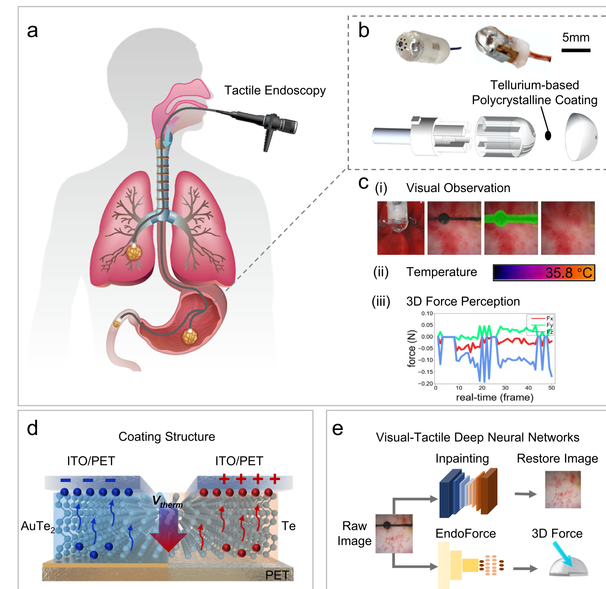
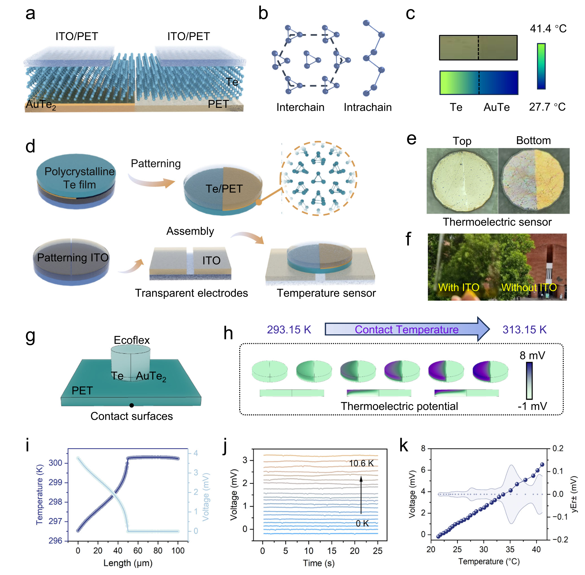
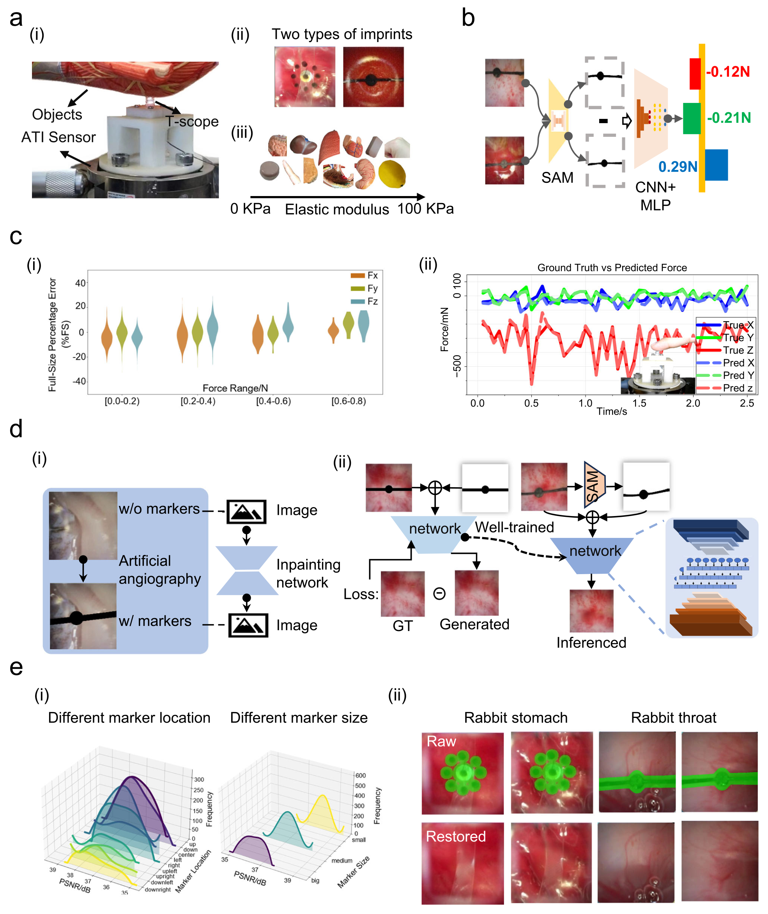
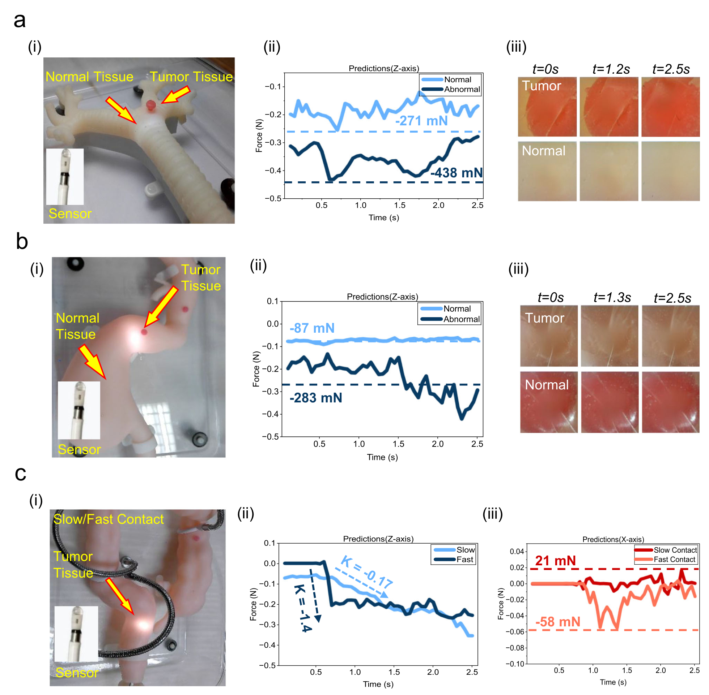
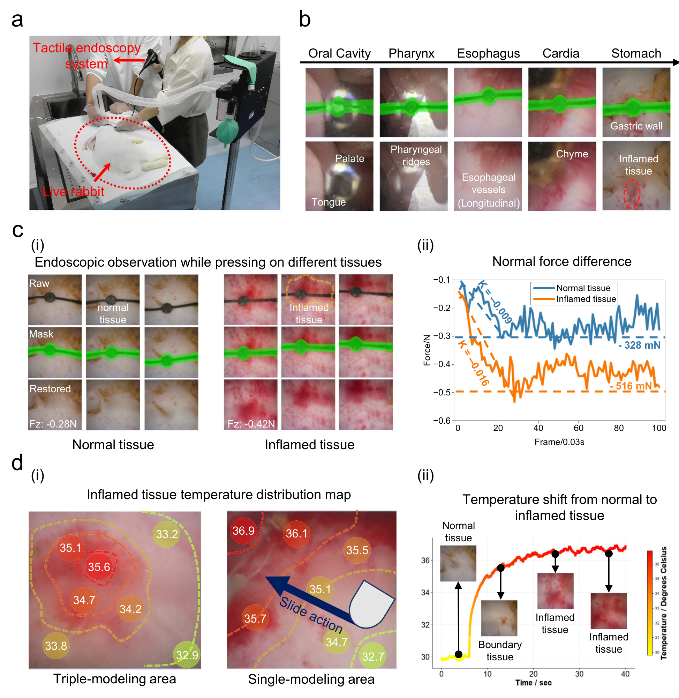

# Superelastic Tellurium Thermoelectric Coatings for Advanced Trimodal Microsensing 精读笔记

> **论文**：Superelastic Tellurium Thermoelectric Coatings for Advanced Trimodal Microsensing（面向先进三模态微感知的超弹性碲热电涂层）
> **作者**：Shaowei Cui、Linlin Li、Zi-Xin Huang（三人共同第一作者）；Yanzhe Yu、Mingxue Cai、Xiangyin Bao、Chaofan Zhang、Tiandong Zhang、Long Cheng、Wenxuan Zhang、Zheng Lou、Shuo Wang、Wen Gong、Chao-Feng Wu、Lili Wang、Yu Wang（通讯作者：Chao-Feng Wu、Lili Wang、Yu Wang）
> **期刊**：Nature Communications，2026; 17: 1612。DOI: [10.1038/s41467-026-68317-3](https://doi.org/10.1038/s41467-026-68317-3)
> **投稿时间线**：2025-08-24 收稿 → 2026-01-04 接收
> **单位**：中国科学院自动化研究所 多模态人工智能系统全国重点实验室；中国科学院半导体研究所 半导体物理与芯片技术全国重点实验室；武汉工程大学 电气信息学院；中国科学院深圳先进技术研究院；乌镇实验室 先进功能陶瓷研究中心；清华大学长三角研究院 先进陶瓷材料与器件研究中心
> **基金**：国家重点研发计划（2024YFB3212100）；北京市自然科学基金（L253006）；国家自然科学基金（62025307、62303455、U23B2038、U24A20282、U25A20455、62422409）；博士后创新人才支持计划（BX20240360）
> **开放获取**：**CC BY 4.0**（可自由复制、分发、改编，需署名）。© The Author(s) 2026
> **数据与代码**：原始数据存于 Zenodo（[10.5281/zenodo.18041502](https://doi.org/10.5281/zenodo.18041502)）；代码开源在 GitHub `tryallfailure/T-Scope`
> **利益声明**：作者声明无竞争性利益

---

## 一、一句话看懂这篇论文

**一句话**

在一个 **5 mm 粗、7.5 mm 长**的透明硅胶探头表面上，长了一层只有 **200 nm 厚**的碲（Te）薄膜，薄膜被刻成一片排列整齐的小圆点花纹。这层花纹同时干三件事：**①被人一压就变形，摄像头看着花纹怎么动，就能反推出"三个方向的力各有多大"；②碲的"塞贝克效应"把"接触的那一小块比周围热多少"直接变成毫伏级电压，于是它同时是个温度计；③花纹挡住的画面，交给 AI 从图像里"擦掉"，视线恢复干净。** 视觉、力觉、温度觉就这样共用同一块表面、同一个摄像头、同一片薄膜。

**为什么这件事值得发表（Nature Communications 是 Nature 旗下的综合性子刊）**

过去二十年，触觉内镜（tactile endoscope）已经能把"力"塞进内镜探头了——办法是在探头表面刻上小标记，用摄像头看标记怎么动。但**温度**一直塞不进去，原因是三种现成温度计都不合适：

- **红外测温**：要"看得见"被测表面，内镜视野里全是组织、镜头贴在组织上，根本谈不上；
- **热敏电阻（Pt、Cu 做的）**：要靠改变电阻来读数，需要恒流源、电桥、标定电路，信号又小，做不成一层薄膜贴在软胶上；
- **热电偶**：原理上最合适（自己发电、只测接触点），但热电偶的输出电压正比于**两端的温差**，而温差要靠"热慢慢传过去"来积累——所以传统的碲基热电偶必须做得**又长又大**才能攒出可用的温差，这跟"塞进 5 mm 探头"直接冲突。

> 这三条为什么各自不成立、每一步的物理和量级在哪里，**2.2 节会逐条拆开**——那是全文的"问题定义"，值得慢读。

本文的破局点是一句很硬的物理判断：**温差 = 热流 × 热阻，而热阻 = 长度 ÷（导热系数 × 截面积）。既然不能把长度做大，那就把"导热系数"做小。** 碲的晶体结构是一束束螺旋链，链与链之间靠很弱的范德华力堆着，热量（声子）在链间走一步就被散射一次——导热系数极低。于是哪怕只有 1 mm 的横向距离，也能撑住十几度的温差。再加上碲的塞贝克系数高达 **0.647 mV/K（647 μV/K，是块体碲的 2.6 倍）**，同样的温差能换来更大的电压。**"小"和"灵敏"这对天生的矛盾，被材料本身解开了一半。**

另外一半在网络：花纹虽然只有 5% 的面积，但它毕竟挡在镜头前面。作者没有去硬拼"更透明的材料"，而是训练了一个图像修复网络（inpainting），把花纹从画面里"擦"掉。**阅读这篇论文时最好早点接受这一点：材料解决了"测得到"，网络解决了"看得清"，两者各占一半功劳。**

**但这句话必须加三个限定**（这是我读完后的判断，论文没有这样写）

第一，**它测的不是"组织的绝对温度"，而是"接触处比旁边热多少"。** 塞贝克效应天生只认温差。论文的标定是在"热台 vs 室温"这个场景下做的，而真正使用时的环境是"37 °C 的组织 vs 37 °C 的体腔"。这两件事之间的桥，论文没有搭（第七章 7.2 节会算给你看：活体实验里所有读数都**低于兔子的体温**，这正说明它读的是"探头被捂热到什么程度"，而不是"组织多少度"）。

第二，**"力"不是直接测的，是从花纹形变反推的。** 同一个力，压在硬组织和软组织上，花纹的变形并不相同。网络是在 0–100 kPa 的材料上训练出来的，它学到的其实是"力 + 硬度"的联合分布。所以"炎症组织读数更大 ⇒ 炎症组织更硬"这个推理，有一半是训练集替它做出的（概念 11 和 7.2 第 4 条）。

第三，**活体实验只做了兔子胃**，而且"炎症"是人为用 4 天造出来的模型。支气管和肠道只在塑料体模里做过。它证明的是"这条路走得通"，不是"这已经能进手术室"。

---

## 二、背景与动机

### 2.1 先看清楚：内镜医生现在"看不见"什么

要理解这篇论文在补什么洞，得先知道**医生做一次胃镜时，手里和眼前到底有什么**。

一根胃镜是一根直径约 9–10 mm 的软管，里面塞着：光纤束（把光送进去、把图像送出来）、器械通道（2.8–3.2 mm，可以伸钳子、圈套器）、送气送水通道、以及控制前端弯曲的钢丝。医生看着屏幕，转动旋钮让管子前端在胃里拐弯，看到可疑的地方，就伸钳子夹一块下来送去化验——这一步叫**活检**。

**医生在屏幕上看到的，只有"颜色和形状"。** 他能看出这块黏膜红、那块发白、这里有个溃疡、那里鼓起来一个包。但**摸不到**。

而"摸"这件事，在医学上恰恰是极重要的：

> 两千年前古罗马的塞尔苏斯（Celsus）就把炎症的四个特征总结成四个拉丁词：**红（rubor）、肿（tumor）、热（calor）、痛（dolor）**。其中"热"一直排在前四位。

也就是说，**"这块组织比周围热"是一个和"红、肿"同样古老、同样可靠的诊断线索**，但内镜到今天也没法把它量出来。同样地，**硬度**也没有：乳腺外科医生用手指一摸就知道"这个包硬、像石头、推不动"，而内镜医生只能看。

| 缺口 | 具体表现 | 后果 |
| --- | --- | --- |
| **看不见"力"** | 探头压在黏膜上用了多大劲，医生只能靠手感猜；软管在胃里弯曲、摩擦，力的传递被稀释几十倍 | 按得太重 → 黏膜下出血、穿孔；按得太轻 → 探头贴不实，测不到东西 |
| **看不见"温度"** | 炎症区、肿瘤区的局部温度比正常组织略高，内镜完全测不到 | 早期炎症、早期病变"看着没事"，被漏掉 |
| **看不清"遮挡"** | 一旦在探头表面加了任何传感器/标记，挡住的画面就没了 | 视野残缺，医生不敢用 |

**这三个缺口有一个共同的根源**：内镜的本质是"**隔着一米长的管子看**"。开放的肚子上，外科医生的手指一按，硬度、温度、滑动感全部到手；内镜把这一切都拿掉了，只留下一个摄像头。

本文要做的，就是**把那根"会摸的手指"重新装回内镜前端，并且不让它挡住眼睛**。

### 2.2 为什么"温度"比"力"难塞进去得多

力好办。在透明硅胶表面刻几个小点，用摄像头看小点怎么动，就能算出形变——这条路线（**视觉触觉 / vision-based tactile sensing**）已经被做烂了，本文引用的 Tac-scope（Measurement 2024）就是代表。

温度难办，因为**温度不是"看得见的东西"**：它不能像形状那样被镜头直接记录，必须换成电信号或光信号才能读出来。而"换"这个动作，在内镜这种尺寸下会碰到一串硬约束。

#### （一）先立标准：什么样的温度计才"装得进"内镜

在评价三种方案之前，得先把"合格线"画出来，否则"不合适"就只是印象。下面五条是我从本文的设计反推出来的（论文没有这样列），但它们基本能解释后面所有的取舍：

| # | 约束 | 具体数字 | 违反的后果 |
| --- | --- | --- | --- |
| 1 | **尺寸** | 前端截面 4.8–5 mm；膜厚亚微米；单片面积 < 1 mm² | 装不进去 |
| 2 | **不挡光** | 探头前端就是镜头窗口，贴上去的东西全在视野里 | 视野残缺，医生不敢用 |
| 3 | **可弯、少引线** | 传感器长在软胶上，随探头弯曲、贴壁 | 焊点断裂、读数漂移 |
| 4 | **自发热要小** | 不能明显改变被测组织的温度 | 测到的是"自己造成的扰动" |
| 5 | **点式空间分辨** | 要能说"这 1 mm² 热不热"，而不是"整个视野平均多少度" | 只在宏观上有数，定位不了病灶 |

还有一条不是对器件的要求，而是这一场景特有的物理困难——**在体内，"绝对温度"几乎没有信息量**：

- 人的体温是 37 °C，体腔里的空气、黏液、邻近脏器也是 37 °C 上下；
- 探头伸进去几十秒，自己就被捂到接近 37 °C；
- 而炎症、肿瘤带来的局部温度升高，量级通常只有 **0.5–2 K**。

所以一个读数写着"37.0 °C"的温度计在这里什么也说明不了。真正有用的是**"接触的这一小块，比周围高了多少"**——也就是说，需要的本质上是**差分传感器**，不是绝对温度计。

> 这一点是理解全文的钥匙：热电偶恰恰天生就是差分的，这是它"原理上最合适"的根源；但也正因为它是差分的，本文最终测到的从来不是"组织多少度"（第七章会专门算这笔账）。

---

#### （二）第一类：红外测温——它测的不是"温度"，是"辐射"

**原理**：任何温度高于绝对零度的物体都在向外辐射红外线，温度越高，辐射越强，峰值波长越短。红外温度计 = 一个对红外敏感的探测器 + 一组把辐射聚到探测器上的光学件。它读到的是**视野内所有物体辐射的加权平均**，再按"假设的表面发射率"反推回温度。

用一句话概括它的原理和它的病根：**它测的是光，不是热；是平均，不是一点。**

**问题一：它需要一条"视线"。**

红外测温是隔着距离工作的：探测器 → 一段光路 → 被测表面。这段距离不是可选项，而是原理的一部分（没有光路就没有"视场"）。内镜要做触觉，就必须把探头**贴在黏膜上**；一旦贴上，这条视线就被自己堵死了——探测器看到的首先是探头自己的外壳。

这不是"调一调参数"就能解决的问题，而是**测量方式本身与使用方式冲突**。

**问题二：发射率。**

发射率（ε）是"这个表面有多会辐射红外"的比例：理想黑体 ε = 1，抛光金属可以低到 0.05，湿润的生物组织通常 0.95–0.98。红外测温靠"先假定一个 ε"把辐射强度换算回温度，所以 ε 估错多少，温度就跟着错。

算一笔账。辐射功率 P = ε × σ × T⁴，反解温度：

```
T ∝ (P / ε)^(1/4)
```

指数是 1/4，所以 **ε 估错 10%，温度只错约 2.5%**。听起来很宽容——但在 310 K 上，2.5% 就是 **7.8 K**。而炎症要测的温差是 1–2 K。**一个发射率的误差，就把信号整个淹掉了。**

更麻烦的是，内镜画面里从来不是一种材料：硅胶探头（ε ≈ 0.9）、黏液和水（ε 高）、血液（随干燥程度变）、伸进来的金属器械（ε 可以低到 0.1）。红外相机读到的是这些的混合，而**没有任何办法把混合里的 ε 分离出来**。

**问题三：视野平均，没有"点"。**

红外温度计给的是视场内一块区域的平均值。要测到 1 mm² 的点，探测器得像针孔一样小，可信号又随立体角下降——精度与分辨在这里是直接对立的。

**问题四：它要另占一条光学通道。**

5 mm 的前端里，成像光路、照明光纤、器械通道已经排满；再塞一个红外探测器加一组红外光学件，等于跟成像系统抢同一个空间。

**论文怎么说的**：非接触方法"avoids contact damage, but the measurement accuracy is limited"。注意它给的理由只有"精度"两个字；上面四条里，**视线冲突**和**视野平均**是我补的（论文没展开，但它们是同一件事的另一面）。

---

#### （三）第二类：热敏电阻——信号小到被电路本身的漂移淹没

**原理**：金属的电阻随温度升高而增大，而且在不太宽的温度范围内近似线性：

```
R = R₀ × [1 + α × (T − T₀)]
```

铂的 α ≈ 3.85 × 10⁻³ /K，意思是**每升高 1 K，电阻增加 0.385%**。

**问题一：这个数太小了。**

| 想分辨的温度 | 需要分辨的电阻变化 |
| --- | --- |
| 1 K | 0.385%（约千分之四） |
| 0.1 K | 0.0385%（约万分之四） |

而一根引线的电阻、一个焊点的接触电阻，它们自己随温度的漂移、以及每次弯折造成的接触变化，量级也在千分之一到百分之一。**"温度信号"和"电路噪声"挤在同一个量级里，分不开。**

要分开，就得动用一整套仪器：恒流源供电、精密电桥、四线制接法（用另外两根线单独测电压，把引线电阻减掉）、逐只单独标定。这套东西塞不进 5 mm 的软胶探头——而且就算塞进去，硬邦邦的电路板也把"能弯"这条约束违反了。

**问题二：必须通电，于是自发热。**

测电阻就必须让电流流过敏感元件。电流在元件上产生焦耳热 I²R，于是你测到的是"被自己加热过的温度"。要减小自热就得减小电流，可电流一减小，本来就只有万分之几的相对变化就更读不出来了——**又一对直接对立。**

**问题三：弯折会改变电阻（我补充的）。**

把铂膜做在软胶上，探头一弯，膜被拉伸或压缩，电阻也跟着变——这叫应变电阻效应，金属的应变灵敏系数大约 2。粗算一下：**0.1% 的弯曲应变 → 约 0.2% 的电阻变化 → 相当于 0.5 K 的"假温度"**。这个量级比要测的炎症温差的一半还大，而且它和真实的温度变化**完全无法从电阻读数上区分**。

论文没有讨论这一条。它意味着：即使电路做得再精密，"热敏电阻 + 柔性基底"这个组合本身就把力信号和温度信号焊在了一起——而这恰恰是本文最想避免的串扰（见概念 11）。

**论文的结论很干脆**：热敏电阻的"signal variation minimal and calibration circuits complex"，难以集成到柔性微探头上做视觉-触觉，它更**适合给微纳电子器件做温度漂移校准**。

这句话值得多停一秒：**它连自己的温漂都需要靠别人校准。** 一个专职"当标尺"的器件，是不可能被拿来当"被测对象"的。

---

#### （四）第三类：热电偶——原理最对，但"温差"是要攒出来的

**原理**：两种不同的材料接成一个回路，两个接点温度不同，回路里就会出现电动势——这就是塞贝克效应（详见概念 2、概念 3）。输出

```
V = (S_A − S_B) × (T_hot − T_cold)
```

**先说它为什么是"原理上最合适"的那一个**，对照上面的五条约束逐条看：

| 优点 | 为什么在内镜里重要 |
| --- | --- |
| **自己发电** | 不需要电源、不需要恒流源，也就没有 I²R 自发热（约束 4 直接满足） |
| **点式测量** | 读数就是那个接点所在位置的温度，天然 1 mm² 级分辨（约束 5） |
| **与温差线性** | 标定简单，不需要电桥和四线制 |
| **能做薄膜** | 磁控溅射 + 激光刻蚀即可，可以长在软胶上、跟着弯（约束 1、3） |
| **响应快** | 热容极小，能跟上毫秒级的变化 |

**然后是它唯一的死结：V 正比于温差，而温差不是天生就有的，是要"攒"出来的。**

热量从热端流向冷端时，两端之间才会拉开温度差。这个关系可以写成热学的"欧姆定律"：

```
ΔT = Q × R_th,    R_th = L / (k × A)
```

其中 Q 是经过的热流，R_th 是**热阻**（热量通过这一段有多费劲），L 是热流走过的**长度**，A 是**截面积**，k 是材料的**导热系数**。

把它合起来：

```
ΔT = Q × L / (k × A)
```

三个旋钮：**做长、做细、用导热差的材料**。现在把"器件要小"这个约束代进去：

- A 变小 → 热阻变大 → 对攒温差**有利**（但同时能流过的热流 Q 也变小）
- L 变小 → 热阻变小 → 对攒温差**不利**

净效果是：**把热电偶做短，温差就攒不起来，信号跟着掉。** 这正是论文那句原话的意思——碲基热电偶"typically require larger longitudinal or lateral dimensions to achieve greater temperature differentials"；而做大之后又"impacts signal acquisition and reconstruction in tactile sensing"：一块指甲盖大的陶瓷热电偶，会把探头表面那点可怜的面积全占掉，还挡视野。

算一笔账（**我做的粗估，只看数量级**）：取 k = 1 W/(m·K)、A = 1 mm²、L = 1 mm，则 R_th = 10³ K/W；若有 1 mW 的热流经过，ΔT 只有约 **1 K**。

| 改一个旋钮 | R_th | 1 mW 热流下的 ΔT |
| --- | --- | --- |
| 基准：L = 1 mm，k = 1 | 10³ K/W | 1 K |
| 把 L 加到 1 cm（**做长**） | 10⁴ K/W | 10 K |
| 把 k 降到 0.1（**换材料**） | 10⁴ K/W | 10 K |

**同样拿到 10 K，一条路是"把器件做大十倍"，另一条路是"把材料导热降十倍"。前者与"塞进 5 mm"直接冲突，后者才是本文走的路。**

再叠上塞贝克系数这一层。块体碲的塞贝克系数约 **249 μV/K**（由本文实测的 647 μV/K 除以 2.6 反推），1 K 温差只换 0.25 mV。而本文的 200 nm 多晶碲膜实测 **647 μV/K**，在 39 °C 接触、25 °C 环境下输出 **5.5 mV**——反推膜上实际拿到的温差约 8.5 K，输出比"块体碲 + 1 K"大二十多倍，而器件面积小了不止一个量级。

**还有一个必须提的尾巴：冷端。** 热电偶只认温差，所以永远要回答"冷端是多少度"。在内镜里，冷端就是膜上远离接触处的那一端，温度≈体腔温度。这在医学上其实正合适——医生想问的本来就是"这块比周围高多少"。但它同时埋下了本文最大的一个坑（概念 4 和第七章会专门拆）：**它测的从来不是组织的绝对温度。**

---

#### （五）三者的共同死结

把三种方案摆在一起，会看到一个反复出现的结构：

> **温度必须先被"翻译"成电信号或光信号，而翻译出来的强弱，取决于传感器的物理尺寸。内镜把尺寸压死，翻译就被掐死。**

| | 红外 | 热敏电阻 | 热电偶 |
| --- | --- | --- | --- |
| 靠什么"翻译" | 热辐射 → 光强 | 温度 → 电阻变化 | 温差 → 电动势 |
| 信号强度正比于 | 视场立体角 × ε | R₀ × α × ΔT | S × ΔT |
| 器件做小之后 | 立体角变小，信号掉 | 相对变化不变，但被电路噪声淹没 | 温差变小，信号掉 |
| 真正的瓶颈 | 光路长度 | 电路精度 | **热阻** |
| 论文的一句话评价 | 精度受限 | 信号小、电路复杂 | 原理对，但**要大** |

**统一成一句话**：前两类是"翻译工具本身太笨重"，第三类是"翻译工具很轻巧，但需要原材料（温差）够多"。

于是材料学的解法只剩两条，而且它们不冲突：

1. **把 k 做小**——在同样短的路径上攒出更大的温差；
2. **把 S 做大**——同样大的温差换出更大的电压。

**本文两条同时走，而且用的是同一种材料。**

---

#### （六）本文从哪儿切这一刀

碲的晶体结构是一束束螺旋链：链内的原子靠共价键紧紧咬住，链与链之间只靠很弱的范德华力堆着。热量在固体里主要靠**晶格振动**（声子）传递，而声子在链与链之间每跨一步就被散射一次——于是碲的**晶格热导率很低**：热量不容易沿膜面跑掉，接触点攒起来的热就留在原地，形成陡的温度梯度。

论文对此有一个很漂亮的内建对照：把同样的结构、同样的工况换成 **AuTe**（金碲合金，导热、导电都很好），温度分布立刻被拉平——因为热量一进来就迅速摊开了，"攒"不出梯度；而换成 Te，在 40 °C 接触时膜上能撑起约 10 K 的梯度。**同一台器件，只换材料，梯度就没了**——这把"温差来自材料"这件事直接钉死。

再配合 200 nm 多晶薄膜的高塞贝克系数（647 μV/K，块体的 2.6 倍），小尺寸下的输出从"微伏级"抬到了"毫伏级"。

把这两个因子代回 ΔT = QL/(kA) 和 V = S·ΔT：**k 小 → ΔT 大；S 大 → 同样的 ΔT 换更大 V。两个因子朝同一个方向使劲**，这就是"200 nm 的膜凭什么能当温度计"的完整答案。

---

#### （七）一个补充的追问：真的只有这三种方案吗（我的补充）

论文在引言里只否定了三类：红外、热敏电阻、热电偶。严格说，还有若干路线没被摆上台面，其中最该被问一句的是**光纤荧光测温**（在光纤尖端涂一层荧光材料，用激发光去打，看余辉衰减多快；GaAs 晶体、红宝石都是常用材料）。

它其实能满足好几条约束：探头可以细到百微米级、本质安全、抗电磁干扰。**但**它同样要占用光学通道——一根激发光纤、一套分光与探测，在 5 mm 的前端里和成像光路抢位置；而且荧光材料的余辉衰减对弯曲、漂白、温度区间都敏感。

所以我倾向于认为作者略去它**不算隐瞒**，只是"它仍然要额外一套光路，解决不了本文真正在意的那件事——三种感官必须共用同一块表面"。但这个论证论文没有给出，是读的时候应该自己补上、或者在讨论时问出来的一句。

### 2.3 触觉内镜这条线，已经走到哪一步

把这条研究线按时间捋一遍，就明白本文站在哪：

| 阶段 | 代表工作 | 能力 | 缺什么 |
| --- | --- | --- | --- |
| 第一代 | 电子皮肤式贴片（压阻/电容） | 能测力 | 不透明，挡住视野；引线多；只能测"有没有压到" |
| 第二代 | **视觉触觉**（表面刻标记 + 摄像头） | 能测三维力、分辨率高、抗电磁干扰 | 标记挡视野；标记在复杂组织背景下难分割 |
| 第三代 | 视觉触觉 + 深度网络（如 Tac-scope） | 标记被网络识别，能算力 | 仍然**没有温度**；标记仍然挡视野 |
| **本文** | 视觉触觉 + **碲热电薄膜** + **修复网络** | 力 + **温度** + **恢复视野** | 见第七章 |

**关键的一步棋是"让温度传感器和触觉标记变成同一个东西"。** 如果温度传感器是一层额外的膜，它必然又挡一次光、又多一层厚度、又多一套引线。本文的办法是：**碲薄膜本身就被刻成花纹**——花纹既是"给摄像头看的标记"，又是"测温的电极"，还是"透明的"。一个器件，三种身份。

### 2.4 本文的破局点，用一张图说清

```
   传统做法：三样东西抢同一块地方
   ┌────────┬────────┬────────┐
   │ 摄像头 │ 温度计 │ 触觉标记│   ← 互相遮挡、互相增厚
   └────────┴────────┴────────┘

   本文做法：三样东西叠成一层
   ┌───────────────────────────┐
   │  5 mm 透明硅胶半球         │
   │  ├ 碲薄膜花纹  ← 触觉标记  │
   │  │            ← 温度电极  │
   │  │            ← 半透明    │
   │  └ AI 把花纹"擦掉" ← 视野  │
   └───────────────────────────┘
```

### 2.5 一句话概括本文的定位

> **它把"热电偶"从实验室里一块指甲盖大的陶瓷片，压缩成一层 200 nm 厚、长在软胶上的花纹，然后用深度学习把"花纹挡视线"这个副作用补掉——于是内镜第一次同时拥有了视觉、三维力觉和温度觉，尺寸只有 5 mm。**

---

## 三、核心概念：读懂这篇论文需要的全部前置知识

这一章是为"完全没有物理和工程背景"的读者写的。**每一个概念都从零开始**，用日常经验搭桥，最后落到论文里那张具体的图上。如果你只想知道结论，可以直接跳到第四章；但第四章里几乎每一句话都建立在这一章上。

### 概念 0：先把全文的物理链条画成一条线

在读任何一个细节之前，先把整台器件"怎么运转"压缩成一张图。**这张图就是全文的骨架**：

```
【第一步：热从哪来】
   人体组织（约 37 °C）
        │  探头压上去，热量从组织往探头里流
        ▼
【第二步：温差在哪建立】
   碲薄膜：左半边是 AuTe₂，右半边是纯 Te
   碲的横向导热极差 → 温差集中在薄膜里，不被抹平
        │  得到一个几十微米到一毫米尺度上的 ΔT
        ▼
【第三步：温差怎么变成电压】
   塞贝克效应：两种材料在同样温差下"堆"出的电压不一样
        │  V = (S_Te − S_AuTe) × ΔT
        ▼
【第四步：怎么读出来】
   两端各接一片透明 ITO 电极 → 引到外面的电压表
        │  毫伏级电压，线性正比于"接触温度 − 环境温度"
        ▼
【第五步：同时，力怎么来】
   探头表面还刻着一片小圆点花纹
        │  压、推、扭 → 圆点位移 → 摄像头看到
        ▼
【第六步：力怎么算出来】
   分割出圆点 → 和"没接触时"比 → 只留位移 → 神经网络 → Fx, Fy, Fz
        │
        ▼
【第七步：视野怎么恢复】
   把圆点从画面里"擦掉"，用周围组织纹理补上
        │
        ▼
   医生看到：干净的画面 + 温度数值 + 三维力曲线
```

**这条链里只有两个真正的物理现象**：热在材料里的传导（第二、三步），和塞贝克效应（第三步）。其余全是工程——材料怎么做薄、电极怎么做透明、网络怎么训练。

**记住这条链，后面每一张图都只是它的某一段特写。**

---

### 概念 1：温度是什么，热是怎么流动的

**温度**是"微观粒子抖得多厉害"的度量。你摸到一杯热水觉得烫，本质上是水分子撞你手指的皮肤，撞得越猛、频率越高，你就觉得越烫。所以温度不是"一种东西"，而是**一种运动状态的刻度**。

**热**不是一种可以"装"的流体（虽然古人这么以为）。热是**能量从高温处流向低温处的过程**。只要两边温度不一样，能量就会自发地从热的那边跑到冷的那边，直到两边一样为止。

这个"跑"的过程，可以用一个和电学完全平行的模型来算——**这是理解整篇论文最关键的一个类比**：

| 电学 | 热学 | 单位 | 直觉 |
| --- | --- | --- | --- |
| 电流 I | **热流 Q** | 瓦特（W） | 每秒流过去多少能量 |
| 电压差 V | **温差 ΔT** | 开尔文（K）或摄氏度（°C） | 两端差多少 |
| 电阻 R | **热阻 R_th** | K/W | 这条路有多"难走" |
| **I = V / R** | **Q = ΔT / R_th** | — | 同一条欧姆定律 |

**电阻由什么决定？** 导线越长越难走、越粗越好走、材料本身的电阻率越大越难走：

```
R = ρ × L / A        （电阻 = 电阻率 × 长度 ÷ 截面积）
R_th = L / (κ × A)   （热阻 = 长度 ÷ (导热系数 × 截面积)）
```

其中 **κ（读作"卡帕"）是导热系数**，单位 W/(m·K)，意思是"每米长、每平方米截面、每差 1 K，每秒能流过去多少瓦"。它是材料的一个固有属性：

| 材料 | κ（W/m·K） | 说明 |
| --- | --- | --- |
| 铜 | ~400 | 极好的导热/导电体（散热器） |
| 硅 | ~150 | 芯片衬底 |
| 玻璃 | ~1 | 一般 |
| **碲（Te）** | **~2（面内，且强各向异性）** | **本篇的主角：在"晶体"里算很差的导热体** |
| PET 塑料 | ~0.2 | 隔热 |
| 硅胶（Ecoflex） | ~0.2 | 隔热 |
| 空气 | ~0.026 | 最好的隔热体之一 |

**把这条定律代进"热电偶"的处境，就得到了全文最关键的一句话**：

> **在热流 Q 相同的条件下，导热系数 κ 越小，能撑起的温差 ΔT 越大。**

换句话说：**导热差的材料，最擅长"身上挂着温差"。** 热量在它身上走不动，于是在它的两端积起一个温差，像水流被堵在窄管里，水压差就大。

**这就解释了整个设计的逻辑**：

```
传统热电偶：材料导热还行 → 只能靠"做长"来增加热阻 → 必须做大
本文碲薄膜：材料导热极差 → 长度只有 1 mm 也能有足够热阻 → 可以做小
```

**注意一个容易忽略的点**：这里的"长度"不是薄膜的**厚度**（200 nm），而是**两个电极之间的横向距离**（约 1 mm）。第七章 7.2 第 10 条会给一笔账，说明为什么厚度方向根本撑不住这个温差。

---

### 概念 2：温差怎么变成电压——塞贝克效应

这是全文唯一的物理核心。分四步讲。

**第 1 步：金属和半导体里有一群"可以到处跑"的电子**

一块金属不是"钉死"的原子堆。原子核固定在晶格里，但每个原子还贡献出 1–2 个电子，这些电子可以在整块材料里自由移动——就像一锅水里的分子，或者一箱子滚来滚去的小球。**能导电，就是因为有这群自由电子。**

**第 2 步：热的地方，电子跑得快，会往冷的地方"扩散"**

温度就是"平均跑得多快"。所以一块材料如果左端热、右端冷：左端的电子平均跑得快，像个精力旺盛的人往人群里挤；右端的电子跑得慢。

结果是——**左端的电子净往右跑**（速度快的更容易穿过中间那道线）。于是：

```
       热端                     冷端
      (电子跑得快)            (电子跑得慢)

     ○→  ○→  ○→  │  ←○  ←○  ←○
     ○→  ○→  ○→  │  ←○  ←○
        ↑                ↑
     电子跑掉了      电子堆积了
     带正电           带负电
```

**第 3 步：电荷一分开，就自己造出一个电场，把自己拉回来**

左端少了电子 → 带正电；右端多了电子 → 带负电。这两端之间就有了一个电场，方向是从正指向负，它会把往右跑的电子往回推。**扩散（想让电子往冷端跑）和电场（不让它们跑）达到平衡时，两端就稳定下来了，这个稳定的电压差就是塞贝克电压。**

**第 4 步：把它写成一个公式**

```
        V = S × ΔT

  V   两端电压（伏特 V，实际是毫伏 mV）
  ΔT  两端温差（开尔文 K）
  S   塞贝克系数（Seebeck coefficient），单位 V/K，习惯用 μV/K
```

**S 是材料的固有属性**，表示"每差 1 K，这个材料能堆出多少伏"。它的量级差别巨大：

| 材料类型 | S 的量级 | 例子 |
| --- | --- | --- |
| 普通金属 | 几 μV/K | 铜 ~1.8 μV/K |
| 半金属/合金 | 几十 μV/K | 镍铬 ~20 μV/K |
| **半导体** | **几百 μV/K** | **碲块体 ~250 μV/K；本文薄膜 647 μV/K** |
| 强关联/拓扑材料 | 可上千 μV/K | Bi₂Te₃ 系热电材料 |

**这就是为什么选半导体而不是金属**：同样 1 K 的温差，金属给你几微伏，半导体给你几百微伏。**差了 100 倍。**

**本文的 S = 0.647 mV/K = 647 μV/K**，是块体碲的 2.6 倍。所以：

```
   温差 10 K  →  电压 6.47 mV
   温差 1 K   →  电压 0.65 mV
```

毫伏级——这正好是普通电压表、甚至单片机自带 ADC 能直接读的量级。**不需要放大器，这是这个设计非常漂亮的一点**：整个探头只引出两根电极，不需要任何前端电路。

---

### 概念 3：为什么"必须是两种材料"——热电偶到底在读什么

这是一个几乎所有人第一次接触热电偶时都会卡住的地方。

**问题**：如果你有一块碲，两端温度不同，产生了电压。你想量这个电压，怎么办？

**你会拿两根导线把两端接到电压表上。** 但——**这两根导线本身也是材料，它们的两端也可能有温差，也会产生自己的塞贝克电压。**

```
       热端 T_h                        冷端 T_c
    ┌──────────碲──────────┐
    │                      │
    ●──导线 A──→ 电压表 ←──导线 B──●
```

电压表读到的其实是**一整条回路上的电压总和**。而在一整条回路上，两端的接点温度分别是 T_h 和 T_c，中间所有材料的塞贝克电压会**互相抵消掉一部分**，最后只剩下：

```
        V_读出 = (S_A − S_B) × (T_h − T_c)
                 ↑
         两种材料的塞贝克系数之差
```

**这就是热电偶（thermocouple）的全部秘密，也解释了三件事：**

1. **为什么必须两种材料**：如果 A 和 B 是同一种材料，S_A − S_B = 0，读数是零。**没有材料差，就没有信号。**
2. **为什么叫"偶"（couple）**：一对材料，两个接点。一个接点放在你要测的地方（**热端 / 测量端**），另一个接点放在一个温度已知的地方（**冷端 / 参考端**）。
3. **为什么热电偶不需要电源**：它是**自发电**的——温差本身就驱动了电荷分离。这也是它比热敏电阻优越的地方（热敏电阻必须通电流）。

**回到本文**：图 1d 里的结构，左半边是 **AuTe₂**（金的碲化物），右半边是**纯 Te**。这就是"两种材料"：

```
   ┌────────────┬────────────┐
   │   ITO 电极  │   ITO 电极  │   ← 两个"冷端"
   ├────────────┼────────────┤
   │   Te        │   Te        │
   │   ────────  │             │
   │   AuTe₂     │             │   ← 两种材料的分界在这
   └────────────┴────────────┘
            ↑
       热量从下方（组织）进来
```

**AuTe₂ 那一段和 Te 那一段，在同一个温差下堆出的电压不一样，差值就是读数。**

---

### 概念 4：热电偶测的是"温差"，不是"温度"——本文最大的一个坑

把概念 3 的结论再往前推一步，会得到一个不太舒服的结论：

> **热电偶永远不知道"某一个点有多少度"。它只知道"热端比冷端高多少度"。**

因为 V = (S_A − S_B) × (T_h − T_c)，如果你不知道 T_c，你就没法从 V 反推出 T_h。这个 T_c 就是所谓的**"冷端补偿"**问题——所有用热电偶的仪器都必须解决它（比如用另一只温度计测冷端温度，再算回来）。

**这在实验室里是小事，在人体里是大事。** 想想看：

| 场景 | 热端 | 冷端 | 结果 |
| --- | --- | --- | --- |
| **论文的标定**（图 2k） | 热台，20–40 °C | 空气，约 25 °C | 温差 = 接触温度 − 25 °C，标定成立 |
| **真实的体内使用** | 组织，约 37 °C | **体腔里的空气/器械，也接近 37 °C** | 温差远小于标定时，且随位置、时间漂移 |

**这就是为什么第七章会重点批评这一点**：论文的标定曲线是"电压 vs 接触温度"，但那条曲线里偷偷藏着一个前提——**冷端永远是 25 °C 的室内空气**。内镜伸进 37 °C 的胃里，这个前提就不成立了。

**一个具体的数字感受**：论文说"加热到 39 °C 时输出 5.5 mV"。用 0.323 mV/K 反推：5.5 ÷ 0.323 ≈ 17 K。39 − 17 = 22 °C。**也就是说，这条标定曲线的"零点"大约在 22 °C 的室温。** 到了体内，如果冷端也是 37 °C，那真正的温差就只剩组织局部的差异（几度），输出会掉到零点几毫伏。

**这不是说数据是假的**，而是说：**"5.5 mV 对应 39 °C"这句话，只在"冷端 22 °C"的条件下成立。** 读任何一篇热电偶论文，都要先问一句：冷端在哪？

---

### 概念 5：为什么是"碲"——一种元素的三重身份

**碲（Tellurium，符号 Te）**是元素周期表第 52 号元素，和第 16 族的氧、硫、硒同一列。它是一种**窄带隙半导体**，室温下呈银灰色，很脆。

**它的晶体结构很特别，值得单独看（图 2b）：**

```
    沿 c 轴（链的方向）              垂直方向
    ┌───┐                            ┌───┐
    │ ╱ │  ← 螺旋链：原子沿螺旋线   │   │  链与链之间
    │╱  │     一圈圈往上盘          │· ·│  只有很弱的
    │   │                            │   │  van der Waals 力
    └───┘                            └───┘
     链内：强共价键                   链间：弱作用
```

用日常语言说：**碲是一捆"用胶水粘在一起的钢丝绳"，而不是一块实心的铁。** 沿着绳子方向（链内），原子用强共价键连着，振动可以顺畅地传下去；但从一捆绳子跳到另一捆（链间），中间只有范德华力——极弱，像隔着一层空气。

**这带来三个后果，本文三个都用上了：**

**① 导热系数极低（这是"能测温差"的原因）**

热量在绝缘体/半导体里主要靠**声子**传递——声子可以粗略理解为"原子集体振动的波包"。它在链内走得顺，一跨链就被散射。**散射越多，导热越差。** 于是碲的晶格导热系数在晶体里算很低的（面内约 2 W/m·K 量级，远低于硅的 150）。

**② 塞贝克系数高（这是"信号大"的原因）**

碲是半导体，载流子浓度低。回忆概念 2 的表：**半导体比金属的 S 高两个数量级。** 本文薄膜测到 0.647 mV/K，是块体的 2.6 倍。

> **这里有一个论文没有解释的地方**：为什么薄膜的 S 比块体高 2.6 倍？论文只把它归到补充材料 Fig. S6，正文没有给机理。常见的原因包括：薄膜的晶粒取向更一致、晶界散射改变了载流子输运、或者衬底应变改变了能带。**这是一个"结果可信、机理不明"的数字**，读的时候心里有数就行（这是第 7.2 节第 11 条）。

**③ 半透明（这是"不挡视线"的原因）**

碲在可见光区有吸收，但**只要膜足够薄（50 nm），透过率就还可以**。图 2e 里那片直径 1 mm 的圆片，看上去是黄绿色的、能透光的。

**"碲"的三重身份，正好对应本文要做的三件事**：低导热 → 能测温差；高塞贝克 → 信号够大；薄膜 → 能透光。**一个元素，解决了三个互相矛盾的需求。**

> **顺带说一句"超弹性"**：标题里的 superelastic 容易让人想到形状记忆合金那种"超弹性"。论文没有定义这个词。我的理解是：这层薄膜贴在一层 Shore 10A 的极软硅胶上，跟着硅胶一起被压扁、拉伸、回弹而不开裂——"弹性"指的是**涂层能承受大形变**，不是指某种特殊的力学机制。读的时候别被这个词带偏。

---

### 概念 6："变薄"为什么反而是一个难题——厚度与灵敏度的权衡

这一节是整个设计里最"反直觉"的地方，值得单独讲清楚。

**先看一个事实**：热阻 R_th = L / (κ·A)。如果你把薄膜做薄（L 变小），热阻就变小，**温差也就变小，信号变弱**。

```
   R_th = L / (κ·A)

   厚度 L 从 10 μm 减到 200 nm（缩小 50 倍）
   → 热阻也缩小 50 倍
   → 同样热流下，温差缩小 50 倍
   → 信号缩小 50 倍
```

**这就是为什么薄膜热电偶很难做：你为了"薄、透明、不挡形变"把厚度砍掉两个数量级，代价是温差也跟着砍掉两个数量级。**

论文的原话是他们的结构"**reduces the trade-off between thickness and responsivity**"（缓解了厚度与响应度之间的权衡）。他们靠的是什么？**仍然是"低导热系数"这一个杠杆**：κ 小，就能在 L 已经很小的情况下，把热阻拉回来一部分。

**先回答一个几乎每个人第一次读都会卡住的问题：测温，为什么还要"给热量"？**

因为热电偶测的**不是温度，是两点之间的温度差**；而温度差不会自己长出来。平衡态下，挨在一起的东西温度必然相同（热力学第二定律）；把两种材料在同一个温度下接起来，输出电压就是 **0**。

所以在接触式测温里，**热量必须流动**：热从被测对象流进探头，再从探头流向更冷的外壳或空气。正是这个热流，在传感器的"热阻"上砸出一个温度差。

```
   被测对象 T_hot ──热流 Q──→ 传感器（热阻 R_th）──→ 外壳 / 空气 T_cold

       ΔT = Q × R_th        ← 热流越强、热阻越大，温差越大
```

没有热流 → 没有温差 → 没有电压。**"测温"这个动作本身，就是在允许热量流过自己。**

顺带说，这也解释了论文标定方式的选择：标定时用"42 °C 热台 vs 室温"，驱动温差有十几度；而活体实验里读数**全部低于兔子体温**，因为那里的驱动温差小得可怜（这一条在第 7.2 节展开）。

另外要纠正一个常见的误解：**温差长在两个"位置"之间，不是长在两种"材料"之间。** 换一种材料，改变的是"每 1 K 温差能换多少电压"（也就是塞贝克系数），而不是温差本身。温差由热设计（热流 × 热阻）决定，材料只决定换算率。

**但这里必须算一笔账，否则会读错整篇论文。** 假设 8.5 K 的温差真的落在 200 nm 厚的膜上（因为 0.647 mV/K × 8.5 K ≈ 5.5 mV，正好是论文在 39 °C 时的读数）：

```
   要在这层膜的两面之间建立 8.5 K 的温差，需要多大的热流？

   R_th = t / (κ·A)
        = 200×10⁻⁹ m / (2 W/m·K × 7.85×10⁻⁷ m²)     ← A = π×(0.5 mm)²
        ≈ 0.13 K/W

   Q = ΔT / R_th = 8.5 / 0.13 ≈ 65 W
```

**65 瓦。** 这个数字有多大？一个小电烙铁的功率。**注意：这是一个"反证用的数字"，不是说器件需要消耗 65 W 的电。****如果真有 65 W 的热量从 1 mm² 的面积上灌进探头，组织会被烧焦。**

所以结论是：**这 8.5 K 的温差不可能落在 200 nm 的厚度方向上。**

**那它落在哪？落在横向。** 两种材料的两个电极之间隔着约 1 mm，热量沿着这 1 mm 的碲膜横向传递：

> **先把方向词钉死，避免读串**：本篇里
> - **穿膜方向**（"垂直"）= 穿过那 200 nm 的厚度，尺度 10⁻⁷ m；
> - **面内方向**（这里叫"横向"）= 沿膜面从一个位置到另一个位置，尺度 10⁻³ m，也就是约 1 mm。
>
> 如果你习惯把"沿着器件走"叫"纵向"，那么"面内 = 纵向"——**我们说的是同一个方向**，只是叫法不同。真正要区分的只有一件事：**产生电压的那段温差，是沿 1 mm 的面内，不是穿 200 nm 的厚度。**


```
   R_th = 1 mm / (κ × 宽度 × 厚度)
        = 1×10⁻³ m / (2 × 1×10⁻³ m × 200×10⁻⁹ m)
        ≈ 2.5 × 10⁶ K/W

   Q = 8.5 / 2.5×10⁶ ≈ 3.4 μW
```

**3.4 微瓦。** 这个数字就非常合理了——组织接触面上的自然漏热就是几十微瓦到几毫瓦的量级。

**有人会问：既然碲膜这么薄，横向导热会不会反而变好？**

不会。一般规律是**越薄越差**，不是越好。

- 声子在材料里走一段就会散射一次，这段距离叫"平均自由程"。当膜厚小于它时，**上下两个表面成了额外的散射面**，κ 随之下降。
- 溅射得到的多晶膜还有一道额外的关卡：**晶界**。晶粒越细、边界越多，声子被拦住的机会越大。200 nm 的溅射膜，κ 通常比同成分的块体单晶更低。

所以"做薄"对 κ 是**减分**，和"做短"的损失是叠加的，不是相互抵消。

**但有一处措辞要先纠正**：200 nm 不是"二维"。单层碲只有约 0.6 nm 厚，200 nm 相当于三四百层。所谓"二维材料"那一套（量子限域、声子色散的重整）在这里不适用；这一层的 κ 更接近"多晶块体"，也就是上面用到的 ~2 W/(m·K) 量级。

**也有一个方向相反的可能，值得追问（我的补充）**：碲是强各向异性的——**螺旋链的方向是"快车道"**，垂直于链的方向是"慢车道"。溅射膜往往带织构；如果链恰好沿面内排列、并且顺着热流路径，面内 κ 就会朝快车道的值靠，也就是"变好"。

问题是：**论文既没有报织构，也没有报任何一个 κ 数值。** 正文里的"低导热"是从温度场图（图 2c）和图 2h 的仿真反推出来的，不是测出来的。

**不过这个论点对 κ 的具体取值并不敏感**：把 κ 从 2 改成 4，R_th 减半，要撑住同样的 8.5 K 只需要 6.8 μW 的漏热——仍然落在"几十微瓦到几毫瓦"的合理区间。也就是说，**在这个设计里 κ 差两倍不改变结论**；真正起决定作用的是"截面只有 200 nm × 1 mm"这件事。

**所以正确的图景是：**

> **热量从接触点渗进来，沿着薄膜横向走 1 mm，因为路上的热阻巨大（碲导热极差 + 截面只有 200 nm 厚），一路走一路降温，于是"接触端"和"远端"之间就撑起了十几度的温差。电压就是在这段横向路径上、尤其是两种材料的交界处产生的。**

**这也解释了图 2i 的形状**：纵轴那条台阶式下降的电压曲线，台阶的位置正好在两种材料的交界处（约 45 μm 处）——**电压是在"材料变了"的地方一次性产生的**，而不是均匀分布的。

**这个账算出来的那个结论很值得记住**：因为这个设计的温差是靠"漏热"撑起来的，所以它对**任何一点额外的漏热**都极其敏感——比如灌洗液、比如器械贴着管壁、比如探头在胃里被液体包住。**这是它脆弱的地方，而论文没有讨论。**

---

### 概念 7：AuTe₂ 在里面干什么——"另一条腿"

概念 3 说清楚了：热电偶必须有**两种**材料。本文的第二种材料是 **AuTe₂**（二碲化金），它是把金膜和碲膜叠在一起、再用激光在交界处"烧"出来的（方法里写的是"激光烧蚀在 Au–Te/Te 界面定义出直径 1 mm 的圆形热转换单元"）。

它在器件里承担三份工作：

| 身份 | 做什么 | 为什么重要 |
| --- | --- | --- |
| **另一条腿** | 提供与 Te 不同的 S，让"差值"不为零 | 没有它，V = 0，整个温度通道不存在 |
| **欧姆接触** | 高电导，把载流子顺畅地引到电极 | 降低串联电阻，避免信号被内阻"吃掉" |
| **热学对照** | 论文原话：AuTe"由于高导热和高电导，保持均匀的温度分布" | 与 Te 侧形成对比，**放大**了温差 |

**最后一条最值得注意。** 它说的其实是：

```
   同样的热流进来
   ┌─────────────┬─────────────┐
   │   AuTe₂     │      Te     │
   │  导热好      │   导热差     │
   │  温度均匀    │   温度落差大  │
   │  ────────   │      ╲      │
   │  ────────   │       ╲     │
   └─────────────┴─────────────┘
       整片一个温度      从一端到另一端一路降温
```

**但这句话必须说准，否则会推出一个错误结论。**

两种材料的导热差**不是在"制造"温差，而是在"分配"温差**：

- **温差存不存在**，由热流决定。热从接触点流向冷端；没有热流，整片同温，什么材料都制造不出温差。
- **温差落在哪一段**，由材料决定。热流串联经过 Te 段和 AuTe₂ 段，而 R_Te ≫ R_AuTe₂，于是绝大部分温降落在 Te 那一段，AuTe₂ 段几乎是平的。

所以温度剖面是一段陡、一段缓的**折线**，而不是在交界处突然断开——**两种材料接触的地方温度是连续的**（不然那一薄层就要承受无限大的热流）。图 2h 里看到的正是"坡度突然变缓"，不是"温度跳变"。

**那两种材料到底提供了什么？提供的是"换算率"，不是温差。**

电压只在 S 发生变化的地方才累积出净差值。一条腿如果通体同料，绕一整圈 ∮S·dT = S·∮dT = 0——**温差再大，输出也是零**。这才是概念 3 里"必须两种材料"的真正原因。

一句话：

> **温差来自热流，电压来自材料差。两者缺一不可。**

**这个设计真正聪明的地方**：传统热电偶靠"把腿做长"来攒温差；本文用材料的不对称性，把温降**集中**到 Te 那一段上，于是短得多的距离也能拿到同样的温差。

> **一个措辞上的小坑**：论文里 **AuTe** 和 **AuTe₂** 两个写法混着用——结构图（图 2a、2h）写 AuTe₂，正文和部分图注写 AuTe。严格说，AuTe₂ 是一个确定的化合物（二碲化金），AuTe 更像"金碲合金/界面相"的笼统说法。这不影响理解，但你如果去查文献会发现对不上（见附二）。

---

### 概念 8：ITO 是什么，为什么电极必须是透明的

**ITO = 氧化铟锡（Indium Tin Oxide）**。它是一个很特殊的材料：**既导电，又透明**。

普通导体（金属）都不透明——金属里的自由电子会吸收可见光，所以金、银、铜做成膜都是"反光"的、不透明。ITO 是**掺杂的宽带隙半导体**：带隙很宽（约 3.5 eV），可见光的光子能量（1.6–3.2 eV）不够把它激发起来，所以大部分光直接穿过去；同时掺进去的锡提供了大量自由载流子，让它能导电。

| 属性 | 典型值 |
| --- | --- |
| 可见光透过率 | 85–90% |
| 方阻 | 10–100 Ω/□（取决于厚度） |
| 用途 | 触摸屏、LCD、OLED、太阳能电池的透明电极 |

**在本文里它是硬约束**：电极必须透明，因为**摄像头要透过电极看组织**。图 2f 那张照片就是在证明这件事——同一幅景，左边窗口镀了 ITO、右边没镀，**两处都还能看清背景，但镀了 ITO 的那半边明显更雾、对比度更低**。**这是一个"眼见为实"的举证，说不上有多深，但很有必要**：读者有权怀疑"你那层电极是不是把画面糊掉了"——答案是"糊了一点，但没糊到看不清"。

> **一个细节，值得留意**：论文说"把总器件厚度控制在 10 μm 量级，以减小对后方有机材料形变过程的影响"。这句话的意思是：**整个温度传感器必须薄到"感觉不到"**——如果它是一块硬片子，探头一压，变形就被它挡住了，触觉信号也就废了。**这也是为什么这层东西必须做成"涂层"，而不是"贴片"。**

---

### 概念 9：视觉触觉——用摄像头"摸"东西

这是触觉传感里最反直觉、也最优雅的一条路线。

**核心思想**：不在表面放电学传感器，而是在**柔软的透明表面内部/背面刻上一些标记（fiducial markers，基准标记）**，然后用一个摄像头从背后看这些标记。**表面一变形，标记就动；标记怎么动，就反推出表面受了什么力。**

**为什么这招好使**：人类的手指就是这么干的。你指尖的**指纹脊线**不只是为了增加摩擦——它们让皮肤在受压时产生可预测、可重复的形变，底下的机械感受器读这个形变。**指纹本质上就是一套天生的"触觉标记"。** 本文的圆点阵列，就是人造的指纹。

**三种基本变形，对应三种力**（这是读图 3、图 4、图 5 的基础）：

```
  ① 垂直压（法向力 Fz）        ② 侧向推（切向力 Fx/Fy）
                                
     ·  ·  ·                      ·  ·  ·
     ·  ·  ·        ↓             ·  ·  ·      → →
     ·  ·  ·                      ·  ·  ·
       ↑                                        
   标记向四周散开                标记整体往一个方向平移
   （半球被压扁，像踩扁的馒头）    （表面被"推着走"）
```

```
  ③ 扭转（扭矩 Tz）

     ·  ·  ·          标记绕中心旋转
     ·  ·  ·          （像拧瓶盖）
     ·  ·  ·
```

**只要标记够多（本文是 9 个），位移场就足以唯一地反推三维力 + 扭矩。**

**这个方案对比"贴压阻传感器"的三个优势：**

| 优势 | 说明 |
| --- | --- |
| **抗电磁干扰** | 信号是光，不是电。MRI 室里也能用（这是介入器械里很值钱的一个性质） |
| **不需要引线** | 探头里没有电线和焊点，可靠性高、可以做得很小 |
| **分辨率高** | 摄像头有几十万像素，理论上每个像素都是一"个"传感点 |

**代价也很明确：**

| 代价 | 说明 |
| --- | --- |
| **挡视野** | 标记是不透明的，它就长在你要看的地方 |
| **依赖背景** | 组织是红的、湿的、反光的，标记在里面不好找 |
| **依赖算力** | 必须有一个网络实时处理图像，不是一根导线能解决的 |

**本文的三件事，就是在这三个代价上各下了一刀**：用碲膜做标记（同时兼做温度计）、用 SAM 做分割（对付复杂背景）、用 inpainting 把标记擦掉（对付挡视野）。

---

### 概念 10：EndoForce 这条流水线，每一步在干什么

图 3b 那个方框图，翻译成人话是一条四步流水线：

```
 一张内镜照片
      │
      ▼
 ①【分割】Efficient-SAM：找出 9 个标记点，给每个点涂上"掩码"
      │
      ▼
 ②【相减】和"没接触时"的参考帧做 XOR（异或）
      │   只留下"动过的像素"，背景组织被彻底扔掉
      ▼
 ③【回归】ResNet：一张"位移图" → 三个数 (Fx, Fy, Fz)
      │
      ▼
 ④【门控】9 个点的质心都不动 → 判定"没接触" → 暂停网络，省算力
```

**第一步：SAM 是什么**

**SAM = Segment Anything Model（分割一切模型）**，Meta 在 2023 年发布的一个通用图像分割大模型。你给它一张图，再加上一个"提示"（点一下、框一下），它就能把那个物体精确地圈出来。它的价值在于**零样本泛化**——没见过的物体也能分割，因为它是在十亿级掩码上训练的。

**在本文里它不干"理解图像"的活，只干一件很土的事：把 9 个圆点找出来。** 用一个大模型干这么小的活，好处是**不用为"红色胃黏膜背景"专门调参**——换个器官、换个光照，它照样能找到。

**第二步：为什么要 XOR**

这是整条流水线里最巧妙的一步，值得多说两句。

假设你有两张图：

```
  参考帧（没接触）：     ●  ●  ●
                        ●  ●  ●
                        ●  ●  ●

  当前帧（被压了）：     ●    ●    ●
                          ●  ●  ●
                        ●    ●    ●
```

如果直接把"当前帧"喂给网络，网络要同时学两件事：**"背景是什么"**和**"标记动了多少"**。而背景是千变万化的（胃、肠、支气管，红的、粉的、有血管的、有泡沫的），这会淹没真正的信号。

**XOR 的做法是：把两张掩码图逐像素异或。** 同一个位置都是"有标记" → 结果 0；一处有、一处没有 → 结果 1。于是输出只剩下一张"哪里变了"的黑白图：

```
   位移图：   ░░░░░░░
              ░█░░█░░
              ░░░░░░░
```

**网络从此只看"变化"，不看"背景"。** 这是一个非常经典的**共模抑制**思想——把"两张图都有"的东西（组织背景、光照、标记本身的形状）全部约掉，只留下"两张图不同"的东西（位移）。你在上一篇光磁机器人笔记里见过同一招：**两个波长相除，把泵浦抖动和弯折损耗约掉。** 这里是空间版本、上一版是波长版本，思想完全一样。

**第三步：ResNet 输出三个数**

ResNet 是一个"很深的卷积网络"，本来是做图像分类的（这是猫还是狗）。这里把最后一层换成三个连续输出，就变成了**回归**：输入一张位移图，输出 Fx、Fy、Fz 三个以牛顿为单位的数。论文没有给网络结构的细节（在补充材料 Fig. S8、Note S2、Table S1 里）。

**第四步：门控**

9 个点的质心坐标如果一动不动，说明探头悬空、没接触组织。这时候**冻结网络、不更新参数**——省电、省算力，也避免网络在"没有信息"的输入上乱猜。

---

### 概念 11：力和硬度为什么会纠缠——本文最值得警惕的一条

这一条是我加的，论文没有讨论，但它是读懂第四、五章全部力数据的钥匙。

**先看物理事实。** 探头压到组织上时，硅胶半球的变形量是由**四个因素共同决定**的：

```
        探头变形量  =  f( 施加的力, 组织的硬度, 接触的角度, 表面的摩擦 )
```

**关键在于"硬度"这一项。** 想象两种情况，你用手指按同一块硅胶：

- 按在**软床垫**上：手指陷进去，硅胶本身变形不大（因为力被床垫"吸收"了）；
- 按在**桌面**上：手指压不下去，硅胶被压得很扁（所有形变都发生在硅胶上）。

**同一个力，硅胶的变形量完全不同。**

**这意味着什么？** 网络的输入是"标记位移"，输出是"力"。但位移同时取决于力和硬度。**网络必须"知道"硬度，才能从位移算出力**——它靠的是训练集。

本文的训练集是 **11 种（图注写 18 种）弹性模量从 0 到 100 kPa 的软材料**。在这些材料上反复压、反复记录"位移 ↔ 力"的对应关系，网络学到的其实是一张**"位移 × 硬度 → 力"的二维映射表**。

**于是出现了一个逻辑上的麻烦：**

> 当网络在活体上输出"炎症组织受到的力是 516 mN、正常组织是 328 mN"时，
> **这个"更大"可能有两种来源：**
> **①医生真的按得更重了；**
> **②网络认为"这种形变，在硬组织上对应更大的力"。**

**两种来源在输出上长得一模一样，而论文没有做实验把它们分开。**

**公平地说，论文在体模实验里做对了一半**：图 4 的图注明确写了 "at the same contact depth"（同样的接触深度）。这是一个**位移控制**的实验——医生把探头推到同样的深度，硬组织让探头变形更多，于是读数更大。**这个逻辑是成立的、干净的。**

**但活体实验（图 5）是"医生用手推"**，论文的原话是 "two regular pressing processes"（两次常规按压）。深度没有控制、速度没有控制、角度没有控制。**在这种情况下，"炎症组织读数更大"就不能严格归因于硬度。**

**这不是说作者造假**，而是一个所有"用触觉判断硬度"的研究都会遇到的**根本性困难**：你的传感器测的是"形变"，你要推的是"力"，而你真正想诊断的是"硬度"——**三个量，两个方程，解不出来**，除非你把其中一个控制住。

**这一条在各章的落点**：
- 4.6 节（体外体模）：论文做对了，同深度控制；
- 4.7 节（活体兔）：没控制，结论要打折；
- 7.2 第 4 条：正式列为局限。

---

### 概念 12：图像修复（inpainting）——把不存在的东西"画"出来

**inpainting** 直译是"修补"，指的是：给一张图，指定一块区域"这里缺了/这里不要"，让算法**根据周围的像素，把这块区域重新生成出来**，而且要求看不出破绽。

**它和你熟悉的两个东西是同源的：**

| 任务 | 输入 | 输出 |
| --- | --- | --- |
| 老照片修复 | 一张有划痕的照片 | 划痕消失、纹理补齐的照片 |
| 照片"消除路人" | 一张有人在风景前的照片 | 人消失、背景补齐的照片 |
| **本文的 inpainting** | 一张被圆点挡住的胃镜图 | 圆点消失、组织纹理补齐的图 |

**它是怎么训练的**（图 3d）：

```
   ① 用一个"没有花纹"的特制探头，去活体兔子身上拍真实的胃/呼吸道视频
        → 得到"干净的真值图像" GT
   ② 在干净图像上，人为地画上各种圆点阵列、点线图案（模拟真实标记）
        → 得到"输入图像"（有遮挡）
   ③ 训练网络：输入 = 有标记的图，目标 = 原来那张干净的图
        → 网络学会"把标记换成它周围的组织纹理"
   ④ 实际使用时，输入真实的内镜图（有标记），输出"修复后"的图
```

**这里有一个必须看清的事实：**

> **修复出来的那块区域，从来没有被真正拍到过。它是网络"猜"出来的。**

网络猜得好不好，取决于两件事：**①周围纹理提供了多少信息；②这个场景在训练集里出没出现过。** 在训练集覆盖的兔子胃黏膜上，它猜得很像；换到人的结肠、换到有出血、有溃疡、有食物残渣的部位，它可能猜出一个"看起来很正常、实际上不存在"的组织。

**这在工程上叫"幻觉"（hallucination），在医学上叫"生成内容"。** 论文用 PSNR 衡量它（概念 14），而 **PSNR 只能衡量"像素平均差多少"，完全衡量不了"这块组织纹理是不是编的"**——只要编得和真值统计上接近，PSNR 就高。

**这是本文最需要读者自己动脑子的地方**，第 6.4 节和 7.2 第 9 条会展开。

---

### 概念 13：弹性模量 0–100 kPa 是什么量级

**弹性模量（Young's modulus，E）**衡量"这个材料有多硬"——准确地说，是"施加单位压应力，它能产生多少形变"：

```
        E = 应力 / 应变

   应力：单位面积上受的力，单位 Pa
   应变：长度变化的比例（无量纲）
```

**一个能建立直觉的例子**：一块 1 cm² 见方、1 cm 高的方块，上面压 1 kg（约 10 N）：

| E | 压缩量 | 手感 |
| --- | --- | --- |
| 1 kPa | 1 cm（压扁到底） | 果冻、脂肪 |
| 10 kPa | 1 mm | 肝、肌肉（放松） |
| 100 kPa | 0.1 mm | 硬一点的肌肉、纤维化组织 |
| 1 MPa | 10 μm | 橡皮 |
| 100 GPa | 完全压不动 | 钢 |

**本文训练集覆盖的 0–100 kPa**，正好覆盖人体**软组织的全部范围**：

| 组织 | E 的量级 |
| --- | --- |
| 脂肪 | 1–10 kPa |
| 肝 | 5–10 kPa |
| 放松的肌肉 | 10–40 kPa |
| 纤维化的组织、硬肿瘤 | 50–200 kPa |

**所以 0–100 kPa 这个区间不是随便选的，它是"人体软组织字典"的完整目录。** 这也是为什么这个概念重要：网络的泛化能力，就取决于这个区间覆盖得够不够密。论文用了 11 种（图注写 18 种）材料，**每种材料之间大概隔 10 kPa**——这是一个相当稀疏的采样。

---

### 概念 14：两个评价指标——%FS 和 PSNR

**① %FS（满量程误差百分比，full-scale percentage error）**

```
        %FS = 误差的绝对值 / 满量程 × 100%
```

**为什么用它而不是"绝对误差"**：假设传感器量程 0–1 N，误差 0.06 N。听起来很大。但如果量程是 0–100 N，0.06 N 就微不足道了。**%FS 把误差"归一化"到量程上，不同传感器之间才能横向比较。**

**本文的数据**：平均 6 %FS；切向力平均误差 0.02 N（6.50 %FS），法向力平均误差 0.06 N（5.96 %FS）。

**这里有一个必须自己动手算的地方**：

```
   0.02 N ÷ 6.50% = 0.31 N   ← 反推出的切向满量程
   0.06 N ÷ 5.96% = 1.01 N   ← 反推出的法向满量程
```

**同样是 "%FS"，两个分量用的满量程差了 3 倍。** 这在工程上可以解释（切向力通常比法向力小得多，满量程本来就该分开定），**但论文没有说明**，读者会以为是一个统一的量程。**看见 %FS 就一定要问一句：分母是多少？**（见附二）

**② PSNR（峰值信噪比，peak signal-to-noise ratio）**

```
        PSNR = 10 × log₁₀( MAX² / MSE )

   MAX：像素最大值（8 位图像是 255）
   MSE：修复图和真值图之间，逐像素差值的平方的平均
```

**换成人话**：把两张图每个像素的差平方、取平均、再取对数。**差得越小，PSNR 越大。**

| PSNR | 直观含义 |
| --- | --- |
| 20 dB | 明显看出破绽 |
| 30 dB | 还行，仔细看能看出 |
| **37.35 dB（本文）** | **平均每个像素的误差约 1.4% 满幅** |
| 40 dB 以上 | 很难看出 |

**PSNR 的三个致命问题**（读图像论文时必须记住）：

1. **它只衡量"平均差多少"，不衡量"结构对不对"**。把一块组织纹理整体平移 2 个像素，PSNR 会很低，但人眼看不出区别；反过来，AI 编出一块"统计上很像、实际上是假的"纹理，PSNR 会很高。
2. **它对你最在意的地方不敏感**。血管、溃疡边缘这些高频细节，在 MSE 里被大面积平滑区域的低误差淹没了。
3. **它是平均值**。37.35 dB 意味着"大部分帧很好"，但不能保证"每一帧都很好"。**在诊断场景里，恰恰是最差的那一帧最要命。**

---

## 四、逐节精读

### 4.1 摘要（Abstract）

摘要三段，结构非常标准，逐句拆开看：

| 句子 | 它在说什么 | 我的注解 |
| --- | --- | --- |
| "Tactile endoscopes can provide physicians with rich sensory information... **However, existing tactile endoscopy sensors do not consider temperature perception**" | 立靶子：触觉内镜已经能做力，但**都不做温度** | 这是全文的立足点，也是这篇能发 NC 的理由——**不是"做得更好"，而是"补了一个空位"** |
| "we report for the **first time** a tellurium-based superelastic thermoelectric visual-tactile sensor" | 首次 + 三个关键词：碲基、超弹性、热电 | "首次"这个说法要打折看：碲热电、视觉触觉、柔性，三样单独都不新，**新的是"叠在一起并且做到 5 mm"** |
| "combining tellurium **thermocouples designed based on crystal structures** with **viscoelastic silicone encapsulation**" | 两大技术支柱：碲热电偶 + 硅胶封装 | "based on crystal structures" 指的是概念 5 那个螺旋链结构 |
| "enabling simultaneous **microscale visual, thermal, and force** measurements in a single device" | 三模态、微尺度、单器件 | "microscale" 指的是 5 mm 探头 + 200 μm 标记 + 1 mm 热电单元 |
| "By employing a **morphologically optimized tellurium-polymer heterointerface** and **advanced deep neural network algorithms**, we address the **inherent trade-off between transparency and responsiveness**" | 两个手段解决一个矛盾：透明 vs 灵敏 | **这句话是全篇最诚实的一句**：作者自己承认"透明"和"灵敏"是天生对立的，而他们是用"材料 + 算法"两头夹击 |
| "achieving **artifact-free imaging, real-time thermal mapping, and microstructure force feedback**" | 三个成果 | "artifact-free"（无伪影）是一个**很强的词**，严格说应该是 "marker-free"，见 7.2 第 9 条 |
| "**clinical endoscopic palpation experiments on live rabbits**... tactile diagnosis of inflamed tissue including temperature distribution" | 活体验证 | 只做了兔子胃，且是人为造的炎症模型 |

**读摘要时最该抓住的一句**是中间那句 "**the inherent trade-off between transparency and responsiveness**"。**因为整篇论文的所有设计，都可以理解成在跟这个 trade-off 讨价还价：**

```
   要灵敏  →  膜要厚、要有不透明的高吸收材料
   要透明  →  膜要薄、要选带隙宽的材料
   ↓
   本文的答案：膜做薄（透明），但靠"低导热 + 高塞贝克"把灵敏度抢回来；
              再靠 AI 把剩下的视觉损失补掉。
```

---

### 4.2 引言（Introduction）精读

引言只有四段，逻辑链非常紧凑，几乎是教科书式的"三段否定 + 一段立论"。

**第 1 段：先讲"已经做到了什么"**

> "In the past decades, tactile endoscope systems have achieved force measurement while maintaining basic visual observation capabilities."

翻译：过去几十年，触觉内镜已经能"一边看一边测力"了。**这是先给同行一个面子，也是在给自己划边界**——我不否认你们做得好，我只是要做你们没做的。

**第 2 段：指出缺口——"温度"**

> "a notable limitation... lies in their general **lack of temperature-sensing functionality**"

并给出了两个理由，这两个理由都很硬：

| 用途 | 论文原话 | 临床意义 |
| --- | --- | --- |
| **热损伤监测** | "necessary thermal monitoring (real-time target tissue temperature measurement to avoid thermal damage)" | 内镜下的电刀、氩气刀、激光都在产热。**现在的办法是"按经验设功率"，不是"按温度闭环"** |
| **异常组织诊断** | "accurate diagnosis of abnormal tissues (such as identifying inflammation and tumor lesions through **local temperature changes**)" | 炎症区、肿瘤区的局部温度略高——回到第二章那个"红、肿、热、痛" |

**第 3 段：把三条现成路线挨个否掉**

这一段是全篇最值得学的"文献综述写法"：**不是罗列别人做了什么，而是解释"为什么他们不行"**。

| 路线 | 论文的否定理由 | 否定得站不站得住 |
| --- | --- | --- |
| **红外测温** | "avoids contact damage, but the **measurement accuracy is limited**" | 站得住。红外测温在腔道内的精度问题（发射率、距离、水汽）是公认的 |
| **热敏电阻**（Pt、Cu） | "minimal signal variation and **complex calibration circuits**... **difficult to integrate onto flexible micro-probes**... more suitable for temperature drift calibration in micro-nano electronic devices" | 站得住。热敏电阻确实要恒流源 + 电桥 |
| **热电偶** | "signal strongly correlated with contact position, excellent spatial resolution"（这是优点）"**but**... typically require **larger longitudinal or lateral dimensions** to achieve greater temperature differentials" | **这是全文的"钥匙孔"**：他们把热电偶唯一的缺点（要大）指了出来，然后整篇论文就是在攻这一点 |

**第 4 段：立论**

> "we develop a **paradigm-shifting** Te endoscope architecture (T-scope)... within an **ultra-compact 4.8 mm probe**"

然后一口气报了五个数：膜厚约 200 nm、横向尺寸小于 1 mm²、探测"精度" 647 μV/K、AI 双网络、活体兔验证。

> **注意这里有个数字对不上**：引言写 **4.8 mm**，图 1 图注、讨论、方法里都写 **5 mm**。差 0.2 mm 不影响结论，但说明这篇稿子在数字上不够严谨（附二）。另外 "detection accuracy of **647 μV/K**" 这个说法是错的——647 μV/K 是**塞贝克系数**（一个灵敏度），不是"精度"（精度是 ±多少度）。这种"用词不准"在 Nature 子刊里不常见，值得记一笔。

---

### 4.3 第 1 节：T-scope 的原理与设计（图 1）



**这一节要回答一个问题**：一个 5 mm 的探头，怎么把"看到的东西、受到的力、摸到的温度"同时变成三路信号，而且彼此不打架？

**答案的结构是这样的：**

```
   机械上：软硬结合的探头，前端是一颗透明硅胶半球（图 1b）
   材料上：半球表面长了一层碲薄膜花纹（图 1d）
   信息上：同一个画面，拆成三路去算（图 1c、1e）
```

#### （1）图 1a：它要去的三个地方

左边是一个人体半身示意图，一根内镜从口腔进去，分叉到**肺部的支气管**，另一路走到**胃和十二指肠**。右边放大显示内镜前端就是这台 T-scope。

**这张图的真正作用是"划定适应症"**：支气管（直径 3–8 mm）、胃（空腹时几厘米）、十二指肠（2–4 cm）。**这些腔道的共同特点是"窄、弯、湿、滑"，且内镜前端到医生的手隔着 1 米。** 这正是"触觉"最值钱的地方。

#### （2）图 1b：拆开看，它到底长什么样

上半部分两张照片：左边是探头正面（能看到一圈小圆点），右边是侧后方，中间一个 **5 mm 黑条**标尺——**整个探头的外径就是 5 mm**。

下半部分是爆炸图（CAD）：

```
   ┌─────────────┐
   │ 透明硅胶半球 │ ← "Tellurium-based Polycrystalline Coating" 指着它的表面
   ├─────────────┤
   │  支撑骨架    │ ← 3D 打印，层精度 25 μm，"10 mm³ 体积"
   ├─────────────┤
   │  影像模组    │ ← 直径 3 mm 的微型摄像头
   └─────────────┘
```

**三个数字要记住**：**外径 5 mm、影像模组 3 mm、功能段长 7.5 mm**。

> **"软硬结合（soft-rigid hybrid）"是这里的关键设计。** 如果整个探头都是软的，压力一大就整个塌了，没有结构；如果整个都是硬的，就贴不实、会戳伤组织。**做成"外层软胶负责感知、内层硬骨架负责承力"**——这是一个很成熟的思路，和汽车的"软壳 + 硬骨架"一样。论文说，这样既能在"大接触力下保持结构稳定"，又能对"极小的相互作用力保持高灵敏"。

#### （3）图 1c：三路输出长什么样

这是最能"一眼看懂"的三格：

| 子图 | 显示什么 | 读图要点 |
| --- | --- | --- |
| **(i) Visual Observation** | 四张内镜照片：①探头带圆点；②一条直线标记；③绿色圆点阵列；④**修复后的干净图** | **第 1 张和第 4 张是"同一时刻"**——第 4 张就是第 1 张被 AI 擦掉之后的版本。**把这两张来回看，你就理解了本文一半的卖点** |
| **(ii) Temperature** | 一条色标，从深紫到亮橙，顶端标着 **35.8 °C** | 这是一张温度图的**色标**。注意它只写了最高值，没有写最低值——**这就让读者无法判断动态范围** |
| **(iii) 3D Force Perception** | 三条曲线 Fx（红）、Fy（绿）、Fz（蓝），横轴 "real-time (frame)" 0–50，纵轴 −0.20 到 +0.10 N | **Fz 是蓝线，它在 −0.05 到 −0.15 之间大幅波动；Fx、Fy 在 ±0.05 内小幅摆动**。这说明操作者主要在"往下按"，侧向力很小 |

**关于 1c(iii) 的一个细节**：三条曲线是**真实的、有抖动的**，不是平滑的漂亮曲线。Fz 在 frame 20 附近有一个 −0.15 N 的尖峰，然后有几次 −0.1 N 的台阶。**这种"脏数据"反而是可信的证据**——它是实时算出来的，不是事后平滑的。

#### （4）图 1d：全文最重要的一张示意图

**如果能只记住一张图，就记这一张。** 它把整个测温机理压缩进了一个剖面：

```
          ┌───────────┐        ┌───────────┐
          │  ITO/PET  │        │  ITO/PET  │   ← 两片透明的"引出电极"
          │  ⊖⊖⊖⊖⊖   │        │  ⊕⊕⊕⊕⊕   │   ← 极性相反 → 有电压差
          ├───────────┤        ├───────────┤
          │  Te 柱状晶 │        │  Te 柱状晶 │   ← 碲的"尖刺"是一束束螺旋链
          │           │        │           │
          │  AuTe₂    │        │           │   ← 金碲化物：另一条"腿"
          └───────────┘        └───────────┘
          └──────────────────────────────────┘
                        PET 基底
                            │
                       V_therm（热电电压）
```

**从左到右看四件事：**

1. **左边底下多了一层 AuTe₂，右边没有。** 这就是"两种材料"的分界——热电偶的两条腿。
2. **两片 ITO/PET 电极在顶部，中间是断开的。** 电压就是从这两个端点之间读出来的。
3. **左边标 ⊖（蓝圈），右边标 ⊕（红"+"）。** 这说明在实际工作温度下，右侧 Te 富集**正**电荷、左侧 AuTe₂ 富集**负**电荷——**这就是塞贝克电压的极性**。
4. **中间的紫色箭头 V_therm 向下。** 它表示"热电势的方向"，也就是"电压是从上到下建立起来的"。

> **这里有一个读图时容易误解的地方**：箭头向下、尖刺向上，很多人会以为"热量从上面来"。**不是的。** 热量是从**下面**（组织接触面）进来的——图 2g 的仿真模型明确画了"Ecoflex 在上、接触面在下"。所以正确的方向是：**热量从底部进入 → 沿着薄膜往上传 → 顶部两片电极之间出现电压差。**

**比"看懂了"更重要的是"看懂了它在回避什么"**：这张图**没有画"冷端"在哪**。热电偶必须有一个温度已知的参考端（概念 3、4），而这张示意图只画了器件本身，没有画"参考端挂在哪里"。**这个缺失，就是 7.2 第 1 条批评的起点。**

#### （5）图 1e：两个网络，一右一左

```
                  ┌──────────────┐    ┌──────────────┐
   原始画面 ──────┤  Inpainting  ├───→│ Restore Image │  ← "擦掉花纹"
        │         └──────────────┘    └──────────────┘
        │
        │         ┌──────────────┐    ┌──────────────┐
        └─────────┤  EndoForce   ├───→│   3D Force    │  ← "算出三维力"
                  └──────────────┘    └──────────────┘
```

**一张原始图，分两路走**：一路去"擦"，一路去"算"。**注意：两路是并行的，不是串联的**——力的计算**依赖**那些被擦掉的花纹，图像修复**消灭**那些花纹。**这是一个很妙的安排：同一个物体，对一条支路是信号，对另一条支路是噪声。**

**这也是本文和普通"图像去噪"最大的区别：它不是要"去掉一个缺陷"，它是要"同时保留和使用这个缺陷"。**

---

### 4.4 第 2 节：碲热电薄膜——机理与性能（图 2）



**这一节要回答一个问题**：一层 200 nm 的膜，凭什么能当温度计，而且能当到毫伏级的精度？

图 2 有 **11 格**（a–k），是全篇最密的一节。**但它们不是 11 个独立实验，而是围绕一句话层层加证据**：

| 格子 | 它要回答的问题 | 一句话结论 |
| --- | --- | --- |
| **a** | 这个器件长什么样 | 左 AuTe₂ / 右 Te，顶上两片 ITO |
| **b** | 材料为什么选它 | 螺旋链 + 范德华间隙 → 导热极差 |
| **c** | 真的会形成温差吗 | 会，红外图上差 14 °C |
| **d** | 怎么做出来的 | 磁控溅射 + 激光直写 + 组装 |
| **e** | 成品长什么样 | 直径 1 mm 的圆片，分两半 |
| **f** | 电极真的透明吗 | 透明，能看见后面的树和墙 |
| **g** | 仿真的工况是什么 | Ecoflex 在上、接触面在下，25 °C 环境 |
| **h** | 温度怎么变成电势 | 接触温度升 → Te 侧紫色（+8 mV）扩张 |
| **i** | 电势沿长度怎么分布 | 在"材料交界处"跳变 |
| **j** | 响应快不快、稳不稳 | 1–2 s 到位，25 s 不漂 |
| **k** | 输入-输出什么关系 | 线性，0.323 mV/K |

#### 先交代三把"读图的钥匙"

不先讲这三件事，后面每一个数字都会被读错。

**钥匙一：这一节同时有"温度"和"电压"两条纵轴。**

| 图上标的 | 单位 | 它是什么 |
| --- | --- | --- |
| **Temperature (K)** | 开尔文 | 材料内部某一点的温度 |
| **Voltage (mV) / Thermoelectric potential** | 毫伏 | 塞贝克效应产生的电势 |
| **yErr (mV)** | 毫伏 | 拟合的残差（误差） |

**最容易读错的地方**：图 2i 有**左右两个纵轴**，左轴是温度（296–300 K），右轴是电压（0–4 mV），**两条曲线画在同一张图里**。**如果把右轴看成了左轴，你会得出"温度掉到 0 K"这种荒谬结论。**

**钥匙二：色标的方向不统一，必须逐张确认。**

| 子图 | 色标含义 | 颜色 → 数值 |
| --- | --- | --- |
| **图 2c**（上半） | 温度 | 绿 → 高（41.4 °C）；蓝 → 低（27.7 °C） |
| **图 2c**（下半，红外） | 温度 | **亮绿/黄 → 高；深蓝 → 低** |
| **图 2h** | 热电电势 | **深紫 → +8 mV；淡绿 → −1 mV** |

> **注意 2h 的色标是"倒过来的"**：紫色是**正**的最大值，淡绿色是**负**的最小值。如果你按"彩虹顺序"（红=热=大）去读，会把它读反。

**钥匙三：分清"仿真"和"实测"。**

| 图 | 性质 | 为什么重要 |
| --- | --- | --- |
| **2c、2e、2f、2j、2k** | **实测** | 这些数字可以直接引用 |
| **2g、2h、2i** | **COMSOL 有限元仿真** | 这些是"模型说应该这样"，**不是"我测到这样"** |

**这个区分极其重要**，因为仿真的边界条件是理想化的（论文说考虑了自然对流，但没有说接触热阻、没有说衬底的实际热耦合）。第（10）小节会给出一笔账：**仿真给出的灵敏度比实测高约 50%。**

---

#### （1）图 2a：结构的三维透视

左半边：`PET / AuTe₂ / Te`；右半边：`PET / Te`；顶上两侧各一片 `ITO/PET`。

**和 1d 是同一件事的两种画法**：1d 是剖面（讲机理），2a 是透视（讲结构）。**把两张对照着看，就能在脑子里建立这个器件的立体形象。**

**一个值得注意的工艺细节**：方法里说，Au 只溅射在**一半**面积上（50%），然后在整面铺 Te。**所以"半边金、半边碲"不是刻出来的，是"先把金铺一半，再把碲铺满"**——碲盖住了金，在交界处形成 Au–Te 界面。这个工艺非常巧：**一次镀膜，自然形成两种材料。**

#### （2）图 2b：为什么是碲

这张图是晶体结构示意，两个词：**Interchain（链间）** 和 **Intrachain（链内）**。

- **链内**：原子沿螺旋线共价相连，键很强；
- **链间**：只有范德华力（分子间那种很弱的吸引），像"一捆用静电吸在一起的吸管"。

**这就是概念 5 讲的"声子散射"的来源**：热振动的波包在链内走得顺，一跨链就被散射掉。**散射 = 热阻。**

**这张图只用两个词，就把"为什么碲能做小"讲完了**——因为它说明了"低导热"是**结构决定的、不可改变的**，不是一个可以调参的性质。**这是材料选择的"硬理由"。**

> **注意它没说的话**：图 2b 讲的是"导热差"，但**没有解释"为什么塞贝克系数是块体的 2.6 倍"**。这两个性质是分开的，后者论文一句带过（指向补充材料 Fig. S6）。**读到这里要意识到：这是全文唯一一个"结果强、机理弱"的核心数字。**

#### （3）图 2c：那张红外图，藏着一个必须问的问题

上半部分：一张宏观照片，一个 1 mm 的圆片，中间一条**虚线**把圆分成左右两半，左标 **Te**、右标 **AuTe**。
下半部分：同一片东西的**红外热像**，左半边亮绿（热），右半边深蓝（冷）。
右侧色标：**41.4 °C（上）到 27.7 °C（下）**。

**表面读法**：把这片器件放在 42 °C 的热板上，它自己内部形成了 41.4 → 27.7 °C 的温差。

**但这里有一个说不通的地方，必须停下来想一想：**

> **如果整片器件都放在 42 °C 的热板上，它怎么可能是 27.7 °C？**

42 °C 的热板，热平衡之后，整片东西应该都是 42 °C 左右。**除非——**

**解释一：它不是"整片放在热板上"，而是"半边搭在热板上"。**
从图上看，27.7 °C 非常接近室温（图 2g 的仿真里环境温度就是 25 °C）。**这更像是"左边搭在热板上、右边悬在空气里"。** 这种情况下，这道 14 °C 的温差是"热板 vs 空气"造成的，**不是"组织 vs 组织"**。

**解释二（更技术，也更可能）：红外相机的读数被"发射率"骗了。**
红外热像仪不是直接"量温度"，它是量**红外辐射强度**，然后**假设一个发射率**（通常假设 0.95，接近黑体）反推温度。**金属含量高的表面发射率低**，同样的真实温度，辐射出去的红外线少得多，相机就会**读出一个偏低的温度**。

AuTe₂ 那一半含金，金属性强、反射率高、发射率低——**它完全可能在真实温度 40 °C 时被读成 27.7 °C。**

**论文没有提供任何发射率标定。** 所以这张图**不能作为"器件内部存在 14 °C 温差"的定量证据**，只能作为"两个半区热学行为明显不同"的定性证据。

> **这一条是很典型的"红外图陷阱"，值得单独记住**：看到红外热像图，第一件事是问"发射率是多少、有没有标定"。**本文的两个半区材料不同，发射率必然不同——这是最不该用红外图对比的一组样品。**

**那么，真实的温差到底在哪、有多大？** 下一小节（图 2h、2i）的仿真给了答案：**温差主要落在"材料交界处"上，量级是几度到十几度**。**方向是对的，但 2c 那张图的定量意义要打折扣。**

#### （4）图 2d、2e、2f：先证明"东西真的做出来了"

这三张不是曲线，**没有横纵轴**，看的是"能不能看出该看到的东西"。

**图 2d —— 四步工艺**

```
 ① 多晶碲薄膜  ──图案化──→  Te/PET（半个圆是碲、半个圆是金碲）
                                    │
 ② 图案化 ITO  ──组装────→  透明电极（两条，中间断开）
                                    │
                                    ▼
                            ③ 温度传感器（成品）
```

**读法**：这不是一步做成的，是**"薄膜工艺 + 激光图案化 + 微组装"三套工艺拼起来的**。方法里的细节：

- PET 基底 10 μm，先用乙醇超声 30 min 除油、去离子水冲 30 min；
- 用可剥离的胶带遮住一半，磁控溅射 50 nm 金；
- 撕掉胶带，整面溅射 50 nm 碲；
- 用 **1064 nm 激光**在 Au–Te/Te 交界处刻出**直径 1 mm** 的圆形单元；
- 另做 ITO 电极，光刻对准后组装。

**这套工艺的成熟度值得注意**：磁控溅射、光刻对准、激光直写——**都是半导体产线上的标准工艺**，不需要特殊的实验室手艺。**这意味着它有量产的潜力**，这也是"5 美元/支"那个成本估算的基础。

**图 2e —— 成品照片（Top / Bottom）**

一个直径 1 mm 的圆片，**正面是浅黄绿色、半透明**，**背面能清楚看到分界：左半边灰白（金碲）、右半边黄（碲）**。

**这张照片的作用是"自证"**：①圆片真的只有 1 mm；②两种材料真的分成了两半；③正面确实能透光。

**图 2f —— ITO 到底透不透明**

一张实景照片（树、红砖楼），两处圆形窗口并排：左标 "With ITO"，右标 "Without ITO"。

**两处都能看清背景，但带 ITO 的那半边明显更雾、对比度更低**——树干发灰、红砖的颜色变淡。这是必然的：任何一层膜都会吸收、反射、散射一部分光，**透明不等于无损**。图注写的是 "high optical clarity"，语气偏乐观；图本身展示的是一个可见的代价。

**这一格是"对照实验"的典范**：不是"我说它透明"，而是"同一幅景，镀了和没镀，你比一比"。但这种"眼见为实"的举证有三个可以质疑的地方：

| 问题 | 说明 |
| --- | --- |
| **场景太友好** | 远处、高对比度、户外强光。内镜是近距离（1–2 cm）、湿润低对比度的黏膜、照明昏暗 |
| **只展示了 ITO/PET** | 真实器件上还有碲花纹（约 5% 面积）和保护层，镜头要穿过好几层 |
| **没有数字** | 没给透过率曲线。图 3e 的 PSNR 才是定量版本；而且**修复网络补的是花纹，补不回 ITO 造成的雾度** |

**别把它读反了**：这一格证明的是"ITO 不至于毁掉成像"，**不是**"ITO 没有代价"。而且它展示的是单层 ITO/PET，不是完整堆叠——真正的图像质量证据在图 3e。

#### （5）图 2g：仿真的"工况"是什么

一个 COMSOL 模型：

```
        ┌────────┐
        │ Ecoflex│  ← 顶：模拟"和视觉传感器集成"的硅胶层
        └───┬────┘
    ┌───────┴────────┐
    │  Te  │  AuTe₂  │  ← 中：碲薄膜
    ├────────────────┤
    │      PET       │  ← 底：衬底
    └────────────────┘
            ●  Contact surfaces  ← 底：热边界（模拟不同接触温度）
```

**这张图最该注意的是那个"底部的黑点"**：它标的是**接触面**，意思是**热量从底部进入**。**这就把方向钉死了**——前面 1d 那张图上"箭头向下"容易让人误读，这里给了答案：**热量从下面（组织那一侧）进来。**

**环境条件**：环境温度 25 °C，接触温度 20–40 °C，并考虑了自然对流。

**这意味着**：仿真的"冷端"其实就是**顶部的 Ecoflex 表面（向 25 °C 的空气散热）**。**这是一个非常关键的设定**——它同时说明了"这个器件在实验室为什么能工作"（顶部对着冷空气）和"在体内为什么可能会失灵"（顶部也贴着 37 °C 的组织/体液）。

#### （6）图 2h：温度怎么变成电势

一排 **5 个圆片**，从左到右，顶部一条紫色大箭头标着 **Contact Temperature**，从 **293.15 K（20 °C）** 到 **313.15 K（40 °C）**。

每个圆片下面还有一小条"截面"色带，显示**沿厚度方向的电势分布**。

**读法**：

| 接触温度 | 圆片上的颜色 | 含义 |
| --- | --- | --- |
| 20 °C | 全淡绿 | 几乎没有电势（≈ −1 mV） |
| 25 °C | 仍淡绿，右侧开始有点偏 | 开始有梯度 |
| 30 °C | **左半边出现紫色** | 电势开始建立 |
| 35 °C | 紫色扩大到整个左半 | 电势差明显 |
| 40 °C | 紫色很深（接近 +8 mV） | 差值最大 |

**注意紫色的位置：在左边（Te 那一半），而且是"从交界处往外扩张"的。** 这正好对应概念 7 讲的"AuTe₂ 铺平热量、Te 堵住热量"——**电势是在 Te 这一侧积累起来的**。

**论文给的定量结论**：

> 接触温度 30 °C 时，Te 内部有 4 °C 的温度梯度，输出 **4 mV**；
> 接触温度 40 °C 时，Te 内部有 **10 °C** 的温度梯度，输出 **9 mV**。

**这里出现了本节第一个"要自己算一下"的地方**：

```
   4 mV ÷ 4 K  = 1.0 mV/K
   9 mV ÷ 10 K = 0.9 mV/K
```

**仿真给出的"每度多少毫伏"是 0.9–1.0，而实测是 0.647**（图 2k）。**仿真比实测高了 40–50%。** 这非常正常——仿真通常不包含接触热阻、不做真实的对流损失、把材料参数取成理想值。**但它提醒我们：图 2h、2i 只能读"趋势和形状"，不能读"具体数值"。**

#### （7）图 2i：沿长度方向的温度与电势

**这张图是全节最密的一张，必须左右两个纵轴分开读。**

```
   横轴：Length (µm)，0 → 100
   左轴：Temperature (K)，296 → 300
   右轴：Voltage (mV)，0 → 4

   蓝紫色曲线（温度）：  296.5 → 300 K，在 45 µm 处开始变平
   浅蓝色曲线（电压）：  3.7 → 0.2 mV，在 45 µm 处陡降然后变平
```

**三条要读出来的结论**：

**① 两条曲线都在 45 µm 附近"拐弯"。** 这个位置就是**两种材料的交界处**。

**② 温度在交界处从"陡升"变成"平台"**，说明交界处的热学性质突然变了——**AuTe₂ 那一侧导热好，温度被摊平了**（对应概念 7）。

**③ 电压在交界处一次性"跌掉大头"，然后归零。** 这说明：

> **塞贝克电压不是"均匀产生在整条路径上"的，而是"主要在材料发生变化的地方产生的"。**

**为什么？** 因为 V = ∫ S·dT。在纯 Te 段，S 是常数，温度连续变化，电压缓慢积累；**到了交界处，S 突然从 S_Te 跳到 S_AuTe，温度还在变，于是 ∫S·dT 发生一个"台阶"。** 直观地说：**两种材料的分界线，就是"电压产生的地方"。**

**④ 一个容易忽略的符号细节**：**冷端（左边，296.5 K）的电势高（3.7 mV），热端（右边，300 K）的电势低（0.2 mV）。**

这看起来和"热端应该电势高"的直觉相反。**原因是碲是 p 型半导体**——它的主要载流子是**空穴**（可以理解为"带正电的电子空位"）。**热端的空穴热运动更剧烈，会往冷端扩散**，于是冷端积累了正电荷 → **冷端电势高**。**这和概念 2 里用"电子"讲的版本方向相反，但道理一模一样，只是载流子的符号变了。**

> **读到这里，你已经能读懂一个"符号"了。** 这是很值钱的技能：**热电偶的极性，取决于材料是 p 型还是 n 型。** 如果论文里电压的符号和你的直觉相反，第一反应应该是"它是不是 p 型"，而不是"图错了"。

#### （8）图 2j：稳不稳

```
   横轴：Time (s)，0 → 25
   纵轴：Voltage (mV)，0 → 4
   一叠近乎水平的曲线，从 0 K（最下面）到 10.6 K（最上面），共约 10 条
```

**"10.6 K" 的意思是"接触温度比环境温度高 10.6 K"**（图注给了定义："the difference between the contact temperature and the ambient temperature"）。

**读法**：

| 要看的 | 结论 |
| --- | --- |
| **每条线在 25 s 内几乎水平** | 温差不变时，读数不漂——这是"稳定性"的证据 |
| **最下面那条贴着 0** | ΔT = 0 时输出约为 0，零点没有明显偏置 |
| **曲线之间近似等距** | 输出随温差单调增加，大致线性 |
| **最上面那条** | 10.6 K → 约 3 mV 量级。按论文自己的 0.323 mV/K 反推应为 3.4 mV；**精确读数需对原图核对，这份页面渲染读不准** |

**这张图没有证明的四件事**（比它证明了什么更重要）：

| 缺什么 | 为什么重要 |
| --- | --- |
| **响应时间** | 每条曲线**从 t = 0 就已经是平的**，图上没有任何上升沿。"响应快"在这里读不出来 |
| **长期漂移** | 只测了 25 s。真实使用是分钟级，而探头被体腔捂热的时间尺度正是分钟 |
| **迟滞** | 只有一组数据，看不出"升到 40 °C 再降回 30 °C"是否重合 |
| **机械稳定性** | 标题主打 superelastic，但这是静态电学测试，没有弯折、没有压缩循环 |

> **一个容易带偏的地方**：这一格容易被读成"又快又稳"，但**它只证明了"稳"，没有证明"快"**。响应时间要靠阶跃实验单独测——200 nm 膜热容极小、时间常数应当很短，这是合理的预期，但**不是这张图给出的数据**。

#### （9）图 2k：标定曲线

```
   横轴：Temperature (°C)，20 → 40
   纵轴：Voltage (mV)，0 → 8（左）
         yErr (mV)，−0.2 → 0.2（右）
   蓝色圆点：实测数据（带误差棒）
   虚线：线性拟合
   灰色阴影带：残差（yErr）
```

**读法**：

| 项目 | 数值 |
| --- | --- |
| 起点 | 20 °C 时约 0 mV |
| 终点 | 40 °C 时约 6.5 mV |
| 斜率 | **0.323 mV/K**（论文把它叫 "sensitivity"） |
| 线性度 | 肉眼上看非常直 |
| **残差带** | **在 20–32 °C 很窄（±0.03 mV），在 33–36 °C 明显变宽（最大到 +0.15 / −0.10 mV），37 °C 之后又收窄** |

**最后一行是这张图最该看、也最容易被忽略的地方。**

> **误差最大的那一段（33–36 °C），正好是人体体温的区间。**

论文说这条曲线"linear"，从大体上看确实直。**但如果你要把它用在"36.5 vs 37.0 vs 37.5"这种分辨率为 0.5 °C 的场景上**，那么在这段区间里的残差（±0.1 mV ÷ 0.323 mV/K ≈ **±0.3–0.5 °C**）**已经和你要分辨的差异一样大了**。

**这不是说数据假，而是说：这条标定曲线"看起来很好的线性"，在最重要的温度区间里，精度刚刚够用、或者不够用。** 论文没有讨论这一点。

#### （10）0.647 和 0.323 差在哪——一个必须自己推的账

论文同时给了两个数：

| 名称 | 数值 | 定义 |
| --- | --- | --- |
| **Seebeck coefficient（塞贝克系数）** | **0.647 mV/K** | **薄膜两端每差 1 K，产生多少电压** |
| **Sensitivity（灵敏度）** | **0.323 mV/K** | **接触温度每升高 1 °C，产生多少电压** |

**同样的单位（mV/K），差了整整一倍。为什么？**

**答案：因为它们的"分母"不是同一个温差。**

```
   塞贝克系数：  S = V / ΔT_膜        ← 分母是"薄膜两端的温差"
   灵敏度：      S' = V / ΔT_接触      ← 分母是"接触温度 − 环境温度"
```

**两者之间的关系是：**

```
   ΔT_膜 = α × ΔT_接触

   α = 有多少比例的温差真的落在了薄膜上

   于是：S' = S × α
   0.323 = 0.647 × α  →  α ≈ 0.50
```

**结论：接触面与环境之间的温差，大约只有一半落在了薄膜两端，另一半被"接触热阻"和"衬底/封装"吃掉了。**

**这个 α ≈ 0.5 是一个非常有信息量的数字**（这是我自己推的，论文没有写）：

- 它说明**器件的热学效率只有 50%**——一半的热"落差"浪费在了别处；
- 它说明**这个比例会随环境变化**：如果封装更厚、接触更松、或者周围被液体包住，α 就会变，**灵敏度就会变**；
- 它解释了为什么**"器件灵敏度"永远低于"材料塞贝克系数"**——材料再好，也有一半的温差到不了它身上。

> **这也是为什么看到"材料 S = 647 μV/K"时不要直接把它当"传感器灵敏度"。** 材料参数和器件参数之间，永远隔着一个"耦合效率"。**这是实验物理里最基本的一件事，也是很多论文喜欢模糊处理的地方。**

---

### 4.5 第 3 节：视觉-触觉深度神经网络（图 3）



**这一节要回答两个问题**：
①你怎么训练一个网络，让它从"看花纹"变成"算力"？
②你怎么把花纹从画面里擦掉，而不把组织也擦掉？

**先看清这一节的逻辑顺序**：它不是"先有方法再验证"，而是**"先造数据集 → 再训练 → 再测"**，这是一个非常标准的深度学习论文结构。

#### （1）图 3a：数据集是怎么"造"出来的

**3a(i) —— 采集装置**

```
        ┌─────────────┐
        │   被测物体   │  ← 18（或 11）种软材料
        ├─────────────┤
        │   ATI 六轴力 │  ← "真值"：这是唯一可信的力
        │    传感器     │
        └─────────────┘
              ↑
        ┌─────┴─────┐
        │  T-scope  │  ← 探头从上方压下来
        └───────────┘
```

**这张图最重要的一点是：真值从哪来。** 内镜画面里""看到"的力，是网络要学的**输出**；而**真值**来自底下那个 **ATI Gamma 六轴力/力矩传感器**——一个商用的、标定过的力学仪器。**整个数据集的可信度，全压在这个传感器上。**

**3a(ii) —— 两种花纹**

两张 1 mm 圆片的照片，左图是**圆点阵列**，右图是**中心圆点 + 十字/环形**的图案。

**为什么要有两种？** 论文说"to enhance the heterogeneity of the dataset"（增加数据集的异质性）。**翻译：给网络看两种不同的"指纹"，逼它学"位移的规律"而不是"记住某一个花纹长什么样"。** 这是一种**数据增强**的思路。

**3a(iii) —— 18 种软材料**

一排材料的照片：有肉块、有果冻、有硅胶块、有海绵……**底下一根箭头"0 kPa → 100 kPa Elastic modulus"**。

**这张图的含义**：训练集覆盖了**人体软组织的全部硬度范围**（概念 13）。

> **一个必须记下来的矛盾**：**图注写 18 种，方法部分写 11 种。** 这不是小数目的差别（60%）。读者没法从论文判断到底是几个。**这会影响你对"泛化能力"的判断**——如果只有 11 种，那每 10 kPa 才有一个采样点，非常稀疏（附二）。

#### （2）图 3b：EndoForce 的完整结构

```
   两张输入图像（一张"未接触"参考、一张"当前"）
        │
        ▼
   ┌─────────┐
   │   SAM   │  ← 分割出标记（黄色块 = 掩码）
   └────┬────┘
        ▼
   ┌─────────┐
   │  ⊕ / ⊖  │  ← 与参考做 XOR，只留位移
   └────┬────┘
        ▼
   ┌─────────┐
   │ CNN+MLP │  ← 回归
   └────┬────┘
        ▼
   −0.12 N（红）  −0.21 N（绿）  0.29 N（蓝）
```

**右侧那三个数字（红 −0.12、绿 −0.21、蓝 0.29）是三个轴的分量**，说明这一帧的接触是"向下压 + 侧向推 + 有扭转"的混合。

**这张图里最值得学的是中间那个"XOR"方块。** 它把一个"图像识别"问题，变成了一个"变化检测"问题（概念 10）。**这一步省掉了多少麻烦，值得体会：**

| 不做 XOR | 做了 XOR |
| --- | --- |
| 网络要同时学"组织背景"和"标记位移" | 网络只需学"位移" |
| 换个器官就要重新训练 | 换器官基本不受影响 |
| 标记在红黏膜上难分割 | 只比"有没有变"，背景无关 |

#### （3）图 3c：误差有多大

**3c(i) —— 小提琴图（violin plot）**

```
   横轴：Force Range (N)，四段：[0.0-0.2] [0.2-0.4] [0.4-0.6] [0.6-0.8]
   纵轴：Full-Size Percentage Error (%FS)，−40 → 40
   三个颜色：Fx（橙）Fy（绿）Fz（蓝）
```

**小提琴图是什么**：它= 一个"竖起来的直方图"（轮廓的宽度 = 该误差值出现的频率）。**越胖的地方，说明误差越常出现在那儿。**

**读法**：

| 看什么 | 结论 |
| --- | --- |
| **四个力区间的"胖瘦"** | 基本没变——**力越大，误差没有跟着变大**（论文的结论） |
| **中位数（最胖的那一点）** | 都在 0 附近，Fz（蓝色）略微偏正，Fx/Fy 略微偏负 |
| **尾部（上下尖）** | 最长能伸到 ±30%FS——**但那是极少数帧** |

**这张图证明了什么**：**误差不随力的大小而变化**。这是一个很实用的结论——它意味着"小力也能测准"，而小力恰恰是触诊最需要的（按重了会出血）。

**但请注意它没有证明什么**：它**只按"力的大小"分段，没有按"组织的硬度"分段**。**如果误差在硬组织上更大，这张图是看不出来的**（而这正是概念 11 关心的事）。

**3c(ii) —— 真值 vs 预测**

```
   横轴：Time (s)，0 → 2.5
   纵轴：Force (mN)，+100 → −500
   细线：True X / Y / Z（真值）
   粗线：Pred X / Y / Z（预测）
```

**读法**：

| 曲线 | 形状 | 说明 |
| --- | --- | --- |
| **True Z（红细线）** | 在 −50 到 −400 mN 之间**剧烈锯齿** | 手指随机按压，力在快速变化 |
| **Pred Z（粉粗线）** | 跟着锯齿走，但**明显更平滑** | 网络学到了趋势，但**跟不上突变** |
| **True X / Y** | 在 +50 到 +100 之间小幅波动 | 手指没有明显侧推 |
| **Pred X / Y** | 基本重合 | 侧向力小的时候很准 |

**这张图暴露了一个很实际的问题**：**预测曲线总是比真值"钝"**。这是所有"从图像回归力"的方法共同的特点——网络的输入是**当前帧**（0.03 s 一张），它没有历史信息，所以它给的是"这一张图最可能对应的力"，而不是"真实的瞬时力"。**遇到快速冲击（比如探头碰到骨头、或者病人突然动）时，它会漏掉峰值。**

**对触觉诊断来说，这不算致命**——因为诊断关心的是"平均压了多大力"，不是"峰值有多尖"。**但如果将来要做"避免穿孔的安全联锁"，这个滞后就是致命的。**

#### （4）图 3d：图像修复是怎么训的

**3d(i) —— 数据集的造法**

```
   ┌──────────────┐               ┌──────────┐
   │ 无标记探头的  │──→ 干净图像 ──→│ Inpainting│
   │ 真实内镜视频  │               │  Network  │
   └──────────────┘               └──────────┘
            │                            ↑
            └──→ 人工加标记 ──→ 有标记图像 ┘
```

**核心是一个"套娃"**：**先用一个"没有花纹"的特制探头，去活体兔子身上拍真实视频**（得到干净的 GT），**再在这些干净画面上人工画上各种标记**（得到输入）。**于是每一对"输入-输出"都是精确对齐的。**

**这个造数据集的思路非常聪明**，因为它解决了 inpainting 领域最头疼的事：**没有真值**。通常你只有一张"有遮挡的图"，你不知道被遮挡的地方本来长什么样。**本文用"先拍干净的、再加遮挡"的办法，凭空造出了真值。**

> **但这也埋下了一个隐患**：真实的标记是**圆的、有厚度、有阴影、有反光**的；而人工画上去的标记是**扁平的、理想化的**。**训练集和真实场景之间，存在一个"仿真-现实差距"（sim-to-real gap）。** 论文说用"真实活体视频"做底，缓解了一部分，但**标记本身仍然是"画"上去的**（见 7.2）。

**3d(ii) —— 训练与推理**

```
   输入图 →【⊕ 掩码】→ 【Well-trained network】
                            │
               ┌────────────┴────────────┐
               ▼                         ▼
          Generated（生成图）          Inferred（真实推理）
               │
    GT ────────⊖──→ Loss（损失）
```

**这就是标准的"监督学习 + 推理"流程**：

- **训练时**：给网络"有标记图 + 掩码"，让它生成"修复图"，然后和 GT 比较，算损失，反向传播；
- **推理时**：把训练好的权重直接拿去跑真实内镜画面。

**注意一个技术细节（在方法里）**：**掩码被向外扩张了 20%**。为什么？因为分割常常"少切一点"，如果掩码刚好贴着标记边缘，边缘那一圈残留的标记像素会留在图上。**扩张 20% 是一个工程上很有效的"保险"**——**代价是它顺带把标记周围 20% 的真实组织也一起"擦掉重画"了。**

**这个代价值得单独想一想**：**你为了擦干净一个 200 μm 的点，实际重画的是一个 240 μm 的圆——里面有一圈是真的组织。**

#### （5）图 3e：修复效果到底怎么样

**3e(i) —— PSNR 的分布**

两张三维曲面图（其实是"堆叠的曲线"）：

**左图：Different marker location（不同标记位置）**

```
   横轴：PSNR/dB，35 → 39
   另一个轴：Marker Location（up / down / center / left / right / upright / downright）
   纵轴：Frequency
```

**读法**：**所有位置的曲线都挤在 36–38 dB 之间**，峰在 37 附近，**位置之间差别很小**。→ 说明**网络对"标记出现在画面哪个位置"不敏感**。

**右图：Different marker size（不同标记尺寸）**

```
   横轴：PSNR/dB，35 → 39
   另一个轴：Marker Size（small / medium / big）
   纵轴：Frequency，0 → 600
```

**读法**：**三条曲线都挤在 37–39 dB**，**big 稍微高一点**。→ 说明**标记越大，反而修得越好**。

> **最后这一条乍看反直觉，其实很合理**：标记越大，掩码区域越大，但**周围可用于推断的上下文也越多**（因为大标记往往在画面中央，四周组织多）。而且大掩码意味着"网络要画的东西多"，但 PSNR 是按面积平均的——**大块的平滑组织纹理容易画，小块的细节难画。**

**但请记住概念 14 说过的话**：**PSNR 高 ≠ 诊断信息保真。** 37.35 dB 只是说"平均像素误差 1.4%"，**它完全不能告诉你"网络会不会在一块正常黏膜上编出一个溃疡"。**

**3e(ii) —— 四组真实画面**

```
   Rabbit stomach（兔胃）        Rabbit throat（兔喉）
   ┌────────┬────────┐          ┌────────┬────────┐
   │ Raw    │ Raw    │          │ Raw    │ Raw    │
   │(绿点阵)│(绿点阵)│          │(绿十字)│(绿十字)│
   ├────────┼────────┤          ├────────┼────────┤
   │Restored│Restored│          │Restored│Restored│
   └────────┴────────┘          └────────┴────────┘
```

**这张图是全文最有说服力、也最该警惕的一张。**

**说服力在于**：修复后的画面**确实干净了**，圆点处被补上了黏膜纹理，颜色、光泽、褶皱都接得上。**肉眼很难看出破绽。**

**警惕在于**：

1. **绿色标记极其醒目，而修复后完全消失**——说明网络确实学到了"把标记替换成组织"，而不只是"模糊掉"。
2. **你看不见"哪里被改过"**——而这恰恰是问题：**医生也无法知道哪一块是原图、哪一块是 AI 生成的。**
3. **有两张 Raw 的标记是"十字 + 圆点"（throat）**，修复后连十字的横条也被抹得干干净净。**这种长条形的遮挡，按理说应该比圆点更难修**，效果却一样好——**这到底是网络强，还是……网络其实只是"糊了一大片"？** 这一点从静态图上判断不了，需要看视频（论文提供了 Supplementary Movie）。

> **一个合理的怀疑，留给你自己看视频时验证**：修复区域如果是**模糊的、没有高频纹理的**，那它就是"糊掉"而不是"重建"；如果能看到清晰的血管、腺体结构，才是真的"重建"。**静态照片有压缩和缩放，看不出来；看视频最清楚。**

---

### 4.6 第 4 节：体外体模里的触诊对比（图 4）



**这一节要回答一个问题**：在"像人体"的模型里，它能不能分出"正常组织"和"肿瘤组织"？

**先交代实验设置，这一点很关键**：三个塑料/硅胶做的**体模**（phantom）——**支气管、胃、肠道**。每个体模里都埋了一块"肿瘤"，这块肿瘤的材料是**作者自己配的、比周围更硬的硅胶**。

> **这就带来一个方法学上的问题**：**"肿瘤更硬"不是实验发现，是实验设定。** 作者先决定"让肿瘤硬一点"，然后测出"肿瘤的力读数更大"，再说"这证明我们能分辨硬度"。**这在逻辑上是成立的（它验证的是"传感器能不能测出已知的差异"），但它不是"传感器发现了什么"。** 这一点要分清。

#### （1）图 4a：支气管体模

**4a(i) —— 现场照片**

一条半透明的树状管（支气管树），上面用黄箭头标出 **Normal Tissue（正常组织）** 和 **Tumor Tissue（肿瘤组织，用红点标出）**，右下角小图是伸进去的探头，标 "Sensor"。

**4a(ii) —— 力曲线**

```
   横轴：Time (s)，0 → 2.5
   纵轴：Force (N)，−0.5 → −0.1
   浅蓝：Normal / 深蓝：Abnormal
```

| 曲线 | 平均力 | 波动 |
| --- | --- | --- |
| **正常组织** | **−271 mN** | 在 −0.15 到 −0.25 之间小幅波动 |
| **肿瘤组织** | **−438 mN** | 在 −0.3 到 −0.45 之间**大幅波动**，且有明显的"台阶" |

**两条水平虚线**标出了各自的代表值：**−271 和 −438 mN，比值 1.6 倍**。

**读法**：肿瘤那条线**不但更低（力更大），而且更"抖"**。论文的解释是"肿瘤组织生物力学刚度更高，所以在维持稳定接触时，法向力的波动更明显"。

**这个解释合理吗？** 合理。**硬的组织不会"让"，所以探头推同样的距离，硬组织给的反力更大、变化也更剧烈**——就像你把手指按在桌面上，稍微一动，手上的力就变很多；按在床垫上，动来动去力都差不多。

**4a(iii) —— 修复效果**

```
          t=0s      t=1.2s    t=2.5s
  Tumor   [图]      [图]      [图]
  Normal  [图]      [图]      [图]
```

**每一格都是"修复后"的画面**，时间是按压过程中的三个时刻。**这张图是"顺手证明"**：在真实的按压过程中，修复网络依然工作，画面没有崩。

#### （2）图 4b：胃体模

同样的结构，但数字很不一样：

| 曲线 | 平均力 |
| --- | --- |
| **正常组织** | **−87 mN** |
| **肿瘤组织** | **−283 mN** |

**比值 3.3 倍**——比支气管的 1.6 倍大得多。

**为什么同一个传感器、同一个实验，比值差这么多？** 论文没有解释。**我的推测（标记为我的）**：

- 胃体模的"正常组织"可能做得非常软（所以只有 87 mN），而支气管的"正常组织"相对硬一些；
- 或者两次操作者按压的深度不同（这是"手动"实验无法避免的）。

**这正好是概念 11 说的那件事**：**"力读数"里混着"你按了多深"，而不只是"组织多硬"。** 两个体模的 1.6 倍 vs 3.3 倍，很可能不是"胃的肿瘤更硬"，而是**"两次按压不一样"**。

#### （3）图 4c：肠体模里的"快慢"对比

这一格是全节最聪明的一格。它不再比"正常 vs 肿瘤"，而是比**"快压 vs 慢压"**。

**4c(i)**：一条盘绕的肠体模，箭头标着 **Slow/Fast Contact**。

**4c(ii) —— 法向力**

```
   浅蓝：Slow（慢）    深蓝：Fast（快）
   两条曲线都在 2.5 s 内从 0 掉到 −0.3 左右
```

| 曲线 | 斜率 K | 说明 |
| --- | --- | --- |
| **Slow** | **K = −0.17** | 缓慢下降，几乎是斜线 |
| **Fast** | **K = −1.4** | 先"断崖式"掉到 −0.2，然后缓降 |

**K 是"力的变化率"**，单位 N/s（这里横轴是秒）。

**为什么这个实验聪明**：它不再依赖"组织硬度"这个作者自己设定的量，而是依赖**"操作速度"这个完全由操作者控制的量**。**如果传感器能分辨出 −0.17 和 −1.4（差 8 倍）的斜率，说明它真的在"实时跟踪力的变化"，而不是在"输出一个常数"。**

**这是一个"自证灵敏度"的实验**，比"我测出了我埋进去的硬块"要有说服力得多。

**4c(iii) —— 切向力**

```
   浅红：Slow（21 mN）    深红：Fast（−58 mN）
```

| 曲线 | 幅值 | 说明 |
| --- | --- | --- |
| **Slow** | 约 **+21 mN** | 小幅、平滑 |
| **Fast** | 约 **−58 mN**（摆动到 −0.06 ~ −0.07 N） | 大幅、剧烈振荡 |

**读法**：**快速插入时，肠壁会给探头一个"侧向的拖拽力"**（因为摩擦、因为组织被推着走），这个力在慢速时几乎没有。

**这一格证明的是**：**三维力里的"切向"分量是真的在工作，不是摆设。** 很多触觉传感器的"Fx、Fy"其实是把 Fz 的噪声拆出来的；**能测到一个独立的、符合直觉的侧向振荡，说明它确实在测两个方向。**

#### （4）这一节真正证明了什么

| 证明了 | 没有证明 |
| --- | --- |
| 传感器能在真实尺寸的腔道里工作 | 体模 ≠ 活体：没有血流、没有蠕动、没有黏液、没有温度 |
| 能分辨作者预设的"硬/软"差异 | "硬"是作者埋进去的，不是它发现的 |
| 能跟踪快速变化的力（快慢对比） | 没有做"同一个人、同一深度、多次重复"的重复性统计 |
| 图像修复在动态按压中稳定 | 没有给出"修复失败"的例子 |

---

### 4.7 第 5 节：活体兔子的三模态诊断（图 5）



**这一节是全文的高潮**，也是全篇唯一一个"三模态同时用上"的实验。**但读懂它需要先知道一件事：这里的读数有一个系统性的偏差，论文没有说。**

#### （1）图 5a：现场

医生手里握着一根内镜，兔子上半身伸进一个塑料罩里。箭头标出 **Tactile endoscopy system** 和 **Live rabbit**。

**实验流程**（正文）：先用 4 天时间**人为造出胃部炎症模型**，然后把探头装在内镜前端，从口腔送进去。

#### （2）图 5b：导航过程

**两行 × 五列**，这是本文里"视觉"这一模态最直观的展示：

```
   上排（绿点标记可见）：  口腔 → 咽 → 食管 → 贲门 → 胃
   下排（标注结构）：      舌  腭  咽皱襞  食管血管  食糜 / 炎症组织
```

**每一格的上半是"原始画面（带绿色标记）"，下半是"标注"**。

**这张图要说明两件事**：

1. **探头能一路走进去**——从口腔到胃，全程画面清晰，标记一直在（说明没掉）；
2. **它在真实的解剖结构里能看见东西**——舌、腭、咽皱襞、食管纵向血管、食糜（胃里的食物残渣）、以及**最后那格"炎症组织"**（用红色虚线圈出来）。

> **注意最后一格**：那是"胃壁"和"炎症组织"并列，而**炎症组织在视觉上并不特别**——它只是比周围红一点点、局部有一点不平。**这正是本文想要的叙事：视觉上分不清，所以要靠力觉和温度觉。**

#### （3）图 5c：压觉

**5c(i) —— 三行画面**

```
   Raw      （原始：有标记）      ← 正常组织 Fz = −0.28 N
   Mask     （分割掩码：绿色）    ← 炎症组织 Fz = −0.42 N
   Restored （修复后）
```

**左右两组分别是"正常组织"和"炎症组织"**，下面标着各自的 Fz：**−0.28 N vs −0.42 N**。

**5c(ii) —— 力曲线**

```
   横轴：Frame/0.03s，0 → 100   （即 0 → 3 s）
   纵轴：Force/N，−0.6 → −0.1
   蓝：Normal tissue   橙：Inflamed tissue
```

| 项目 | 正常组织 | 炎症组织 | 比值 |
| --- | --- | --- | --- |
| **峰值力** | **−328 mN** | **−516 mN** | **1.57×** |
| **斜率 K** | **−0.009** | **−0.016** | **1.8×** |

**这张图和 4a(ii) 结构完全一样**，只是从体模换成了活体。**结论也一样：炎症组织的力更大、上升更快。**

**但是，这里必须打个问号（这是我的判断）：**

> **论文说这是"两次常规按压（two regular pressing processes）"——不是"同样深度的按压"。**
>
> 而图 4 的体模实验里，图注明确写了 "at the same contact depth"（同样的接触深度）。
>
> **也就是说：体模实验做了"位移控制"，活体实验没做。**

**为什么这件事要命**：概念 11 讲过，**力读数 = f(压入深度, 组织硬度, 角度, 摩擦)**。在体模里，前者的"深度"被控制住了，所以剩下的是硬度——逻辑成立。**在活体里，四个变量全都没控制，"力大 1.57 倍"可能来自"医生按得更重"，也可能来自"组织更硬"。**

**佐证**：看图 5c(ii) 的曲线形状——**橙色那条在前 10 帧就以 −0.016 的斜率掉下去，蓝色那条只以 −0.009 掉**。**如果两者硬度不同但压入速度相同，斜率确实会不同**；**但如果医生在炎症处按得更快，斜率也会不同。** 从这条曲线上，**分不出是哪一种**。

#### （4）图 5d：温度——全篇最关键、也最可疑的一张

**5d(i) —— 温度分布图**

两幅照片，都是同一片"炎症区"：

```
   Triple-modeling area（三次建模区）      Single-modeling area（单次建模区）
   33.8   35.1   33.2                    36.9   36.1   35.5
      35.6   34.2                            35.1   35.7
   32.9      34.7                         32.7      34.7
```

**每个圆点是一个测量点，数字是读数（°C）**，颜色从绿（32–33）到红（36–37）。

**读法**：

| 观察 | 含义 |
| --- | --- |
| **中心红区 35.1–36.9，边缘绿区 32.7–33.8** | 炎症区**确实比周围热**，差约 **4 °C** |
| **两幅图的中心读数：35.6 vs 36.9** | **同一个位置，两种取法差 1.3 °C** |
| **"Triple-modeling" vs "Single-modeling"** | 前者是"一个点测三次取代表值"，后者是"测一次" |

**第二个观察很重要**：**同一个炎症中心，用不同的取点/平均方式，读数差 1.3 °C。** 你要证明的是"炎症比正常高 4 °C"——**而你的测量重复性误差就有 1.3 °C。** 这个信噪比只有 3 倍。**论文没有给误差棒。**

**5d(ii) —— 滑移测温曲线**

```
   横轴：Time/sec，0 → 40
   纵轴：Temperature/°C，30 → 36（色标从黄到红）
   一条橙色曲线，从 30 °C 开始，一路爬到 36.5–36.7 °C
   箭头标出三个时刻：Normal tissue（~3 s）、Boundary tissue（~18 s）、Inflamed tissue（~35 s）
```

**论文的读法**：**探头从正常组织滑到炎症组织，温度上升了约 6.5 °C。**

**我的读法（这一段是我加的，也是这篇笔记最重要的一个观察）：**

> **看起点：t = 0 时，温度是 30 °C。**
>
> **兔子是恒温动物，胃里的温度不可能是 30 °C。**
>
> 兔子的正常体温是 **38.5–39.5 °C**，胃壁温度通常在 **37–38 °C** 左右。
>
> **那么 30 °C 是从哪来的？只能是——探头本身刚从室温（约 25–30 °C）拿进来，还没有被组织捂热。**
>
> **换句话说：这条曲线的前半段（30 → 35.5 °C），量的是"探头升温"，不是"组织温度"。**

**这个判断有一条很硬的旁证**：**图 5d(i) 那张"温度分布图"里，所有读数都在 32.7–36.9 °C 之间——全部低于兔子的体温。**

**如果这个传感器真的在测"组织温度"，它应该读出 37–38 °C。** 它读出的是 33–37 °C，说明它测的是**"探头自己热到了多少度"**——而这个值取决于**接触了多久、贴得多紧、探头有多少热量漏到了内镜管身和空气里**。

**这解释了三件事**：

1. **为什么"炎症区 36.9、边缘 32.7"**——中心接触得最久、贴得最实、漏热最少，所以读数最高；边缘刚碰上、贴不实，所以读数低；
2. **为什么 5d(ii) 的曲线前 5 秒窜得那么快（30 → 34）**——那是探头升温的时间常数，不是组织差异；
3. **为什么"两种建模方式差 1.3 °C"**——因为每次接触的时长和压力都不一样。

**公平地说，这个批评不否定"炎症区比正常区热"这个结论**——**如果两处的测量条件相同，相对比较仍然成立**。但**它否定了"绝对温度读数有意义"**，也**否定了"4 °C"这个数字的精确性**——真实差异可能只有 1–2 °C，剩下的来自接触条件。

**这也回头印证了概念 4**：**热电偶测的是温差。当"冷端"也在 37 °C 的体内时，你能测到的就只剩下"探头各部分之间"的温差，而不是"组织与环境"的温差了。**

#### （5）这一节到底证明了什么

| 论文的主张 | 我的评估 |
| --- | --- |
| 能在活体里导航并完成三模态测量 | **成立**，视频和图都能看到 |
| 炎症组织更硬（力更大） | **弱成立**——没控制压入深度，且网络训练时就"知道"硬度 |
| 炎症组织更热 | **趋势成立，绝对值不成立**——所有读数低于体温，说明测的是探头升温 |
| 视觉上分不清、热觉上分得清的边界 | **这是全文最有价值的一句**，但被上面的问题拖累了可信度 |

---

### 4.8 讨论（Discussion）

讨论很短，只谈了三个维度，**这个"三点式"结构值得学**：**稳定性、生物相容性、成本**——这正是"能不能变成产品"的三道门。

**① 稳定性（Stability）**

> "a single probe can reliably complete **over 10k+ data acquisition cycles** and support **more than 20+ full animal experiments** while maintaining operational functionality"

| 数字 | 含义 |
| --- | --- |
| **10 000+ 次** | 反复按压不坏 |
| **20+ 次** | 整只动物实验不坏 |

**另外两个结构设计**：

- **"integrated framework with both support and connection functions"**：一体化的"支撑 + 连接"框架（就是 1b 那个硬骨架）；
- **"fully encapsulate the entire structure with Ecoflex silicone"**：整机用硅胶全包。

**② 生物相容性（Biocompatibility）**

论文的论证是"**两层内胶 + 一层外硅胶，把碲完全封住，不让它接触组织**"。

> **注意这是"工程论证"，不是"实验论证"。** 它说"封住了，所以安全"，但**没有做任何细胞毒性、浸出、致敏实验**。Ecoflex 本身有成熟的生物相容性数据（论文引用了这一点），**但"碲被包住了"这件事没有实验支持**（7.2）。

**③ 成本（Cost）**

> "the material cost for manufacturing a single probe is approximately **5 USD**"

**注意措辞**：**"material cost"（材料成本）**，不是"制造成本"，也不是"售价"。5 美元指的是 PET、金、碲、硅胶这些原料。**加工（溅射、光刻、激光、组装）的成本一分没算。**

**④ 明确承认的局限**

> "the probe currently **lacks an additional overload-resistant structure** and may be **damaged under accidental force exceeding 5 N**"

**这是一句很诚实的自我批评**：5 N 大概相当于 500 克重物的力。**内镜操作时，如果病人突然咳嗽、或者医生手滑，很容易超过 5 N。**

**⑤ 未来方向**

> "develop an endoscopy system with **tactile feedback**"

**注意这个"未来"其实很关键**：**现在医生看到的是屏幕上的力曲线，不是手上的感觉。** 而"力反馈"（让医生的手真的感觉到力）才是触诊的完整形态。**这一步还没做。**

---

### 4.9 方法（Methods）速读

方法部分信息密度很高，挑出对理解结论最关键的几条：

**① 机械尺寸**

| 参数 | 数值 |
| --- | --- |
| 影像模组直径 | **3 mm** |
| 探头外径 | **5 mm** |
| 功能段长度 | **7.5 mm** |
| 骨架 | 3D 打印，层精度 25 μm，体积 10 mm³ |

**② 薄膜工艺**

| 步骤 | 参数 |
| --- | --- |
| 基底 | PET，**10 μm** |
| 金层 | 磁控溅射 **50 nm**，只覆盖 50% 面积 |
| 碲层 | 磁控溅射 **50 nm**，整面覆盖 |
| 图案化 | **1064 nm 激光**，刻出直径 **1 mm** 的圆形单元 |
| 电极 | ITO，分步掩模 + 激光微图案化 |

> **注意：50 nm 金 + 50 nm 碲 = 100 nm。** 而引言说"温度传感膜厚度约 **200 nm**"。**两者差一倍**（附二）。

**③ 硅胶半球**

| 参数 | 数值 |
| --- | --- |
| 直径 | 5 mm |
| 硬度 | **Shore 10 A**（非常软，比橡皮筋软） |
| 透过率 | **>92%** |
| 标记尺寸 | 正文"200 μm"，方法"+=100 μm" |
| 标记覆盖率 | **<5%** 表面积 |

**④ 电学标定**

- 半导体分析仪：**Keithley B1500A**（专测半导体器件，能测 pA 级电流）；
- 热源：**Peltier 元件**（半导体制冷片，可以精确控温）；
- 参考温度计：**热电偶（UNI-T UT325）**；
- 流程：加偏压 3 分钟 → 热平衡 → 读温度、读电压 → 换下一个温度。

**这套标定流程是标准做法。** 但要注意：**它是在"热台 vs 室温"的条件下做的**，这就是概念 4 说的"冷端 22 °C"的来源。

**⑤ 数据集**

| 项目 | 数值 |
| --- | --- |
| 材料 | **11 种**（方法）/ **18 种**（图注） |
| 方向 | **9 个** |
| 力等级 | **3 档**（高/中/低） |
| 探头 | **2 个**（不同花纹） |
| 总样本 | **121 800** |
| 测试集 | **24 000**（约 20%） |

**⑥ 图像修复数据集**

| 项目 | 数值 |
| --- | --- |
| 来源 | 无标记探头拍的**活体**兔呼吸道/胃视频 |
| 增强方式 | 人工叠加各种标记（位置、尺寸、角度变化） |
| 总样本 | **17 500** |
| 测试集 | **900** |

**⑦ 算力与帧率**

| 项目 | 数值 |
| --- | --- |
| 采集 | **Raspberry Pi 4B**，224×224，30 fps，千兆网传输 |
| 推理 | 工作站 + **RTX 4080（16 GB）** |
| 力估计 | **30 fps** |
| 图像修复 | **17.8 fps** |

> **这两个数字要放在一起看**：相机 30 fps，修复网络 17.8 fps。**修复的速度跟不上采集的速度。** 也就是说，**"实时恢复视野"实际上是"每两帧才恢复一帧"**（或者要做丢帧处理）。论文把这点写在方法里，正文说 "real-time"——**两者之间有一个不大不小的缝**（7.2 第 7 条）。

**⑧ 动物实验**

- 批准单位：**武汉实验动物管理办公室**
- 协议号：**HZAURAB-2025-0017**
- 动物：兔（数量未在正文给出；讨论里提到"20+ 次完整动物实验"）

**⑨ 数据与代码**

- 数据：Zenodo（10.5281/zenodo.18041502）
- 代码：GitHub `tryallfailure/T-Scope`

> **这两条要给它加分**：**把数据和代码都放出来，在生物医学工程论文里仍然不是常态。** 这意味着你可以真的去复现那些曲线。**如果哪天要深究"温度到底准不准"，这里就是入口。**

---

## 五、数学建模（只讲"表达了什么关系"，不推导）

这一章只做一件事：**把论文里出现的每一个公式/关系，翻译成"它在说什么"**。不推导、不展开，只给"谁正比于谁、谁和谁成反比"。

### 5.1 关系一：温差怎么变成电压

```
        V = S × ΔT
```

| 符号 | 含义 | 单位 | 本文的值 |
| --- | --- | --- | --- |
| V | 热电势（塞贝克电压） | mV | 0–9（实测 0–6.5） |
| S | 塞贝克系数 | mV/K | **0.647**（材料级） |
| ΔT | 两端温差 | K | 几度到十几度 |

**这个公式表达了什么**：**电压只和"两端的温度差"成正比，和"绝对温度是多少"无关。**

**这句话的两个推论**：
1. **35 °C 对 30 °C**，和 **40 °C 对 35 °C**，输出是一样的——**因为差值都是 5 K**；
2. **你永远无法从 V 单独反推出某一个温度**，除非你知道另一端是多少。

---

### 5.2 关系二：热怎么"撑"出一个温差

```
        Q = ΔT / R_th          （热量的欧姆定律）

        R_th = L / (κ × A)     （热阻）

        合并：ΔT = Q × L / (κ × A)
```

| 符号 | 含义 | 单位 |
| --- | --- | --- |
| Q | 热流（每秒流过的能量） | W |
| ΔT | 温差 | K |
| R_th | 热阻 | K/W |
| L | 热量要走的长度 | m |
| κ | 导热系数 | W/(m·K) |
| A | 截面积 | m² |

**这个公式表达了什么**：**同样多的热流，走得越长、截面越细、材料导热越差，温差就越大。**

**本文的设计就是在这三个变量上做文章**：

| 变量 | 传统热电偶 | 本文 | 为什么 |
| --- | --- | --- | --- |
| L | 做长（几毫米到几厘米） | **1 mm** | 要小 |
| A | 做小 | **1 mm × 200 nm** | 要小、要透光 |
| **κ** | 普通材料（几十 W/mK） | **碲，~2 W/mK** | **这是唯一的杠杆** |

**一句话**：**L 和 A 都被"要小"逼到了极限，唯一还能调的就是 κ。所以整篇论文的材料学努力，本质上就是"找一个导热极差的材料"。**

---

### 5.3 关系三：为什么"薄"和"灵敏"打架

把 5.1 和 5.2 合起来：

```
        V = S × ΔT = S × Q × L / (κ × A)
```

**在这个式子里，把 L 当成"薄膜厚度"**（也就是热量穿过去的路程）：

```
        V ∝ L / κ
```

**这个公式表达了什么**：**V 正比于"厚度 ÷ 导热系数"。**

- 你想让膜变薄（为了透光、为了不挡形变）→ **L 变小 → V 变小**；
- 你想让 V 变大 → **只能把 κ 变小**。

**这就是论文说的 "trade-off between thickness and responsivity" 的数学形式**（概念 6）。

**而 6.3 那笔账告诉我们**：实际的 L 不是 200 nm，而是横向的 1 mm。**换句话说，作者真正用的是这个公式的"横向版本"**：

```
        V = S × Q × (横向长度) / (κ × 宽度 × 厚度)
```

**在这个版本里，厚度变薄会让 V 变小**，但**横向长度（1 mm）把损失补了回来**。**这就是为什么这个器件"又薄又灵"**——它不是在厚度方向上做热电偶，而是在**横向**做。

---

### 5.4 关系四：材料系数与器件灵敏度之间的那座桥

```
        V = S × ΔT_膜
        V = S' × ΔT_接触

        两式相除：S' = S × (ΔT_膜 / ΔT_接触) = S × α
```

| 符号 | 含义 | 本文的值 |
| --- | --- | --- |
| S | 材料塞贝克系数 | 0.647 mV/K |
| S' | 器件灵敏度 | 0.323 mV/K |
| **α** | **热耦合效率**（有多少温差真的落在膜上） | **≈ 0.50** |

**这个公式表达了什么**：**器件灵敏度 = 材料性能 × 热学效率。**

**为什么这个关系重要**：

1. **它解释了为什么"材料 S 很高"不等于"传感器很灵"**——一半被浪费了；
2. **它给出了一个可以被优化的目标**：如果把封装做薄、把接触做好，α 可以从 0.5 提到 0.7、0.8，灵敏度就能直接涨 40%–60%；
3. **它解释了为什么这个器件对环境敏感**——α 取决于"周围有没有东西把热抢走"，而体内环境千变万化。

> **注意：α ≈ 0.5 是我用两个公开数字推出来的，论文没有给这个值，也没有讨论"热耦合效率"这个概念。** 但它是一个非常自然、非常标准的分析方式——**任何"材料→器件"的转换，都藏着这样一个效率因子**。

---

### 5.5 关系五：为什么"力"要用神经网络，而不是一个公式

**如果力只取决于探头本身的形变，那可以用一个公式**。比如经典的赫兹接触：

```
        F ∝ E* × √R × δ^(3/2)

   F   接触力
   E*  等效弹性模量（探头和组织的"合成硬度"）
   R   曲率半径
   δ   压入深度
```

**这个公式表达了什么**：**力 ∝ 硬度 × 压入深度的 1.5 次方。**

**问题在于**：探头看到的不是 δ（压入深度），而是**表面标记的位移场**。而标记位移又取决于：

```
        标记位移 = f( F, E*_组织, 接触角度, 摩擦系数, 曲率 )
```

**五个自变量，一个观测量。** 这就是为什么**必须用神经网络**——它没有解析解，只能靠"见过足够多的组合"来拟合。

**而这也正是 5.4 之外最重要的一个"隐藏假设"**：

> **网络只认得见过的东西。** 训练集里的组织硬度是 0–100 kPa，接触角度是 9 个方向，探头是 2 种花纹。**一旦超出这个范围（比如硬到 200 kPa 的癌组织、或者斜着 45° 蹭过去），网络的输出就没有保证。**

**论文的训练集设计（9 方向 × 3 力档 × 11/18 种材料 × 2 探头 = 121 800 样本）就是在尽量补齐这个空间。** 但**补得再密，也只是"网格上的点"，网格之间仍然是插值**。

---

### 5.6 关系六：%FS 到底是什么

```
        %FS = |误差| / 满量程 × 100%
```

**这个公式表达了什么**：**误差相对于"整整一量程"占多少。**

**它的价值在于"可比较"**：一个量程 1 N、误差 0.06 N 的传感器（6 %FS），和一个量程 0.1 N、误差 0.006 N 的传感器（6 %FS），**性能是一样的**——虽然绝对误差差 10 倍。

**它的陷阱在于"分母不透明"**：本文的两个分量反推出不同的满量程（0.31 N 和 1.0 N），**读者无法判断这是"设计如此"还是"笔误"**（概念 14、附二）。

---

### 5.7 关系七：PSNR 到底衡量了什么

```
        PSNR = 10 × log₁₀( MAX² / MSE )

        MSE = (1/N) × Σ (修复图 − 真值图)²
```

**这个公式表达了什么**：**"修复图和真值图，平均每个像素差多少"，然后取对数、变成 dB。**

**37.35 dB 的具体含义**（自己算一遍）：

```
        MSE = 255² / 10^(37.35/10) = 65025 / 5432 ≈ 12.0

        均方根误差 = √12.0 ≈ 3.46 个灰度级

        相对误差 = 3.46 / 255 ≈ 1.4%
```

**这个公式没有表达什么**（这才是重点）：

| 它没衡量 | 后果 |
| --- | --- |
| **结构相似性** | 一块纹理被"平移"3 个像素，PSNR 会很低，但诊断上没区别；反过来，AI 编出一块"纹理对、位置错"的组织，PSNR 很高 |
| **高频细节** | 血管、溃疡边缘这些细节只占一小部分像素，被大面积的平滑区域平均掉了 |
| **最差的那一帧** | 平均值掩盖了"偶发的、灾难性的失败" |
| **诊断相关性** | 它和"医生能不能看出这里有问题"没有直接关系 |

**在诊断场景里，正确的问法不是"PSNR 多少"，而是"有没有可能在正常组织上画出一个假的溃疡"。** 论文没有回答这个问题。

---

### 5.8 一张表：本文所有公式/关系的"定位"

| 编号 | 关系 | 出现在 | 作用 | 论文是否给了推导 |
| --- | --- | --- | --- | --- |
| 5.1 | V = S·ΔT | 正文（隐含） | **核心机理** | 否（在补充材料 Note S1） |
| 5.2 | ΔT = Q·L/(κA) | 正文（隐含） | 解释"为什么要低导热" | 否 |
| 5.3 | V ∝ L/κ | 正文（隐含） | 解释"薄与灵的权衡" | 否 |
| 5.4 | S' = S·α | **我推的** | 解释 0.647 与 0.323 的差 | 论文未提 |
| 5.5 | F ∝ E*·√R·δ^1.5 | **我补的** | 解释"为什么必须用网络" | 论文未提 |
| 5.6 | %FS = 误差/满量程 | 正文 | 评价力误差 | 否（标准定义） |
| 5.7 | PSNR = 10log(MAX²/MSE) | 正文 | 评价修复质量 | 否（标准定义） |

> **注意这张表里"论文是否给了推导"一栏全是"否"。** 这不是批评——**Nature 子刊的正文就是不放推导的**，它们都在补充材料里（Supplementary Note S1）。**但作为读者，你必须自己把这条链补上，否则你只是在记结论。**

---

## 六、风险（安全与危害）

这一章按"会不会伤人"排序，**从最危险的开始**。

### 6.1 热学安全：几乎没有，但原因值得说清

**首先要说一句反直觉的话**：**这个器件几乎不可能烫伤组织。**

**为什么？** 回看 5.2 那笔账：**它能工作的前提是"热流极小"（微瓦级）**。如果热流大，温差就撑不起来（因为 ΔT = Q·R，而它需要的 ΔT 只有几度）。**所以一个"好用的"热电偶，天生就是一个"几乎不取热"的传感器。**

**这和上一篇光磁机器人里的"光热消融"形成鲜明对照**：

| | 光磁机器人 | T-scope |
| --- | --- | --- |
| 热流 | **瓦级**（要烧组织） | **微瓦级**（只测量） |
| 风险 | 烧穿、热失控 | ≈ 无 |

**但这不等于"没有热学风险"。** 有两个次要风险：

1. **镜体自身的热**（内镜光源的 LED 会发热，氙灯更热）。**这不是本文的器件带来的，但会把"冷端"加热**，从而让读数漂移（这属于"测量风险"，不是"安全风险"）。
2. **如果未来加上"电刺激/电凝"功能，薄膜可能被高频电流加热**——本文没有这个功能，但它是内镜的常规配置，**将来集成时要考虑**。

### 6.2 机械风险：5 N 的天花板

**论文自己承认的**：**"may be damaged under accidental force exceeding 5 N"**（超过 5 N 可能损坏）。

**5 N 是什么概念**：

| 场景 | 典型力 |
| --- | --- |
| 轻轻按压皮肤 | 1–3 N |
| 内镜前端顶到肠壁（正常操作） | 1–5 N |
| 病人咳嗽、痉挛时的一次冲击 | **10–30 N** |
| 医生用力过猛 | **> 20 N** |

**也就是说：正常操作在边缘，一次咳嗽就超了。**

**这不只是"探头坏了"的问题，还有一个更隐蔽的风险**：**如果探头在体内破裂，碎片会不会留在体内？**

论文的回答是：

> "it is easily replaceable, and its **multi-layer elastomer encapsulation ensures no components will remain in the body**"

**"多层弹性体封装确保没有部件会留在体内"** —— 这句话是**设计承诺**，不是**实验结论**。**他们没做"压碎后看碎片"的实验**。

**而且这里有一个物理上的困难**：碲薄膜只有 50 nm 厚，**破碎之后是"纳米级的碎屑"**，不是"一块块的碎片"。**纳米碎屑在体液里会扩散，不可能靠"肉眼看不见"来判断"没有残留"。** 这是一个需要做组织学才能回答的问题（7.2）。

### 6.3 材料风险：碲到底有没有毒

**碲（Te）的毒性，是一个"有争议但不容忽视"的问题**：

| 方面 | 已知情况 |
| --- | --- |
| **急性毒性** | 元素碲的急性毒性较低（比硒、砷低得多），历史上被用作抗菌剂 |
| **慢性暴露** | 长期吸入碲尘会引起"**碲汗**"（呼出大蒜味）、头痛、嗜睡——这是职业病的经典症状 |
| **纳米形态** | **纳米碲的毒性数据非常有限**。纳米材料和大块材料的行为完全不同（表面积大、更容易进入细胞） |
| **法规** | 不是常规的医用材料，**没有 ISO 10993 系列的生物相容性认证** |

**论文的处理方式**：

> "As for Te, it is **tightly encapsulated by two inner rubber layers and an additional outer silicone coating**. This multi-layer protection **completely prevents Te from coming into direct contact with human tissue**."

**这句话的问题在于"completely"**：**没有任何实验支持"完全"这个词。** 没有浸出实验（把器件泡在模拟体液里，测碲离子浓度）、没有细胞毒性实验（MTT/LDH）、没有动物组织学。

**这是一个明确的、可以补的实验缺口**（7.2 第 13 条）。

### 6.4 诊断风险：AI 生成的内镜图像

**这是全文最不显眼、但可能最严重的风险。**

**问题在于**：修复网络把标记"擦掉"之后，**补上的像素是生成的**。医生看到的是**一张被修改过的图**，而**他无法分辨哪里是原始的、哪里是生成的**。

**这违反了医学影像的一条基本原则**：**诊断用的图像，必须能被追溯到原始采集数据。** 现在的做法是"先擦后看"，**中间丢失了"哪里被改过"的信息**。

**三种可能出问题的方式**：

| 方式 | 具体情形 | 后果 |
| --- | --- | --- |
| **伪影被抹掉** | 标记刚好盖在一处早期溃疡上，网络把它当成"标记的一部分"擦掉，并用周围正常黏膜填上 | **病灶消失** |
| **幻觉** | 网络在一块光滑黏膜上"生成"了一处看起来像炎症的纹理 | **假阳性** |
| **边界失真** | 病灶边界被"平滑"掉 | **边界判断错误**（对判断浸润范围很关键） |

**一个合理的设计应该是**：**同时显示原图和修复图**（或者用一个半透明叠加层提示"这一块是重建的"）。**论文没有这样做**，它只展示了"修复后"这一张。

**这一点，比"5 N 会坏"要严重得多**——因为它是**无声的**。

### 6.5 感染与灭菌

**论文完全没有讨论。**

这根内镜要进人的**呼吸道和消化道**，属于**接触黏膜的半critical器械**（Spaulding 分类中的 semicritical），**必须高水平消毒或灭菌**。

**可能的灭菌方式及其对器件的破坏**：

| 方式 | 温度 | 对器件的影响 |
| --- | --- | --- |
| 高压蒸汽（121 °C） | 高 | **碲熔点 450 °C 没问题，但 PET 会变形（玻璃化温度约 78 °C），硅胶会老化，AI 算法不受影响** |
| 环氧乙烷（EO） | 常温 | 温和，但**残留有毒**，需要解析时间 |
| 过氧化氢等离子 | 约 50 °C | 温和，是内镜常用的 |
| **一次性使用** | — | **5 美元/支 → 最可能的商业模型** |

> **注意"5 美元"这个数字和"一次性"的强关联**：如果一支只要 5 美元，那么"用一次就扔"在经济上是可行的。**但论文没有说它是不是一次性的**，也没有做"复用 N 次后的性能衰减"实验（虽然它做了 1 万次按压的机械循环）。

### 6.6 电学安全

**这个器件本身不产生电流**（塞贝克效应是"电动势"，不是"电源"），**所以没有"漏电伤人"的风险**——这是它比电阻式传感器安全的地方。

**但有三个次要的电学问题**：

1. **静电（ESD）**：薄膜只有 50 nm 厚，人体带静电（几千伏）可能击穿它。**这在手术室里是真实存在的风险**（干燥、化纤衣物、橡胶手套）。
2. **电外科干扰**：内镜下经常用电刀（单极，几百伏、几百千赫）。**巨大的电磁场会耦合到两根引线上**，在毫伏级的信号上叠加几伏的干扰。**论文完全没有测这个**。
3. **引线**：从 5 mm 探头里引出两根线，穿过 1–1.5 m 的镜身——**这条线上会拾取噪声**。毫伏级信号在这么长的引线上，**屏蔽做得不好就会被淹没**。

**第 2 条是最现实的问题**：内镜手术几乎一定会用到电刀，而本文的所有实验里**都没有电刀在场**。

### 6.7 误诊风险：把"接触时间"读成"温度"

这一条是 4.7 那个观察的直接后果，值得单独列出来。

**因为读数取决于"探头被捂热到什么程度"，而不是"组织多少度"，所以：**

| 医生的操作 | 读数 | 医生可能的理解 |
| --- | --- | --- |
| 探头刚贴上去 1 秒 | 34 °C | "这块组织凉" |
| 探头贴了 10 秒 | 36.5 °C | "这块组织热" |
| **同一块组织，只是贴的时间不同** | **差 2.5 °C** | **被误读成"两块组织温度不同"** |

**而"炎症比正常高 4 °C"这个结论的信噪比，只有 1.6 倍。**

**这个风险的严重性在于：它不会被"看起来正常"的数据暴露出来。** 数据是平滑的、单调的、看起来很有说服力的——**它只是量的不是你以为的那个量。**

---

## 七、局限性

### 7.1 论文承认的局限（3 条）

| # | 论文原话 | 位置 | 我的注解 |
| --- | --- | --- | --- |
| 1 | "lacks an additional overload-resistant structure and may be **damaged under accidental force exceeding 5 N**" | 讨论 | 诚实的自我批评。5 N 在内镜操作里不算高 |
| 2 | "the **material cost** for manufacturing a single probe is approximately 5 USD" | 讨论 | 注意是"材料成本"，不含加工 |
| 3 | "future development will focus on developing an endoscopy system with **tactile feedback**" | 讨论 | 承认现在还没有"手感"，只有屏幕上的曲线 |

**只有三条，而且都集中在"工程成熟度"上，没有一条涉及"测量原理"的局限。** 这在 Nature 子刊里其实很常见——**讨论部分倾向于谈"下一步做什么"，而不是"我哪里做得不够"。**

### 7.2 我独立发现的局限（15 条）

> 以下全部是**我读图、读数据、自己算账**得出的判断，论文没有提。每一条都标了"证据在哪"。

#### 第 1 条：测的是"温差"，但冷端在体内——最根本的一条

**证据**：概念 4、图 2k 的标定（5.5 mV ↔ 39 °C，反推零点 ≈ 22 °C）。

**问题**：热电偶只能测"热端 − 冷端"。论文的标定是"热台 vs 室温"，而体内是"组织 vs 体腔"。**当冷端也从 22 °C 变成 37 °C 时，整个标定曲线会平移、缩放。**

**后果**：**绝对温度读数没有物理意义**（除非做冷端补偿，论文没有提）。

#### 第 2 条：活体温度没有独立参考

**证据**：图 5d(i)、5d(ii) 的所有读数都**低于兔子的体温**（兔子正常体温 38.5–39.5 °C，胃壁约 37–38 °C），而读数在 32.7–36.9 °C 之间。

**问题**：**没有用任何独立温度计（热电偶探针、红外）去测同一块组织，做对照。**

**后果**：无法判断"4 °C 的差异"里，有多少是真实温度差、有多少是接触时间差。

#### 第 3 条：图 5d(ii) 的前半段是"探头升温"，不是"组织差异"

**证据**：曲线从 **30 °C** 起步，5 秒内窜到 34 °C。**30 °C 不可能是胃里的组织温度。**

**问题**：这条曲线把"探头热平衡"和"组织温度差异"叠在了一起，而论文把它整体解释为"从正常组织滑到炎症组织的温度变化"。

**后果**：**"温度差 4 °C"这个核心结论，至少有一部分来自"接触时间"。**

#### 第 4 条："更硬 → 力更大"的推理里有循环论证的风险

**证据**：概念 11、图 5c(ii)。

**问题**：网络在 0–100 kPa 的材料上训练，**它天然"知道"硬度会让形变-力关系改变**。活体实验里，"两次常规按压"没有控制深度。**"力读数大 1.57 倍"既可能来自"更硬"，也可能来自"按得更重"。**

**公平之处**：**图 4 的体模实验做了"同深度控制"（"at the same contact depth"），那部分逻辑是干净的。** 但活体部分不是。

**后果**：**"炎症组织更硬"这个结论，目前只有间接证据。**

#### 第 5 条：体模的"肿瘤"硬度是作者设定的

**证据**：图 4 的三个体模。

**问题**："肿瘤更硬"不是实验发现，而是实验设计。**这验证的是"传感器能否测出已知差异"，不是"传感器发现了新东西"。**

**这不是错误**——**验证性实验本来就该这样设计**。但**论文的叙事方式（"我们成功区分了肿瘤和正常组织"）容易让读者以为是"发现"。**

#### 第 6 条：活体数据没有统计

**证据**：图 5c(ii) 的两条曲线，论文说是"两次常规按压"。

**问题**：**n = 1（每一类只有一条曲线），没有重复次数、没有误差棒、没有 p 值。**

**后果**：−328 vs −516 mN 这个差异，**没有统计学意义上的可靠性**。**它是一条代表性的记录，不是一个统计结论。**

#### 第 7 条：帧率、分辨率、算力——三个"实时"的水分

**证据**：方法部分。

| 参数 | 论文的说法 | 实际情况 |
| --- | --- | --- |
| 图像分辨率 | — | **224 × 224**（临床内镜通常 ≥ 1080p） |
| 相机帧率 | 30 fps | — |
| 力估计 | "real-time" | **30 fps**（刚好跟上） |
| 图像修复 | "real-time" | **17.8 fps**（**跟不上相机**） |
| 算力 | — | **RTX 4080 工作站**（不是嵌入式） |

**问题**：**"实时的图像修复"实际上是"每两帧修一帧"。** 而且**整个系统要靠一台带 4080 的工作站**——这在内镜室里不是不可行，但**离"便携"很远**。

**另外**：**224×224 的图像，对"看黏膜细节"来说太低了。** 早期病变（比如几毫米的糜烂）在这个分辨率下可能就是几个像素。

#### 第 8 条：5 mm 探头和真实内镜的兼容性

**证据**：方法（外径 5 mm、影像模组 3 mm）。

| 内镜类型 | 典型外径 | 装 5 mm 探头后 |
| --- | --- | --- |
| 胃镜 | 9–10 mm | **可行**（探头比镜身细，但会挡住前端的部分视野） |
| 支气管镜 | 4.9–6.0 mm | **勉强**（探头和镜身一样粗，等于把前端整体加粗） |
| 超细支气管镜 | 2.8–3.2 mm | **完全装不上** |

**问题**：论文的图 1a 画的是"支气管和十二指肠"，但**5 mm 的探头在支气管镜上会很勉强**。**真正的超细支气管镜（2.8 mm）根本装不了。**

#### 第 9 条：inpainting 的伦理与信息损失

**证据**：图 3e(ii)、图 1c(i) 第 3 与第 4 张。

**问题**：**被擦掉的区域是生成出来的，而显示上没有标注。** 医生无法区分"原始"和"重建"。

**更深一层**：**标记覆盖率 <5%** 听起来很少，但**9 个 200 μm 的点，分布在一片 ~20 mm² 的视野里**——**如果病灶正好在标记下面，网络会把它一起"补掉"。**

#### 第 10 条：厚度、标记尺寸、材料数——三处数字打架

**证据**：

| 项目 | 说法 A | 说法 B | 差 |
| --- | --- | --- | --- |
| 薄膜厚度 | 引言 **200 nm** | 方法 50 + 50 = **100 nm** | 2× |
| 标记尺寸 | 正文 **200 μm** | 方法 **100 μm** | 2× |
| 材料种数 | 图注 **18 种** | 方法 **11 种** | 1.6× |
| 探头外径 | 引言 **4.8 mm** | 其他处 **5 mm** | 4% |

**问题**：**这些不是"四舍五入"级别的差异，有些是 2 倍。** 它们不影响定性结论，但**说明这篇稿子在数字一致性上不够严谨**（附二）。

#### 第 11 条：仿真的灵敏度比实测高 50%

**证据**：图 2h 说"4 °C → 4 mV，10 °C → 9 mV"（0.9–1.0 mV/K），图 2k 实测 0.323 mV/K。

**问题**：**仿真没有包含接触热阻、没有包含真实的封装热损失。** 这不是错误（仿真本来就理想化），**但正文把两者混在一起讲，读者容易以为仿真的数字是"验证过的"。**

#### 第 12 条：温度图是"逐点接触拼出来的"，不是"同时测量的"

**证据**：图 5d(i) 的圆点阵列，"intensive contact sampling"（密集接触采样）。

**问题**：**每一个点是一次独立的按压**。换句话说，**这张"温度分布图"是用几十次不同时刻、不同压力、不同时长的接触拼出来的**。它**不是一张"热像图"**（没有相机），也**不是"扫描图"**（没有连续扫描）。

**后果**：图上相邻两个点的差异，**可能只是"按了两次"的差异**——这正是 35.6 vs 36.9 那 1.3 °C 的来源。

#### 第 13 条：没有任何生物相容性实验

**证据**：讨论部分的论证（"两层内胶 + 一层外硅胶完全隔绝"）。

**问题**：**没有浸出实验、没有细胞毒性、没有组织学。**

**而"完全隔绝"这个词，需要用实验来支撑**——尤其是当膜只有 50 nm 厚、会碎的时候。

#### 第 14 条：只做了胃，支气管和肠道只有体模

**证据**：活体实验只有兔胃。

**问题**：论文的图 1a 画的是"支气管 + 胃 + 十二指肠"，但**真正做过的只有胃**。**支气管里空间更小、分泌物更多、运动更剧烈**——这是完全不同的工况。

#### 第 15 条：没有灭菌/复用/老化数据

**证据**：全文没有提。

**问题**：一支器械要进人体，**"能不能消毒"和"用几次"是绕不过去的**。论文只说了"1 万次按压不坏"和"5 美元"，**但那不是灭菌后的性能。**

### 7.3 一条"元层面"的观察

把 15 条局限放在一起看，会发现它们有一个共同的结构：

> **这篇论文的"材料部分"（图 2）非常扎实，有仿真、有实测、有标定、有稳定性；而"临床部分"（图 4、图 5）非常"演示性"，没有统计、没有对照、没有误差棒。**

**这不是偶然的。** 两个团队（自动化所 + 半导体所）的分工很清楚：**半导体所做材料和器件，自动化所做算法和系统。** 前者是"物理"，讲的是"能不能";后者是"工程"，讲的是"行不行"。

**结果是：这篇论文在"能不能"上接近满分，在"行不行"上只到"看起来行"。**

**这是所有"材料 + AI + 临床"三栖论文的通病**，也是读这类论文时最该保持清醒的地方：**不要被漂亮的器件图带动情绪，去看那几个"活体数字"背后的样本量。**

---

## 八、可进一步发展的方向

### 8.1 论文提出的（1 条）

**只有一条**，而且很短：

> "Future development will focus on developing an endoscopy system with **tactile feedback**, enabling operators to directly judge the hardness, temperature, and other conditions of the contacted tissue **in real time through tactile force feedback from their hands**"

**翻译**：现在医生看的是屏幕上的数字；未来要让**医生自己的手**感觉到力。**这一步是从"测量"跨到"感知"**，需要一整套机械/电机/控制（力反馈主手）。**这是一个大工程，论文只是指了个方向。**

### 8.2 我补充的（10 条）

按"重要程度 × 可行性"排序。

#### （1）把"冷端"设计出来——这是第一优先级

**问题**：现在冷端在哪里，论文没说（7.2 第 1 条）。

**做法**：在探头尾部集成一个**已知温度的参考结**（比如一个 Pt 薄膜电阻，或者一个热敏电阻），实时测冷端温度，做**冷端补偿**：

```
        T_热端 = T_冷端 + V / S
```

**代价**：多一个传感器、多一路读出、多一层标定。**但这是热电偶从"实验室"走向"临床"的必经之路**——所有的商用热电偶仪表都做这件事。

**更好的做法**：设两个**相同的热电结**，一个贴着组织、一个被屏蔽（贴着已知温度块），**直接差分**，把共模的环境漂移全部约掉。**这正是上一篇光磁机器人用"两个波长相除"做的事，只是换成了"两个结相减"。**

#### （2）做"温度对照"实验

**问题**：活体温度没有独立参考（第 2 条）。

**做法**：在同一时刻、同一位置，**同时**记录：①T-scope 的读数；②一根商用热电偶探针（从活检通道伸进去）；③红外热像（如果能拍到）。

**这一步能把"到底准不准"变成可验证的问题**，而且成本极低——**一根 K 型热电偶几十块钱**。**这一条是"最容易做、收益最大"的改进。**

#### （3）用位移控制代替"手推"

**问题**：活体压觉实验没有控制深度（第 4 条）。

**做法**：加一个**电动进给台**，以恒定速度、恒定深度把内镜推进去。**这样"力"才真的只反映"硬度"。**

**代价**：这在体模里容易做（图 4 已经做了"同深度"），**在活体里很难**（呼吸、蠕动会扰动）。**折中方案**：用图像本身估计"压入深度"（标记从中心向外扩散的程度），作为协变量一起回归。

#### （4）把"修复图"和"原图"同时显示

**问题**：医生无法区分"原始"和"生成"（第 9 条）。

**做法**：**双窗显示**——左边原图（带标记），右边修复图；或者**在修复区上叠一层半透明的提示色**（"这块是重建的"）。

**这是"负责任 AI"的基本要求**，成本几乎为零（一个 UI 的事），**但论文没有做。**

#### （5）做电外科抗干扰测试

**问题**：内镜手术几乎一定会用到电刀，而本文所有实验里都没有电刀（6.6）。

**做法**：在电刀工作时，测一下毫伏级信号上的干扰幅度。**如果干扰是几伏，那这个传感器在真实手术里就不能用；如果做了很好的屏蔽（双绞 + 屏蔽层 + 差分），可能只有几十微伏。**

**这一条不做，"能不能上手术台"就是一个空话。**

#### （6）把网络压到边缘设备

**问题**：需要 RTX 4080，17.8 fps（第 7 条）。

**做法**：模型量化 + 剪枝 + TensorRT，或者把 inpainting 换成更轻的模型（比如基于光流的插帧）。

**目标**：**在内镜主机自带的算力上跑到 30 fps，修 30 帧。**

#### （7）做"温度-力"联合标定矩阵

**问题**：现在温度和力是两条独立的标定曲线。

**做法**：**同时扫描"温度 × 压力"的二维网格**，看两个通道是否互相串扰：

- 压下去，会不会改变温度读数？（会的——压得越实，热接触越好，α 越高）
- 温度变，会不会改变力读数？（会的——硅胶的模量随温度变化）

**这两个串扰现在完全没有数据。** 而**任何"多模态传感器"都必须回答这个问题**——上一篇光磁机器人也是在这里被批评的。

#### （8）做生物相容性与灭菌验证

**问题**：第 13、15 条。

**做法**：ISO 10993 系列（细胞毒性、致敏、刺激、浸出物）+ 灭菌后性能复测（至少 10 次循环）。

**这一条是"能不能注册"的门槛**，不是学术问题，但是产业问题。

#### （9）支气管专用的小型化版本

**问题**：5 mm 在支气管镜上勉强（第 8 条）。

**做法**：把影像模组缩到 1.5–2 mm（现在手机摄像头模组已经有这个尺寸），整个探头缩到 **2.8 mm**，能穿过超细支气管镜的工作通道。

**技术上可行**，但要重新设计热学结构（膜更小 → 温差更小 → 需要更好的低导热材料）。

#### （10）做"多点阵列"而不是"单点"

**问题**：现在的温度是"一个点测一次"，要做一张图就得按几十次（第 12 条）。

**做法**：把 1 mm 的单个热电单元，做成**一排 3×3 或 5×5 的阵列**，同时读出 9/25 个点的温度。**这样"温度分布图"才是一次成像，而不是几十次拼图。**

**难点**：每个单元要独立引线（或者用行列扫描），在 5 mm 的探头里布线很难。**但这是从"能测温"到"能成像"的关键一步。**

---

## 九、与相近研究的对比

### 9.1 与现有"测温手段"的对比

| 方法 | 原理 | 优点 | 缺点 | 能不能塞进 5 mm 探头 |
| --- | --- | --- | --- | --- |
| **红外热像** | 探测热辐射 | 非接触、能成像、直观 | 依赖发射率、受水汽/距离影响、不能贴组织 | 难（需要直视窗口） |
| **热敏电阻**（Pt/Cu） | 电阻随温度变 | 精度高、线性好、便宜 | 要恒流源 + 电桥、信号小、难做柔性薄膜 | 难 |
| **传统热电偶** | 塞贝克效应 | 自发电、点测量、响应快、无需供电 | **要做得长才能攒温差** | **难（本文解决的问题）** |
| **荧光测温**（上转换、量子点） | 两个发射峰的强度比随温度变 | 抗干扰强（比值法）、可做光纤探头 | 需要激发光源、需要光谱仪、体积下不来 | 难（上一篇光磁机器人的方案，靠光纤才做到 1.5 mm） |
| **拉曼测温** | 拉曼峰位随温度偏移 | 无标记、可与成像结合 | 信号极弱、需要强激光和光谱仪 | 不可能 |
| **本文：碲热电薄膜** | 塞贝克效应 + 低导热材料 | **自发电、毫伏级、无需前放、可做成涂层、透明** | **测温差不是测温度、依赖冷端、绝对精度未验证** | **能（5 mm）** |

**一个值得注意的对照**：上一篇光磁机器人用的是**荧光比值法**——那是"两个波长相除"，天然免疫强度抖动。**本文用的是"热电偶"，那是"两个温度相减"，天然免疫环境温度漂移（如果冷端已知）。** **两种方法都在做"减法/除法"，只是减掉的东西不同。**

### 9.2 与现有"触觉内镜"的对比

| 方案 | 测什么 | 怎么测 | 温度 | 视野影响 |
| --- | --- | --- | --- | --- |
| **电子皮肤贴片**（压阻/电容） | 力 | 电学 | 无 | 不透明，挡视野 |
| **光纤触觉**（FBG、强度） | 力/形状 | 光波长/强度 | 部分可（FBG 对温度也敏感，正好是麻烦） | 小 |
| **视觉触觉**（如 Tac-scope，Measurement 2024） | 三维力 | 摄像头看标记 | **无** | 标记挡视野 |
| **超声弹性成像**（腔内） | 硬度（定量弹性模量） | 超声 | 无 | 需要超声探头，尺寸下不来 |
| **本文 T-scope** | 三维力 + **温度** + 视觉 | 摄像头看标记 + 热电薄膜 | **有** | **AI 擦除** |

**三个关键差异**：

1. **超声弹性成像能给出"定量的弹性模量"（kPa）**，而 T-scope 给出的是"力"，需要额外推理才能得到硬度（概念 11）。**在"测硬度"这件事上，超声是更成熟的方案**——但它的探头下不到 5 mm。

2. **光纤方案（FBG）其实也能测温**，而且精度不差——但它的"温度敏感"通常被视为**缺点**（温度和应变交叉敏感），需要解耦。**本文把"温度"当成要测量的东西，而不是要排除的干扰**，这是一个视角的转换。

3. **"擦掉标记"这件事，只有 AI 能做。** 所有其他方案都得接受"视野里有东西"。

### 9.3 与本文作者组的前作对比

从参考文献能看出这个组的技术脉络（这几篇都出自 Lili Wang 组）：

| 年份 | 工作 | 主题 | 和本文的关系 |
| --- | --- | --- | --- |
| 2022 | Li et al., *Nat. Commun.* 13, 5795 | 碲的各向异性用于"双信号解耦"（VR 交互、神经反射） | **碲 + 多信号解耦**，本文的直接前身 |
| 2024 | Li et al., *IEEE EDL* 45, 629 | 基于碲弛豫特性的单传感器多色探测 | 碲的光学应用 |
| 2026 | **本文** | 碲热电 + 视觉触觉 + 温度 | 把碲从"光学"扩展到"热学" |

**这个脉络说明一件事**：**本文不是"灵光一现"，而是一条技术线的自然延伸。** 组里已经把碲的"光学各向异性"做透了，现在做"热学各向异性"（低导热）。**读论文时看清这种"组内脉络"，比看单篇的"首次"更有信息量。**

### 9.4 一句话定位

> **如果上一篇光磁机器人是"用一束光做完三件事"，那这一篇就是"用一层膜做完三件事"**——前者靠光学的复用（同一束光既当探针又当刀），后者靠材料的复用（同一层膜既当温度计又当触觉标记）。**两条路都指向同一个目标：在几毫米的空间里，塞进尽可能多的感官。**

---

## 十、老师可能问的问题（Q&A）

### A 档：理解原理（能答上来，说明你读懂了）

**Q1：为什么用热电偶，不用热敏电阻？**

> **因为热敏电阻要"通电"，热电偶"自己发电"。** 热敏电阻的阻值变化需要恒流源和电桥来读，做不成一层能贴在软胶上的薄膜；而热电偶只要两端有温差就出电压，**两根引线就够了**。另外热电偶是"点测量"，空间分辨率由结的大小决定（本文是 1 mm），热敏电阻是"整体平均"。

**Q2：为什么选碲？**

> **三个理由，正好对应三个需求**：①**导热系数极低**（螺旋链 + 范德华间隙，声子跨链被散射）→ 能在很小尺寸里撑住温差；②**塞贝克系数高**（半导体，647 μV/K，是块体的 2.6 倍）→ 同样温差出更大电压；③**薄膜半透明** → 不挡摄像头。**一个元素，解决了"小、灵、透"三个矛盾。**

**Q3：AuTe₂ 是干什么的？**

> **它是热电偶的"另一条腿"。** 热电偶必须有**两种**材料，因为电压正比于"两种材料的塞贝克系数之差"。只有一种材料，差值是零，什么都测不到。另外它还兼任"欧姆接触"（高电导）和"热学对照"（高导热，让那一侧温度均匀，反衬出 Te 侧的温差）。

**Q4：为什么这层膜只有 200 nm 厚还能测温度？**

> **因为温度不是"靠厚度"测的，是靠"横向的温差"测的。** 热量沿着薄膜横向走约 1 mm，因为碲的导热极差（横向热阻约 2.5×10⁶ K/W），微瓦级的热流就能撑起十几度温差。**厚度只决定"透不透光"和"挡不挡形变"，不决定灵敏度。** （如果真要靠 200 nm 的厚度撑温差，需要 65 W 的热流，组织早就烧焦了——这个概念 6 算过。）

**Q5：为什么还要"AI 擦掉"？不是说了薄膜是透明的吗？**

> **因为透明不等于"看不见"。** 50 nm 的碲膜确实透光，但**9 个 200 μm 的不透明标记**还是挡在画面里。**材料只能解决"膜本身透明"，解决不了"标记是视觉基准点、必须看得见"这个矛盾。** 所以只能让 AI 在"给力网络看"之后，把标记从"给人看"的图上擦掉。

**Q6：EndoForce 那个 XOR 是干什么的？**

> **共模抑制。** 把"当前帧"和"未接触帧"逐像素异或，两张图都有的东西（背景组织、光照、标记本身的形状）全部变成 0，**只留下"动过的像素"**。这样网络就不用学"胃黏膜长什么样"，只学"位移怎么变成力"。**和上一篇光磁机器人"两个波长相除"是同一个思想，只是从"波长"换到了"空间"。**

### B 档：追问细节（答得上来，说明你读得很细）

**Q7：0.647 mV/K 和 0.323 mV/K 是什么关系？**

> **前者是材料级（薄膜两端每差 1 K 出多少电压），后者是器件级（接触温度每升 1 °C 出多少电压）。** 两者的比是"热耦合效率"α ≈ 0.5——**说明接触面与环境之间的温差，只有大约一半落在了薄膜上**，另一半被接触热阻和封装吃掉了。论文没有给这个分析，是我从两个数推的。

**Q8：图 2i 里，温度和电压为什么是反的？**

> **因为碲是 p 型半导体。** 主要载流子是空穴（带正电），热端的空穴热运动更剧烈、往冷端扩散，**所以冷端积累了正电荷、电势高**。**这和我用"电子"讲的通用模型方向相反，但道理一样，只是载流子的符号变了。** 看到热电偶电压的极性和直觉相反，第一反应应该是"它是 p 型还是 n 型"。

**Q9：为什么用 ITO 当电极？**

> **因为电极必须透明**——摄像头要透过电极看组织。普通金属膜不透明（自由电子吸收可见光），ITO 是宽带隙半导体掺锡，**既导电（方阻几十欧）又透明（85–90%）**。图 2f 那张"有 ITO / 无 ITO"的对比照片就是证据。

**Q10：5 mm 的探头，真的能装进内镜吗？**

> **胃镜可以（外径 9–10 mm），支气管镜勉强（4.9–6 mm），超细支气管镜不行（2.8–3.2 mm）。** 论文图 1a 画了支气管和十二指肠，但**活体实验只做了胃**。**这是一个"图示范围"和"实测范围"不一致的地方。**

**Q11：为什么温度图是"按出来的"，不是"拍出来的"？**

> **因为这个器件只有一个测温点（1 mm 的热电单元），没有阵列。** 要做一张分布图，只能**一个一个点去按**（论文叫 "intensive contact sampling"）。**所以那不是一张热像图，是一张"几十次接触拼出来的地图"**——相邻点的差异里，混着"两次按压的差异"。

**Q12：%FS 里的"满量程"是多少？**

> **论文没有明说，而且两个分量反推出的满量程不一样**：0.02 N ÷ 6.50% ≈ 0.31 N（切向），0.06 N ÷ 5.96% ≈ 1.0 N（法向）。**差 3 倍。** 这在工程上可能是有意为之（切向力本来就小），**但论文没解释，读者会以为是统一量程。** 看见 %FS 一定要问分母。

### C 档：挑刺批判（答得上来，说明你在独立思考）

**Q13：这篇论文最根本的问题是什么？**

> **它测的是"温差"，但全程没有处理"冷端在哪"。** 热电偶的读数 = 热端 − 冷端。论文的标定是"热台 vs 室温"，使用场景是"组织 vs 体腔"。**当冷端从 22 °C 变成 37 °C，整条标定曲线就失效了。** 而所有活体读数（32.7–36.9 °C）都低于兔子的体温（38.5–39.5 °C），**这正是"它测的是探头升温、不是组织温度"的直接证据**。

**Q14：那"炎症比正常高 4 °C"这个结论还能信吗？**

> **趋势可以信，数字不能信。** 如果两处的测量条件一样，**相对比较仍然成立**（炎症区确实更热）。但 4 °C 这个数字里，混着"接触时间、接触压力、漏热"的贡献。**图 5d(i) 自己就暴露了这一点：同一个炎症中心，两种取法差 1.3 °C，而你要证的是 4 °C——信噪比只有 3 倍。**

**Q15：它真的能"摸出"肿瘤吗？**

> **不一定。** 网络是从"形变"回归"力"的，而形变同时取决于"力"和"组织硬度"。**训练集教过它"硬度的影响"，所以它的输出里已经混进了硬度信息。** 活体实验又是"手推"，**没有控制压入深度**。所以"炎症组织读数大 1.57 倍"，**可能是真的更硬，也可能是医生按得更重**。**体模实验控制了深度（图注写了 "same contact depth"），那部分逻辑是干净的；活体部分不是。**

**Q16：AI 把标记擦掉，这安全吗？**

> **这是全文最容易被忽视的风险。** 擦掉的那块区域**从来没有被拍到过**，是网络根据周围纹理"生成"的。**医生看到的图里，有一部分是编的，而他不知道哪部分是编的。** 极端情况下，**一个标记正好盖在早期病变上，网络会把它当成标记的一部分抹掉，再用正常黏膜补上——病灶就这样消失了。** 论文只展示了成功案例，没有失败案例，也没有"原图/修复图"的对照显示。

**Q17：为什么要用 4080？能上临床吗？**

> **现在不能独立上。** 力估计 30 fps、图像修复 17.8 fps，**修复速度跟不上 30 fps 的采集**，而且需要一台带 RTX 4080 的工作站。**图像分辨率只有 224×224，临床内镜通常是 1080p 以上。** "实时修复"在论文里是"方法上的实时"，不是"临床意义上的实时"。

**Q18：论文的数字有一致性问题吗？**

> **有，而且不少。** 探头外径：引言 4.8 mm / 其他 5 mm；膜厚：引言 200 nm / 方法 50+50=100 nm；标记尺寸：正文 200 μm / 方法 100 μm；材料种数：图注 18 种 / 方法 11 种。**这些不影响定性结论，但说明稿子在数字校对上不够严谨。** 更严重的是 "detection accuracy of 647 μV/K" 这个说法——**647 μV/K 是塞贝克系数，不是"精度"**。

**Q19：如果让你改进这篇论文，最先做哪一件事？**

> **加一根 K 型热电偶做对照。** 成本几十块钱，在活体实验里从活检通道伸进去，**同一时刻、同一位置**测真实组织温度，和 T-scope 的读数对比。**这一个实验就能回答"它到底准不准"，而现在整篇论文对这个问题的回答是空的。** 第二件是**加冷端补偿**（一个 Pt 电阻就够）。**这两件事做完，这篇论文才真正站得住。**

**Q20：这篇论文有没有"过度包装"？**

> **有一点点，但没到造假的程度。** "first time" 要打折——碲热电、视觉触觉、柔性，三样都不新，**新的是"叠在一起做到 5 mm"**。"real-time" 要打折——修复只有 17.8 fps。"artifact-free" 用词过头——严格说是 "marker-free"。**但它把原理讲清楚了、把数据放出来了（Zenodo + GitHub）、把弱点也承认了一部分（5 N、生物相容性靠封装）**，这在同类论文里算相当坦率的。

---

## 十一、设计巧思：那些"不显眼但很关键"的地方

这一章挑的不是"成果"，而是"做法"——**那些你看第二遍才会拍腿的地方**。

### 巧思一：一次镀膜，自然形成两种材料

**问题**：热电偶需要两种材料。如果分两次做、再对准、再键合，工艺麻烦、界面不可控。

**做法**：**先把金只镀在一半面积上（用胶带遮住另一半），再把碲铺满整面。** 碲盖住金的那一半，在交界处自然形成 Au–Te 界面；没盖住金的那一半，就是纯碲。**一次铺膜，两种材料，界面是"化学形成的"而不是"机械拼的"。**

**为什么妙**：**界面质量决定了热电性能**。机械拼出来的界面有缝隙、有氧化层、有接触电阻；而"碲直接长在金上"的界面，是原子级接触。**这是"用工艺顺序代替工艺精度"的典型例子。**

### 巧思二：让温度计和触觉标记变成同一个东西

**问题**：如果温度传感器是额外贴上去的一层膜，它必然**再挡一次光、再增一次厚、再多一套引线**。

**做法**：**把碲薄膜本身刻成花纹。** 花纹既是"给摄像头看的基准点"，又是"测温的电极对"。

**为什么妙**：**这是在解一个"多模态"的根本难题**——不是你往一个东西上加传感器，而是**让已有的传感器"顺便"多干一件事**。上一篇光磁机器人也有类似的巧思（金颗粒既吸光发热、又受压缩改变吸收），**思路完全一致：一物多用，而不是叠加。**

**代价**：**这种"复用"几乎总是要付代价的**——这里付出的代价是"花纹必须是不透明的"，于是又需要 AI 来擦（巧思四）。**巧思之间是互相欠债的。**

### 巧思三：不靠"做长"，靠"材料导热差"

**问题**：传统热电偶靠"做长"来攒温差，所以做不小。

**做法**：**换一条路走**——用导热系数极低的碲，**在 1 mm 的横向距离上就攒出十几度温差**。

**为什么妙**：**这是整篇论文唯一一个"物理层面"的创新**，其余都是工程。它把一个"几何约束"（尺寸）转化成了一个"材料约束"（导热系数），**而材料约束是可以通过选材来突破的**。

**它真正绕开的是什么**：**它绕开的不是"热电偶要长"这条规律（这条规律仍然成立），而是"长就必须占空间"这个推论**——只要材料够差，短的也能顶长的。

### 巧思四：把"挡视野"交给 AI，而不是死磕材料

**问题**：只要表面有标记，就一定挡视野。想靠"更透明"解决，是死路——**标记必须是可见的，否则摄像头怎么看得见它？**

**做法**：**承认这个矛盾，然后绕过它。** 让标记**继续挡**（因为力网络需要它），但让 AI **在另一个分支上把它擦掉**（因为人要看清）。

**为什么妙**：**它把"物理矛盾"转化成了"信息矛盾"**——同一个像素，对一条支路是"必须保留的信号"，对另一条支路是"必须消除的噪声"。**这在传统传感器设计里是做不到的**，因为传统传感器只有一条信息通路。

**这也是为什么这篇论文必须挂"AI"**：**不是因为 AI 时髦，而是因为这个设计在"没有 AI"的情况下根本成立不了。**

### 巧思五：XOR 做"空间版"的共模抑制

**问题**：内镜背景千变万化，网络很难只盯着标记。

**做法**：**当前帧 XOR 参考帧**，把"两张图都有的"全部清零。

**为什么妙**：**这是通信系统里"差分"思想在图像上的直接移植**：

| 领域 | "共模"是什么 | 怎么消掉 |
| --- | --- | --- |
| 通信 | 电源噪声、温度漂移 | 差分放大 |
| 光学测温（上一篇） | 泵浦功率抖动、弯折损耗 | 两个波长相除 |
| **视觉触觉（本文）** | **背景组织、光照、标记本身的形状** | **两张图 XOR** |

**同一招，换了三次皮。** 你要是能看出它们是同一件事，说明你真的理解了"比值/差值"这类方法的本质。

### 巧思六：先拍"干净的"，再画"脏的"——人造真值

**问题**：图像修复需要"成对的数据"（有遮挡的图 + 没遮挡的真值）。但在真实场景里，**你永远拍不到"没遮挡"的那一张**——因为标记就长在那儿。

**做法**：**做一个"没有花纹"的特制探头**，先去活体身上拍真实的、干净的胃和呼吸道视频；**然后在干净画面上人工画上标记**，于是"输入"和"真值"就都有了。

**为什么妙**：**它把"没有真值"这个死结，用"先造真值再造输入"的方式解开了。** 这是一种非常聪明的**数据合成**思路，而且在医学图像里特别值钱——**因为你不缺"带标记的图"，你缺的是"同一场景、同一时刻、没有标记的图"。**

**代价**：**人工画的标记和真实标记不完全一样**（真实标记有厚度、阴影、反光）。**这是"仿真-现实差距"，论文用"真实活体视频做底"缓解了一部分，但没有消除。**

### 巧思七：用"快压 vs 慢压"自证灵敏度

**问题**：怎么证明"传感器在实时跟踪"，而不是"输出一个常数"？

**做法**：**不做"正常 vs 肿瘤"，改做"快接触 vs 慢接触"**（图 4c）。快压时斜率 K = −1.4，慢压时 K = −0.17，**差 8 倍**；切向力快压摆动 −58 mN，慢压只有 +21 mN。

**为什么妙**：**"组织硬度"是作者自己设定的（循环论证的风险），但"按压速度"是操作者完全控制的**。**用一个"完全由实验者控制的变量"来验证灵敏度，逻辑上没有任何漏洞。**

**这是在实验设计层面很成熟的一招**：**当你怀疑"结果是不是被材料设定带出来的"，就换一个不由材料决定的变量去测。**

---

## 十二、自测清单

在你合上笔记、去和别人讨论之前，逐条自问。**能在 10 秒内答出来的打勾。**

### 原理层（12 条）

- [ ] 1. 塞贝克效应一句话说清：**两端有温差 → 载流子扩散不平衡 → 出电压**
- [ ] 2. 热电偶必须两种材料，因为**电压正比于两种材料 S 的差**
- [ ] 3. 热电偶测的是**温差**，不是温度；要得到绝对温度必须知道**冷端**
- [ ] 4. 温差 = **热流 × 热阻**；热阻 = **长度 ÷（导热系数 × 面积）**
- [ ] 5. 碲的导热差，是因为**螺旋链 + 链间范德华间隙 → 声子强散射**
- [ ] 6. 碲的塞贝克系数是 0.647 mV/K = 647 μV/K，是块体的 **2.6 倍**
- [ ] 7. 器件灵敏度 0.323 mV/K，和材料系数的比是 **热耦合效率 α ≈ 0.5**
- [ ] 8. 为什么要用 ITO：**导电 + 透明**，摄像头要透过它看
- [ ] 9. 为什么 AuTe₂ 在：**另一条腿 + 欧姆接触 + 高导热对照**
- [ ] 10. 视觉触觉怎么测力：**标记位移场 → 三维力**
- [ ] 11. XOR 的作用：**共模抑制，只留位移，扔掉背景**
- [ ] 12. inpainting 干的事：**把标记换成周围纹理，生成出来的**

### 细节层（12 条）

- [ ] 13. 探头：外径 **5 mm**、影像模组 **3 mm**、功能段 **7.5 mm**
- [ ] 14. 碲膜：**50 nm 碲 + 50 nm 金**（引言说 200 nm，对不上）
- [ ] 15. 感温单元：直径 **1 mm**，面积 < 1 mm²
- [ ] 16. 力误差：平均 **6 %FS**；切向 **0.02 N**、法向 **0.06 N**
- [ ] 17. 数据集：**121 800** 个样本，其中 **24 000** 用于测试
- [ ] 18. 修复数据集：**17 500** 个样本，**900** 用于测试
- [ ] 19. 修复质量：**PSNR 37.35 dB**
- [ ] 20. 帧率：力 **30 fps**、修复 **17.8 fps**；图像 **224×224**
- [ ] 21. 算力：采集 **树莓派 4B**，推理 **RTX 4080**
- [ ] 22. 机械寿命：**1 万次以上**采集循环、**20 次以上**动物实验；过载 **5 N**
- [ ] 23. 成本：**材料成本约 5 美元/支**
- [ ] 24. 活体：正常 **328 mN** vs 炎症 **516 mN**；温差 **约 4 °C**

### 批判层（8 条）

- [ ] 25. 活体读数（32.7–36.9 °C）**低于兔子体温**，说明测的是探头升温
- [ ] 26. 图 5d(ii) 从 **30 °C** 起步，前半段是热平衡，不是组织差异
- [ ] 27. 图 5d(i) 同一位置两种取法差 **1.3 °C**，而结论只差 4 °C
- [ ] 28. 活体实验**没有控制压入深度**，体模实验控制了
- [ ] 29. 网络在 0–100 kPa 上训练过，**"力"里已经混进了"硬度"**
- [ ] 30. 修复区域是**生成**的，没有标注，医生分不清
- [ ] 31. 4.8/5 mm、200/100 nm、18/11 种、200/100 μm——**四处数字打架**
- [ ] 32. 没有生物相容性实验、没有灭菌数据、没有电外科抗干扰测试

---

## 附一、词汇表

### 热学与热电

| 中文 | 英文 | 一句话定义 |
| --- | --- | --- |
| 塞贝克效应 | Seebeck effect | 材料两端有温差时产生电压的现象 |
| 塞贝克系数 | Seebeck coefficient (S) | 每差 1 K 产生多少电压，单位 μV/K |
| 热电偶 | Thermocouple | 两种材料构成两个接点、测两点温差的器件 |
| 温差电堆 | Thermopile | 多个热电偶串联，信号相加 |
| 热流 | Heat flux | 单位时间流过的热量，单位 W |
| 热阻 | Thermal resistance | 温差 ÷ 热流，单位 K/W |
| 导热系数 | Thermal conductivity (κ) | 材料导热的"本钱"，单位 W/(m·K) |
| 声子 | Phonon | 晶格振动的量子化描述，热量的主要载体（绝缘体中） |
| 晶格散射 | Lattice scattering | 声子被晶格缺陷/界面散射，导致低导热 |
| 范德华力 | van der Waals force | 分子间弱吸引，碲的链间靠它连接 |
| 冷端补偿 | Cold-junction compensation | 用已知温度修正热电偶读数的技术 |
| p 型半导体 | p-type semiconductor | 主要载流子是空穴（带正电） |
| 空穴 | Hole | 电子缺失留下的"正电荷空位" |

### 材料与器件

| 中文 | 英文 | 一句话定义 |
| --- | --- | --- |
| 碲 | Tellurium (Te) | 第 52 号元素，窄带隙半导体，本征低导热 |
| 二碲化金 | AuTe₂ | 金与碲的化合物，热电偶的另一条腿 |
| 氧化铟锡 | ITO | 既导电又透明的电极材料 |
| 磁控溅射 | Magnetron sputtering | 真空镀膜技术，原子级沉积 |
| 激光直写 | Laser direct writing | 用激光局部烧蚀/改性，做图案 |
| 聚对苯二甲酸乙二醇酯 | PET | 常见的柔性塑料基底 |
| 硅胶 | Silicone / Ecoflex | 透明、极软、生物相容的弹性体 |
| 硬度 | Shore hardness | 软硬程度标度，本文用 Shore 10A（很软） |
| 弹性模量 | Young's modulus (E) | 应力 ÷ 应变，衡量材料"硬不硬" |
| 超弹性 | Superelastic | 标题用词，论文未定义；本文理解为"能承受大形变" |

### 计算与算法

| 中文 | 英文 | 一句话定义 |
| --- | --- | --- |
| 分割一切模型 | SAM (Segment Anything Model) | Meta 的通用图像分割大模型 |
| 图像修复 | Inpainting | 把图像中缺失/多余的区域用生成内容补上 |
| 异或 | XOR | 逐像素"同则 0、异则 1"，用于只留变化 |
| 卷积神经网络 | CNN | 用卷积核提取图像局部特征的网络 |
| 残差网络 | ResNet | 带"短路连接"的深层 CNN，易训练 |
| 全连接层 | MLP | 多层感知机，常用于最后做回归 |
| 峰值信噪比 | PSNR | 图像重建质量的指标，单位 dB |
| 满量程误差 | %FS | 误差 ÷ 满量程 × 100% |
| 泛化 | Generalization | 在训练集之外的表现能力 |
| 幻觉 | Hallucination | 模型生成了看似合理但实际不存在的内容 |

### 临床与解剖

| 中文 | 英文 | 一句话定义 |
| --- | --- | --- |
| 内镜 | Endoscope | 经自然腔道进入体内观察的器械 |
| 支气管镜 | Bronchoscope | 进入气道的细内镜，外径 4–6 mm |
| 胃镜 | Gastroscope | 进入上消化道的内镜，外径 9–10 mm |
| 触诊 | Palpation | 用手（或用器械）按压来感知组织性质 |
| 触觉内镜 | Tactile endoscope | 能测力的内镜 |
| 炎症 | Inflammation | 组织的防御反应，特征是红、肿、热、痛 |
| 弹性成像 | Elastography | 用超声/磁共振测组织硬度的技术 |
| 黏膜 | Mucosa | 腔道内壁的表层组织 |
| 活检 | Biopsy | 取一小块组织做病理检查 |
| 食糜 | Chyme | 胃里半消化的食物 |

---

## 附二、图-文核对

这一节列的是**我在读图和读正文时发现的、图与文之间、正文内部之间的不一致**。**它们大多不影响定性结论，但每一处都值得知道。**

### (a) 探头外径：4.8 mm 还是 5 mm？

- **引言**："within an ultra-compact **4.8 mm** probe"
- **图 1 图注 / 讨论 / 方法**："**5 mm** cross-section" / "**5 mm** outer diameter"
- **方法**："a transparent elastomeric dome (diameter: **5 mm**)"

**判断**：4.8 mm 更可能是"内径/实际加工值"，5 mm 是"标称值"。**但同一篇论文里两个数并存，读者会困惑。**

### (b) 薄膜厚度：200 nm 还是 100 nm？

- **引言**："The thickness of the temperature-sensing film is approximately **200 nm**"
- **方法**：Au **50 nm** + Te **50 nm** = **100 nm**

**判断**：可能"200 nm"包含了界面层/氧化层，或者把两面的膜都算了。**但 2 倍的差异，需要作者自己说明。**

### (c) 标记尺寸：200 μm 还是 100 μm？

- **引言**："each thermoelectric imprint maintaining **200 μm** diameter"
- **方法（正文）**："Tactile fiducial markers (+=**200 μm**, carbon-particle enhanced)"
- **方法（下一段）**："micro-needle indentation (+=**100 μm**)"

**判断**：可能是"标记直径 200 μm、压痕深度 100 μm"——**但论文用了同一个符号 "+= " 表示，读起来像同一个量。**

### (d) 材料种数：18 还是 11？

- **图 3a(iii) 图注**："**18** soft materials used to collect 3 d force-tactile image samples"
- **方法（EndoForce dataset collection）**："The study employs **11** soft objects (with elastic modulus ranging from 0 to 100 kPa)"

**判断**：**这是最明显的一处矛盾。** 图 3a(iii) 的图片里能数出约 18 个物体，而方法说 11。**可能是"18 种材料"但"11 种用于主数据集"，但论文没解释。**

### (e) "detection accuracy of 647 μV/K" 用词不当

- **引言**："a detection accuracy of **647 μV/K**"

**判断**：**647 μV/K 是塞贝克系数（灵敏度），不是"精度"。** 精度应该用 "±x °C" 或 "%" 表示。**这是一个术语误用。**

### (f) 图 2c 的红外图：42 °C 热板上为什么会有 27.7 °C？

- **图注**："Thermal gradient under **42 °C** thermal loading"
- **图**：色标 41.4 °C → **27.7 °C**，AuTe 那半边接近室温

**判断**：两种可能：①器件是"半边搭在热板上"；②**红外相机受发射率影响**（金属含量高的半边被读低）。**论文没有给发射率标定，所以这张图只能定性看。**

### (g) 仿真的灵敏度比实测高 50%

- **图 2h**：4 °C → 4 mV、10 °C → 9 mV（≈ **0.9–1.0 mV/K**）
- **图 2k 实测**：**0.323 mV/K**

**判断**：仿真理想化（无接触热阻、理想对流）。**正文把两者放在一起讲，容易让读者以为仿真数字被实验验证过。**

### (h) 图 5d(i) 的"两种建模"是什么

- **图上**："Triple-modeling area" / "Single-modeling area"
- **正文**：只说 "intensive contact sampling"

**判断**：从图看是"同一片区域、一个点测三次取代表值"vs"测一次"。**但论文没有定义 "triple-modeling" 是什么意思。** 而两幅图在同一位置的读数差了 1.3 °C——**这本身就是一个"重复性"的度量，论文却没有把它当作误差来报告。**

### (i) 图 5d(ii) 从 30 °C 起步

- **图上**：曲线在 t = 0 时约 **30 °C**
- **兔子体温**：38.5–39.5 °C

**判断**：**这不是"组织温度"，是"探头刚从室温进来"。** 论文把整条曲线的上升解释为"从正常到炎症的温度变化"，**但前 5 秒的陡升显然是热平衡过程。**

### (j) 图 4 的 K 与图 5 的 K 单位不同

- **图 4c(ii)**：K = −1.4 / −0.17，横轴是 **Time (s)** → 单位 N/s
- **图 5c(ii)**：K = −0.016 / −0.009，横轴是 **Frame/0.03s** → 单位 **N/帧**

**判断**：换算一下，图 5 的 −0.016 N/帧 ÷ 0.03 s = **−0.53 N/s**。**两张图的 K 不能直接比较，读者容易误以为活体的力变化"更慢"。**

### (k) 图 3d(i) 里的 "Artificial angiography"

- **图上**：一个方形模块标着 "**Artificial angiography**"
- **内容**：w/o markers 与 w/ markers 两张图 → 一个 inpainting network

**判断**："angiography"（血管造影）在这里显然用错了——**它应该是指 "artificial augmentation"（人工增强/合成）**。这是一个翻译或排版错误。

### (l) "real-time" 与实际帧率

- **正文**："real-time thermal mapping"、"real-time interactive requirements"
- **方法**："34.8 fps (force) / 17.8 fps (inpainting)"，相机 30 fps

**判断**：**力是实时的（30 fps），修复不是（17.8 < 30）。** "real-time" 用在力上是准确的，用在整个系统上是打折的。

### (m) 摘要的 "artifact-free imaging"

- **摘要**："achieving **artifact-free** imaging"

**判断**：**"artifact-free"（无伪影）是一个很强的说法。** 严格讲，本文做到的是 "marker-free"（无标记遮挡）——**而且是通过"生成"做到的，生成的区域本身就可能是一种"伪影"。** 用词过头。

### 小结：这张表怎么用

**这些不一致，没有一条能推翻论文的核心结论。** 但它们合在一起说明两件事：

1. **这篇稿子在"数字一致性"上不够严谨**——同一个量在不同地方给了不同的数（4.8/5、200/100、18/11、200/100）；
2. **"活体温度"这一块，是全文最薄的地方**——从 30 °C 的起点，到 1.3 °C 的重复性，再到 4 °C 的结论，三个数字之间的关系没有交代清楚。

**读论文时养成这个习惯**：**每看到一个"看起来很好"的数字，去别的地方找找它有没有被重复提到、提的时候是不是同一个值。** **不一致的地方，往往就是作者最没把握的地方。**

---

## 附三、一页纸速览

### 1. 这篇论文解决了什么问题

**触觉内镜能做力，但不能做温度。** 原因是三种现成温度计都不合适（红外要直视、热敏电阻要电路、热电偶要做大）。**本文用量子级别的材料工程，把热电偶压成一层 200 nm 的膜，贴在 5 mm 探头的表面上。**

### 2. 器件长什么样

```
   5 mm 透明硅胶半球
     ├ 表面刻着 9 个圆点花纹（触觉标记）
     ├ 圆点下是碲薄膜（温度传感器）
     │   ├ 左半边：AuTe₂（另一条腿）
     │   └ 右半边：纯 Te（低导热、高塞贝克）
     ├ 顶部两片 ITO 透明电极（引线）
     └ 底下：3 mm 摄像头（透过一切看组织）
```

### 3. 怎么工作的（三条并行的路）

| 路 | 输入 | 处理 | 输出 |
| --- | --- | --- | --- |
| **视觉** | 原始内镜图 | inpainting 把标记擦掉 | 干净画面 |
| **力觉** | 原始内镜图 | SAM 分割 → XOR 位移 → ResNet | Fx, Fy, Fz |
| **温度** | 碲膜两端的电压 | 除以 0.323 mV/K | 接触温度 |

### 4. 关键数字（背下来）

| 项目 | 数值 |
| --- | --- |
| 探头 | **5 mm 外径 / 3 mm 影像模组 / 7.5 mm 功能段** |
| 碲膜 | **50 nm Te + 50 nm Au**，单元直径 **1 mm** |
| 塞贝克系数 | **0.647 mV/K**（块体的 2.6 倍） |
| 器件灵敏度 | **0.323 mV/K** |
| 39 °C 输出 | **5.5 mV** |
| 力误差 | **6 %FS**（切向 0.02 N / 法向 0.06 N） |
| 数据集 | **121 800** 样本；修复 **17 500** 样本 |
| 修复质量 | **PSNR 37.35 dB** |
| 帧率 | 力 **30 fps** / 修复 **17.8 fps**，图像 224×224 |
| 寿命 | **1 万次**循环、**20 次**动物实验、**5 N** 过载 |
| 成本 | **约 5 美元**（材料） |
| 活体 | 正常 **328 mN** / 炎症 **516 mN**；温差 **约 4 °C** |

### 5. 三个核心创新（答辩就讲这三条）

1. **用"低导热"替代"大尺寸"**——碲的螺旋链结构让 1 mm 的横向距离就能撑起十几度温差，从而把热电偶塞进了 5 mm。
2. **让温度计和触觉标记变成同一个东西**——一层膜，三种身份：测温电极、触觉标记、半透明窗口。
3. **用 AI 解掉"标记挡视野"这个物理死结**——不是把标记做透明（做不到，它必须可见），而是让网络在另一条支路上把它擦掉。

### 6. 三个致命局限（答辩也要讲这三条）

1. **测的是温差，不是温度**。冷端在体内也是 37 °C，标定的"22 °C 冷端"失效；所有活体读数都低于体温，说明测的是"探头被捂热了多少"。
2. **"更硬"的证据链不闭合**。网络在 0–100 kPa 上训练过，输出里混着硬度信息；活体实验又没有控制压入深度。
3. **修复图像是生成内容**。被擦掉的区域从来没有被拍到过，医生无法区分原始与重建，无法排除"病灶被抹掉"或"幻觉病灶"。

### 7. 一句话定位

> **它把热电偶从"一块陶瓷片"压缩成"一层长在软胶上的花纹"，代价是牺牲了绝对温度的可靠性，换来的是内镜第一次同时拥有视觉、三维力觉和温度觉——尺寸只有 5 mm。**

---

### 附：全文最值得记住的五个"物理直觉"

**① 热电偶测的是"差"，不是"值"。**
看到任何热电偶，第一件事问：冷端在哪？

**② 温差 = 热流 × 热阻。**
想让一个小东西身上挂大温差，就找一个导热极差的材料——这是本文的全部材料学。

**③ 材料参数 ≠ 器件参数。**
647 μV/K 到 323 μV/K，中间隔着"热耦合效率 α ≈ 0.5"。**看到"材料性能"时，永远要问"器件能用上多少"。**

**④ 比值 / 差值，是抗干扰的通用武器。**
两个波长相除（荧光测温）、两张图 XOR（本文）、两个结相减（冷端补偿）——**同一招，换了三次皮。**

**⑤ 生成的内容，一定要标注。**
AI 补出来的像素和真实拍到的像素，**在屏幕上长得一模一样**——这正是它危险的地方。
