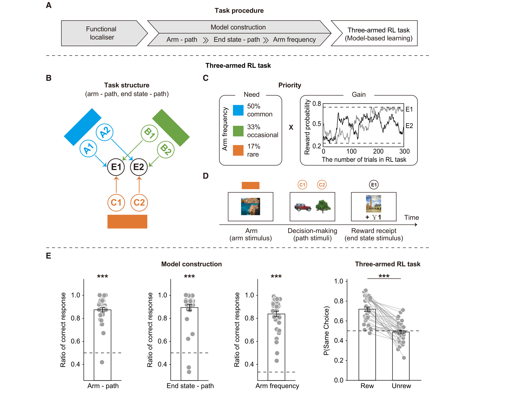
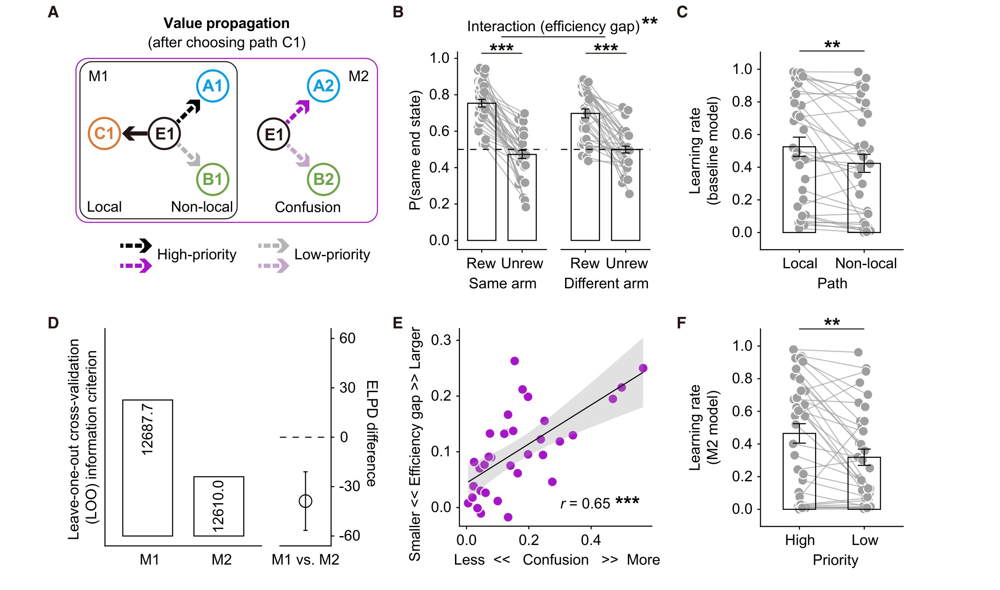
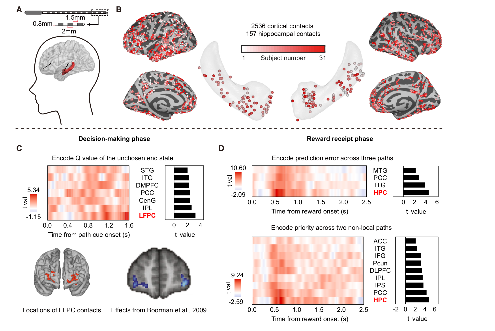
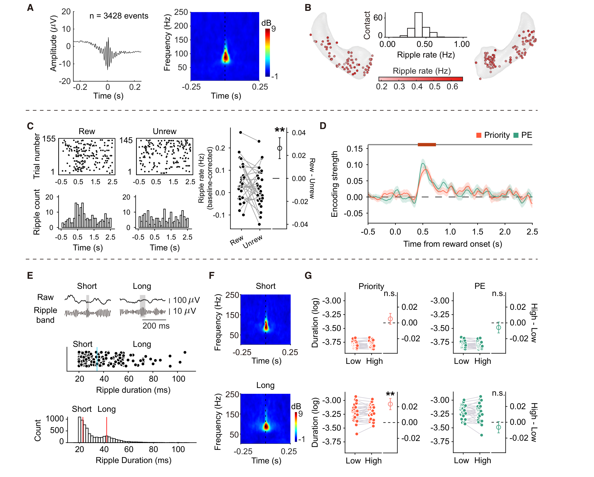
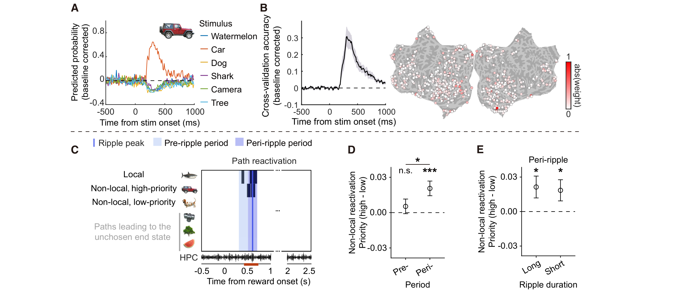
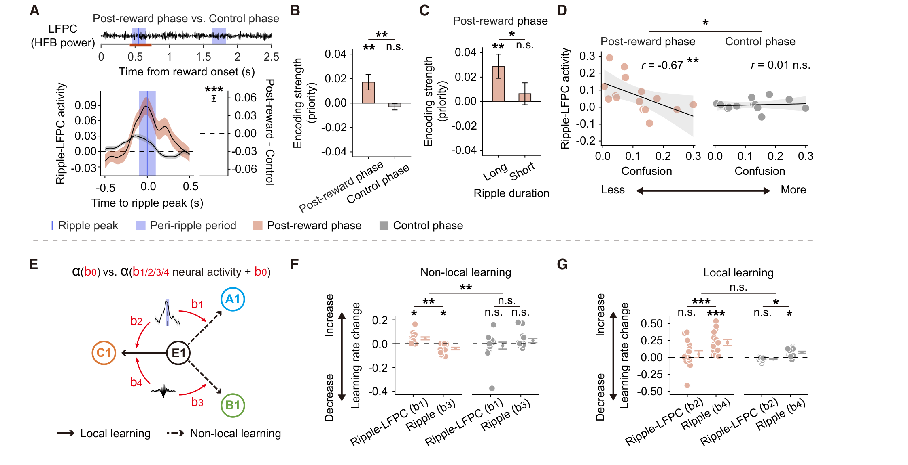

# Human hippocampal ripples prioritize model-based learning 精读笔记

> **论文**：Human hippocampal ripples prioritize model-based learning
> **作者**：Xiaoyu Zhou、Xiongfei Wang、Xiangyu Hu（三人共同第一作者，标注 4）、Haiteng Wang、Jinbo Zhang、Qianqian Yu、Jiahua Xu、Zhibing Xiao、Li He、Yunzhe Liu（通讯作者，yunzhe.liu@bnu.edu.cn）
> **期刊**：Neuron 114, 3111–3125（2026 年 8 月 19 日纸版；2026 年 4 月 9 日在线）；DOI: 10.1016/j.neuron.2026.03.020；STAR Methods 在第 e1–e7 页
> **投稿时间线**：2025-09-07 投稿 → 2026-01-25 修回 → 2026-03-15 接收 → 2026-04-09 在线
> **单位**：北京师范大学认知神经科学与学习国家重点实验室、IDG/麦戈文脑科学研究所；北京脑科学与类脑研究所；首都医科大学三博脑科医院神经外科
> **基金**：北京市自然科学基金（Z230010）；科技创新 2030 重大项目（2022ZD0205500）；国家自然科学基金（32271093、82401707）；北京市科技新星计划（20240484590）；中央高校基本科研业务费
> **开放获取**：是，CC BY-NC 许可（可非商业性转载，需署名）
> **数据与代码**：数据见 Zenodo（https://doi.org/10.5281/zenodo.19363212）；分析代码见 GitLab（https://gitlab.com/liu_lab/three_arm_seeg）

---

## 一、一句话看懂这篇论文

**研究者请 34 名难治性癫痫患者一边做"三臂强化学习"任务、一边用植入脑内的电极同时记录海马和皮层；他们发现，每次拿到奖励后的 420–740 毫秒里，海马会出现一簇高频振荡（涟漪），这簇涟漪的数量与长度编码了"当前哪条没走过的路最值得更新"；而且在这簇涟漪的前后 ±100 毫秒，皮层对高优先级路径的"重演"更强，外侧前额极皮层（LFPC）的活动也与涟漪精确同步——同步得越紧的个体，越会正确使用任务结构。**

把这句话拆成四个动作，就是论文的四步：

1. **造一个"必须举一反三"的任务**：三条"手臂"、六条"路径"、两个"终态"，每条终态被三条路径共享。被试只走过其中一条，另外两条从没走过，但因为通向同一个终态，它们的价值"应该"被一起更新。
2. **用计算模型算出"该更新多少"**：按强化学习理论，更新是有优先级的——**优先级 = 需要 × 收益**。这一步把"应该更新谁"变成一个可以逐试次计算的数字。
3. **在海马里找离散事件**：涟漪是一簇持续 20–100 毫秒的高频振荡，是海马"离线重演"的伴随现象。论文检验涟漪的出现频率和持续时间是否跟着优先级走。
4. **看涟漪前后皮层在重演什么**：用独立任务训练出的图像分类器，在被试看到奖励后，检测"没被呈现过的那条路径的图像"在皮层上被重新唤起的程度。

论文给出的四个答案分别是：**涟漪随奖励出现**、**涟漪编码优先级**、**涟漪期高优先级路径被更多地重演**、**LFPC 与涟漪同步，且同步强度预测行为质量**。

用最日常的话说：**这篇论文在找"举一反三"这件事在大脑里由什么事件触发——答案是一簇持续几十毫秒的高频振荡，它像一次"广播"，把"现在最该更新哪条没走过的路"推送给前额叶。**

---

## 二、背景与动机

### 2.1 一个日常场景

你在一座陌生城市里发现了一家很好吃的面馆。你记住的不只是"我是从哪条路走过来的"，还有"地铁 B 口出来往东也能到"。后者你从没走过，但如果朋友问起，你能直接告诉他。

这个能力的特别之处在于：**你没有走过那条路，却已经知道它的价值。** 这在强化学习里叫**非局部学习**（non-local learning），也叫间接学习、模型推断学习。

### 2.2 强化学习的三件套：状态、动作、价值

要理解后面的内容，先建立三个最基础的词。

| 词 | 在这篇论文里具体指什么 | 日常类比 |
| --- | --- | --- |
| **状态**（state） | "这一轮从哪条手臂开始"——共三种手臂（A、B、C），出场概率不同 | 你现在站在哪个路口 |
| **动作**（action） | 在两条路径里选一条（比如 A1 或 A2） | 你选择走哪条岔路 |
| **奖励**（reward） | 到达终点后得到 ¥1 或 ¥0 | 走到了面馆，或者走错了 |

被试每轮面对的是：先看到一条手臂（比如 A），然后看到它的两条路径（A1、A2），选一条，走到某个终态（E1 或 E2），拿到 ¥1 或 ¥0。

**"价值"（value，记作 Q）**是这个系统的核心变量：它表示"在当前状态下选这个动作，长期来看能拿到多少奖励"。学习的过程，就是不断用实际拿到的奖励去修正 Q。

### 2.3 无模型与有模型：两种算法，两种失败方式

强化学习里有两大类算法。这两类的差别，是整篇论文的地基。

**无模型（model-free）**：只记"看到这个，做那个，上次得了多少"。

```
  看到 A1 → 上次得了 ¥1 → 下次还选 A1
```

它不需要知道任务长什么样，靠反复试错慢慢逼近。**缺点是学得慢**：每个"状态—动作"对都要单独经历很多次。

**有模型（model-based）**：先学一张"世界怎么运转"的图，再用这张图去推算没经历过的事。

```
  我走 A1 到了 E1
  图告诉我：B1 和 C1 也通向 E1
  所以 B1 和 C1 的价值也应该提高
```

**优点是一次经历能更新很多条路径**，也就是"举一反三"。**缺点是计算量大**——下面 2.4 节会说，大到算不完。

论文的"非局部学习"就是这种"用图去更新没走过的路径"。而且这个图是被试**事先学会了的**：正式任务开始前，被试先完成一个"模型构建"任务，把"哪条手臂对哪条路径""哪条路径通向哪个终态""每条手臂多久出现一次"全部学到手（见 4.3 节）。

### 2.4 为什么"更新所有没走过的路"算不过来

假设你的知识地图里有 100 个节点，一次经历之后，理论上所有节点的价值都可能需要调整。节点之间的关系是网状的，一个接一个传下去，计算量会爆炸。

强化学习理论给出的解法是：**不必全更新，按优先级排队。**

只有"最值得现在更新"的那几条先算，其余的等到有机会再说。这个思路在文献里叫**优先化经验回放**（prioritized experience replay），在生物这边的版本叫**优先化记忆提取**。

> **一句话**：大脑不是把整张图重算一遍，而是挑几条最重要的先算。本文要问的是：**"挑"这个动作，在神经层面由什么事件完成？**

### 2.5 标准化答案：优先级 = 需要 × 收益

2018 年 Mattar 和 Daw 提出一个规范性（normative）方案，把优先级写成两个因子的乘积：

```
优先级 = 需要（need） × 收益（gain）
```

- **需要**：这条路径所在的手臂平时多常被遇到？越常遇到，它的价值就越常被用到，越值得保持最新。论文里用"手臂出场频率"来量化——常见臂 50%、偶尔臂 33%、罕见臂 17%。
- **收益**：这次更新能带来多少信息？如果这条路的估计本来就不确定、或者刚刚的奖励大幅超出预期，收益就大。

这个公式有一个很实用的性质：**它把"该更新谁"变成一个可以逐试次算出来的数字。** 于是研究者可以问一个很具体的问题：大脑里的事件，是否跟着这个数字走？

### 2.6 脑子里可能的实现：重放与涟漪

如果大脑真的按优先级挑选，那么"挑中"的那一刻，应该有可见的神经事件。文献里指向两个东西：

**重放**（replay）：海马里的位置细胞或任务状态表征，在动物没有实际经历的时候，按顺序重新激活一遍。老鼠睡觉时、或者停下来休息时，海马会以 10–20 倍速"快放"一遍刚走过的路线。

**涟漪**（ripple）：重放发生时，海马局部场电位上会出现一簇短暂的、频率很高的振荡，持续几十毫秒，形状像水面的一圈涟漪，因此得名。啮齿类的涟漪在 150–250 Hz；人的涟漪频率更低，通常按 70–180 Hz 检测。

两者关系是：**涟漪是重放的"外包装"**——有涟漪的时候，通常正在重放；但涟漪本身只是电生理信号，不含"内容"。

于是本文的核心假说可以写成一句话：

> **如果海马用涟漪来标记"现在该更新谁"，那么涟漪的出现和长度应该跟着优先级走，而且涟漪前后皮层应该更多地重演高优先级的那条路径。**

### 2.7 本文要填的空白

把上面的线索拼起来，本文之前的状态是这样的：

| 已有证据 | 来自 | 缺口 |
| --- | --- | --- |
| 有模型学习依赖前额叶 | 人类 fMRI | fMRI 是间接测量，看不到离散事件 |
| 重放与涟漪伴随出现 | 啮齿类电生理 | 老鼠身上很难做"三臂—六路径"这类抽象结构任务 |
| 重放偏向高价值轨迹 | 计算模型 + 少量实证 | 没人在人脑里直接测过"优先级"这个量 |
| 海马—前额叶存在同步 | 啮齿类 | 人的海马与外侧前额极如何对话，不清楚 |

本文的做法是**把三样东西装进同一个实验**：一个必须用任务结构才能做对的强化学习任务、一个能算出逐试次优先级的计算模型、以及能在人脑里同时记录海马和皮层的颅内电极。

---

## 三、核心概念

这一章把读懂本文必须知道的词逐个从零讲起。**顺序是有依赖的**：后面的概念会用到前面的。

---

### 概念 0：神经元、动作电位与"放电率"

**神经元**是大脑里的信号单元。它平时内外有约 −70 mV 的电位差（静息电位）。当输入足够强，电位差会瞬间翻转，产生一个持续约 1–2 毫秒的电脉冲，叫**动作电位**（action potential，也叫"锋电位" spike）。

一个神经元每秒能发几个到几百个这样的脉冲。**放电率**（firing rate）就是"每秒发多少个"，单位 Hz。

关键在于：**单个神经元的放电很难直接测到**。要测，得把电极插到细胞旁边（单细胞记录）。人身上不允许这样做——除了极少数临床情况。

所以研究人脑时，用的是间接指标：**一群神经元同时放电时，它们周围电场会一起波动。** 电极记录到的就是这种"群体电活动"。这篇论文用的两个指标都是这一类的：

- **高频宽带功率（HFB，60–160 Hz）**：近似"这片组织里神经元在放电的总量"（概念 8）。
- **涟漪（ripple，70–180 Hz）**：一种特定形状的、短暂的高频爆发（概念 6）。

> **要注意的一点**：这两个频段是重叠的。这不是巧合，也不是错误，但会在第七章变成一个真实的解释困难。

---

### 概念 1：价值 Q、预测误差 PE、学习率 α

强化学习的核心只有一条规则：**用"实际结果"减去"预期结果"，按比例修正预期。**

```
新价值 = 旧价值 + 学习率 × (实际奖励 − 旧价值)
```

三个符号：

| 符号 | 名称 | 含义 | 类比 |
| --- | --- | --- | --- |
| `Q` | 价值（value） | "在当前状态下做这个动作，预计能拿多少" | 你心里对这家店的评分 |
| `r` | 奖励（reward） | 这次实际拿到的 | 今天这碗面实际好不好吃 |
| `r − Q` | 预测误差（prediction error, PE） | 结果比预期好多少 | "比我想的好吃" |
| `α` | 学习率（learning rate） | 一次经历能把旧估计改动多少，0–1 之间 | 你有多容易被一次体验改变看法 |

**为什么这个规则重要**：它只有一个参数 `α`，而 `α` 的大小直接决定学习快慢。0.1 意味着每次只改 10%，要试很多次才学会；0.5 意味着改一半，学得快但容易被噪声带偏。

本文的行为分析，核心就是**估计出两种不同的 `α`，看它们是否不同**：走自己走过的那条路时用 `α_local`，走没走过的路时用 `α_non-local`。如果这两个数不同，就说明大脑确实把"直接经验"和"推断经验"分开处理了。

**一个必须记住的细节**：在有模型学习的框架里，同一次奖励会同时产生**三个**预测误差——走过的这条路一个，另外两条通向同一终态的路各一个。这是本文设计的关键（概念 3）。

---

### 概念 2：softmax 与逆温度 β

有了价值，还得把价值变成"选择"。最简单的方式是"选价值最高的"，但这太死板——真实的人和动物会偶尔选次优的（探索）。

**softmax 函数**把价值转成概率：

```
P(选动作 a) ∝ e^(β·Q(a))
```

- `Q(a)` 越大，被选中的概率越高；
- `β` 叫**逆温度**（inverse temperature），控制"多听话"：
  - `β` 很大 → 几乎总选最好的（"低温"，确定性高）；
  - `β` 很小 → 接近随机（"高温"，乱选）。

**为什么要有它**：如果不用 softmax，模型就无法解释"被试有时会选差的那条"。加上它，模型才能把行为里"系统性偏好"和"随机噪声"分开，从而干净地估计 `α`。

> **注意**：`β` 和 `α` 是两种完全不同的东西。`α` 决定"学多快"，`β` 决定"选多准"。两者都在模型里被估计，但含义不能混。

---

### 概念 3：非局部更新，以及"共享终态"这个设计

整个实验的全部巧妙之处，都压在这一条概念上。**如果这一条没懂，后面所有结果都只是"脑区活动有差异"这类没有意义的描述。** 所以这里分十个小节，从最基础的名词开始，一层一层推到"为什么必须这样设计"，最后说清楚它付出了什么代价。

---

#### （一）先认识任务里的三个词

被试每轮做的动作很简单：**看到一条手臂 → 在两条路径里选一条 → 走到一个终态 → 拿到奖励或没拿到。**

| 词 | 在屏幕上是什么 | 在任务里是什么 | 本文的数量 |
| --- | --- | --- | --- |
| **手臂**（arm） | 一条彩色条块（蓝 / 绿 / 橙） | 这一轮的"起点"，决定你能选哪两条路 | 3 条：A、B、C |
| **路径**（path） | 一张图片（西瓜、汽车、狗、鲨鱼、相机、树） | 从手臂通向终态的一条"边"，这才是你要选的东西 | 6 条：A1–C2 |
| **终态**（end state） | 另一张图片，伴随 ¥1 或 ¥0 | 这一轮的"终点"，决定你拿不拿到钱 | 2 个：E1、E2 |

三者之间的关系是**固定的**，而且被试事先被教到滚瓜烂熟：

```
终态 E1 的三条来路：            终态 E2 的三条来路：

  手臂 A（常见 50%）── A1 ┐        手臂 A（常见 50%）── A2 ┐
  手臂 B（偶尔 33%）── B1 ┼─► E1   手臂 B（偶尔 33%）── B2 ┼─► E2
  手臂 C（罕见 17%）── C1 ┘        手臂 C（罕见 17%）── C2 ┘
```

读法：**每条手臂伸出两条路，各通一个终态；反过来，每个终态收回三条来自不同手臂的路。** 也就是说，六条路径被平均分成了两组，每组三条，每组汇聚成一个终态。

下面用两张表把这个结构完整列出来。**两张表的切法不同，合起来才是完整的结构。**

**第一张表：按"路径"切**

| 路径 | 属于哪条手臂 | 通向哪个终态 | 这条手臂多久出现一次 |
| --- | --- | --- | --- |
| A1 | A | **E1** | 50%（常见） |
| A2 | A | E2 | 50%（常见） |
| B1 | B | **E1** | 33%（偶尔） |
| B2 | B | E2 | 33%（偶尔） |
| C1 | C | **E1** | 17%（罕见） |
| C2 | C | E2 | 17%（罕见） |

**第二张表：按"终态"切**

| 终态 | 哪几条路径通向它 | 这三条路径各自的手臂频率 |
| --- | --- | --- |
| **E1** | A1、B1、C1 | 50% / 33% / 17% |
| **E2** | A2、B2、C2 | 50% / 33% / 17% |

> **这两张表是同一个结构的两种切法。** 第一张按"手臂"切：每条手臂带两条路。第二张按"终态"切：每个终态由三条路汇聚。**"共享终态"这个词说的就是第二张表**——三条来自不同手臂的路，汇聚到同一个终点。

---

#### （二）一次试次的完整流程，以及为什么每轮只给一条手臂

```
  ① 注视点 500 ms
        ↓
  ② 出现一条手臂（例如橙色的 C）              ← 只有一条手臂，不是三条
        ↓
  ③ 出现这条手臂的两条路径（C1 的图、C2 的图），左右随机
        ↓
  ④ 被试选一条（比如 C1），按空格
        ↓
  ⑤ 到达终态 E1，屏幕显示 E1 的图片
        ↓
  ⑥ 显示结果：¥1 或 ¥0（持续 2500 ms）      ← 此时路径图片已经从屏幕上消失
        ↓
  ⑦ 抖动间隔 500–700 ms，进入下一轮
```

这里有两个设计决定，各自都不是随手做的。

**决定一：每轮只呈现一条手臂。**

如果三条手臂同时出现，被试可以直接比较六条路径，那么"推断"就不需要了——眼睛看到就行。只给一条手臂，等于**人为制造信息缺口**：你只能看到这一轮的两条路，另外四条路的信息必须从记忆里的结构推出来。

**决定二：奖励期屏幕上只留终态图片，路径图片全部撤掉。**

这一条是为后面的"再激活"分析服务的。如果奖励期路径图片还在屏幕上，那么"皮层里出现了路径图片的神经模式"完全可以是眼睛看到的。撤掉之后，这段模式如果还出现，就只能是**内部产生的**。

> **这两条合起来**：一条制造缺口（你必须推断），一条封闭回路（你不能作弊）。这就是一个能测"推断"的实验该有的样子。

---

#### （三）"局部"与"非局部"到底指哪几条路

假设这一轮是 **C 臂**，你选了 **C1**，走到了 **E1**，屏幕显示 **¥1**。

现在问：哪些路径的价值应该上升？

| 路径 | 与本轮的关系 | 该不该上升 | 论文里的名字 |
| --- | --- | --- | --- |
| **C1** | 你实际走过的那条 | **该**，最直接 | **局部**（local） |
| **A1** | 没走过，但也通向 E1 | **该**——E1 刚才值 ¥1，A1 也应该值 ¥1 | **非局部**（non-local） |
| **B1** | 没走过，但也通向 E1 | **该**，同上 | **非局部**（non-local） |
| A2 | 通向 E2，不是 E1 | **不该** | —— |
| B2 | 通向 E2 | **不该** | —— |
| C2 | 同一条手臂的另一条路，通向 E2 | **不该** | —— |

**关键的一步在 A1 和 B1 那两行**：A1 和 B1 你从来没走过，但你知道"它们也通向 E1"。这次 E1 给了 ¥1，那么"通向 E1"这件事本身变值钱了，A1 和 B1 就跟着变值钱。

这就是"举一反三"的全部内容。**它不是"因为 A1 和 C1 长得像"，而是"因为 A1 和 C1 通向同一个地方"。** 这一点很重要，第五章和第六章还会回来。

---

#### （四）为什么必须"共享终态"——四种设计，只有一种能活

要理解这个设计，最好的办法是把其他几种设计摆出来，看它们各自死在哪里。

| 设计 | 结构 | 会发生什么 | 能否测非局部学习 |
| --- | --- | --- | --- |
| **甲：六路六终点** | 每条路径通向各自的终态 | "没走过的路值多少"没有任何线索——它与走过的路毫无已知联系 | **不能**，这个概念根本不存在 |
| **乙：共享手臂** | 同一手臂的两条路通向同一终态 | 奖励可以告诉你"这条手臂好"，但无法告诉另一条手臂里哪条路好 | **不能**，信息不跨手臂 |
| **丙：全部汇聚** | 六条路全部通向同一个终态 | 所有路径永远同值，选择没有意义，学习也无从谈起 | **不能**，缺对比 |
| **丁：本文** | 三臂 × 二路 = 六路，两终态，每终态三条汇聚 | 走过一条，另两条（不同手臂、同一终态）可推断 | **能** |

**丁之所以能活，靠的是一个精确的"部分汇聚"**：

- 汇聚得**够多**（每个终态有三条路），才有"另外两条"可供推断；
- 汇聚得**不够多**（不是六条全汇），才保留"另一终态"作为对照，让"该更新"和"不该更新"能区分开。

> **一句话**：共享终态必须"共享一部分、不共享一部分"。全共享和全不共享，都会让"非局部"失去意义。

---

#### （五）为什么偏偏是"三臂 × 二终态"——这组数字是算出来的

看起来 3 和 2 是随便定的，其实它们是同时满足四个要求的最小配置。

| 要求 | 需要什么 | 结论 |
| --- | --- | --- |
| 要有"局部"和"非局部"之分 | 奖励后必须存在**至少两条**没走过的、通向同一终态的路 | 每个终态至少 3 条路 → 至少 3 条手臂 |
| 要能比较"高优先级 vs 低优先级" | 非局部路径必须**至少两条**，否则只有一条无从比较 | 同上，3 条手臂 |
| 要能操纵"需要" | 手臂的出现频率必须有**多个档位** | 至少 3 个档（50 / 33 / 17） |
| 每轮要能"二选一" | 每条手臂必须恰好连着**两条**路 | 恰好 2 个终态 |

四条要求指向同一个答案：**3 条手臂 × 2 个终态 = 6 条路径**。少一条手臂，就没有"高 vs 低"的比较；多一个终态，每轮就变成三选一，混淆结构也会复杂到无法建模。

---

#### （六）把一次更新完整算一遍

理论讲完，必须落成数字。假设这一轮是 C 臂、选 C1、到 E1、得 ¥1。

**先设几个用于演示的数值**（真实拟合值大约在 0.5 与 0.4 附近，见 4.4 节）：

```
所有路径的初始价值 Q = 0.50
局部学习率   α_local     = 0.50
非局部学习率 α_non-local = 0.40
这次奖励     r = 1.00
```

**第一步：每条路径算自己的预测误差。**

这里最容易出错：**不是算一个 PE 然后平均分配，而是每条路径各算各的。**

```
C1 的 PE = r − Q(C1) = 1.00 − 0.50 = 0.50
A1 的 PE = r − Q(A1) = 1.00 − 0.50 = 0.50
B1 的 PE = r − Q(B1) = 1.00 − 0.50 = 0.50
```

在初始值都一样时，三个 PE 碰巧相等。但只要 A1 之前被更新过（比如 Q = 0.80），它的 PE 就变成 0.20。**PE 是每条路径自己的，不是全局共享的。**

**第二步：各乘各的学习率。**

| 路径 | 更新前 Q | 用哪个 α | PE | 变化量 = α × PE | 更新后 Q |
| --- | --- | --- | --- | --- | --- |
| **C1**（局部） | 0.50 | 0.50 | 0.50 | **+0.250** | **0.75** |
| **A1**（非局部） | 0.50 | 0.40 | 0.50 | **+0.200** | **0.70** |
| **B1**（非局部） | 0.50 | 0.40 | 0.50 | **+0.200** | **0.70** |
| A2 | 0.50 | 0 | — | 0 | 0.50 |
| B2 | 0.50 | 0 | — | 0 | 0.50 |
| C2 | 0.50 | 0 | — | 0 | 0.50 |

**第三步：读这张表。**

三件事一眼可见：

1. **走过的那条涨得最多**（0.75），因为它的学习率高；
2. **没走过的两条也涨了**（0.70），这是"推断"的直接体现；
3. **另外三条纹丝不动**，因为它们通向另一个终态。

> **如果 A1 的更新前 Q 是 0.80 呢**？那么 A1 的 PE = 1.00 − 0.80 = 0.20，变化量 = 0.40 × 0.20 = 0.08，更新后 Q = 0.88。**同一次奖励，对不同的路径产生不同的变化量**——这正是"每条路径算自己的 PE"的意义，也是为什么模型能解释"同样得奖，有的人学得多、有的人学得少"。

---

#### （七）模型里为什么把"动作"写成终态，而不是路径

论文的 softmax 里写的是 `Q(s, a)`，其中 `a` 是终态（E1 或 E2），不是路径（A1、B1……）。这不是笔误。

**原因是：在同一条手臂内，路径和终态是一一对应的。**

```
C 臂下：选 C1  ⇔  选 E1
        选 C2  ⇔  选 E2
```

既然一一对应，"选哪条路"和"选哪个终态"是同一件事。于是模型不需要为六条路径各存一个值，只需要存"三手臂 × 二终态"= **六个值**。

| 记号 | 含义 | 与之对应的路径 |
| --- | --- | --- |
| `Q(A, E1)` | A 臂下选 E1 的价值 | A1 |
| `Q(A, E2)` | A 臂下选 E2 的价值 | A2 |
| `Q(B, E1)` | B 臂下选 E1 的价值 | B1 |
| … | … | … |

**这也解释了 `a_c` 和 `ã_c` 这两个符号**：

- `a_c`（c = chosen）：这一轮实际选了哪个终态；
- `ã_c`（~ = 取反）：另一个终态。

于是"非局部更新"就是 `Q(s_nl, a_c)`（另外两个手臂、**同一个**终态），"混淆更新"就是 `Q(s, ã_c)`（**另一个**终态）。

---

#### （八）行为上怎么把这个区别测出来

模型讲得再漂亮，也必须在不依赖模型的行为里看见它。方法是比较两种情况的奖励效应。

**先把因变量说清楚**：被试下一轮是否选择**通向与上一轮相同终态**的路径。

> 为什么不用"是否选同一条路径"？因为手臂一换，原来那条路径根本不在选项里，没法比。"同一终态"是唯一在两种情况下都可定义、可比较的量。

**再看两种情况下，两种理论的预测有什么不同：**

| 条件 | 如果只有局部学习 | 如果只有非局部学习 | 本文（两者都有） |
| --- | --- | --- | --- |
| **手臂重复**（这轮还是 C 臂） | 上一轮得奖 → 更想选 C1。**有效应** | 上一轮得奖 → 更想选 E1。**也有效应** | 有效应 |
| **手臂改变**（这轮换成 A 臂） | C1 不在这轮里，局部学习**无话可说** | 上一轮 E1 得奖 → 更想选 A1。**有效应** | 有效应 |

**决定性的一格是第二行（手臂改变）**：当手臂改变时，如果你仍然看到"上一轮得奖的人更倾向于选通向 E1 的路"，那么除了"价值被传播过来了"，没有别的解释。因为局部学习在这种条件下没有任何预测。

实测结果（图 2B）：

| 条件 | 上一轮得奖 | 上一轮没得奖 | 效应 |
| --- | --- | --- | --- |
| 手臂重复 | 约 0.75 | 约 0.46 | **极显著**（p < 5.2 × 10⁻¹²） |
| 手臂改变 | 约 0.69 | 约 0.48 | **极显著**（同上） |
| 两者之差 | — | — | p = 1.2 × 10⁻³（局部更强） |

**于是得到两个结论，一个定性、一个定量**：

1. **定性**：非局部学习确实存在（手臂改变时仍有效应）；
2. **定量**：它比局部学习弱（交互项显著），这个差叫**效率差**。

---

#### （九）这个设计付出了什么代价

任何设计都是交换。共享终态换来了"可测的推断"，代价有两条（论文自己承认第一条，第二条是我读式子时的观察）。

**代价一：三类预测误差在时间上完全重合。**

一次奖励到手，同时发生：

```
局部 PE：实际奖励 − 走过的 C1 的价值
非局部 PE ①：实际奖励 − 没走的 A1 的价值
非局部 PE ②：实际奖励 − 没走的 B1 的价值
以及对奖励本身的直接反应
```

它们在**同一时刻**产生。所以当研究者看到"涟漪随 PE 增加"时，**无法确定**这是对奖励本身的反应，还是对推断结果的反应。论文在讨论里把这一条列为第一条局限。

> **对比一下**：如果每条路径通向独立的终态，这三类 PE 就会在时间上分开，可以分别测量。但那样一来，"非局部学习"就没有了。**这是设计上的两难，不是执行上的疏漏。**

**代价二：论文的更新式只覆盖了五条路径，不是六条。**

按第五章的式子 2–7 逐条数：

| 路径 | 被哪个式子更新 |
| --- | --- |
| C1（局部，终态 E1） | 局部更新 |
| A1、B1（非局部，终态 E1） | 非局部更新 |
| A2、B2（非局部臂，终态 E2） | 混淆更新 |
| **C2（同一手臂，终态 E2）** | **没有式子覆盖** |

也就是说，**"同一条手臂里通向另一终态的那条路"没有被单独建模**。这不会影响主结论（主结论只依赖三条通向 E1 的路径），但它说明模型对"同一手臂内部的两个选项如何相互竞争"做了一个简化。读的时候最好不要把模型当成完整的认知描述。

---

#### （十）四个必须记住的边界

"非局部"这个词很容易被读宽，下面四条是用来收紧它的。

| 常见理解 | 实际含义 |
| --- | --- |
| 被试在脑子里**想象**那条没走过的路 | 模型里只是一个乘法更新，**不需要任何主观体验** |
| 任何**相似**的东西都会被更新 | 不，只沿**已学会的结构**传播，而且只到**共享终态**的那两条 |
| 被试在做**有意识的推理** | 模型不区分有意识和无意识；行为上也无法分辨 |
| 所有路径都通向一个终点 | 是**两个**终点，每个由三条路汇聚——"共享"是部分共享 |

> **最需要记住的一句**：本文测的是"价值是否会沿结构传播"，不是"人会不会想事情"。前者可以用六个数字和两个学习率写完，后者不能。

---

### 概念 4：优先级 = 需要 × 收益

有了"该更新谁"的问题，还要回答"先更新谁"。本文用的定义来自 Mattar 与 Daw（2018）：

```
优先级(路径) = 需要 × 收益
```

**需要（need）**：这条路径**所在的手臂**，平时多常被遇到。

本文用**手臂出场频率**来量化。正式任务里三条手臂按固定概率出现：

| 手臂 | 概率 | 称呼 | 需要 |
| --- | --- | --- | --- |
| A | 50% | 常见（common） | **高** |
| B | 33% | 偶尔（occasional） | 中 |
| C | 17% | 罕见（rare） | **低** |

**这个方向非常容易记反，所以单独说一句：越常遇到的手臂，需要越高。**

需要不是"稀缺性"，而是"这条路径的价值有多常用得上"。常见臂每出现两次，就要用到它的值两次；如果这个值过时了，每一轮都在犯小错。罕见臂就算很久没更新，大多数轮次也用不着它。所以**常遇到的状态更值得保持最新**。

> **那"罕见"的作用在哪**？在**收益**里。一条手臂很久没被访问，它的估计就越不可靠，信息价值（VOI）越高——这才是"稀缺"起作用的地方。**需要在频率上，收益在不确定性上**，两者不能混。这也是为什么优先级要做成乘积：一个是"用得多不多"，一个是"差得多不多"。

**收益（gain）**：这次更新能带来多少新信息。

本文的收益由两部分合成：
1. **预测误差的绝对值**：结果偏离预期越多，信息越多；
2. **信息价值（VOI）**：这条路径多久没被访问过了？越久没看，它的估计越不可靠，越值得看一眼。

这两部分在公式里被合成一个量（见第五章式子 5–6）：

```
Q_voi = Q + VOI
收益 = | r − Q_voi |
```

读法：**先把"价值"人为抬高一点（抬高多少取决于多久没访问），再用实际奖励去减它。** 于是"很久没看过的路径"即使拿到一个普通的奖励，也会产生较大的"收益"——因为按理说它本该更不确定。

> **一个必须记住的性质**：这个"收益"不是纯粹的物理量，它是**模型算出来的**。后面第七章会讨论这里的循环风险。

#### 那么，"高优先级路径"和"低优先级路径"到底指哪两条

每一轮，实际走过的那条路是**局部**的，另外两条通向同一终态的路是**非局部**的。**这两条非局部路，就按优先级被分成"高"和"低"。**

以图 2B 的条件为例：这一轮是 **C 臂**（罕见 17%），你选了 **C1**，走到 **E1**，拿到 ¥1。

| 候选 | 所在手臂 | 该手臂频率 = 需要 | 这一轮的角色 |
| --- | --- | --- | --- |
| **A1** | A（常见） | 50%，高 | **高优先级路径** |
| **B1** | B（偶尔） | 33%，中 | **低优先级路径** |

换一轮，如果这次从 **A 臂**（常见 50%）开始，选了 A1 到 E1：

| 候选 | 所在手臂 | 需要 | 角色 |
| --- | --- | --- | --- |
| **B1** | B（偶尔） | 33%，中 | **高优先级路径** |
| **C1** | C（罕见） | 17%，低 | **低优先级路径** |

**三件必须记住的事：**

1. **"高/低"是每轮临时贴的标签，不是路径的固定属性。** 同一条 B1，在这一轮是高的，在另一轮可能是低的。所以论文里 `α_high` / `α_low` 不是"两条特定路的学习率"，而是"被标成高的位置"和"被标成低的位置"的学习率。
2. **决定高低的首先是两条非局部路各自所在手臂的频率**：更常见的那条高，更罕见的那条低。
3. **但频率不是唯一的因素。** 增益（预测误差和 VOI）每轮都在变，如果罕见那条路的 VOI 已经积累得很大，它的优先级可能反超。论文按**每轮的实际优先级数值**排序，而不是简单地按手臂颜色排序。

**一个可以自己验算的细节**：论文报告的三档逐试次优先级均值是 **罕见 0.309、偶尔 0.259、常见 0.199**。如果"需要"确实是"两条非局部路所在手臂的频率之和"，那么三档之比应当是：

| 试次开始的手臂 | 两条非局部路所在手臂 | 需要之和 | 相对值 |
| --- | --- | --- | --- |
| C（罕见 17%） | A（50%）+ B（33%） | 0.83 | 1.66 |
| B（偶尔 33%） | A（50%）+ C（17%） | 0.67 | 1.34 |
| A（常见 50%） | B（33%）+ C（17%） | 0.50 | 1.00 |

而实测比值是 0.309 : 0.259 : 0.199 = **1.55 : 1.30 : 1.00**。两组数字几乎重合。

> **这个验算说明了两件事**：第一，"需要 = 所在手臂频率"这个读法是对的；第二，**"罕见臂试次优先级最高"听起来像"越罕见越重要"，其实机制正好相反**——罕见臂试次里，要更新的两条路恰好落在最常见和较常见的两条手臂上。论文没有把这一点写出来，但数字支持这个解释。

---

### 概念 5：信息价值 VOI

**信息价值**（value of information）回答的是："如果我去看一眼这个我不知道的东西，这个'看'本身值多少钱？"

在本文的公式里，它被写成一个随"上次访问以来的轮数"增长的函数：

```
VOI = U₀ × (1 − e^(−k · N))
```

- `N`：距离上次访问这条路径，过了多少轮；
- `U₀`：不确定性的上限（再久没看，最多值这么多）；
- `k`：切换速率常数，控制"随时间恢复"的快慢。

这个函数有两个端点很好记：

| `N` 的值 | `VOI` | 直觉 |
| --- | --- | --- |
| 0（刚看过） | 0 | 刚确认过，没有新信息 |
| 很大 | ≈ `U₀` | 很久没看，什么都可能变了 |

本文把初始的 `N` 设为 10000，这意味着**实验开始时，所有路径都被当作"很久没看过"**——它们的 VOI 都接近上限。

**为什么要有这一项**：如果没有它，"收益"就只是预测误差，而预测误差只反映"这次结果多意外"，不反映"这条路径我多久没管了"。而"多久没管"恰恰是"需要"之外的另一半动机。

---

### 概念 6：重放与涟漪

**重放**（replay）：海马在动物没有实际移动的时候，把一段经历的状态序列快速重新激活一遍。

- 老鼠在迷宫里跑完一段、停下来休息时，海马位置细胞会按顺序重新发放，顺序可能是正向（再走一遍）也可能是反向；
- 速度比真实经历快 10–20 倍，一段几秒的路线可以在几百毫秒内"放完"；
- 重放的内容可以与当前任务无关（离线重放），也可以与当前决策直接相关。

**涟漪**（sharp wave-ripple, SWR）：重放发生时，海马 CA1 区局部场电位上出现的一簇特征性的高频振荡。

```
   原始信号（局部场电位）
        ╱╲
   ────╱  ╲────        ← 一个"尖波"（sharp wave）
      ╱    ╲
     ╱ ～～～ ╲        ← 尖波上叠着一串快速振荡（ripple）
```

三个可测的属性：

| 属性 | 典型值（人） | 本文怎么用 |
| --- | --- | --- |
| 频率 | 70–180 Hz（啮齿类 150–250 Hz） | 检测用这个频段 |
| 持续时间 | 20–200 毫秒（中位数约 27 毫秒） | 分成"长涟漪"和"短涟漪" |
| 发生率 | 每秒 0.1–1 次 | 比较不同条件下的次数 |

**为什么涟漪重要**：它是"重放正在发生"的**可检测标志**。你没法在人脑里直接看到"哪个位置的细胞在放电"，但你能看到涟漪——于是可以问："涟漪出现的那一瞬间，皮层在重演什么？"

---

### 概念 7：颅内脑电（iEEG），以及为什么用癫痫患者

**iEEG**（intracranial electroencephalography）：把电极直接放到大脑表面（硬膜下）或插入脑组织（深部电极），记录局部电活动。

**为什么这个技术不可替代**：头皮脑电（EEG）要穿过颅骨和头皮，信号被严重模糊，空间分辨率只有厘米级，而且看不到深部的海马。iEEG 的电极就贴/插在组织上，能记录到毫米级、且能到深部结构。

**为什么研究对象是癫痫患者**：这是伦理决定的。健康人不可能为了科研在脑子里插电极。但难治性癫痫患者在临床评估时**本来就要**植入电极，用来定位癫痫灶。研究者在他们住院监测期间，请他们做行为任务——电极位置完全由临床需要决定，与实验设计无关。

**本文的具体参数**：

| 项目 | 数值 |
| --- | --- |
| 患者数 | 34 人（20 男 14 女），其中 31 人有海马电极 |
| 电极 | 深部电极，直径 0.8 mm，触点高 2 mm，触点中心间距 3.5 mm |
| 采样率 | 2000 Hz，带通 0.3–500 Hz |
| 触点总数 | 皮层 2536 个，海马 157 个 |
| 参考方式 | **双极重参考**：同一根电极上相邻两个触点相减 |

**双极重参考为什么重要**：单极记录（每个触点对远处一个公共参考）会把参考点的噪声带进所有通道。改成"相邻触点相减"，共模噪声（两个触点都有的干扰，比如远处的肌电、市电）会被减掉，剩下的是**两个触点之间**的局部差异。代价是空间分辨率略微下降。

> **必须知道的一个局限**：癫痫患者的海马可能本身就有病变，长期服药也可能影响认知。所有基于这类样本的结论，推广到健康人时要打一个折扣。

---

### 概念 8：高频宽带（HFB）功率

**HFB**（high-frequency broadband）指 60–160 Hz 这一段的功率。论文把它当作"局部神经元群体放电强度"的代理指标。

**为什么高频能代理放电**：神经元发放动作电位时，电流在细胞外空间急剧变化，产生很宽频带的电场变化。单个细胞的贡献很小，但成千上万个细胞同步放电时，高频段的功率会明显上升。经验上，HFB 功率与同一位置的的多单位活动（multi-unit activity）相关性很高。

**为什么叫"宽带"**：不是取某一个窄频段，而是把 60–160 Hz 切成 10 Hz 一个的小段（60–70、70–80……150–160），各自算功率，再平均。

**为什么要"归一化"**：脑电的功率谱大致按 1/f 衰减——频率越高，功率越低。如果不做处理，低频永远占主导，高频的微小变化会被淹没。归一化（每个频段除以自己的基线）之后，各频段的贡献才可比。

> **和涟漪的关系**：涟漪是 70–180 Hz 的一段**短暂爆发**，HFB 是 60–160 Hz 的**连续功率**。两者频段重叠，但时间尺度不同：涟漪是"事件"，HFB 是"状态"。本文在皮层用 HFB，在海马用涟漪，正是因为海马要抓的是"离散事件"。

---

### 概念 9：外侧前额极皮层（LFPC）

**前额极皮层**（frontopolar cortex, FPC）是额叶最前端的那一块，位于两个半球的最前面，是整个人脑前部"最高"的位置。

**外侧**（lateral）指它靠外的部分（Brodmann 10 区的外侧部）。

**已知功能**：LFPC 在需要"考虑备选方案"的时候活动增强——比如：

- 当前策略还行，但要不要试试别的？（探索）
- 我没选的那个选项，现在值多少？（反事实价值）
- 要不要暂时放下当前目标，去做另一件事？（任务切换）

本文在决策期复现了其中一条：**LFPC 编码"未被选择的终态"的价值**（β = 0.014 ± 0.004，p = 1.2 × 10⁻³），与 2009 年 Boorman 等的 fMRI 结果一致。

**和它对照的两个区域**：

| 区域 | 全称 | 本文中的角色 |
| --- | --- | --- |
| LFPC | 外侧前额极皮层 | 编码**优先级**，不编码 PE |
| VMPFC | 腹内侧前额叶 | 编码 **PE**，不编码优先级 |
| LOFC | 外侧眶额皮层 | 编码 **PE**，不编码优先级 |

这个"双重分离"是本文结论的重要支点（4.8 节）。

---

### 概念 10：神经解码与"再激活"

**问题**：被试看到奖励时，脑子里"想到"了那条没走过的路径。怎么测？

**思路**：先教一个分类器认图像，再看它在别的时候能不能"读出"同一张图像。

**具体做法**（三步）：

1. **训练**：在正式任务之前，先做一个"功能定位"任务——屏幕上一个一个呈现六张图片（西瓜、汽车、狗、鲨鱼、相机、树），每张呈现 50 次，同时记录脑活动。用这些数据训练六个分类器：每个分类器负责判断"现在这张图是不是 X"。
2. **应用**：把分类器用到正式任务的记录上。在奖励呈现期（屏幕上只有终态图片，没有路径图片），如果某个路径的分类器输出概率升高，就说明那段"路径图像"的神经模式被重新唤起了。
3. **比较**：同一个试次里有两条非局部路径（一高一低优先级），比较它们被再激活的程度。

**为什么这个指标可信**：分类器是在**独立的数据**上训练的，而且训练时**故意排除了海马触点**（只用皮层），避免"用海马自己的信号预测海马自己的活动"这种循环。

**本文的筛选标准很严**：每个被试的每个分类器，真实标签的准确率必须超过"打乱标签重训 100 次"得到的零分布的 95 百分位。34 个被试里只有 **11 个**通过。

> **记住这个数字**：11。后面的再激活结论都建立在这 11 个人身上。

---

### 概念 11：混淆参数 χ

行为上有一个现象：非局部学习比局部学习弱（效率差）。为什么弱？

本文给出的解释是：**被试对任务结构的掌握不完美，有时会把奖励错误地传播到"另一个终态"的路径上。**

```
正确传播：E1 得奖 → 更新 A1、B1、C1
混淆传播：E1 得奖 → 还顺带更新了 A2、B2（另外两个手臂里通向 E2 的路）
```

模型 M2 用参数 `χ`（0–1 之间）来量化这种错误传播的强度：

```
混淆更新量 = χ × α × (r − Q)
```

- `χ = 0`：完全不混淆，M2 退化成 M1；
- `χ` 越大：结构使用越差。

**为什么这个参数有用**：它把"学习效率低"这个笼统的说法，拆成了一个可估计的、有具体含义的量。而且它可以直接和被试的行为表现对上：本文发现 `χ` 与效率差正相关（r = 0.65，p = 2.9 × 10⁻⁵，n = 34）——**越容易混淆的人，局部与非局部的差距越大**。

后面的关键相关（LFPC 活动 vs `χ`，r = −0.67）用的就是这个参数。

---

### 概念 12：混合效应模型与"试次级调制"

**混合效应模型**（mixed-effects model）解决的是一个具体问题：**数据是分层的。**

- 每个被试做了 300 个试次；
- 每个被试有多个电极触点；
- 同一被试的试次之间不独立，同一触点的数据也不独立。

如果直接把所有数据混在一起做普通回归，会把"个体差异"当成噪声，导致 p 值虚高。混合效应模型的做法是：

```
观测值 = 固定效应（所有人共有的规律） + 随机效应（每个人/每个触点的偏离） + 残差
```

本文的随机效应通常写成 `(1|subject)`（每个被试一个随机截距）或 `(1|subject/contact)`（触点嵌套在被试里）。

**"试次级调制"是什么意思**：本文最后一步（4.8 节）不是问"脑活动和行为有没有相关"，而是问：

> **如果让每个试次的学习率被该试次的脑活动调制，模型会不会更好地解释行为？**

具体形式：

```
α(第 t 轮) = b₀ + b × 神经活动(t)
```

- `b₀`：基础学习率；
- `b`：神经活动对学习率的调制强度；
- 如果 `b` 显著大于 0，说明"脑活动强的那几轮，学得更多"。

这比相关分析强一层：相关只说明两者同步变化，调制模型说明**把脑活动放进生成过程后，行为的可预测性提高了**。

---

## 四、逐节精读

### 4.1 摘要：四句话，四个结论

摘要可以拆成四句，每一句对应一个结论：

| 摘要原文的意思 | 对应的证据 | 强度 |
| --- | --- | --- |
| 海马涟漪与非局部学习的优先化相关 | 涟漪率随奖励升高，且只在奖励期随手臂罕见程度升高 | 行为—事件层面的相关，强 |
| 每个结果之后，涟漪携带"哪条间接经验最值得更新"的信息 | 涟漪率与优先级回归（420–740 ms 窗口）显著 | 相关，强 |
| 长涟漪携带更强的优先级信号 | 长涟漪的持续时间随优先级变化，短涟漪不变（交互 p = 0.066） | **边缘**，见第七章 |
| 涟漪与皮层再激活高优先级路径同步；LFPC 与涟漪精确同步，同步强度预测学习效果 | 再激活（n = 11）、LFPC 编码（n = 15） | 相关，中等，样本小 |

> **读摘要时值得注意的地方**：摘要用了"support""prioritize""coincide"这类词，它们描述的是**关联**，不是**因果**。论文自己也承认没有做因果操控（见 7.1）。

### 4.2 引言：问题的三层结构

引言把问题摆成三层，一层比一层具体：

**第一层：能力层。** 人能"从很少的经验里学到很多"，靠的是用内部模型推断没经历过的事。

**第二层：计算层。** 但把所有没经历过的状态都推一遍，在计算上不可行。所以需要一个"先算谁"的机制。强化学习理论给出的答案是**优先级**。

**第三层：神经层。** 啮齿类研究指向海马重放与涟漪；人类影像研究指向前额叶。但**没人把人脑里的离散事件（涟漪）和"优先级"这个计算量直接对上过**。

引言的落点是这一句（意译）：*"海马—前额叶的相互作用在有模型学习中究竟起什么作用，仍基本未知。"*

### 4.3 实验设计（图 1）



**读图顺序**：先看 A（三个任务的时间顺序），再看 B（任务结构），然后 C（优先级怎么定义），D（一个试次长什么样），最后 E（行为表现）。

**（1）三个任务，顺序不能换**

| 任务 | 作用 | 为什么必须放在前面 |
| --- | --- | --- |
| 功能定位（functional localizer） | 用六张图片训练解码器 | 必须在任何学习发生前，采集"纯粹的图像反应" |
| 模型构建（model construction） | 让被试学会"手臂—路径""终态—路径""手臂频率" | 非局部学习的前提是**先有图** |
| 三臂强化学习（主任务，300 试次） | 真正被分析的阶段 | 前两个任务的产物在这里被使用 |

**模型构建任务有一个硬性达标条件**：被试必须重复练习，直到"无反馈测试正确率 > 80%"或"能口头报告所有正确映射"为止。最终成绩：

| 测试 | 平均正确率 | 统计 |
| --- | --- | --- |
| 手臂—路径映射 | 0.874 ± 0.111 | t(33) = 19.44, p = 1.2 × 10⁻¹⁹ |
| 终态—路径映射 | 0.894 ± 0.163 | t(33) = 14.19, p = 1.3 × 10⁻¹⁵ |
| 手臂频率 | 0.838 ± 0.140 | t(33) = 21.06, p = 1.0 × 10⁻²⁰ |

> **这三行数字的意义**：它们证明了"非局部学习"的前提成立——被试确实知道"B1 也通向 E1"。如果被试根本没学会结构，后面所有关于"推断"的解释都不成立。论文把这一步做扎实了，是整篇文章可读的前提。

**（2）一个试次的时间线**（图 1D）

```
  注视点 500 ms
     ↓
  手臂图片 2500 ms          ← 例如出现一条橙色条块（C 臂）
     ↓
  两条路径图片（左右随机）    ← 被试自定步调选一个
     ↓
  终态图片
     ↓
  按空格 → 奖励呈现 2500 ms  ← 显示 ¥1 或 ¥0
     ↓
  抖动间隔 500–700 ms
```

**两个细节值得留意**：

- **手臂呈现有 2500 ms，而路径选择是自定步调的**。这是因为分析要把"决策期"和"奖励期"切开，两段不能重叠。
- **终态图片在奖励期仍然显示**。这样奖励期屏幕上只有终态，没有路径图片，于是"路径图像被再激活"就不可能是因为眼睛看到了它。

**（3）奖励怎么变化**（图 1C 右）

两个终态的奖励概率各自做**独立的高斯随机游走**：均值 0、标准差 0.025、限制在 25%–75% 之间。

**为什么用随机游走而不是固定概率**：固定概率学几次就稳定了，预测误差会趋近于零，就没有"学习"可研究了。随机游走让价值一直在变，被试必须持续更新——这才产生持续存在的预测误差和持续的"该更新谁"的问题。

**（4）优先级怎么算**（图 1C）

```
优先级 = 需要 × 收益
需要 = 手臂出场频率（常见 50% / 偶尔 33% / 罕见 17%）
收益 = |奖励 − (价值 + 信息价值)|
```

图 1C 把这两项画成两个方框中间乘一个"×"，这是全文最重要的一张概念图。

**（5）行为表现**（图 1E）

前三根柱子是被试对任务结构的掌握程度（都远高于 50% 的随机水平）；第四根柱子是主任务里的"保持率"：

- 上一轮得奖后，这一轮选"通向同一终态"的路径的比例明显高于上一轮没得奖（约 0.70 vs 0.48，p = 4.0 × 10⁻¹⁰）；
- 说明被试确实在用终态的价值指导选择。

### 4.4 行为：优先化的非局部学习（图 2）



这一节回答三个问题：非局部学习**存在吗**？它**比局部学习弱吗**？它的强弱**跟着优先级走吗**？

**（1）存在，而且能分离**（图 2B）

论文用了一个不依赖任何模型的回归：

```
选择（保持/切换） ~ 上一轮结果 × 手臂是否改变 + (上一轮结果 × 手臂是否改变 | 被试)
```

结果：

| 条件 | 上一轮得奖后的保持率 | 含义 |
| --- | --- | --- |
| 手臂重复（同一臂） | 得奖约 0.75 vs 未得奖约 0.46 | 局部学习在起作用 |
| 手臂改变（不同臂） | 得奖约 0.69 vs 未得奖约 0.48 | **非局部学习在起作用** |
| 交互（效率差） | p = 1.2 × 10⁻³ | 局部 > 非局部 |

> **怎么读这个结果**：两个简单效应本身都极其显著（论文报告均为 p < 5.2 × 10⁻¹²），所以问题不是"有没有学习"，而是"两种学习的强度是否相同"。关键在于"手臂改变"那一栏仍然有效应。当手臂换了，上一轮走过的那条路根本不在选项里，此时奖励还能影响选择，唯一的解释就是价值被传播到了"另一条通向同一终态的路"。这是整篇论文最干净的一个行为证据。

**（2）效率差从哪来：混淆**（图 2A、2E）

论文先建了一个基线模型（局部/非局部两个学习率），发现 `α_non-local` 显著低于 `α_local`（t(33) = 3.19，p = 3.1 × 10⁻³，图 2C）。

然后提出解释：效率差可能来自**结构使用不完美**。于是加入混淆机制（M2）：

```
正确传播：更新通向同一终态的另外两条路
混淆传播：还按比例 χ 更新另外两个手臂里通向另一终态的两条路
```

**（2′）图 2D：为什么"数字更小"反而说明模型更好**

这是全文最容易被跳过、也最容易被误读的一张图。它只有一个问题：**加了混淆机制（M2）之后，模型是不是真的更好？**

**先看它在画什么**（图 2D 有三块内容）：

| 位置 | 内容 | 读数 |
| --- | --- | --- |
| 左 | 两根柱：M1 = 12687.7，M2 = 12610.0 | 越低越好 |
| 右 | 一个点（约 −33）加误差棒 | 离 0 越远越说明有差别 |
| 虚线 | 0 | 参照线：差异为零 |

**为什么不能直接比"谁拟合得好"**

M2 比 M1 多了一个参数 `χ`。一个规律是：**参数越多，在用来拟合的那批数据上总是更好**——哪怕新参数毫无意义，它也能靠"记住噪声"把误差压低一点。这叫**过拟合**（overfitting）。

如果只看训练数据上的拟合，那么"参数更多的模型一定赢"，比较就失去意义。所以要问的不是"谁记得住这批数据"，而是**"谁预测得了没见过的数据"**。

**留一交叉验证（LOO）怎么回答这个问题**

```
对每一个试次 i：
    用其余所有试次拟合模型
    预测第 i 个试次的选择
    记下这次预测的概率 p(i)

把 10,200 个试次的 log p(i) 全加起来
```

这个总和叫 **ELPD**（expected log pointwise predictive density，逐点预测密度的期望对数）。名字很长，含义只有一句：**模型对新数据的预测能力**。

三个关键点：

1. **每个试次都是"没见过"的**，所以过拟合在这里得不到好处；
2. **取对数再相加**，等于把每一步的预测概率乘起来——这是概率论里衡量"一组预测有多好"的标准做法；
3. `p(i)` 越接近 1，`log p(i)` 越接近 0（负数里最"高"的值）；预测得越差，负数越负。所以 **ELPD 越大越好**。

**为什么图里出现的是"信息准则"，而且小更好**

为了和历史习惯对齐，通常把 ELPD 乘 −2：

```
LOO 信息准则 = −2 × ELPD
```

乘以 −2 之后，方向就反过来了：**ELPD 越大 → 信息准则越小**。所以：

```
M2：12610.0  <  M1：12687.7     →  M2 的预测更好
```

> **一句话记住**：这里的"小"不是"学得少"，而是"预测误差小"。它是**误差**，不是**分数**。

**右图那个 −33 是什么**

右边的点画的是 M1 与 M2 的 ELPD 差（约 −33），误差棒大约从 −41 到 −25。**整个误差棒都在 0 的左边，没有跨过 0**，所以这个改进不是噪声。

> **为什么左图差 77.7，右图却写 −33**？因为左图是信息准则（−2×ELPD），右图是 ELPD 本身，两者差一个 −2 的因子。77.7 ÷ 2 ≈ 38.9，与 33 在同一个量级（具体数值还取决于交叉验证的修正方式）。**读图时不要把这两个数字当成互相矛盾。**

**这个改进到底有多大——必须算一下**

这一步论文没有做，但读的时候应该做，否则会高估 `χ` 的重要性。

```
总改进 77.7（信息准则）÷ 2 ≈ 38.9 nats（ELPD 单位）
38.9 ÷ 10,200 个试次 ≈ 0.0038 nats / 试次
e^0.0038 ≈ 1.0038
```

**平均每个试次的预测概率只提高了约 0.4%。**

这个量级说明：`χ` 是一个**小而稳定**的改进——统计上可靠，但远不是"加上它就解释了行为"。这一点很重要，因为后面 `χ` 还要承担"把行为与 LFPC 活动连起来"的角色（r = −0.67）。一个只带来 0.4% 预测提升的参数，能承载多重的理论负担，需要读者自己判断。

> **顺带做个量级检查**：12610 ÷ 2 ≈ 6305 nats，摊到 10,200 个试次是每个约 −0.62；而"每次瞎猜"的 log 概率是 log(0.5) ≈ −0.69。两者很接近，说明这些数字确实落在"二选一预测"该有的量级上，不是另一种计算方式的产物。

**最后一条限定：模型比较不能证明机制**

M2 赢了，只说明"多一个 χ 参数值得"。它**不能**说明"被试心里真的在做混淆"。M2 也可能是因为 `χ` 顺手吸收了别的东西——比如学习率随时间的衰减、注意力忽高忽低、或者"同一个终态最近刚出现过"这类简单效应。

要证明机制，需要的是**独立的预测**：比如先测出每个被试的结构知识掌握程度，再看它能不能预测 `χ`。论文做了接近这一步的事——`χ` 与 LFPC 活动相关——但那仍然是相关，不是机制证明（见第七章）。

**总结图 2D 的四句话**：

1. 左图比的是**对新数据的预测**，不是对旧数据的拟合；
2. 信息准则是**误差**，所以越小越好；
3. 77.7 的差距在统计上可靠，但在实际预测上只有每试次约 0.4%；
4. 它证明了"该加这个参数"，没有证明"这个参数就是心理机制"。

回到 `χ` 本身：它与效率差正相关（r = 0.65，p = 2.9 × 10⁻⁵，n = 34，图 2E）——**混淆越多的人，局部与非局部的差距越大**。这把"效率差"从一个描述性现象，变成了一个有机制的参数。

**（3）优先级真的影响学习率**（图 2F）

在 M2 里，把非局部学习率拆成两档：

| 参数 | 含义 | 结果 |
| --- | --- | --- |
| `α_high` | 高优先级路径的学习率 | 显著高于 `α_low`（t(33) = 3.58，p = 1.1 × 10⁻³） |
| `α_low` | 低优先级路径的学习率 | — |

**另一个一致性检验**：M2 预测"两个选项的价值差越大，反应越快"。实测 β = −0.025 ± 0.006，p = 1.7 × 10⁻⁵——价值差越大反应时越短，与模型预测同向。这是一个**模型外的**检验（模型没有用反应时来拟合），因此有独立的验证价值。

### 4.5 海马与 LFPC 参与非局部学习（图 3）



**读图顺序**：A/B 是电极位置，C 是决策期，D 是奖励期。C 和 D 的绘图方式相同：左边是随时间变化的 t 值热图，右边是整段平均的条形图。

**（1）决策期：LFPC 编码"没选的那个终态"**（图 3C）

分析模型：

```
HFB 功率 ~ Q(未被选择的终态) + Q(被选择的终态)
```

结果：LFPC 显著编码未被选择终态的价值（β = 0.014 ± 0.004，p = 1.2 × 10⁻³）。

**这意味着什么**：在还没做决定的时候，LFPC 里已经同时存着"我选的这个值多少"和"我没选的那个值多少"。这正是"有模型"的一个标志——它需要维护备选方案的价值，才能在做完决定后知道"错过了什么"。

**（2）奖励期：海马同时编码优先级和预测误差**（图 3D）

分析模型把两个量同时放进回归：

```
HFB 功率 ~ 优先级 + 预测误差 + 控制项
```

| 指标 | 海马的结果 |
| --- | --- |
| 优先级 | β = 0.015 ± 0.003，p = 1.1 × 10⁻⁴ |
| 预测误差 | β = 0.014 ± 0.003，p = 6.0 × 10⁻⁴ |

统计上做了 Bonferroni 校正（跨所有脑区）。

**为什么要同时放两个变量**：因为两者相关——高优先级往往伴随大预测误差。"同时放"之后，每个系数代表的是**扣掉另一个之后**的独立贡献。这一步是必要的，不是锦上添花。

> **但要注意**：这两个量在本文里都由同一个模型算出，而模型是用行为拟合的。所以这里的"编码"严格说是"与模型量相关"，不是"与真实世界的量相关"（见 7.2 第 2 条）。

### 4.6 海马涟漪编码优先级（图 4）



这一节是全文的核心。**读图顺序**：A/B 是涟漪长什么样、有多少；C 是涟漪与奖励；D 是涟漪与优先级的时间过程；E/F/G 是涟漪长度。

**（0）先看有多少**：全部被试合计检出 **3428** 个涟漪事件（图 4A）。图 4B 的直方图显示，每个触点的涟漪率集中在 0.4–0.5 Hz 附近。

> **这个数字值得记住**：3428 个事件分布在 31 个被试、每人 300 个试次里，意味着**大部分试次里根本没有涟漪**。所有"涟漪率"分析实际上都是在很稀疏的事件上做回归——这也是为什么后面的效应量普遍不大，而 p 值仍能达到显著。

**（1）涟漪检测的四道关卡**

| 步骤 | 参数 | 目的 |
| --- | --- | --- |
| 带通滤波 | 70–180 Hz | 提取涟漪频段 |
| 阈值 | 幅度 > 4 SD（最小中位数平方估计） | 找出候选事件 |
| 时长 | 功率 > 2 SD 的持续时间 | 定义持续时间 |
| 清洗 | 合并 30 ms 内的相邻事件；丢弃 < 20 ms 或 > 200 ms 的 | 去掉碎片和伪迹 |

**额外的排除步骤**（这一步很关键）：

| 排除对象 | 方法 | 排除了多少 |
| --- | --- | --- |
| 癫痫样放电（IED） | 25–60 Hz 滤波，> 4 SD | 6.3% ± 3.7% |
| 病理性 γ 活动 | 30–100 Hz，线长法，> 3 SD | 7.5% ± 3.8% |

排除后再检测，与不排除时的重合率是 98.0% ± 2.1%——说明病理性活动对结果影响很小。论文还换了 80–150 Hz 的频段重做，主要结果保持。

**（2）涟漪确实与奖励相关**（图 4C）

| 比较 | 结果 |
| --- | --- |
| 得奖 vs 没得奖（0–2.5 s 平均） | p = 4.0 × 10⁻³ |
| 奖励期 vs 奖励前基线 | p = 6.5 × 10⁻¹² |
| 控制唤醒度（θ 功率作协变量）后 | p = 3.9 × 10⁻³ |

**为什么要控制 θ 功率**：θ 功率是"唤醒/注意状态"的常用指标。如果涟漪只是"被试更清醒"的副产品，那么控制 θ 之后效应应该消失。它没有消失。

**（3）最有说服力的一个对照：罕见臂**（图 S3B）

模型的预测是：从罕见臂开始的试次，非局部更新的优先级更高（逐试次估计：罕见 0.309 ± 0.010、偶尔 0.259 ± 0.009、常见 0.199 ± 0.009）。

> 原文："trials starting with rarely seen arms should have a higher priority for non-local updates"
>
> 译：从罕见手臂开始的试次，其非局部更新的优先级应当更高。**注意主语是"试次"，不是"手臂"**——这句话说的是"这一轮的优先级更高"，不是"某条手臂本身更值得更新"。原因见下。

**为什么会这样**（概念 4 里详细解释过）：罕见臂试次里，要更新的两条非局部路恰好落在**最常见和较常见**的手臂上，它们的"需要"最高。

| 试次从哪条臂开始 | 两条非局部路在哪 | 需要之和 |
| --- | --- | --- |
| C（罕见 17%） | A（50%）+ B（33%） | **0.83（最高）** |
| B（偶尔 33%） | A（50%）+ C（17%） | 0.67 |
| A（常见 50%） | B（33%）+ C（17%） | **0.50（最低）** |

所以"罕见臂试次优先级最高"这句话，**不是**"越罕见越重要"，而是"罕见臂出现时，它的替代方案恰好是最常用的那几条路"。

实测：

| 时间窗 | 罕见臂 vs 其他臂的涟漪率 |
| --- | --- |
| 奖励期 | 罕见臂最高（显著） |
| 手臂呈现期 | 无差异（p > 0.05） |

> **这个对照为什么强**：如果涟漪多只是因为"罕见的东西让人兴奋/新鲜"，那么**手臂一出现**就应该有差异。但差异只在**奖励之后**出现。这就把"新奇感"这个平凡解释排除掉了，留下"与奖励后的非局部更新有关"。

**（4）时间窗：420–740 ms**（图 4D）

用基于聚类的置换检验（cluster-based permutation），发现奖励后约 420–740 ms 有一个时间窗，涟漪出现率同时与优先级和预测误差相关（p < 0.01）。控制 θ 功率后同一时间窗仍然存在。

这个窗口随后被定义为**"奖励后期"（post-reward phase）**，成为后面两节的核心对比条件。

**（5）长涟漪 vs 短涟漪**（图 4E–G）

按每个被试的中位数把涟漪切成两类：

| 类别 | 平均持续时间 |
| --- | --- |
| 短涟漪 | 22.67 ± 1.30 ms |
| 长涟漪 | 42.03 ± 5.43 ms |

结果：

| 检验 | 结果 |
| --- | --- |
| 长涟漪：高优先级试次的涟漪更长 | p = 1.1 × 10⁻³ |
| 短涟漪：无差异 | p = 0.460 |
| 交互（长度类别 × 优先级） | **p = 0.066（边缘）** |
| 同样分析换成预测误差 | 全部 p > 0.37 |

**峰幅与峰频**：

| 属性 | 受优先级调制 | 受预测误差调制 |
| --- | --- | --- |
| 峰幅 | 交互 p = 0.019 | p = 0.317 |
| 峰频 | p = 0.769 | 交互 p = 0.069（边缘） |

> **这一段的读法**：真正的核心发现是"涟漪的**持续时间**跟着优先级走，而不跟着预测误差走"。这是一个**分离**：如果涟漪只是"奖励让人兴奋"的信号，那么预测误差（最直接的"意外程度"）应该调制得更多，而不是更少。实际相反。
>
> **但**：支撑"长涟漪更强"的交互项只有 p = 0.066。严格说，这是"趋势"而不是"确证"。论文在摘要里说"longer ripples showing stronger priority signals"，比数据本身的支持要强一点（见 7.2 第 5 条）。

### 4.7 涟漪期的皮层再激活（图 5）



**（1）分类器怎么训**（图 5A、5B）

| 环节 | 做法 |
| --- | --- |
| 算法 | Lasso 正则化的逻辑回归（每个路径一个分类器） |
| 训练数据 | 功能定位任务（六张图各 50 次） |
| 验证 | 10 折交叉验证 |
| 训练时排除 | 海马触点（只用皮层，避免循环） |
| 取用时刻 | 每个被试取准确率最高的时间点（平均约图像出现后 310 ms） |
| 被试筛选 | 每个分类器都要超过"打乱标签 100 次"零分布的 95 百分位 |

通过筛选：24 个有定位数据的被试中，**11 个**合格（图 5B）。

**（2）总体：高优先级路径被更多地再激活**

| 分析 | 结果 |
| --- | --- |
| 整个 2.5 s 奖励期平均，高 vs 低优先级 | p = 0.028 |
| 对照：手臂呈现期（此时还没分出优先级） | p = 0.107（无差异） |

> **注意：这里的 0.028 是单尾检验。** 论文方法里写明："所有再激活分析"都用单尾（因为"高优先级被更多地再激活"是方向明确的强假设）。单尾 0.028 折合双尾约 **0.056**，也就是按双尾标准**刚好不过 0.05 这条线**。单尾在这里不算滥用——它在分析前就声明了，而且假设有理论依据——但读的时候要知道，这条证据比那个数字看起来的要轻一档。
>
> 它之所以弱，还有一个技术原因：**这是一个把 2.5 s 全程平均掉的"粗"指标**。真正的效应集中在一簇几十到几百毫秒的涟漪里，摊到 2.5 s 就被稀释了。所以这个数字弱不代表现象弱——真正的证据在下一条的时间锁定分析（p = 4.7 × 10⁻⁴）。

**为什么"手臂期"这个对照重要**：优先级是在**奖励之后**才被计算的。手臂期做同样的比较高/低优先级路径，如果没有差异，就说明再激活的偏向**不是事先就存在的**，而是奖励之后才出现的。

**所有分析都控制了手臂频率和预测误差**——这两个是"新奇"和"意外"的代理，控制它们之后，剩下的差异才能归给优先级。

**（3）关键：时间锁定在涟漪上**（图 5C、5D）

把每一个落在 420–740 ms 窗口内的涟漪拿出来，定义两段：

| 时段 | 定义 |
| --- | --- |
| 涟漪前（pre-ripple） | 涟漪峰值前 300–100 ms |
| 涟漪中（peri-ripple） | 涟漪峰值前 100 ms 到后 100 ms |

结果：

| 时段 | 高 vs 低优先级再激活 | 含义 |
| --- | --- | --- |
| 涟漪前 | p = 0.197（无差异） | 涟漪还没发生时，两条路"一样安静" |
| 涟漪中 | p = 4.7 × 10⁻⁴ | 涟漪发生时，高优先级被显著唤起 |
| 两者之差 | p = 0.040 | 差异确实是在涟漪**期间**出现的 |

**（4）打乱检验**（图 5E）

为了排除"恰好这一段时间有这种差异"，论文把"涟漪"和"试次"的对应关系随机打乱 1000 次，重建零分布。实际差异相对零分布 p = 0.006。

> **这一检验在说什么**：它检验的是"涟漪的时间位置"是否携带信息。如果随便把涟漪挪到别的试次也照样有这个差异，那说明差异与涟漪无关。

**（5）长 vs 短涟漪**（图 5E）

| 组别 | 高 vs 低优先级的再激活差异 |
| --- | --- |
| 长涟漪 | 显著（*） |
| 短涟漪 | 显著（*） |
| **两者之差（长 vs 短）** | **p = 0.413，不显著** |

也就是说：长涟漪和短涟漪**各自**都能看到高优先级被更多地再激活；差距只在数值上更大，统计上没有达到显著。论文用 "numerically larger" 表述，这是诚实的。

> **注意这个结果与 LFPC 那一节的差别**：在 LFPC 里，是"长涟漪有、短涟漪没有"（分离）；在皮层再激活里，是"两者都有、长的不比短的显著更多"。两处结论的方向一致，但强度不同，不要混为一谈。

### 4.8 涟漪对齐的 LFPC 活动（图 6）



这一节回答最后一个问题：**前额叶在里面做什么？**

**（1）核心的对比设计**

论文把"对齐到涟漪的 LFPC 活动"按涟漪峰值出现的时间分成两组：

| 组 | 定义 |
| --- | --- |
| 奖励后期（post-reward phase） | 涟漪峰值落在奖励后 420–740 ms 内 |
| 对照期（control phase） | 涟漪峰值落在该窗口之外 |

**这两组是同一批涟漪、同一个脑区、同一种分析方法**，唯一的区别是时间位置。这个设计的好处是：任何"涟漪本身带来的"效应在两组里都有，只有"与奖励后优先级计算有关"的部分才在两组之间不同。

**（2）活动强度**：奖励后期 > 对照期，p = 6.2 × 10⁻³³（图 6A），相对打乱零分布 p = 0.001。

**（3）信息内容**（图 6B）

| 条件 | LFPC 编码优先级 | 统计 |
| --- | --- | --- |
| 奖励后期的涟漪 | 显著 | β = 0.017 ± 0.006，p = 7.8 × 10⁻³ |
| 对照期的涟漪 | 不显著 | β = −0.003 ± 0.002，p = 0.216 |
| 两者之差 | 显著 | p = 3.4 × 10⁻³ |
| 与涟漪**不对齐**的 LFPC 活动 | 不显著 | β = −0.004 ± 0.007，p = 0.614 |

> **最后一行是这一节最重要的对照**：LFPC 平时（不与涟漪对齐时）**不编码优先级**。只有当它的活动正好落在一簇涟漪上时，优先级信息才出现。这支持"同步本身携带信息"，而不只是"LFPC 一直知道优先级"。

**（4）长涟漪更强**（图 6C）

| 涟漪类型 | LFPC 编码优先级 |
| --- | --- |
| 长涟漪 | β = 0.029 ± 0.010，p = 3.2 × 10⁻³ |
| 短涟漪 | β = 0.006 ± 0.009，p = 0.483 |
| 两者之差 | p = 0.045 |

**（5）LFPC 不编码预测误差**

- 奖励后期的涟漪：LFPC 对 PE 的编码 β = 0.002 ± 0.007，p = 0.775；
- 而且优先级编码显著强于 PE 编码（p = 0.038）。

**（6）双重分离**（图 S5）

| 区域 | 优先级 | 预测误差 |
| --- | --- | --- |
| LFPC | **有** | 无 |
| VMPFC | 无 | **有**（p < 9.6 × 10⁻⁶） |
| LOFC | 无 | **有** |

奖励 vs 无奖励的对比：VMPFC p = 1.3 × 10⁻⁶、LOFC p = 2.8 × 10⁻³、LFPC p = 0.104（不显著）。

**这组分离说明**：LFPC 处理的是"该更新什么"，VMPFC/LOFC 处理的是"这次结果好不好"。

**（7）个体差异**（图 6D）

用混淆参数 `χ` 衡量"结构使用得多差"：

| LFPC 活动 | 与 χ 的相关 |
| --- | --- |
| 奖励后期的涟漪对齐活动 | r = −0.67，p = 8.1 × 10⁻³，n = 15 |
| 对照期的涟漪对齐活动 | r = 0.01，p = 0.985 |
| 不对齐涟漪的 LFPC 活动 | r = −0.23，p = 0.419 |
| 海马涟漪率 / HFB | 不相关（p > 0.25） |
| VMPFC / LOFC | 不相关（p > 0.25） |

两个相关系数之差 z = −2.04，p = 0.041。

> **n = 15**：这是同时有海马和 LFPC 电极的被试数。全文最关键的一个相关，建立在 15 个人身上。

**（8）混合学习模型：从相关到"能解释行为"**（图 6E–G）

模型形式（见第五章式子 10）：

```
α(第 t 轮) = b₀ + b × 神经活动(t)
```

两种神经活动分别作为调制项：

| 调制项 | 非局部学习 | 局部学习 |
| --- | --- | --- |
| LFPC 涟漪对齐活动 | 奖励后期 **提高** α（p = 0.021） | 无影响（p > 0.18） |
| 涟漪率本身 | 奖励后期 **轻微降低** α（p = 0.032） | 两期都 **提高** α（p < 0.040） |
| 交互（神经项 × 时期） | p = 1.1 × 10⁻³ | — |

> **这组结果是全文的落点**：涟漪本身只支持"简单的直接学习"（局部学习）；只有涟漪**加上** LFPC 的同步活动，才支持"复杂的推断学习"（非局部学习）。这就是论文标题里"hippocampal–prefrontal coordination"的含义。
>
> **但注意那个 p = 0.032 的负效应**：单独放涟漪率时，非局部学习率反而下降。论文只用一句话带过。这个符号问题在后文（7.2 第 6 条）会讨论。

### 4.9 讨论：作者自己怎么定位

讨论部分做了五件事，值得逐条看：

1. **涟漪不只是"奖励惊讶"**：涟漪对预测误差敏感（符合啮齿类结果），但**涟漪长度跟着优先级走、不跟着预测误差走**。这是"涟漪携带的不只是"有个好事发生"。
2. **优先级偏置了皮层再激活**：作者指出，已有的"重放避开最近经历"的解释不足以说明观察到的结果——因为被优先重演的恰恰是"没走过但很有价值"的路径。这与啮齿类"奖励后重放包含高潜在价值的替代路线"一致。
3. **LFPC 的角色**：作者把 LFPC 定位为"访问内部模型"的执行者。关键限定是：这种作用**只在涟漪对齐的时间窗内**表现出来。非涟漪期没有。
4. **解剖学问题**：作者坦承海马与内侧前额叶的连接更强，与外侧前额极的连接较弱，并提出可能的间接通路（经背外侧前额叶 → 后内侧颞叶皮层 → 海马）。这是一个**推测**，没有本文数据支持。
5. **四条局限**（见 7.1）。

### 4.10 方法速读：想复现的话要知道什么

| 环节 | 关键参数 |
| --- | --- |
| 电极定位 | FreeSurfer 分割、Brainstorm 配准 CT；3 名评分者独立标注；超出皮层带 3 mm 的触点剔除；Brainnetome 图谱 |
| 预处理 | 剔除电压/导数/RMS 超过 5 SD 的通道；50 Hz 及谐波陷波（3 Hz 宽 FIR） |
| 重参考 | 皮层触点对相邻触点；海马触点对邻近白质触点 |
| HFB | 60–160 Hz，10 Hz 子带，660 阶 FIR，Hilbert 包络，归一化后跨子带平均 |
| θ | 3–7 Hz，同法计算，用于唤醒度协变量 |
| 尖波 | 1–25 Hz，> 2.5 SD，持续 20–400 ms |
| 涟漪 | 70–180 Hz，> 4 SD，持续按 2 SD 计，20–200 ms |
| 行为模型 | Stan 分层贝叶斯，4 链 × 2000 采样，丢弃 1000 预热 |
| 统计 | R + LME4；除时间分析外 Bonferroni 校正；时间分析用聚类置换（100 次打乱） |

---

## 五、数学建模

这一章把论文的方法部分逐个式子讲清楚。**只讲"这个式子表达了什么关系"，不做推导**。每个式子的符号都完整列出，并对本文的用途单独说明。

论文的方法部分一共 27 个编号式子。其中真正承载理论的只有前 13 个；后面的 14–27 都是统计回归的具体形式。本章挑出 10 个最关键的讲，其余的在 4.10 和第六、七章里零散提到。

---

### 式子 1：用 softmax 把价值变成选择概率

```
P(aₜ = a | sₜ = s) ∝ β · Q(s, a)
```

**它表达的关系**：给定当前状态 `s`（这一轮是哪个手臂），选择动作 `a`（哪个终态）的概率，正比于该路径价值的 β 次方（严格地说是 exp(β·Q)，论文正文简写为 β·Q）。

**符号**

| 符号 | 含义 |
| --- | --- |
| `a` | 动作，本文里定义为"选择哪个终态"（E1 或 E2） |
| `s` | 状态，本文里定义为"这一轮从哪个手臂开始"（常见/偶尔/罕见） |
| `Q(s, a)` | 状态 `s` 下选择终态 `a` 的价值 |
| `β` | 逆温度，控制选择有多确定 |
| `∝` | 正比于（所有动作的概率加起来等于 1，所以是比例关系） |

**这里有一个对初学者不直观的地方**：本文的"动作"不是"选 A1 这条路径"，而是"选 E1 这个终态"。原因是——在同一手臂下，两条路径各通向一个终态，所以选终态等价于选路径。这个改写让模型不用为六条路径各建一个价值，只需为"三手臂 × 二终态"建六个价值。

> **对本文的意义**：这是整个行为模型的输出端。前端的价值更新（式子 2–7）无论怎么改，最后都要经过这个式子变成"被试下一次会选什么"，才能和实际行为比对。`β` 也是在拟合中被估计的参数之一。

---

### 式子 2：局部学习——只改自己刚走过的那条路

```
Q(s_local, a_c) = Q(s_local, a_c) + α_local · [r − Q(s_local, a_c)]
```

**它表达的关系**：这次走过的路径，其价值按"实际奖励与旧预期的差"乘以学习率进行调整。这就是最经典的 Rescorla–Wagner / Q-learning 更新。

**符号**

| 符号 | 含义 |
| --- | --- |
| `s_local` | 这一轮实际开始的手臂 |
| `a_c` | 这一轮实际到达的终态（`c` 表示 chosen） |
| `r` | 这一轮的实际奖励（¥1 或 ¥0） |
| `α_local` | 局部学习率 |
| `r − Q` | 预测误差（PE） |

**一个容易忽略的细节**：等式右边的 `Q` 是更新前的旧值，左边的 `Q` 是更新后的新值。这种"用旧值算完再覆盖"的写法，是所有时序差分学习的标准形式。

> **对本文的意义**：这是对照组。全文所有关于"非局部学习"的结论，都是相对这个局部学习基准来说的。`α_local` 与 `α_non-local` 的差值，就是论文反复讨论的"效率差"。

---

### 式子 3：非局部学习——同时改另外两条没走过的路

```
Q(s_nl1, a_c) = Q(s_nl1, a_c) + α_non-local · [r − Q(s_nl1, a_c)]
Q(s_nl2, a_c) = Q(s_nl2, a_c) + α_non-local · [r − Q(s_nl2, a_c)]
```

**它表达的关系**：一次奖励之后，**另外两个手臂里通向同一终态的路径**，也按同样的规则被更新，但它们用的是自己的学习率 `α_non-local`。

**符号**

| 符号 | 含义 |
| --- | --- |
| `s_nl1`、`s_nl2` | 另外两个手臂（`nl` 表示 non-local） |
| `a_c` | 同一个终态，所以下标相同 |
| `α_non-local` | 非局部学习率 |

**为什么写两个式子而不是一个**：因为有两个非局部手臂。每个都有自己独立的 Q 值，都要单独更新。

**如果 `α_non-local = 0`**：模型退化成"只学自己走过的路"，也就是纯无模型学习。论文把这个当作基线。

> **对本文的意义**：这两个式子就是"举一反三"的数学形式。注意它的写法——形式和式子 2 完全一样，**只有系数不同**。这意味着"局部"与"非局部"的区别，在模型里仅仅体现为一个标量参数的大小。这是本文最关键的一个建模选择，也是它最容易受质疑的地方（见 7.2 第 1 条）。

---

### 式子 4：高优先级与低优先级的非局部学习分开

```
高优先级：Q(s_high, a_c) = Q(s_high, a_c) + α_high · [r − Q(s_high, a_c)]
低优先级：Q(s_low,  a_c) = Q(s_low,  a_c) + α_low  · [r − Q(s_low,  a_c)]
```

**它表达的关系**：在两个非局部手臂中，每一轮都有一个"更该更新"的（`s_high`）和一个"较不着急"的（`s_low`）。分别给它们不同的学习率。

**符号**

| 符号 | 含义 |
| --- | --- |
| `s_high` | 这一轮优先级较高的非局部手臂 |
| `s_low` | 这一轮优先级较低的非局部手臂 |
| `α_high`、`α_low` | 两者各自的学习率，在拟合中被估计 |

**"哪一个是 high"怎么定**：按式子 9 算出的优先级，逐轮判定。**这是每轮都会变的**——同一个手臂这一轮可能高，下一轮可能低。

> **对本文的意义**：这是整篇文章的核心检验。如果 `α_high` 显著大于 `α_low`，就说明大脑确实按优先级分配学习资源。实测结果：t(33) = 3.58，p = 1.1 × 10⁻³。

---

### 式子 5：收益 = 实际奖励与"抬高后的价值"之差

```
Gain(s_nl, a_c) = | r − Q_voi(s_nl, a_c) |
```

**它表达的关系**：一次更新能带来多少信息，等于"实际结果"与"考虑过不确定性之后的价值估计"之间的差，取绝对值。

**符号**

| 符号 | 含义 |
| --- | --- |
| `Gain` | 收益 |
| `r` | 实际奖励 |
| `Q_voi` | 在价值上叠加了信息价值之后的量（见式子 6） |
| `\|·\|` | 绝对值——不管是意外的好还是意外的坏，都是信息 |

**为什么取绝对值**：一个让人失望的结果同样提供了信息（"这条路原来没那么好"）。如果只用 `r − Q`，负的预测误差会被当成"没有收益"。

**为什么要用 `Q_voi` 而不是 `Q`**：如果只用 `Q`，那么"收益"就退化成普通的预测误差。而优先级理论要强调的是——**一条很久没看过的路，即使拿到一个平淡的结果，也应该被当作"值得更新"**，因为它本来就不确定。`Q_voi` 通过在价值上叠加不确定性上限来实现这一点。

> **对本文的意义**：这个式子是"优先级"两个因子中的第二个。它让"需要"（出场频率）之外，还有一个持续变化的、逐试次的动力。

---

### 式子 6：信息价值随时间恢复

```
VOI_nl = U₀ · [1 − e^(−k · Nₜ(s_nl))]
```

**它表达的关系**：距离上次访问这条路径越久（`N` 越大），它的信息价值越高，但增长会饱和，上限是 `U₀`。

**符号**

| 符号 | 含义 | 本文取值 |
| --- | --- | --- |
| `U₀` | 不确定性的上限 | 拟合参数 |
| `k` | 状态切换的危险率（hazard rate），控制恢复速度 | 拟合参数 |
| `Nₜ(s_nl)` | 距离上次访问这个手臂，过了多少轮 | 初始化为 **10000** |
| `e` | 自然常数，约 2.718 | — |

**这个函数的形状**（`k` 固定时）：

```
VOI
 U₀ ┤              ●──────────────  饱和
    │          ●
    │       ●
    │    ●
  0 ┤ ●
    └──┬───┬───┬───┬───┬──→ N（距上次访问的轮数）
       0   10  20  30  40
```

**为什么 `N` 初始化为 10000**：这相当于告诉模型"实验开始时，所有路径都是极其陈旧的"。于是实验早期的 VOI 全部接近上限，每条路径都"很值得看"。这也符合真实情况——刚开始时被试对所有路径都一无所知。

**为什么叫"危险率"**：这是从生存分析借来的词。它描述"环境多久会变一次"——变化越频繁，`k` 越大，信息价值也衰减得越快（因为旧信息很快过时）。

> **对本文的意义**：这个式子让"优先级"成为一个随时间动态变化的量，而不是一个静态的权重。它保证在 300 个试次里，每一轮都有不同的"该更新谁"的排序，从而让逐试次的神经分析有足够的变异。

---

### 式子 7：混淆——把奖励错误地传播到另一条终态

```
Q(s_high, ã_c) = Q(s_high, ã_c) + χ · α_high · [r − Q(s_high, ã_c)]
Q(s_low,  ã_c) = Q(s_low,  ã_c) + χ · α_low  · [r − Q(s_low,  ã_c)]
```

**它表达的关系**：被试可能把这次奖励也传播到"通向另一个终态"的路径上，传播强度由 `χ` 控制。

**符号**

| 符号 | 含义 |
| --- | --- |
| `ã_c` | 与 `a_c` 相反的终态（`~` 在这里表示"取反"） |
| `χ` | 混淆参数，0 到 1 之间，越接近 1 越混淆 |
| `α_high`、`α_low` | 与式子 4 相同的学习率 |

**两个端点**

| `χ` | 模型行为 |
| --- | --- |
| 0 | 完全不混淆，模型退化成 M1 |
| 1 | 完全把结构搞错，相当于认为"所有路径都通向所有终态" |

> **对本文的意义**：这是全文最聪明的一个修补。它把"非局部学习比局部学习弱"这个**现象**，从"一句描述"变成一个**参数**。于是研究者可以问：`χ` 大的人，效率差是不是也大？答案是是（r = 0.65，p = 2.9 × 10⁻⁵）。
>
> 更关键的是，`χ` 后来成了连接行为和神经的桥：LFPC 活动与 `χ` 负相关（r = −0.67）。**一个纯粹从行为拟合出来的参数，和一个独立的神经测量对上了**，这比单纯的"脑活动与行为相关"要有说服力。

---

### 式子 8：不依赖模型的效率差回归

```
choice ~ outcome * transition + (outcome * transition | subject)
```

**它表达的关系**：用逻辑回归预测"这一轮是否保持同一终态"，自变量是上一轮是否得奖、这一轮手臂是否改变，以及二者的交互。

**符号**

| 符号 | 含义 |
| --- | --- |
| `choice` | 二元结果：保持（stay）vs 切换（switch） |
| `outcome` | 上一轮是否得奖 |
| `transition` | 这一轮手臂是否改变 |
| `*` | 主效应加交互 |
| `(… \| subject)` | 随机效应：允许每个被试有自己的截距和斜率 |

**三个系数分别对应什么**

| 系数 | 含义 | 论文里的名字 |
| --- | --- | --- |
| `outcome` 在手臂重复时的效应 | 局部学习强度 | local learning |
| `outcome` 在手臂改变时的效应 | 非局部学习强度 | non-local learning |
| 交互项 | 两者之差 | **效率差**（efficiency gap） |

**为什么这一步很重要**：它**完全没有用到计算模型**。所有关于"局部/非局部"的区分，只靠实验设计（手臂是否改变）。如果模型分析出了问题，这个回归仍然成立。这就是论文把它放在行为部分最前面的原因——先给一个不依赖假设的证据，再给一个依赖模型的解释。

> **对本文的意义**：这是全文最稳的一块地基。任何一个审稿人都会先看这个。结果：手臂改变时仍有显著效应，交互项 p = 1.2 × 10⁻³。

---

### 式子 9：神经活动如何编码优先级与预测误差

```
power ~ priority + PE + Q(ã_c)_{t+1} + Q(a_c)_{t+1} + (1 | subject/contact)
```

**它表达的关系**：某脑区某触点的活动强度，同时由"优先级"和"预测误差"解释，另外加入两个 Q 值作为控制变量。

**符号**

| 符号 | 含义 |
| --- | --- |
| `power` | HFB 功率（或涟漪率） |
| `priority` | 两条非局部路径优先级之和 |
| `PE` | 三条通向同一终态的路径的预测误差平均值 |
| `Q(ã_c)_{t+1}`、`Q(a_c)_{t+1}` | 更新后的"未被选终态"与"被选终态"的平均价值，作为控制项 |
| `(1 \| subject/contact)` | 随机截距：触点嵌套在被试里 |

**两个"求和/求平均"的处理**：论文明确说明，因为非局部路径之间高度相关（它们共享同一个终态），所以把两条的优先级**相加**、三条的 PE **平均**。如果不这么做，回归会因为共线性而无法稳定估计各自的系数。

**为什么必须同时放 priority 和 PE**：两者相关（高优先级往往伴随大预测误差）。只有同时放进模型，每个系数才代表"扣掉另一个之后的独立贡献"。这一步不是可选的。

> **对本文的意义**：这是海马涟漪那一段的核心统计。结果：优先级 β = 0.015 ± 0.003（p = 1.1 × 10⁻⁴），PE β = 0.014 ± 0.003（p = 6.0 × 10⁻⁴）。两者都显著——这是论文说"涟漪不只是奖励惊讶"的依据。

---

### 式子 10：让学习率被神经活动逐试次调制

```
α_t = b₀ + b · N_t
```

**它表达的关系**：某一轮的学习率，等于一个基础值加上"该轮神经活动"乘以一个系数。神经活动强的轮次，学得更多（或更少）。

**符号**

| 符号 | 含义 |
| --- | --- |
| `α_t` | 第 t 轮的学习率 |
| `b₀` | 基础学习率（截距） |
| `b` | 神经活动对学习率的调制强度 |
| `N_t` | 第 t 轮的神经活动（LFPC 涟漪对齐活动，或涟漪率） |

**如果 `b = 0`**：学习率退化成常数，模型就是普通的"局部—非局部"模型（式子 2–3）。所以这里检验的是：**加上神经调制项之后，模型对行为的解释是否更好。**

论文构建了两个这样的模型：

| 模型 | 调制项 `N_t` |
| --- | --- |
| 模型 A | LFPC 的涟漪对齐 HFB 活动 |
| 模型 B | 涟漪率本身 |

**比较方式**：看哪个模型在加入调制项后，对行为的拟合显著改善（用式子 16 的 `learning change ~ neural type * time` 检验）。这里的 `learning change` 定义为：

```
learning change = φ(截距 + 斜率) − φ(截距)
```

其中 `φ` 是 softmax 的 logit 变换。这个量的意思是：**把神经调制项加进去之后，学习率实际提高了多少。**

> **对本文的意义**：这是全文从"相关"迈向"解释"的一步。它检验的不是"脑活动和行为是否同步"，而是"把脑活动放进行为的生成过程后，能不能预测得更好"。
>
> 结果构成了一个**双重分离**：
> - LFPC 调制项 → 只提高非局部学习率（p = 0.021）；
> - 涟漪率本身 → 只提高局部学习率（p < 0.040）；
> - 涟漪率对非局部学习率反而有轻微**负**效应（p = 0.032）。
>
> 最后这个负号是全文最需要解释、也最没有被充分解释的结果（见 7.2 第 6 条）。

---

### 附：其余式子的定位

为了查阅方便，把没展开讲的式子列在这里：

| 式子 | 形式 | 用途 |
| --- | --- | --- |
| 14 | `choice ~ outcome + (outcome\|subject)` | 检验奖励对保持行为的主效应 |
| 15 | `priority ~ frequency + (1\|subject)` | 检验优先级是否随手臂频率变化 |
| 16 | `learning change ~ neural type * time + (1\|subject)` | 检验神经调制项是否改善拟合 |
| 17 | `power ~ Q(ã_c)ₜ + Q(a_c)ₜ` | 决策期：编码"没选的那个终态" |
| 19 | `ripples ~ outcome` | 涟漪是否随奖励增加 |
| 20 | `ripples ~ frequency` | 涟漪是否随手臂罕见程度增加 |
| 21 | `attribute ~ priority type` | 涟漪的时长/幅度/频率是否被优先级调制 |
| 22 | `duration ~ ripple type * priority type` | 长涟漪是否被优先级特异性调制 |
| 23 | `reactivation ~ path + arm + PE` | 再激活是否随优先级偏向 |
| 24 | `reactivation ~ (path + arm + PE) * stage` | 涟漪前 vs 涟漪中的差异 |
| 25 | `reactivation ~ (path + arm + PE) * ripple type` | 长 vs 短涟漪的差异 |
| 26 | `power ~ cluster` | 奖励后期 vs 对照期的活动强度 |
| 27 | `power ~ [priority + PE + Q] * cluster` | 奖励后期 vs 对照期的信息内容 |

---

## 六、误读与误用风险

这一章列的不是论文的错误，而是**读者最容易把它读成什么**。每一条都是这篇论文在传播过程中真实会发生的走样。

### 风险 1：把"涟漪编码优先级"读成"涟漪导致了更新"

论文的因果链是**相关**，不是**因果**。它没有做任何操控：

| 论文做了什么 | 论文没做什么 |
| --- | --- |
| 观察到涟漪多的试次，优先级也高 | 人为增加/抑制涟漪，看学习是否改变 |
| 观察到涟漪与 LFPC 同步 | 打断同步，看行为是否变差 |
| 用混合模型说明"加进涟漪项后拟合更好" | 说明"涟漪是原因" |

"混合模型拟合更好"听起来接近因果，但它检验的仍然是**预测关系**：把神经活动当作已知量去预测行为，比不用它预测得更好。这可以是"涟漪导致学习"，也可以是"学习过程同时产生涟漪和行为改善"，还可以是"第三个因素同时驱动两者"。

> **正确说法**：海马涟漪是**标记**（marker），不是**原因**。论文自己在讨论里明确提出了"未来可用因果操控检验"（见 7.1 第二条）。

### 风险 2：把"非局部学习"读成"被试在脑子里想象那条路"

"非局部"（non-local）这个词很容易被读成"被试有意识地回想、想象、推理"。论文**没有**这样主张。

模型里的非局部更新，只是一个数学操作：`Q(s_nl, a_c)` 被乘上 `α_non-local` 后加点东西。这个操作**不需要意识参与**，也不需要被试"想到"那条路。它可以是完全自动的、无意识的价值传播。

> **证据在哪里**：论文确实发现了皮层对路径图像的"再激活"，但那是**神经层面的相似性**，不是"被试在想这件事"的报告。两者不能等同。

### 风险 3：把"效率差"读成"人脑主要是无模型学习"

论文发现 `α_non-local < α_local`（效率差），并用混淆参数 `χ` 解释。这不等于"人脑的有模型学习很弱"。

真正的情况是：

- 效率差的一部分来自**混淆**（结构用得不完美），不是来自"非局部学习本身弱"；
- `χ` 的个体差异很大（r = 0.65 的相关意味着有相当大的变异）；
- 任务被设计成"结构必须学透才做得好"，而结构学习本身有难度。

> **更准确的理解**：这个任务测的是"在结构刚学会、还不牢固的时候，非局部学习有多强"。它测的不是成年人在熟悉环境里的推断能力。

### 风险 4：把 LFPC 读成"专管有模型学习的脑区"

论文的措辞是"LFPC 在涟漪对齐的窗口内编码优先级"，这**不是**"LFPC = 有模型学习中枢"。

三个限定必须保留：

| 限定 | 含义 |
| --- | --- |
| **只在涟漪对齐时** | 非涟漪期的 LFPC 活动不编码优先级（β = −0.004，p = 0.614） |
| **只编码优先级** | 不编码预测误差（p = 0.775），PE 在 VMPFC/LOFC |
| **只在奖励后期** | 手臂呈现期没有差异 |

> **一个常见的误读**：看到"LFPC 与模型学习有关"，就把它当成"前额叶负责推理"。本文的数据只支持一个更窄的命题：**LFPC 在与海马涟漪同步的那几十毫秒里，携带了"该更新哪条路"的信息**。

### 风险 5：把"涟漪"和"HFB"当成两个独立的证据

这是本文一个真实的技术难点，不是读者的错。

| 指标 | 频段 | 时间形态 |
| --- | --- | --- |
| 涟漪 | 70–180 Hz | 短暂事件（20–200 ms） |
| 海马 HFB | 60–160 Hz | 连续功率 |

**两者频段几乎完全重叠。** 于是"海马 HFB 编码优先级"（图 3D）和"海马涟漪编码优先级"（图 4D）**不是两个独立的证据**——涟漪本身就是 HFB 频段里的一段爆发，涟漪多的时候 HFB 自然高。

论文对此的处理是：把涟漪当作**离散事件**（计数、时长），把 HFB 当作**连续功率**，两者在时间尺度上不同。这个区分是合理的，但它不能消除"这两个指标共享同一个信号源"这一事实。读的时候不要把两节当成"两次独立验证"。

### 风险 6：把 11 人、15 人的结论当成群体规律

| 分析 | 被试数 | 占全部 34 人的比例 |
| --- | --- | --- |
| 行为建模 | 34 | 100% |
| 海马涟漪 | 31（有海马电极的） | 91% |
| 皮层再激活 | **11** | 32% |
| LFPC–χ 相关 | **15** | 44% |

再激活那部分（4.7 节）和 LFPC 个体差异那部分（4.8 节第 7 点）是全文最有意思的两块，也是样本最小的两块。

**更麻烦的一点**：这 11 人是**按解码器准确率筛出来的**。筛选标准是"每个路径分类器都超过零分布 95 百分位"。这意味着被选中的被试在**信号质量**上系统性更好。信号质量可能与海马电极的位置、数量、阻抗相关，也可能与个体的认知表现相关——**筛选本身就是一种选择偏差**。

> **读法**：把 4.7、4.8 两节的结论理解为"在一批信号质量较好的被试身上观察到的现象"，而不是"人脑的普遍规律"。

### 风险 7：把"再激活"读成"被试真的在脑子里看见了那张图"

解码器输出的概率升高，说明**皮层活动模式与看那张图时的模式更相似**。它不说明：

- 被试有相应的主观体验；
- 这个模式是"图像"而非"概念"；
- 这个模式被用于决策。

论文自己也很克制，用的是 "reactivation"（再激活）而不是 "imagery"（想象）或 "replay"（重放）。**在人脑里，我们没有老鼠那样的位置细胞序列证据，所以"replay"这个词在人身上是要打引号的。**

---

## 七、局限性

### 7.1 论文自己承认的

论文在讨论末尾用一段列出了四条，措辞很直接。

**第一条：共享终态的设计，使得"模型推断产生的 PE"和"对主奖励的直接反应"无法完全分开。**

原文的逻辑是：每个奖励结果会**同时**产生局部 PE 和非局部 PE，两者在时间上完全重合。所以当研究者看到"涟漪随 PE 增加"时，无法确定这是"对奖励本身的反应"还是"对推断结果的反应"。

> **这一条的分量**：它直指本文设计的一个内在代价。为了让"非局部学习"可以被测量，必须让多条路径共享终态；但共享终态又让局部与非局部的 PE 无法在时间上分离。**这是设计上的两难，不是执行上的疏漏。**

**第二条：没有操控涟漪。**

论文明确说 "we did not manipulate ripples"，并提出未来方向：在与涟漪锁定的时间窗内，对 LFPC 或解剖通路做因果调制；或者用干预延长涟漪，检验是否增强高优先级信息的学习。

**第三条：人与啮齿类的涟漪可比性受限。**

老鼠可以用层状探针（laminar probe）和 CA1 电流源密度（CSD）剖面来验证涟漪；人只能用稀疏采样的宏电极，层和亚区的特异性很有限。

**第四条：人海马涟漪容易被病理性事件和 γ 活动污染。**

因为是在癫痫患者身上、从宽带信号里检测的。论文的做法是排除 IED 和病理性 γ（见 4.6 节），并用替代频段（80–150 Hz）重做——但作者承认，只有层状记录才能更彻底地区分生理性涟漪与其他快振荡。

### 7.2 我独立发现的（论文没有提，但客观存在）

以下七条是我的判断，不是论文的说法。每条都标注了它对主结论的影响程度。

**第 1 条：优先级与"需要"在统计上没有真正解开。**

优先级的定义是 `需要 × 收益`，而"需要"在本文里**就是手臂出场频率**（罕见 17% / 偶尔 33% / 常见 50%）。于是：

```
ripples ~ priority      （式子 18）
ripples ~ frequency     （式子 20）
```

这两个检验的自变量，在很大程度上是同一个东西的不同写法。论文用"手臂呈现期无差异"这个对照来说明"不是单纯的新奇效应"，这个对照是有效的——它排除了"看到罕见的东西就兴奋"。但它**没有排除**"奖励出现时，罕见手臂的试次更容易引发涟漪"这个更窄的替代解释。

**影响程度**：中等。核心结论（涟漪随优先级变化）可能仍然成立，但"优先级"与"罕见"的贡献比例无法确定。

**第 2 条：预测误差与优先级共享同一个分子，共线性比论文承认的更严重。**

```
PE   = r − Q
Gain = |r − Q − VOI|
```

`Gain` 里包含 `r − Q`，`PE` 就是 `r − Q`。两者唯一的独立变异来源是 `VOI` 那一项。

论文把 priority 和 PE 同时放进回归（式子 18），并说这样能"分离"两者。严格说，分离出来的**只是 VOI 的贡献**，而不是"优先级"这个整体概念的贡献。当论文说"涟漪不只是奖励惊讶"时，这句话的精确含义是"**涟漪还随 VOI 变化**"。

**影响程度**：中等，属于解释精度问题而非结论方向问题。但它让"priority 的独立效应"听起来比实际更独立。

**第 3 条：420–740 ms 这个窗口是数据选出来的，然后被用作后续所有分析的定义。**

这个窗口由聚类置换检验在**同一批数据**上确定（图 4D），随后立刻被用来：

- 定义"奖励后期"（4.7、4.8 节的所有分析）；
- 定义哪些涟漪属于"post-reward phase"；
- 作为混合模型中"哪个时段的神经活动"的判据。

这是一个典型的**选择后推断**（post-selection inference）结构。窗口如果换了，后面所有结果都要重算。

**论文的缓解措施**：用扩展窗口 400–800 ms 重做，结果保持。这确实减轻了担忧，但没有消除——扩展窗口仍然是在看到结果之后选的。

**影响程度**：中等偏低。方向应该稳健，但具体的时间边界不宜当作精确结论。

**第 4 条："长涟漪更强"的核心交互不显著。**

| 检验 | p 值 |
| --- | --- |
| 长涟漪的时长随优先级变化 | 1.1 × 10⁻³ |
| 短涟漪的时长随优先级变化 | 0.460 |
| **两者交互（长 vs 短 × 优先级）** | **0.066** |
| LFPC 中长 vs 短的优先级编码差异 | 0.045（且是单尾检验） |

注意最后一行的单尾检验：论文在方法里明确说，**"所有再激活分析"和"LFPC 长/短比较"**用的是**单尾检验**（有强假设指导）。单尾 p = 0.045 对应的双尾约 0.09。同理，4.7 节"整个 2.5 s 奖励期"那条 p = 0.028 也是单尾，折合双尾约 0.056。

而摘要把这一点写成 "longer ripples showing stronger priority signals"，语气比数据强。

**影响程度**：较高。这是全文唯一一个被写进摘要、但统计上只是"趋势"的结论。

**第 5 条：涟漪率单独作用时，对非局部学习率是负的。**

混合模型的结果（4.8 节第 8 点）：

| 调制项 | 非局部学习率 | 局部学习率 |
| --- | --- | --- |
| LFPC 涟漪对齐活动 | **+**（p = 0.021） | 无（p > 0.18） |
| 涟漪率本身 | **−**（p = 0.032） | **+**（p < 0.040） |

"涟漪越多，非局部学习率越低"这个结果，论文只用一句 "actually resulted in a slight decrease" 带过，**没有给出机制解释**。

一个可能的（我自己的）解读是：模型里 LFPC 项和涟漪率项在竞争解释同一批方差，当两者同时可用时，涟漪率那一项吸收了"与 LFPC 无关的涟漪"，而这部分涟漪恰好对应更简单的、局部化的学习。但这只是猜测，论文没有讨论。

**影响程度**：中等。它实际上**强化**了"必须是海马—LFPC 协同、单靠海马不够"这个核心论点。但一个显著的负号被轻轻带过，是写作上的选择性。

**第 6 条：行为参数与神经指标来自同一个模型，误差会互相传导。**

`priority`、`PE`、`Q_voi`、`χ` 全部由同一个计算模型估计，而这个模型是用**同一批被试的行为**拟合的。于是：

```
模型 → 行为参数 → 神经回归的自变量
     ↘ 行为拟合优度 → χ → 与 LFPC 活动相关
```

如果模型设定有偏（比如"局部/非局部只是两个标量"这个假设不成立），那么行为端和神经端会**同时**被污染，而两者的相关可能被**人为放大**（共同来源偏差，common-source bias）。

论文没有做"用独立数据估计模型参数"的检验（比如一半试次拟合参数、另一半做神经分析）。

**影响程度**：中高。这是这类"模型 + 神经"研究的通病，但本文的相关（r = −0.67）相当强，值得警惕。

**第 7 条：没有报告涟漪由多少触点贡献。**

一个被试可能有多个海马触点，涟漪检测是在触点层面做的。论文报告的统计量是"跨触点"的混合效应结果，但没有说明：

- 涟漪是否集中在少数几个触点；
- 如果只保留贡献最多的那个触点，结果是否还在；
- 触点数量与效应大小是否相关。

这类"由少数通道驱动"的问题在 iEEG 研究里很常见，通常需要补充分析来排除。

**影响程度**：中等偏低，但这是一个应该被问到的技术问题（见第十章 C 组）。

### 7.3 元层面观察：这篇论文的论证结构

把六、七两章放在一起看，会发现本文的论证是一个**六级递进**的结构：

```
第 1 级  行为：手臂改变时仍有奖励效应        ← 最硬，不依赖模型
   ↓
第 2 级  模型：α_non-local < α_local         ← 依赖模型设定
   ↓
第 3 级  机制：χ 解释效率差                   ← 依赖模型设定
   ↓
第 4 级  事件：涟漪随优先级变化               ← 相关，n = 31
   ↓
第 5 级  内容：高优先级路径被再激活           ← 相关，n = 11
   ↓
第 6 级  协同：LFPC 与涟漪同步，同步预测行为   ← 相关 + 个体差异，n = 15
```

每一级都比上一级弱一点，但**方向全部一致**。这就是这类论文的力量所在：单看第 6 级，n = 15、单尾检验、相关分析，很难说服人；但当前面五级都指向同一个方向时，整体图景就变得可信。

它的弱点也在这里：**六级证据共享同一个模型**。如果模型错了，六级会一起错，而且错得一致——一致性本身不能证明正确性。

> **一个实用的判断标准**：读这类论文时，先看第 1 级是否成立。第 1 级（不依赖模型的行为分离）成立，后面的模型解释才值得讨论；第 1 级如果不成立，后面再漂亮也只是模型的自洽。

---

## 八、可进一步发展的方向

### 8.1 论文提出的

论文在讨论里给出三个方向，都写在"局限"那一段旁边。

**方向一：因果调制海马—LFPC 的同步。**

原文的建议是：在与涟漪锁定的时间点，对 LFPC 或对"海马到 LFPC 的解剖通路"施加调制，看模型学习是否被扰乱或增强。

技术上有几种可能的形式（以下是我的补充，论文只说了"causal modulation"）：

| 手段 | 在人类中是否可行 | 难点 |
| --- | --- | --- |
| 单脉冲电刺激（SPES） | 可行，癫痫患者本来就有电极 | 刺激本身产生伪迹，且会诱发涟漪，难以分离 |
| 低频重复刺激（rTMS 不可及深部） | 对 LFPC 可行 | LFPC 在额极，经颅刺激可达；海马不可达 |
| 闭环刺激 | 理论可行 | 需要实时检测涟漪，延迟要在毫秒级 |
| 药物（如促涟漪的药物） | 无特异性药物 | — |

**方向二：延长涟漪，看是否增强高优先级信息的学习。**

这一条比方向一更巧妙：它不要求"打断"，只要求"延长"。如果涟漪时长真的编码优先级，那么人为延长涟漪应该让高优先级路径学得更好。这是一个**可证伪的强预测**。

**方向三：更密的 hippocampal sampling 与层状方法。**

原文提到两类技术：

- **更密的海马采样**：更多触点、更细的间距，能提高涟漪检测的可靠性；
- **波形拓扑学方法**（waveform-topology approaches）：在无法做 CSD 的情况下，用波形形状来区分涟漪亚型。

### 8.2 我补充的

以下五条是我的判断，论文没有提。

**补充一：用独立数据估计模型参数，再检验神经相关。**

针对 7.2 第 6 条。做法：

```
奇数试次 → 拟合计算模型 → 得到 priority、PE、χ
偶数试次 → 用这些参数做神经回归
```

如果跨半的相关仍然成立，就排除了"同一批数据同时污染两端"的可能。这是一个成本很低、说服力很高的补充分析。

**补充二：做"频率匹配的对照涟漪"。**

针对 7.2 第 1 条。做法：在非奖励期检测涟漪，按手臂频率分层，看是否也有"罕见臂更多涟漪"的效应。如果非奖励期没有，说明效应确实绑定在奖励后的更新过程上；如果有，说明"罕见"本身就足以驱动涟漪。

**补充三：把解码器的内容从"图像身份"扩展到"序列"。**

本文的解码只回答"哪条路径的图像模式被激活了"。但重放的核心特征是**顺序**——A1 → E1 这个序列。如果能解码出"在涟漪期间，路径图像与终态图像的表征按时间先后出现"，那才是真正的"重放"证据，而不只是"再激活"。

技术门槛很高（人脑 iEEG 的时间分辨率够，但信噪比和试次数是瓶颈），但这是把"涟漪 = 重放"这个类比变成证据的唯一途径。

**补充四：检验涟漪时长的因果作用，而不只是相关。**

针对 7.2 第 4 条。方向二已经提出了"延长涟漪"的思路。可以进一步：

- 如果长涟漪确实携带更多优先级信息，那么**短涟漪应该携带更少但方向相同的信号**；
- 本文的结果是短涟漪完全不敏感（p = 0.460），这其实是一个**比"长涟漪更强"更强的断言**——它暗示存在一个**阈值**，低于阈值的涟漪完全不参与优先级编码。

这个"阈值假设"是可以独立检验的：把涟漪按时长分成三档或四档，看是否存在一个陡峭的转折点。

**补充五：在非癫痫人群中寻找替代窗口。**

癫痫患者的海马可能有病变，长期服药也可能影响涟漪的产生。一个可行的替代是**帕金森病 DBS 患者**（电极在丘脑底核，海马不可及，不合适），或者**难治性抑郁症的深部电极**（部分研究在前后扣带）。真正理想的是**术中记录**（清醒开颅手术期间），但时间窗口极短。

这一条更多是"承认限制"，而不是"有现成方案"。

---

## 九、与相近研究的对比

### 9.1 与优先级理论的原始文献（Mattar & Daw, 2018）

| 维度 | Mattar & Daw (2018) | 本文 |
| --- | --- | --- |
| 性质 | 理论 / 规范性模型 | 实证 |
| 核心主张 | 优先级 = 需要 × 收益，决定重放什么 | 该式的两个因子在神经层面都可测 |
| 证据 | 计算模拟、与啮齿类重放数据的一致性 | 人脑 iEEG、逐试次行为建模 |
| 贡献 | 给出"该重放什么"的规范答案 | 给出"该重放什么"的神经标记 |

**本文相对它的推进**：把"优先级"从一个理论量变成了一个**可与神经事件对齐的逐试次量**。这一步看似技术性，实际上是这类理论能否被检验的关键——如果算不出逐试次的优先级，就永远只能做定性比较。

**本文对它的偏离**：本文的 `gain` 用的是 `|r − Q_voi|`，而不是原始理论里更复杂的"期望未来折扣收益"形式。这是一个简化，论文没有特别讨论简化带来的后果。

### 9.2 与啮齿类的重放与涟漪研究

| 维度 | 啮齿类研究 | 本文 |
| --- | --- | --- |
| 记录方式 | 层状探针、单细胞 + LFP | 宏电极、仅 LFP |
| 涟漪验证 | CA1 的 CSD 剖面可确认 | 仅靠频段和幅度阈值 |
| "内容"证据 | 位置细胞序列可直接读出轨迹 | 只能靠解码器推断"像不像某张图" |
| 任务 | 空间导航为主 | 抽象的三臂结构任务 |
| 优势 | 机制清晰 | 能测人类特有的抽象推断 |

**关键的不可比之处**：老鼠的涟漪是**在细胞层面被验证过的**——你知道那几十毫秒里哪些细胞按什么顺序放电。人的涟漪只是一个**频段内的爆发**，你只知道"这里有一簇高频活动"，不知道里面是什么。

本文的所有"内容"结论，都建立在一个间接推理上：**如果涟漪期间皮层对某条路径的表征增强，就推断海马在重演这件事**。这个推理是合理的，但它比啮齿类的直接证据弱一个数量级。

### 9.3 与人类 fMRI 的有模型学习研究

| 研究 | 方法 | 发现 | 与本文的关系 |
| --- | --- | --- | --- |
| Daw 等 (2011) | fMRI | 有模型与无模型学习对应不同脑区 | 确立了两种学习在人类中可分离 |
| Boorman 等 (2009) | fMRI | LFPC 编码未被选择选项的价值 | 本文 4.5 节在 iEEG 中复现 |
| Kolling 等 (2012) | fMRI | ACC 编码选择难度与价值 | 本文未涉及 ACC |
| 本文 | iEEG | LFPC 与海马涟漪同步 | 把"哪个脑区"推进到"哪个时刻" |

**本文相对 fMRI 研究的推进**：时间分辨率。fMRI 的 BOLD 信号有 4–6 秒的延迟，无法区分"决策时"和"奖励后"；iEEG 可以精确到几十毫秒，于是才能问"涟漪前后 100 ms 内发生了什么"。

**代价**：空间覆盖。fMRI 能看全脑，iEEG 只能看有电极的地方，而且电极位置由临床需要决定。本文的"哪些脑区参与"的结论，实际上是"**在有电极的那些脑区里，哪些参与**"。

### 9.4 与本文最接近的竞争解释

这是第九章最重要的一节：**如果有人要反驳本文，最可能从哪几个方向入手？**

**竞争解释一：涟漪只是"奖励/唤醒"的反应。**

预测：涟漪应该随奖励增加，但不应随"优先级"这种与唤醒无关的量变化。

本文的反驳：

| 证据 | 说明 |
| --- | --- |
| 控制 θ 功率后效应仍在（p = 3.9 × 10⁻³） | 排除了"唤醒度" |
| 涟漪时长随优先级、不随 PE 变化 | 分离了两个量 |
| 手臂呈现期无差异 | 不是"看到罕见东西就兴奋" |

**这条反驳的有效性**：较强，但不是决定性的。θ 功率只是唤醒的一个粗糙代理。

**竞争解释二：涟漪是运动或眼动伪迹。**

预测：涟漪应该与按键、眼动在时间上锁定。

本文的反驳：论文做了伪迹排除（电压/导数/RMS 超 5 SD 的剔除），并且涟漪检测在 70–180 Hz——这个频段通常不受眼动影响（眼动主要在低频）。但论文**没有**报告"与按键时间的锁时分析"。

**这条反驳的有效性**：中等。缺一个直接的对照。

**竞争解释三：海马 HFB 与涟漪是同一个信号，所谓"两种证据"其实是同一种。**

见 6.5 节。这是**技术上最有力**的一条质疑。

**本文的反驳**：把涟漪当离散事件（计数、时长）、HFB 当连续功率，两者时间尺度不同。但频段重叠是事实，论文没有做"去掉涟漪事件后，剩余 HFB 是否仍编码优先级"的分析。

**这条反驳的有效性**：较强。这是我认为最值得追问的一点。

**竞争解释四：LFPC 与涟漪的"同步"是容积传导或全局状态。**

预测：LFPC 的活动只是"整体脑状态"的一部分，任何与海马同步的时段都会显示类似效应。

本文的反驳：

| 证据 | 说明 |
| --- | --- |
| 双极重参考 | 减少共模信号 |
| 不对齐涟漪的 LFPC 活动**不**编码优先级（p = 0.614） | 如果是全局状态，不对齐时也该有 |
| VMPFC/LOFC 不显示同样效应 | 如果是全局状态，其他额叶区也该有 |

**这条反驳的有效性**：较强。第 2、3 条是有效的对照。但"全局状态"本身可能就有区域差异，所以不是完全排除。

> **总结这一章**：本文最坚固的部分是**行为分离**（4.4 节）和**时间精度**（4.6–4.8 节）；最脆弱的部分是**样本量**（11 人、15 人）、**长涟漪的统计**（p = 0.066）和**指标重叠**（涟漪 vs HFB）。

---

## 十、老师可能问的问题（Q&A）

### A 组：理解原理

**A1. 什么叫"非局部学习"？用一句话说清楚。**

> 拿到一次奖励后，把这份奖励的价值**传播到没有实际走过的、但通向同一结果的路径上**。传统强化学习只更新"我刚走的这一步"，有模型学习则用已知的任务结构做一次推断，把价值一次性分配给所有相关的路径。

**A2. 为什么这个任务必须用"共享终态"？如果不共享会怎样？**

> 如果六条路径各通向六个独立终态，那么"一条没走过的路值多少"在信息上**无法推断**——它和刚走过的路没有任何已知联系。只有让三条路径共享同一个终态，才存在"既然这条路到了这里并且得了奖，那另外两条到这里的路是不是也值得"这样的推断。所以共享终态不是便利设计，而是**非局部学习存在的必要条件**。

**A3. 优先级为什么是"需要 × 收益"，而不是加法？**

> 因为两个因子缺一不可，是**必要条件**而非可加贡献：
> - 如果一条路很罕见（需要高），但这次结果完全在预期之内（收益低），就没有新信息可更新；
> - 如果一条路很常见（需要低），即使这次结果很意外，下次很快就会再遇到，不急于现在更新。
>
> 乘法形式让任一项接近零时整体就接近零，这符合"两个条件同时满足才值得做"的逻辑。加法做不到这一点——它会让一个极高、一个为零的情况仍然得到高分。

**A4. 涟漪是什么？为什么它能代表"重放"？**

> 涟漪是海马 CA1 区局部场电位上的一簇高频振荡（人脑 70–180 Hz，持续几十毫秒）。在啮齿类中，它被反复证实与**重放**（位置细胞序列的快速重演）同时发生，而且是重放最可靠的电生理标志。
>
> 但要注意：在人脑里，我们没有细胞层面的证据，只能说"涟漪是重放的可能标志"。本文用的是 "ripple" 而不是 "replay"，措辞是有意保守的。

**A5. 为什么用癫痫患者？这对结论有什么影响？**

> 这是伦理决定的：只有需要做术前评估的难治性癫痫患者才会在脑内植入电极。好处是能记录到深部海马；代价是：
> - 海马本身可能有病变；
> - 长期服药可能影响认知；
> - 电极位置由临床需要决定，不是随机分布。
>
> 所以结论应理解为"在该人群中的发现"，推广到健康人时要打折扣。

**A6. 本文最重要的一个结论是什么？**

> 我认为是**涟漪的时长**这一条。因为涟漪的**出现率**同时受奖励和预测误差影响，很难与"奖励让人兴奋"区分；而涟漪的**时长**只随优先级变化、不随预测误差变化。这是一个**双分离**：两个理论上应该不同的量，在同一个神经指标的两个属性上表现出不同的依赖关系。这比"涟漪随奖励增加"有信息量得多。
>
> 但要补充：这个结论的统计支撑是 p = 0.066 的交互，属于趋势级别。

### B 组：追问细节

**B1. 为什么奖励期是 2.5 秒，而分析窗口只取 420–740 ms？**

> 奖励呈现持续 2500 ms，但涟漪与优先级的关系只在一个窄窗内显著（由聚类置换检验确定）。论文的解释是：优先级计算是一个**有时间限制的加工过程**，发生在奖励出现后的几百毫秒内，之后转为其他加工。
>
> 需要提醒的是：这个窗口是**从数据里选出来的**，然后被用于后续全部分析。论文用扩展窗口（400–800 ms）做了稳健性检验，但没有完全消除选择后推断的问题。

**B2. 为什么有两个非局部手臂，却只报告一个"高优先级"和一个"低优先级"？**

> 因为每一轮有两个非局部手臂，模型按式子 9 算出各自的优先级，然后按中位数把它们标成 high 和 low。注意**这个标签每轮都在变**——同一个手臂这一轮可能是 high，下一轮可能是 low。所以 `α_high` 和 `α_low` 不是"两个特定手臂的学习率"，而是"高/低优先级位置上的学习率"。

**B3. 混淆参数 χ 是怎么被验证的？**

> 三条证据：
> 1. 加 χ 的模型（M2）比不加的（M1）拟合更好（留一交叉验证信息准则 12610.0 vs 12687.7）；
> 2. χ 与行为上的效率差正相关（r = 0.65，p = 2.9 × 10⁻⁵，n = 34）；
> 3. χ 与 LFPC 的涟漪对齐活动负相关（r = −0.67，n = 15）——一个纯行为参数和一个独立神经测量对上了。
>
> 第三条最有分量，因为它是**跨测量模态**的验证。

**B4. 解码器为什么排除了海马触点？**

> 为了避免循环论证。如果训练分类器时用了海马信号，而后面又要用海马涟漪来解释再激活，那就变成"用海马的信号预测海马的活动"。排除海马触点后，分类器只用皮层信号训练，再把这个分类器应用到皮层活动上——海马涟漪只作为**时间标记**，不参与内容解码。

**B5. 为什么 34 个被试只有 11 个进了再激活分析？**

> 三个原因叠加：
> 1. 7 人没参加功能定位任务 → 只剩 24 人；
> 2. 电极位置个体差异大，不是每个人都有覆盖视觉/语义区的电极；
> 3. 筛选标准很严：**每一个**路径分类器的准确率都要超过"打乱标签重训 100 次"零分布的 95 百分位。
>
> 24 人中 11 人通过。这个筛选保证了分析的可靠性，但也引入了选择偏差（见 6.6 节）。

**B6. "peri-ripple" 和 "pre-ripple" 是怎么定义的？为什么要这样分？**

> 相对于涟漪峰值：
> - pre-ripple：峰值前 300–100 ms；
> - peri-ripple：峰值前 100 ms 到后 100 ms。
>
> 这样分是为了做**内部对照**：如果高/低优先级路径的再激活差异在涟漪**前**就存在，那说明差异是预先存在的，与涟漪无关；只有在涟漪**期间**才出现的差异，才能归因于涟漪本身。实测：pre-ripple p = 0.197，peri-ripple p = 4.7 × 10⁻⁴，两者之差 p = 0.040。

### C 组：挑刺批判

**C1. 这篇论文能证明涟漪"导致"了学习吗？**

> 不能。全文没有做任何因果操控。论文自己承认 "we did not manipulate ripples"。
>
> 最强的证据来自混合学习模型：把 LFPC 活动作为逐试次的调制项加进学习率后，模型对行为的拟合显著改善（p = 0.021）。这比相关强，但它仍然是**预测性**的——把神经活动当已知量预测行为，可以是因果，也可以是共同原因。
>
> 要证明因果，需要方向二那样的干预：在涟漪锁定的时间点调制 LFPC 或通路，看学习是否改变。

**C2. 优先级的两个因子，在统计上真的分开了吗？**

> 没有完全分开，这是本文一个实质性的弱点。
>
> - "需要"就是手臂频率，所以 `ripples ~ priority` 和 `ripples ~ frequency` 在很大程度上是同一个检验；
> - "收益"= `|r − Q − VOI|`，而 PE = `r − Q`，两者共享同一个分子。
>
> 论文用"手臂呈现期无差异"排除了"新奇效应"，但没有排除"罕见手臂的奖励更容易引发涟漪"这个更窄的解释。真正被独立检验出来的，是 **VOI 那一项的贡献**。

**C3. 长涟漪的结论站得住吗？**

> 站得不够稳。
>
> - 长/短 × 优先级的交互：p = 0.066（双尾），属于趋势；
> - LFPC 中长/短的差异：单尾 p = 0.045，折合双尾约 0.09；
> - 再激活分析中长 vs 短的差异：p = 0.413，不显著。
>
> 而摘要把这一点写成了 "longer ripples showing stronger priority signals"，语气强于数据。
>
> 不过，短涟漪完全不敏感（p = 0.460）这一点本身是有意义的——它暗示存在一个**时长阈值**，而不是"越长越强"的连续关系。这个"阈值假设"论文没有讨论。

**C4. 涟漪和 HFB 的频段重叠，这不是问题吗？**

> 是问题，而且我认为这是本文最值得追问的技术点。
>
> 涟漪检测在 70–180 Hz，海马 HFB 定义为 60–160 Hz，两者几乎完全重合。所以"海马 HFB 编码优先级"（图 3D）和"海马涟漪编码优先级"（图 4D）不是两份独立证据——涟漪本身就是 HFB 频段里的一段爆发。
>
> 论文用"离散事件 vs 连续功率"来区分，这个区分在时间尺度上成立，但不能消除共享信号源。缺少的分析是：**去掉涟漪事件后，剩余的 HFB 是否仍编码优先级**。这个分析很简单，论文没做。

**C5. 样本量这么小，结论可靠吗？**

> 要分部分看：
>
> | 分析 | n | 可靠性 |
> | --- | --- | --- |
> | 行为建模 | 34 | 较好 |
> | 海马涟漪 | 31 | 较好 |
> | 皮层再激活 | 11 | 弱 |
> | LFPC–χ 相关 | 15 | 弱 |
>
> 而最有意思的两块（再激活、LFPC 个体差异）恰好样本最小。
>
> 更麻烦的是，11 人是**按信号质量筛出来的**。信号质量可能与电极位置、数量相关，也可能与个体表现相关——筛选本身是一种选择偏差。这在文献里叫"赢家诅咒"（winner's curse）：在严格筛选下选出的效应量，往往在后续研究中缩水。

**C6. 如果让你改这个实验，你会改哪里？**

> 三个层次，从便宜到昂贵：
>
> **最便宜的**：补两个分析——(1) 去掉涟漪后剩余 HFB 是否仍有效应；(2) 用奇数试次拟合模型、偶数试次做神经分析，排除共同来源偏差。
>
> **中等成本**：加一个"频率匹配对照"——在非奖励期按手臂频率分层比较涟漪率，分离"罕见"与"优先级"。
>
> **最昂贵但最有力**：加因果干预。比如在与涟漪锁定的时间点对 LFPC 施加单脉冲刺激，看非局部学习是否被扰乱。这是唯一能把"标记"变成"机制"的做法。
>
> 另外，如果技术上允许，我最想做的是**解码序列而不只是解码图像**——重放的本质是顺序，不是单个刺激的表征。但以目前人脑 iEEG 的信噪比和试次数，这非常困难。

---

## 十一、设计巧思

这一章挑出六个"如果换一种做法就做不出来"的设计决定。每一个都可以单独拿去当方法学的例子。

### 巧思一：让三条路径共享终态，把"推断"变成可观测的量

**问题**：怎么让人脑做非局部学习？

**常规做法**：给被试一个复杂的环境，让他自由探索，然后从行为里推断"他有没有用结构"。

**本文做法**：把结构**固定成一张极简的图**，然后让这张图有一个特殊性质——**多条路径汇聚到同一个终点**。

```
A1 ─┐
B1 ─┼──→ E1
C1 ─┘
```

**为什么这是关键**：只有汇聚，才有"没走过的路"可以被推断。如果六条路径通向六个独立终点，"非局部学习"在信息论上根本不存在——没有任何线索能告诉你那条没走过的路值多少。

而且这样做还有一个额外的好处：**"哪条路径通向哪个终态"是事先教会的**，所以研究者知道被试的"图"是什么样。不需要从行为里反推结构，可以直接用它算优先级。

### 巧思二：用"手臂是否改变"做一个完全不依赖模型的分离

**问题**：怎么证明"奖励效应"不是只来自"我刚走过的那条路"？

**本文做法**：看下一轮的**手臂是否改变**。

| 情况 | 局部学习预测 | 非局部学习预测 |
| --- | --- | --- |
| 手臂重复 | 保持原选择 | 可能保持 |
| 手臂改变 | **无预测**（原路径不在选项里） | 选通向同一终态的路 |

**这个方法的力量在于它的"笨"**：它不用估计任何参数，不用假设任何模型，只用一个 2×2 的交互。任何一个审稿人都无法说"你的结论依赖于模型设定"。

> **方法学上的启示**：在写论文时，先用一个**不依赖模型**的分析把核心现象立住，再用模型去解释它。顺序反了，整篇文章就都悬在模型上。

### 巧思三：把"效率差"从一个现象变成一个参数

**问题**：非局部学习比局部学习弱。这句话本身没有解释力——它只是重复了观察。

**本文做法**：提出"混淆"机制，并用参数 `χ` 量化。

```
正确传播：E1 得奖 → 更新 A1、B1、C1
混淆传播：E1 得奖 → 还按比例 χ 更新 A2、B2（另外两个手臂里通向 E2 的路）
```

**为什么这一步重要**：它把一个**描述**变成了一个**可检验的机制**。因为一旦有了 `χ`，就可以问三个新问题：

1. `χ` 能不能解释效率差的大小？（能，r = 0.65）
2. `χ` 大的人，神经上有什么不同？（LFPC 活动更弱，r = −0.67）
3. `χ` 能不能被独立测量？（可以，用行为报告的结构知识）

> **方法学上的启示**：当一个现象"太显然"时，试着给它一个参数。参数化之后，它才可能和别的东西建立联系。

### 巧思四：用"罕见臂"做时间上的对照，排除新奇效应

**问题**：涟漪在罕见手臂的试次里更多。这不是很自然吗？罕见的东西让人注意。

**本文做法**：比较**两个时间点**的同一件事。

| 时间点 | 罕见臂 vs 其他臂 |
| --- | --- |
| 手臂呈现期（看到罕见手臂的瞬间） | 无差异（p > 0.05） |
| 奖励期（拿到奖励之后） | 罕见臂显著更高 |

**这个对照的精妙之处**：如果效应来自"新奇"，它应该在**看到罕见东西的那一刻**就出现。但实际没有——差异只在奖励之后才有。

> **方法学上的启示**：要排除一个"平凡解释"，最好的办法不是控制变量，而是**找一个这个解释会做出不同预测的时间点**。时间上的分离比统计上的协变量控制更有说服力。

### 巧思五：用"涟漪前"和"涟漪中"做内部对照

**问题**：高优先级路径的再激活更强。这会不会是因为这些路径本来就更容易被激活？

**本文做法**：在**同一批试次**里，比较涟漪峰值前 300–100 ms 和峰值前后 100 ms。

| 时段 | 高 vs 低优先级 |
| --- | --- |
| 涟漪前 | 无差异（p = 0.197） |
| 涟漪中 | 显著差异（p = 4.7 × 10⁻⁴） |
| 两者之差 | p = 0.040 |

**为什么这是内部对照**：同一批试次、同一批路径、同一批被试，唯一的区别是**时间位置**。任何"这条路径天生更容易解码"的解释，在涟漪前也应该成立——但它不成立。

> **方法学上的启示**：当你要证明"某事件带来了差异"时，最有说服力的对照是**同一批数据在事件之前的状态**。这是事件相关设计的核心逻辑。

### 巧思六：让神经走到前台，去预测行为

**问题**：前面所有分析都是"神经活动与某个模型量相关"。相关可以是巧合，也可以是共同原因。

**本文做法**：把神经活动**放进行为的生成过程**里。

```
α_t = b₀ + b · N_t
```

然后问：加上这一项之后，模型对行为的拟合是否显著改善？

**为什么这比相关强一层**：

| 分析层次 | 问的问题 | 弱点 |
| --- | --- | --- |
| 相关 | 脑活动和 X 是否同步变化 | 可能是共同原因 |
| 解码 | 能不能从脑活动读出 X | 只能说明信息存在 |
| **调制模型** | **把脑活动当作已知量，能不能更好地预测行为** | 仍不是因果，但方向明确 |

而且这个模型给出了一个**双重分离**：

| 调制项 | 非局部学习 | 局部学习 |
| --- | --- | --- |
| LFPC 涟漪对齐活动 | 提高（p = 0.021） | 无影响 |
| 涟漪率本身 | 略降（p = 0.032） | 提高（p < 0.040） |

> **方法学上的启示**：把神经变量放进行为模型，是"从相关走向机制"的一座桥。它仍然不是因果，但它检验的是一个**比相关更具体的假设**——"这个神经量在功能上扮演这个角色"。

---

## 十二、自测清单

### A 档：能不能讲清楚（10 条）

- [ ] 能用一句话说出"非局部学习"是什么，并举一个生活例子
- [ ] 能画出示意图，说明三条手臂、六条路径、两个终态的关系
- [ ] 能解释为什么"共享终态"是必要的，而不是设计上的巧合
- [ ] 能说清楚"局部学习"和"非局部学习"在模型里只差一个参数
- [ ] 能解释优先级 = 需要 × 收益，以及为什么用乘法
- [ ] 能说清楚"需要"和"收益"分别由什么量算出来
- [ ] 能解释涟漪是什么、为什么它被当作重放的标志
- [ ] 能说清楚"手臂重复/改变"这个设计怎么分离两种学习
- [ ] 能解释 `χ` 是什么、为什么它有用
- [ ] 能说清楚 LFPC 和 VMPFC/LOFC 在本文里的分工

### B 档：细节掌握（9 条）

- [ ] 记得奖励期窗口是 420–740 ms，以及它的来源
- [ ] 记得涟漪检测的四个关键参数（频段、阈值、时长、清洗）
- [ ] 能说出论文排除了哪两类伪迹，以及排除前后的重合率
- [ ] 记得再激活分析用了 11 人、LFPC 相关用了 15 人
- [ ] 能说出解码器的训练数据来自哪个任务、为什么排除海马触点
- [ ] 能解释 pre-ripple 和 peri-ripple 的时间定义
- [ ] 记得长/短涟漪的交互 p 值，以及它意味着什么
- [ ] 能说出混合学习模型的两种调制项，以及它们各自的效应方向
- [ ] 能说出四条论文自己承认的局限

### C 档：批判性思考（9 条）

- [ ] 能指出本文没有做因果操控，并说明这限制了什么
- [ ] 能指出"优先级"与"手臂频率"在统计上没有真正解开
- [ ] 能指出 PE 和 Gain 共享 `r − Q`，共线性被低估
- [ ] 能指出 420–740 ms 窗口是选择后推断
- [ ] 能指出长涟漪结论是趋势而非确证
- [ ] 能指出涟漪率对非局部学习率的**负**效应没有被解释
- [ ] 能指出涟漪与 HFB 频段重叠，两者不是独立证据
- [ ] 能说明 11 人按信号质量筛选带来的选择偏差
- [ ] 能提出至少一个具体的改进方案（补分析、加对照或做干预）

---

## 附一、词汇表

### 强化学习与计算建模

| 中文 | 英文 | 一句话解释 |
| --- | --- | --- |
| 强化学习 | reinforcement learning | 通过奖励反馈学习"该做什么"的框架 |
| 无模型学习 | model-free learning | 只记"状态—动作—结果"，不建世界模型 |
| 有模型学习 | model-based learning | 先建世界模型，再用它推断没经历过的事 |
| 非局部学习 | non-local learning | 把奖励传播到未经历但相关的路径上 |
| 局部学习 | local learning | 只更新实际走过的那条路径 |
| 价值 | value, Q | "在这个状态下做这个动作，预计能得多少" |
| 预测误差 | prediction error, PE | 实际奖励减去预期，`r − Q` |
| 学习率 | learning rate, α | 一次经历能改变多少估计 |
| 逆温度 | inverse temperature, β | 选择有多确定；大则总选最优 |
| softmax | softmax | 把价值转成选择概率的函数 |
| 优先级 | priority | 该先更新哪条路径的量，= 需要 × 收益 |
| 需要 | need | 这条路径多难遇到，本文用手臂频率量化 |
| 收益 | gain | 这次更新能带来多少信息 |
| 信息价值 | value of information, VOI | 去看一个不确定的东西本身值多少 |
| 混淆参数 | confusion, χ | 把奖励错误传播到另一终态路径的强度 |
| 效率差 | efficiency gap | 局部学习与非局部学习的强度之差 |
| 分层贝叶斯 | hierarchical Bayesian | 个体参数从群体分布里抽取的建模方式 |
| 混合效应模型 | mixed-effects model | 同时估计群体规律与个体差异的回归 |

### 电生理与解剖

| 中文 | 英文 | 一句话解释 |
| --- | --- | --- |
| 颅内脑电 | intracranial EEG, iEEG | 电极直接置于脑表面或脑内的记录 |
| 局部场电位 | local field potential, LFP | 一群神经元周围电场的总和 |
| 高频宽带 | high-frequency broadband, HFB | 60–160 Hz 的功率，近似群体放电强度 |
| 涟漪 | sharp wave-ripple, SWR | 海马上一簇 70–180 Hz、几十毫秒的爆发 |
| 尖波 | sharp wave | 涟漪所在的那个大而慢的负向偏转 |
| 重放 | replay | 海马在离线状态下按序列重新激活经历 |
| 双极重参考 | bipolar re-referencing | 相邻触点相减，去掉共模噪声 |
| 海马 | hippocampus | 深部结构，负责记忆与空间导航 |
| CA1 | cornu ammonis 1 | 海马的一个亚区，涟漪的主要产生地 |
| 前额极皮层 | frontopolar cortex, FPC | 额叶最前端，处理备选方案与探索 |
| 外侧前额极 | lateral FPC, LFPC | FPC 的外侧部，本文的核心皮层区域 |
| 腹内侧前额叶 | ventromedial prefrontal cortex, VMPFC | 编码主观价值与预测误差 |
| 外侧眶额皮层 | lateral orbitofrontal cortex, LOFC | 编码结果价值 |
| 癫痫样放电 | interictal epileptiform discharge, IED | 癫痫患者脑内的异常放电，需排除 |
| θ 振荡 | theta oscillation | 3–7 Hz，常作为唤醒/注意的指标 |

### 统计方法

| 中文 | 英文 | 一句话解释 |
| --- | --- | --- |
| 聚类置换检验 | cluster-based permutation test | 在时间轴上找连续显著段，用打乱建零分布 |
| 交叉验证 | cross-validation | 一部分数据拟合、另一部分检验 |
| 信息准则 | information criterion | 衡量模型拟合优度与复杂度的平衡 |
| 单尾检验 | one-tailed test | 只检验一个方向的差异，p 值约为双尾的一半 |
| Bonferroni 校正 | Bonferroni correction | 多重比较时把阈值除以比较次数 |
| 随机效应 | random effect | 允许每个被试/触点有自己的截距或斜率 |
| 零分布 | null distribution | 打乱数据后得到的"无效应"分布 |
| 选择后推断 | post-selection inference | 先用数据选窗口/阈值，再用同一批数据检验 |

---

## 附二、一页纸速览

### 1. 一句话

**人脑在拿到奖励后的几百毫秒里，海马会出现一簇高频振荡；这簇振荡的数量和长度标记了"哪条没走过的路最值得更新"，而只有当前额极皮层与它同步时，这种"举一反三"才真正发生。**

### 2. 六个结果，一句话一个

| # | 结果 | 关键统计 |
| --- | --- | --- |
| 1 | 手臂改变时，奖励仍影响选择 | 交互 p = 1.2 × 10⁻³ |
| 2 | 非局部学习率低于局部学习率 | t(33) = 3.19，p = 3.1 × 10⁻³ |
| 3 | 混淆参数解释效率差 | r = 0.65，p = 2.9 × 10⁻⁵ |
| 4 | 海马涟漪编码优先级与 PE | β = 0.015，p = 1.1 × 10⁻⁴；β = 0.014，p = 6.0 × 10⁻⁴ |
| 5 | 涟漪期间高优先级路径被更多再激活 | p = 4.7 × 10⁻⁴（n = 11） |
| 6 | LFPC 与涟漪同步，同步预测行为 | r = −0.67，p = 8.1 × 10⁻³（n = 15） |

### 3. 作者版本的因果模型

```
奖励出现
   ↓
海马产生涟漪（标记"该更新了"）
   ↓
涟漪与 LFPC 同步（±100 ms）
   ↓
高优先级路径在皮层被再激活
   ↓
非局部学习率提高
   ↓
下次遇到相关手臂时，选择更优
```

### 4. 四个最值得记住的直觉

1. **一次奖励会同时产生三个预测误差**——走过的路一个，没走的两条各一个。这就是"举一反三"的数学形态。
2. **优先级 = 需要 × 收益**，两个因子缺一不可。"需要"是这条路径所在手臂多常被遇到（常见高、罕见低），"收益"是这次的意外程度与不确定性。**越常用、越不准的，才最值得现在算。**
3. **涟漪的"时长"比"出现率"更有信息量**——因为时长只随优先级变，不随预测误差变。
4. **海马单独不够，必须与前额极同步。** 涟漪率单独只支持简单学习；涟漪 + LFPC 才支持推断学习。

### 5. 三句话的批判

1. **全是相关，没有因果**——论文自己承认没操控涟漪。
2. **优先级与"罕见"没有真正解开**，PE 与 Gain 共享分子，共线性被低估。
3. **最有意思的两块（n = 11、n = 15）样本最小**，而且 11 人是按信号质量筛出来的。

### 6. 如果只带走一个方法

> **先做一个不依赖模型的分离（手臂重复 vs 改变），再用模型去解释它。**

这个顺序决定了整篇文章的可信度。它也适用于任何"模型 + 神经"的研究：如果核心现象必须靠模型才能看见，那么模型错了，现象就没了。

### 7. 关键数字速查

| 项目 | 数值 |
| --- | --- |
| 被试 | 34 人（31 人有海马电极） |
| 正式任务试次 | 300 次 |
| 手臂频率 | 50% / 33% / 17% |
| 奖励期时长 | 2500 ms |
| 分析窗口 | 420–740 ms |
| 涟漪频段 | 70–180 Hz |
| 涟漪时长 | 20–200 ms（中位约 27 ms） |
| 短/长涟漪分界 | 各被试中位数（约 23 / 42 ms） |
| HFB 频段 | 60–160 Hz |
| 再激活分析被试 | 11 人 |
| LFPC 相关被试 | 15 人 |

---
